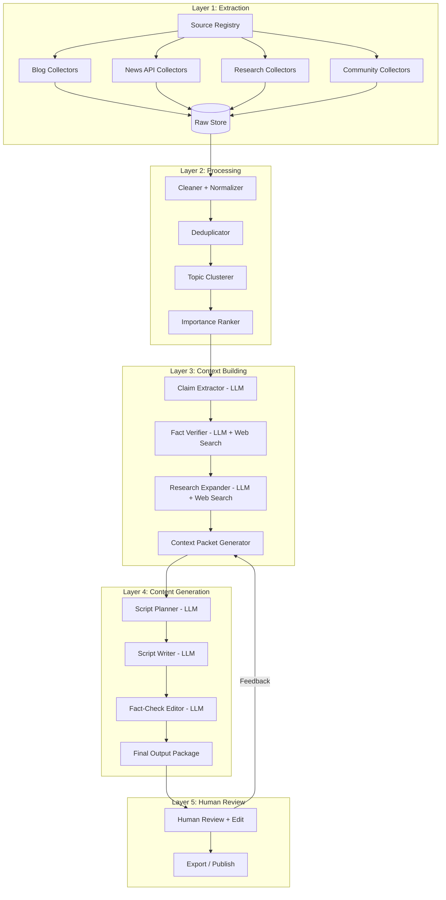

# AI Content Creation System — Strategic Blueprint

> **Project**: Automated AI News → YouTube Script Pipeline  
> **Goal**: Collect AI news from trusted sources, process/analyze it, and produce research-backed YouTube video scripts  
> **Date**: 2026-05-07

---

## 1. Assessment of Your Existing Brainstorming

Your [context_layer_idea.md](file:///Users/manikantamb/_MyFiles/Work_/MyWork_Local/AI_Content_Creation/docs/analysis_and_discussions/context_layer_idea.md) is genuinely strong. Here's what's good and what needs attention:

### ✅ What's Solid
- **Source tiering** (Tier 1–4) — this is the right instinct. Most people skip this and treat Reddit comments equally to official blog posts
- **Normalized document schema** — common output format across all collectors is critical
- **Multi-agent LLM pipeline** — breaking the LLM work into Summarizer → Cluster Analyst → Script Planner → Script Writer → Fact-checker is the correct architecture
- **"Don't ask the LLM what happened in AI today"** — this is the single most important design principle of the entire system
- **Claim extraction before script writing** — very smart. This is what separates a reliable channel from a hallucination factory

### ⚠️ What's Over-Engineered for Day 1
- **PostgreSQL + Celery + Redis + Docker + FastAPI + Streamlit** — you don't need any of this for MVP. This is a solo content creator pipeline, not a SaaS product
- **Vector DB / embedding similarity for dedup** — overkill for MVP. Simple title+URL dedup works fine for the first 3 months
- **Hourly fetch frequency** — AI news doesn't move that fast. Daily is sufficient for a YouTube channel
- **S3/GCS storage** — local files are perfectly fine until you're processing 10,000+ documents

### ❌ What's Missing
| Gap | Why It Matters |
|-----|---------------|
| **Cost analysis** | NewsAPI, YouTube Data API, OpenAI API — you need to budget this |
| **Rate limiting strategy** | APIs will throttle you. No mention of backoff/retry logic |
| **Content freshness window** | How old is "too old"? 24h? 48h? 7 days? This affects dedup logic |
| **Human feedback loop** | You'll review scripts — but how does that feedback improve future runs? |
| **Prompt versioning** | Your prompts WILL evolve. No mention of tracking prompt versions |
| **Error handling & monitoring** | What happens when NewsAPI is down? When arXiv returns garbage? |
| **Video format strategy** | Single-topic deep dive? Multi-topic roundup? Breaking news? Each needs different pipeline behavior |
| **The "Context Layer"** | The most critical concept — explained in detail below |

---

## 2. The "Context Layer" — The Core Concept

This is the idea I want to add to your design. Your brainstorming covers extraction and script writing, but the most critical layer sits between them.

### What is the Context Layer?

The Context Layer is a **structured knowledge packet** that the script-writing LLM receives. It is NOT the raw collected data. It is NOT a giant dump of articles. It is a carefully curated, verified, and organized briefing document that contains everything the LLM needs to write an accurate, engaging, source-backed script.

### Why is this the most important layer?

```
Without Context Layer:
  Raw articles → LLM → Script full of hallucinations and unsourced claims

With Context Layer:
  Raw articles → Cleaned/Verified/Structured context → LLM → Script that's grounded in reality
```

The LLM is only as good as the context you feed it. **The quality of your YouTube channel is determined by the quality of this layer, not by the quality of your prompt.**

### What goes into a Context Packet?

```json
{
  "context_packet_id": "cp_2026_05_07_001",
  "generated_at": "2026-05-07T06:00:00Z",
  "video_type": "single_topic_deep_dive",
  
  "primary_story": {
    "headline": "Anthropic releases Claude 4.5 with tool-use improvements",
    "confirmed_facts": [
      {
        "fact": "Claude 4.5 released on May 6, 2026",
        "source_url": "https://anthropic.com/news/...",
        "source_tier": 1,
        "confidence": "confirmed"
      }
    ],
    "uncertain_points": [
      {
        "claim": "Claude 4.5 outperforms GPT-5 on code generation benchmarks",
        "source_url": "https://techcrunch.com/...",
        "source_tier": 2,
        "confidence": "unverified_by_official_source",
        "note": "Only TechCrunch claims this. No official benchmark published yet."
      }
    ]
  },
  
  "background_context": {
    "what_changed_from_previous": "Claude 4 supported X, now Claude 4.5 supports Y...",
    "competitive_landscape": "GPT-5 released 2 months ago with Z...",
    "why_audience_cares": "Developers using Claude for coding will see..."
  },
  
  "community_reaction": {
    "hackernews_signal": { "score": 842, "sentiment": "mostly_positive", "top_concern": "pricing" },
    "reddit_signal": { "upvotes": 2300, "sentiment": "excited_but_cautious" }
  },
  
  "source_map": [
    { "url": "...", "tier": 1, "type": "official_blog", "used_for": "primary facts" },
    { "url": "...", "tier": 2, "type": "news_article", "used_for": "industry reaction" },
    { "url": "...", "tier": 3, "type": "community", "used_for": "developer sentiment" }
  ],
  
  "script_constraints": {
    "must_cite_sources": ["anthropic.com/news/..."],
    "must_not_claim_without_source": ["benchmark comparisons"],
    "suggested_angle": "Focus on practical developer impact, not just spec comparison"
  }
}
```

### Where it sits in the pipeline

```
Extraction Layer → Processing Layer → CONTEXT LAYER → Script Layer
     (data)          (clean/dedup)      (knowledge)      (content)
```

The Context Layer is the **bridge between raw data and creative output**. It's what makes the difference between:
- *"AI said something happened"* (unreliable)
- *"Here are the verified facts, here's what's uncertain, here's why it matters, and here are the sources"* (trustworthy)

---

## 3. Recommended System Architecture

### Layer Overview



---

## 4. Realistic Source Prioritization

Not all sources are equal in effort-to-value ratio. Here's my honest recommendation:

### 🟢 Build First (High value, low complexity)

| Source | Method | Cost | Notes |
|--------|--------|------|-------|
| **arXiv** | RSS + API | **Free** | Most reliable, structured, no auth needed |
| **Hacker News** | REST API | **Free** | No auth, excellent signal for trending AI |
| **GitHub Trending** | Scrape/API | **Free** | REST API is free with token |
| **Hugging Face Papers** | RSS/scrape | **Free** | Great for trending AI papers |

### 🟡 Build Second (High value, moderate complexity)

| Source | Method | Cost | Notes |
|--------|--------|------|-------|
| **NewsAPI** | REST API | **Free tier: 100 req/day** | Good enough for daily collection. Dev plan: $449/mo |
| **OpenAI Blog** | RSS/HTML | **Free** | No API, need to parse HTML or find RSS |
| **Anthropic News** | HTML parse | **Free** | No RSS, need HTML parsing |
| **Google DeepMind Blog** | HTML/RSS | **Free** | Check for RSS first |
| **Reddit** | API | **Free tier available** | Rate limited, requires app registration |

### 🔴 Build Later (Nice to have, high complexity or cost)

| Source | Method | Cost | Notes |
|--------|--------|------|-------|
| **YouTube Data API** | REST API | **Free quota: 10,000 units/day** | Caption extraction is complex + auth required |
| **GDELT** | REST API | **Free** | Complex query language, noisy results |
| **Semantic Scholar** | REST API | **Free** | Nice enrichment but arXiv covers 80% of need |
| **Twitter/X** | API | **$100/mo minimum** | Not worth it for MVP |
| **Podcast transcripts** | Various | Varies | Manual effort high, defer to later |

### 💰 LLM Costs to Budget

| Operation | Model | Cost Estimate (per run) |
|-----------|-------|------------------------|
| Summarize 50 articles | GPT-4o-mini | ~$0.10–0.30 |
| Claim extraction | GPT-4o | ~$0.20–0.50 |
| Research expansion (with web search) | GPT-4o + web search | ~$0.50–1.00 |
| Script generation | GPT-4o / Claude Sonnet | ~$0.30–0.80 |
| Fact-check pass | GPT-4o | ~$0.20–0.50 |
| **Daily total estimate** | | **~$1.50–3.00/day** |

> [!TIP]
> Use GPT-4o-mini for bulk summarization and claim extraction. Reserve GPT-4o or Claude for the script writing and fact-checking where quality matters most.

---

## 5. Key Design Decisions & Recommendations

### A. Start with SQLite, Not PostgreSQL

For a solo pipeline, SQLite gives you:
- Zero setup, zero server management
- Single file database you can version control
- Easy to inspect with DB Browser
- Migrate to Postgres later only if you need concurrent access

### B. Use JSON Files for Raw Storage, Not S3

```
data/
  raw/
    2026-05-07/
      arxiv/
      hackernews/
      newsapi/
      company_blogs/
  clean/
    2026-05-07/
      documents/
  context_packets/
    2026-05-07/
      cp_001.json
  scripts/
    2026-05-07/
      script_001.md
```

### C. Use a Simple Scheduler, Not Airflow

For MVP, a simple Python script with `schedule` library or even a cron job is sufficient:

```python
# run_daily.py — this is your entire "orchestrator" for MVP
from collectors import arxiv, hackernews, newsapi, blogs
from processors import cleaner, deduplicator, ranker
from agents import context_builder, script_writer

# Step 1: Collect
raw_docs = []
raw_docs += arxiv.collect()
raw_docs += hackernews.collect()
raw_docs += newsapi.collect()
raw_docs += blogs.collect()

# Step 2: Process
clean_docs = cleaner.clean(raw_docs)
unique_docs = deduplicator.deduplicate(clean_docs)
ranked_stories = ranker.rank(unique_docs)

# Step 3: Build context
top_stories = ranked_stories[:5]
context_packets = context_builder.build(top_stories)

# Step 4: Generate scripts
for packet in context_packets:
    script = script_writer.generate(packet)
    script.save()
```

### D. Prompt Versioning from Day 1

Store prompts as versioned files:

```
prompts/
  v1/
    summarizer.md
    claim_extractor.md
    script_planner.md
    script_writer.md
    fact_checker.md
  v2/
    ...
```

Track which prompt version produced which output. This is critical for improving quality over time.

### E. Video Format Strategy

Design for three video types from the start, even if you only build one initially:

| Type | When to Use | Pipeline Behavior |
|------|-------------|-------------------|
| **Daily Roundup** | 3–5 stories, 8–12 min video | Collect broadly, rank top 5, brief context per story |
| **Single Topic Deep Dive** | 1 major story, 15–25 min video | Focus all research on one story, full context packet |
| **Breaking News** | Major announcement, 5–8 min | Fast pipeline, minimal research, highest-trust sources only |

### F. What Your LLM Should NOT Do

| ❌ Don't | ✅ Do Instead |
|----------|--------------|
| Ask LLM "what happened in AI today" | Feed it collected articles and ask it to summarize THOSE |
| Let LLM generate URLs | Only use URLs from your collected data |
| Trust LLM's "knowledge" for facts | Use LLM only for analysis, synthesis, and writing |
| Use one giant prompt | Chain small, focused agents with clear inputs/outputs |
| Let LLM decide importance | Use code-based scoring, LLM only adds qualitative analysis |

---

## 6. Phased Build Plan

### Phase 0: Project Skeleton (Day 1–2)
```
- Set up project structure
- Create source registry (sources.yaml)
- Set up SQLite database with core tables
- Create base collector class with common interface
- Create config management
```

### Phase 1: Core Extraction (Week 1–2)
```
- arXiv collector (RSS + API) — easiest, most structured
- Hacker News collector (REST API) — free, no auth
- NewsAPI collector — broad coverage
- Basic HTML blog collector for 2–3 company blogs
- Raw storage in local JSON files
- Basic cleaning + normalization
```

**Milestone**: Run pipeline, see 50–100 AI items collected daily.

### Phase 2: Processing Pipeline (Week 3–4)
```
- Title + URL deduplication (no embeddings yet)
- Simple topic clustering (keyword-based)
- Importance scoring (rule-based, your scoring table)
- Daily "Top 5 stories" output
```

**Milestone**: Run pipeline, see top 5 ranked AI stories daily.

### Phase 3: Context Layer (Week 5–6)
```
- LLM-based article summarizer
- Claim extractor
- Context packet generator
- Source mapping (every claim → source URL)
- Prompt versioning setup
```

**Milestone**: Generate a context packet for the top story with verified claims and sources.

### Phase 4: Script Generation (Week 7–8)
```
- Script planner agent
- Script writer agent
- Fact-check editor agent
- Output formatting (title, hook, script, sources, tags)
- Human review workflow (output to markdown/Google Docs)
```

**Milestone**: Generate a complete, usable YouTube script from collected data.

### Phase 5: Polish & Automate (Week 9–12)
```
- Add remaining company blog collectors
- Add GitHub trending collector
- Improve dedup with embedding similarity
- Add feedback loop (mark what worked in final videos)
- Cron/scheduler for daily automated runs
- Error handling and retry logic
- Logging and monitoring
```

**Milestone**: Daily automated pipeline produces review-ready scripts.

---

## 7. Recommended Project Structure

```
AI_Content_Creation/
├── docs/
│   └── analysis_and_discussions/     # Your brainstorming (existing)
├── config/
│   ├── sources.yaml                  # Source registry
│   ├── queries.yaml                  # Search queries per source
│   └── settings.py                   # API keys, paths, config
├── collectors/
│   ├── base_collector.py             # Abstract base class
│   ├── arxiv_collector.py
│   ├── hackernews_collector.py
│   ├── newsapi_collector.py
│   ├── blog_collector.py
│   └── github_collector.py
├── processors/
│   ├── cleaner.py                    # HTML → clean text
│   ├── normalizer.py                 # Common document format
│   ├── deduplicator.py               # Title + URL dedup
│   ├── clusterer.py                  # Topic clustering
│   └── ranker.py                     # Importance scoring
├── agents/
│   ├── summarizer.py                 # Article → summary + claims
│   ├── context_builder.py            # Build context packets
│   ├── script_planner.py             # Plan video structure
│   ├── script_writer.py              # Write full script
│   └── fact_checker.py               # Verify claims against sources
├── prompts/
│   └── v1/
│       ├── summarizer.md
│       ├── claim_extractor.md
│       ├── script_planner.md
│       ├── script_writer.md
│       └── fact_checker.md
├── storage/
│   ├── db.py                         # SQLite operations
│   └── file_store.py                 # Raw/clean file management
├── data/                             # gitignored — runtime data
│   ├── raw/
│   ├── clean/
│   ├── context_packets/
│   └── scripts/
├── tests/
├── run_daily.py                      # Main pipeline entry point
├── requirements.txt
└── README.md
```

---

## 8. Things to Keep in Mind

> [!IMPORTANT]
> **Start producing videos BEFORE the system is "perfect"**. The biggest risk isn't bad code — it's spending 3 months building a pipeline and never launching the channel. Build Phase 1–3, manually supplement the gaps, and start recording.

> [!WARNING]
> **API terms of service matter.** Don't scrape aggressively. Respect `robots.txt`. Cache responses. NewsAPI's free tier prohibits commercial use — if you're monetizing the channel, you may need a paid plan.

> [!CAUTION]
> **Don't over-automate the script.** The LLM should draft the script, but YOUR voice, opinions, and personality are what make a YouTube channel work. The system produces the research — you produce the content.

### Key Pitfalls to Avoid

1. **Premature optimization** — Don't add embedding search, vector DBs, or Airflow before you have 10 working videos
2. **Too many sources too early** — 4 reliable sources > 15 half-broken sources
3. **Trusting community signals as facts** — Reddit upvotes ≠ truth
4. **Ignoring the human loop** — Every script needs your review before recording
5. **No prompt iteration tracking** — You WILL rewrite prompts 20+ times. Track versions
6. **Building the UI before the pipeline** — Streamlit dashboard is a distraction for MVP. Terminal output is fine
7. **Not testing with real videos** — The only real test is: did this script produce a good video?

---

## 9. Immediate Next Steps

Here's what I recommend we do right now:

| Step | Action | Output |
|------|--------|--------|
| 1 | Set up project skeleton | Folder structure, config files, base classes |
| 2 | Build arXiv collector | First working collector, proves the pipeline concept |
| 3 | Build Hacker News collector | Second collector, different API pattern |
| 4 | Build basic cleaner + normalizer | Common document format working |
| 5 | Build simple dedup + ranker | Top 5 stories output |
| 6 | Build first LLM agent (summarizer) | Summarize collected articles |

> [!NOTE]
> I can start building any of these right now. Just tell me which phase you want to tackle first, or if you want to adjust any of the architecture decisions above.

---

## 10. Open Questions for You

Before we start coding, I'd like your input on:

1. **Which LLM provider?** OpenAI (GPT-4o), Anthropic (Claude), or both? This affects the agent code structure
2. **Video format priority?** Daily roundup or single-topic deep dive first?
3. **How hands-on do you want the review?** Full script editing, or just approve/reject?
4. **API keys you already have?** (NewsAPI, OpenAI, YouTube, etc.)
5. **Publishing workflow?** Where should final scripts land — local markdown, Google Docs, Notion?
