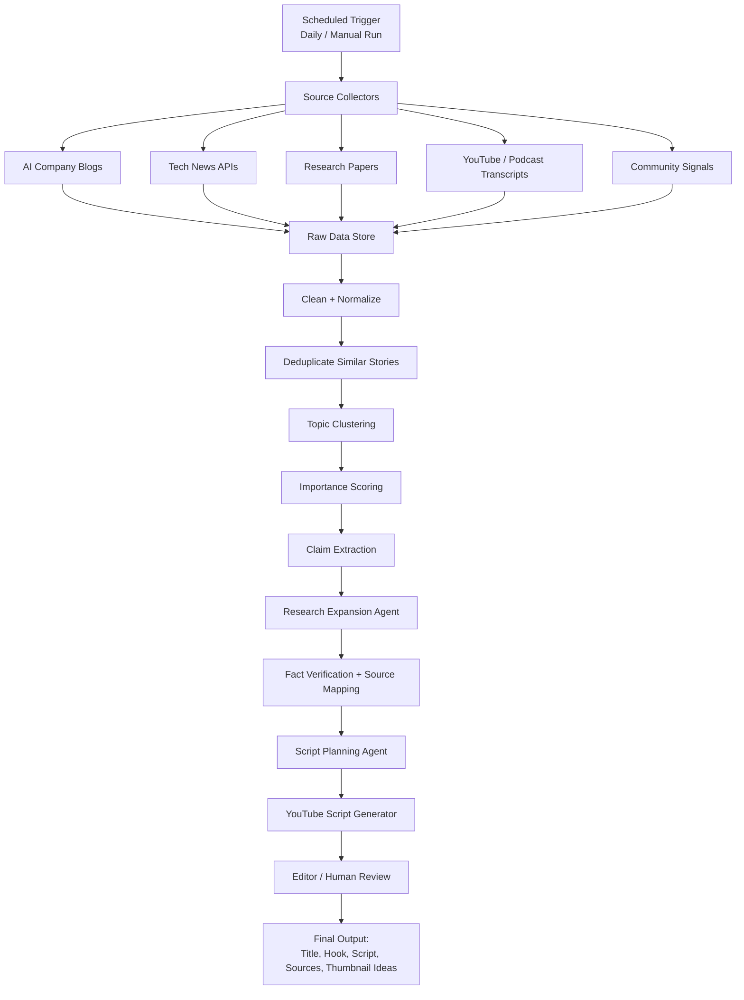
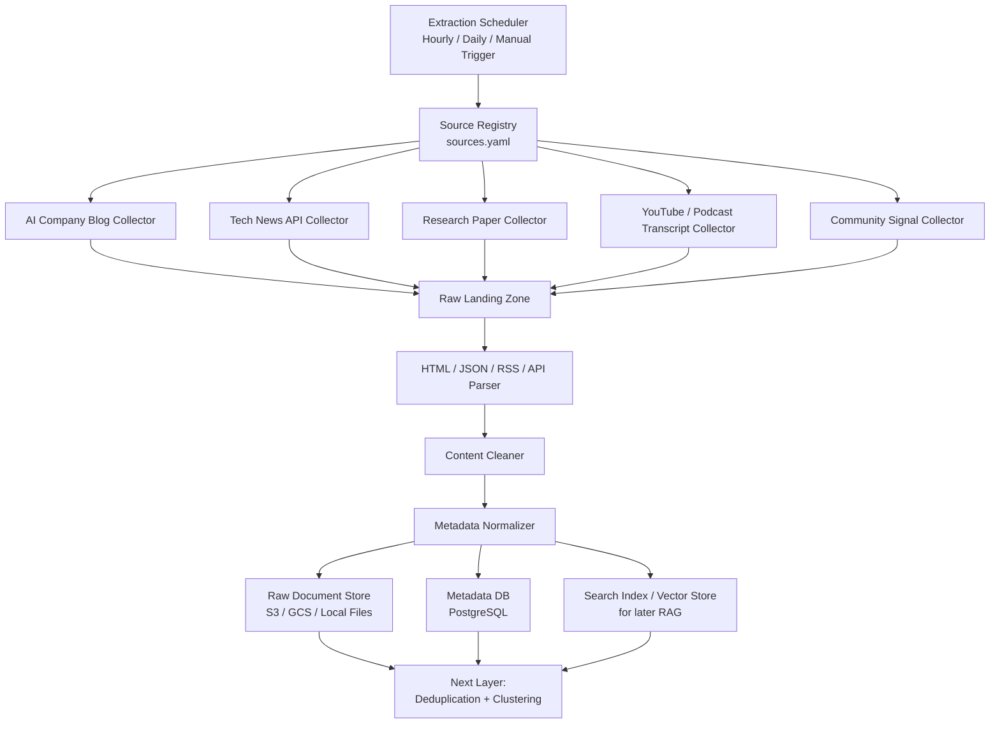

### MY Message
Okay, I wanted to start a YouTube channel with the news about AI and stuff. So I wanted to build a system. I like build this kind of system where it will fetch the latest news from different sources and then process it and then finally it will give me a detailed YouTube video transcript along with the sources, like no proper research and analysis. Can I do that? If so, like what are the sources I need to collect the data from and how? Like how should I divide my project with like first like data collection, right? So what are the sources I need to collect the data? Next, what is the step? And then next what? And finally, we need to pass it to the LLM to process it and further analyze it, further research it, right? And then finally prepare the context. How should I properly design this system?

### Idea
Yes, the system itself should be a proper pipeline: collectors fetch latest AI news, processors clean and deduplicate it, research agents verify it, and finally an LLM prepares a YouTube-ready script with citations.

## 1. High-level system design

Think of your project like this:



The key principle is: **do not directly ask the LLM, “What happened in AI today?”** Instead, your system should first collect trusted source material, then ask the LLM to analyze only that grounded context.

---

## 2. Data sources you should collect from

### A. Official AI company sources — highest priority

These are best for accurate breaking AI updates:

| Category            | Example Sources                                        | Why useful                                             |
| ------------------- | ------------------------------------------------------ | ------------------------------------------------------ |
| AI labs             | OpenAI, Anthropic, Google DeepMind, Meta AI            | Model releases, research announcements, safety updates |
| Cloud/enterprise AI | Microsoft AI/Azure AI, AWS AI/ML Blog, Google Cloud AI | Enterprise AI product releases                         |
| Hardware AI         | NVIDIA Blog, AMD AI, Intel AI                          | GPUs, inference chips, AI infrastructure               |
| Developer platforms | Hugging Face Blog, GitHub Blog, LangChain Blog         | Open-source models, tools, agents, frameworks          |

Collection method: use RSS feeds where available; otherwise use allowed webpage fetching with a source registry.

---

### B. News APIs — for broad latest news discovery

Use these to discover trending AI stories across the web:

| Source          | Use                                                           |
| --------------- | ------------------------------------------------------------- |
| NewsAPI         | Search latest AI articles, top headlines, source-based search |
| GDELT           | Global news monitoring and trend discovery                    |
| Mediastack      | Real-time and historical news articles                        |
| Google News RSS | Lightweight topic monitoring                                  |

NewsAPI provides endpoints for top headlines, keyword search, and publisher sources, which fits this kind of news discovery pipeline. ([News API][2])
GDELT also provides large-scale news search and analysis through its DOC/API-style services. ([GDELT Project][3])

---

### C. Research sources — for serious AI analysis

For deeper videos, collect from:

| Source                    | Use                                  |
| ------------------------- | ------------------------------------ |
| arXiv cs.AI, cs.LG, cs.CL | Latest AI/ML/NLP papers              |
| Papers with Code          | Model benchmarks and implementations |
| Hugging Face Papers       | Trending AI papers                   |
| Semantic Scholar API      | Paper metadata and citations         |

arXiv has RSS/Atom feeds for active subject areas and an API for programmatic access to papers and metadata, so it is very suitable for daily AI research collection. ([arXiv Info][4])

---

### D. YouTube / podcast transcripts

This is useful if your channel reacts to AI interviews, product demos, podcasts, or conference talks.

Sources:

| Source                   | Use                                                    |
| ------------------------ | ------------------------------------------------------ |
| YouTube Data API         | Get video metadata, channel uploads, captions metadata |
| Official transcripts     | Best option when available                             |
| User-provided transcript | Safest for processing                                  |
| Podcast RSS feeds        | Episode title, description, audio link                 |

Be careful with YouTube captions. The YouTube Data API supports caption resources such as listing caption tracks and downloading captions, but caption access has authorization requirements, so design this carefully and avoid relying on unauthorized scraping. ([Google for Developers][5])

---

### E. Community signal sources — not final truth, only trend signal

Use these to detect what people are discussing, not to verify facts:

| Source          | Use                                            |
| --------------- | ---------------------------------------------- |
| Hacker News API | Developer reactions to AI launches             |
| Reddit API      | Community discussion                           |
| X/Twitter API   | Fast breaking signals, if you have paid access |
| GitHub Trending | Open-source AI project discovery               |

Hacker News has an official API, and Reddit provides API access for reading/writing Reddit content depending on developer permissions and terms. ([GitHub][6])

---

## 3. Project phases

### Phase 1: Source registry

Create a `sources.yaml` file where you define every source.

Example:

```yaml
sources:
  - id: openai_blog
    name: OpenAI Blog
    type: rss_or_html
    category: official_ai_lab
    trust_score: 0.95
    fetch_frequency: daily

  - id: arxiv_cs_ai
    name: arXiv cs.AI
    type: arxiv_api
    category: research
    trust_score: 0.90
    fetch_frequency: daily

  - id: newsapi_ai
    name: NewsAPI AI Search
    type: news_api
    category: news
    trust_score: 0.70
    fetch_frequency: hourly
```

This lets your system know **where to collect from, how often, and how much trust to give each source**.

---

### Phase 2: Data collection

Build separate collectors:

```text
collectors/
  rss_collector.py
  newsapi_collector.py
  arxiv_collector.py
  youtube_collector.py
  hackernews_collector.py
  reddit_collector.py
```

Each collector should output the same structure:

```json
{
  "source_id": "openai_blog",
  "title": "Example AI Announcement",
  "url": "https://...",
  "published_at": "2026-05-04T10:00:00Z",
  "author": "OpenAI",
  "raw_text": "...",
  "source_type": "official_blog",
  "collected_at": "2026-05-04T12:00:00Z"
}
```

Do not let the LLM collect everything randomly. Use code for collection.

---

### Phase 3: Cleaning and normalization

Convert every article, paper, transcript, and post into a clean internal format.

You should extract:

```text
title
source
published date
author
main text
summary
entities mentioned
companies mentioned
models mentioned
products mentioned
claims
source URL
```

At this stage, remove navigation text, ads, duplicate paragraphs, cookie banners, unrelated links, and comments unless comments are part of the source.

---

### Phase 4: Deduplication

Many sources will report the same story. For example:

```text
OpenAI releases a new model
The Verge reports OpenAI release
TechCrunch reports OpenAI release
Hacker News discusses OpenAI release
```

Your system should cluster these as **one story**, not three separate stories.

Use:

```text
title similarity
URL canonicalization
embedding similarity
same company/model/product names
same published date range
```

Output:

```json
{
  "cluster_id": "story_2026_05_04_openai_model_release",
  "main_topic": "OpenAI model release",
  "sources": [
    "official OpenAI blog",
    "The Verge",
    "Hacker News discussion"
  ],
  "confidence": 0.91
}
```

---

### Phase 5: Importance scoring

Not every AI article deserves a YouTube video. Score each cluster.

Suggested scoring:

```text
Official source present: +30
Multiple independent sources: +20
Research breakthrough: +20
Major company involved: +15
Developer impact: +15
Consumer impact: +10
Controversy/risk/regulation: +10
Only social discussion: -20
Single weak source: -30
```

Example output:

```json
{
  "topic": "New open-source AI coding model released",
  "importance_score": 82,
  "reason": "Official release, developer impact, multiple sources, GitHub activity"
}
```

---

### Phase 6: Claim extraction

Before script writing, extract claims.

Example:

```json
{
  "claim": "The model supports long-context code generation.",
  "source_url": "...",
  "source_type": "official_blog",
  "confidence": "high",
  "needs_verification": false
}
```

This is very important because your final script should be built from verified claims, not loose summaries.

---

### Phase 7: Research expansion

For each selected story, your research agent should ask:

```text
What exactly happened?
Who announced it?
When was it announced?
Why does it matter?
What changed compared to previous versions?
Who is affected?
What are the limitations?
Are there opposing views?
Is there official documentation?
Are there independent sources?
```

Here you can use OpenAI’s API with web search and file search. The Responses API supports built-in tools such as web search, file search, and function calling; structured outputs can force the model to return JSON in your expected schema. ([OpenAI Developers][7])

---

## 4. LLM workflow

Use multiple small LLM steps instead of one giant prompt.

### Agent 1: News summarizer

Input: one article
Output:

```json
{
  "summary": "...",
  "key_points": [],
  "claims": [],
  "companies": [],
  "models": [],
  "risks": []
}
```

### Agent 2: Story cluster analyst

Input: all articles in one cluster
Output:

```json
{
  "story_angle": "...",
  "confirmed_facts": [],
  "uncertain_points": [],
  "why_it_matters": "...",
  "best_sources": []
}
```

### Agent 3: YouTube script planner

Output:

```json
{
  "video_title_options": [],
  "hook": "...",
  "sections": [
    "What happened",
    "Why it matters",
    "Technical explanation",
    "Business impact",
    "Risks or criticism",
    "Final takeaway"
  ]
}
```

### Agent 4: Script writer

Output:

```text
Full YouTube narration script
Intro hook
Section transitions
Simple explanation
Examples
Conclusion
Source list
```

### Agent 5: Fact-check editor

This agent should verify that every major statement in the script maps back to a source.

---

## 5. Final output format

Your final system should generate something like this:

```text
1. Video Title Options
2. Thumbnail Text Ideas
3. 30-second Hook
4. Full YouTube Script
5. Short-form/Reel Version
6. Key Sources
7. Claims Table
8. Risk Notes / Things Not Fully Confirmed
9. Suggested Description
10. Suggested Tags
```

Example:

```text
Title:
OpenAI Just Changed AI Coding Again — Here’s What It Means

Hook:
AI coding tools are no longer just autocomplete. They are becoming software engineering agents that can inspect code, make changes, run tests, and prepare pull requests.

Main Sections:
1. What was announced
2. Why developers care
3. How this changes coding workflows
4. What limitations still exist
5. My final takeaway
```

---

## 6. Recommended technical stack

For your first version:

```text
Language: Python
Scheduler: cron first, later Airflow or Prefect
Backend: FastAPI
Database: PostgreSQL
Raw storage: local files first, later S3/GCS
Vector DB: OpenAI vector store / Chroma / Qdrant
Queue: Celery + Redis
LLM: OpenAI Responses API
Frontend: Streamlit or React
Deployment: Docker
```

Simple folder structure:

```text
ai-news-youtube-agent/
  app/
    collectors/
      rss_collector.py
      newsapi_collector.py
      arxiv_collector.py
      youtube_collector.py
    processors/
      cleaner.py
      deduplicator.py
      clusterer.py
      scorer.py
    agents/
      summarizer_agent.py
      research_agent.py
      fact_check_agent.py
      script_writer_agent.py
    storage/
      postgres.py
      vector_store.py
    prompts/
      summarizer_prompt.md
      script_writer_prompt.md
    configs/
      sources.yaml
    main.py
  tests/
  docker-compose.yml
  README.md
```

---

## 7. MVP build plan

Start small. Do not build the full autonomous system first.

### MVP 1: Daily AI news collector

Build only:

```text
RSS collector
NewsAPI collector
arXiv collector
PostgreSQL storage
Simple Streamlit dashboard
```

Goal: collect 50–100 AI-related items daily.

---

### MVP 2: Deduplication and story ranking

Add:

```text
embedding similarity
topic clustering
importance scoring
top 5 stories of the day
```

Goal: show only the most important stories.

---

### MVP 3: Research packet generator

For each top story, generate:

```text
summary
source list
confirmed facts
uncertain facts
why it matters
technical explanation
business impact
```

Goal: create a reliable research brief before script writing.

---

### MVP 4: YouTube script generator

Generate:

```text
title
hook
full script
description
tags
thumbnail ideas
source list
```

Goal: produce a usable video script, but still with human review.

---

### MVP 5: Autonomous daily workflow

Add:

```text
daily scheduler
email/Slack notification
approval workflow
script export to Google Docs/Notion
optional voiceover generation
optional video assembly
```

---

## 8. The best architecture rule for this project

Use this separation:

```text
Code = collects, cleans, stores, deduplicates, schedules
LLM = summarizes, extracts claims, explains, writes scripts
Human = reviews final script before publishing
```

That gives you a much more reliable AI news channel than simply asking an LLM to “generate today’s AI news video.”

[1]: https://developers.openai.com/codex?utm_source=chatgpt.com "Codex | OpenAI Developers"
[2]: https://newsapi.org/docs/endpoints/top-headlines?utm_source=chatgpt.com "Top headlines - Documentation"
[3]: https://blog.gdeltproject.org/gdelt-doc-2-0-api-debuts/?utm_source=chatgpt.com "GDELT DOC 2.0 API Debuts!"
[4]: https://info.arxiv.org/help/rss.html?utm_source=chatgpt.com "RSS Feeds - arXiv info"
[5]: https://developers.google.com/youtube/v3/docs/captions?utm_source=chatgpt.com "Captions | YouTube Data API"
[6]: https://github.com/hackernews/api?utm_source=chatgpt.com "HackerNews/API: Documentation and Samples for ..."
[7]: https://developers.openai.com/api/docs/guides/tools-web-search?utm_source=chatgpt.com "Web search | OpenAI API"


### My Message
okay now lets focus on the first layer, which is extraction layer, tell me in detail from where we are collecting them, for exmple you have mentioned like 5 modules right "ai company blogs, tech news API's, Research Papers, Youtube/podcsts Transcripts, commnity signals right, so in each of them from where we are extracting them, like from ai company blogs from where are the places we are going to extract them and reserach papers too, from where we are going to extract them what are all the reliable sources, so explain all of them in details by keeping in mind about the next layers in the project and how we are goint to store them, so explain them in details and also provide me a visualizatoin about this layer, if you think you need more explaination do that. 

### Idea & Analysis
Yes — let’s design only the **first layer: Extraction Layer**.

This layer’s job is **not to write the script**. Its job is to collect reliable raw material from different source types, convert everything into a common format, and store it so the next layers can deduplicate, rank, verify, and generate a YouTube script.

---

# 1. Extraction Layer — main purpose

The extraction layer should answer:

```text
What happened in AI recently?
Where did it come from?
Is the source official, media-based, research-based, or community-based?
Can we trust it?
Can we trace every future YouTube claim back to the original URL?
```

So every extracted item should eventually become a normalized record like this:

```json
{
  "source_id": "openai_news",
  "source_category": "ai_company_blog",
  "source_reliability": "tier_1_official",
  "title": "Article title",
  "url": "original_url",
  "published_at": "2026-05-05T10:00:00Z",
  "author": "author_or_org",
  "raw_text": "full extracted content or summary text",
  "summary": null,
  "entities": [],
  "topics": [],
  "collected_at": "2026-05-05T12:00:00Z",
  "content_hash": "hash_for_deduplication"
}
```

---

# 2. Visual architecture of the Extraction Layer



---

# 3. Module 1 — AI company blogs

This is your **highest-trust source category** because it comes directly from the company or research lab.

These sources should be marked as:

```text
Reliability: Tier 1
Purpose: official announcements, model launches, safety updates, research releases, product releases
Use in final video: primary citation
```

## A. Core AI labs

| Source                | What to collect                                                           | Why it matters                                                                                                                                            |
| --------------------- | ------------------------------------------------------------------------- | --------------------------------------------------------------------------------------------------------------------------------------------------------- |
| OpenAI News           | Product announcements, model releases, research, safety, business updates | Best source for OpenAI-related stories. OpenAI’s news page is the official place for updates about AI technology and company announcements. ([OpenAI][1]) |
| Anthropic News        | Claude releases, enterprise partnerships, safety updates                  | Anthropic’s newsroom lists announcements, product updates, and company news. ([Anthropic][2])                                                             |
| Anthropic Engineering | Claude Code, infrastructure, reliability, engineering writeups            | Useful for technical videos because it gives engineering-level explanations. ([Anthropic][3])                                                             |
| Google DeepMind Blog  | Research breakthroughs, Gemini/Gemma updates, science AI                  | Google DeepMind’s blog publishes AI breakthroughs, model updates, science work, and safety/responsibility updates. ([Google DeepMind][4])                 |
| Google Research Blog  | Research publications, systems, ML, AI applications                       | Google Research publishes latest research posts and scientific updates. ([Google Research][5])                                                            |
| Meta AI Blog          | Llama, open-source AI, computer vision, research/product updates          | Meta AI’s blog is useful for open-source AI and Meta model updates. ([Meta AI][6])                                                                        |
| Meta Research Blog    | Research-level posts from Meta                                            | Useful when you want deeper technical or research context. ([Facebook Research][7])                                                                       |

## B. Cloud and enterprise AI sources

| Source                      | What to collect                                              | Why it matters                                                                                                      |
| --------------------------- | ------------------------------------------------------------ | ------------------------------------------------------------------------------------------------------------------- |
| Microsoft AI News           | Microsoft AI models, Copilot, Foundry, enterprise AI         | Microsoft AI has a dedicated news page for AI models and related updates. ([Microsoft AI][8])                       |
| Microsoft Official Blog     | Microsoft/OpenAI partnership, enterprise announcements       | Good for business and enterprise AI angle. ([The Official Microsoft Blog][9])                                       |
| AWS Machine Learning Blog   | Bedrock, SageMaker, agentic workflows, enterprise AI         | AWS ML blog is useful for technical implementation stories around AI on AWS. ([Amazon Web Services, Inc.][10])      |
| AWS News Blog — AI category | New AWS AI service launches                                  | Useful for “new AI service launched” type videos. ([Amazon Web Services, Inc.][11])                                 |
| NVIDIA Blog / RSS           | GPUs, inference, AI infrastructure, robotics, CUDA, hardware | NVIDIA provides RSS feeds and AI-related blog/news updates, which are valuable for AI infra stories. ([NVIDIA][12]) |

## C. Open-source and developer AI ecosystem

| Source              | What to collect                                                        | Why it matters                                                                                                   |
| ------------------- | ---------------------------------------------------------------------- | ---------------------------------------------------------------------------------------------------------------- |
| Hugging Face Blog   | Model releases, open-source tooling, inference, transformers, datasets | Hugging Face is central for open-source AI, model hosting, datasets, and developer tooling. ([Hugging Face][13]) |
| Hugging Face Papers | Trending AI papers and community-curated research                      | Good for detecting what the AI community is paying attention to. ([Hugging Face][14])                            |

## Recommended extraction method

For company blogs:

```text
Preferred method:
1. RSS feed, if available
2. Official API, if available
3. Clean webpage extraction, if RSS/API is unavailable
```

Do not randomly scrape aggressively. Respect robots.txt, rate limits, and terms of service.

Store:

```json
{
  "source_type": "official_company_blog",
  "trust_tier": 1,
  "company": "OpenAI",
  "content_type": "announcement",
  "title": "...",
  "url": "...",
  "published_at": "...",
  "raw_html_path": "s3://raw/company/openai/...",
  "clean_text_path": "s3://clean/company/openai/..."
}
```

---

# 4. Module 2 — Tech news APIs

This module gives you **broad coverage**. It helps discover stories you may miss from official blogs.

These should be marked as:

```text
Reliability: Tier 2
Purpose: discover trending stories, collect media interpretation, compare independent coverage
Use in final video: secondary citation
```

## Recommended tech news APIs

| Source          | What to collect                                         | Why useful                                                                                                                                                                           |
| --------------- | ------------------------------------------------------- | ------------------------------------------------------------------------------------------------------------------------------------------------------------------------------------ |
| NewsAPI         | AI keyword search, source-specific articles, headlines  | NewsAPI has `/everything` for article discovery and `/top-headlines` for live breaking headlines. It searches many news sources and blogs. ([News API][15])                          |
| GDELT DOC API   | Global media search, trend discovery, article timelines | GDELT DOC 2.0 is a full-text news search API useful for global news monitoring. ([GDELT Blog][16])                                                                                   |
| Mediastack      | Live and historical news articles in JSON               | Mediastack provides live/historical news data, filters by dates, countries, languages, sources, and keywords. ([Mediastack][17])                                                     |
| Google News RSS | Topic discovery, quick aggregation                      | Useful as a lightweight discovery layer, but Google News RSS has limited official documentation, so treat it as optional discovery rather than primary evidence. ([NewsCatcher][18]) |

## Search queries for AI news

Your collector should run query groups like:

```yaml
ai_news_queries:
  - "artificial intelligence"
  - "generative AI"
  - "large language model"
  - "LLM"
  - "AI agent"
  - "OpenAI"
  - "Anthropic Claude"
  - "Google Gemini"
  - "Meta Llama"
  - "NVIDIA AI"
  - "AI regulation"
  - "AI safety"
  - "AI chip"
  - "AI startup funding"
```

## What to store from news APIs

```json
{
  "source_type": "tech_news_api",
  "trust_tier": 2,
  "api_provider": "newsapi",
  "publisher": "The Verge",
  "title": "...",
  "url": "...",
  "published_at": "...",
  "description": "...",
  "raw_api_response": {},
  "query_used": "AI agent",
  "language": "en",
  "country": "us"
}
```

## Why this matters for next layers

Tech news APIs help you:

```text
Find which stories are trending
Compare different media narratives
Detect controversy or market impact
Find supporting independent sources
Avoid depending only on company PR
```

But they should not be treated as final truth. The next layer should check whether an official source exists.

---

# 5. Module 3 — Research papers

This module is for deeper AI videos, not just daily headlines.

These should be marked as:

```text
Reliability: Tier 1.5 or Tier 2
Purpose: research breakthroughs, model architecture, benchmarks, technical depth
Use in final video: technical explanation and credibility
```

## Reliable research sources

| Source                          | What to collect                                    | Why useful                                                                                                            |
| ------------------------------- | -------------------------------------------------- | --------------------------------------------------------------------------------------------------------------------- |
| arXiv API                       | New AI/ML/NLP/computer vision papers               | arXiv provides public API access to paper metadata and e-prints. ([arXiv][19])                                        |
| arXiv RSS                       | Daily category updates                             | arXiv supports RSS/Atom-style feeds, useful for scheduled collection. ([arXiv][20])                                   |
| Semantic Scholar API            | Paper metadata, authors, citations, related papers | Semantic Scholar API supports publication, author, citation, venue, and recommendation data. ([Semantic Scholar][21]) |
| Hugging Face Papers             | Trending AI papers and community activity          | Hugging Face Papers provides daily/weekly/monthly AI paper discovery and community discussion. ([Hugging Face][14])   |
| Papers with Code / related data | Code implementations, benchmarks, datasets         | Useful when explaining whether a paper has code, benchmarks, or practical adoption. ([GitHub][22])                    |

## arXiv categories to track

For an AI news channel, track these categories:

```text
cs.AI  = Artificial Intelligence
cs.LG  = Machine Learning
cs.CL  = Computation and Language / NLP
cs.CV  = Computer Vision
cs.RO  = Robotics
cs.CR  = Cryptography and Security, useful for AI security
stat.ML = Machine Learning statistics
```

## What to extract from papers

```json
{
  "source_type": "research_paper",
  "trust_tier": 1.5,
  "paper_id": "arxiv_id",
  "title": "...",
  "authors": [],
  "abstract": "...",
  "published_at": "...",
  "updated_at": "...",
  "categories": ["cs.LG", "cs.CL"],
  "pdf_url": "...",
  "doi": "...",
  "code_url": "...",
  "benchmark_names": [],
  "model_names": [],
  "institution_names": []
}
```

## How research extraction feeds next layers

Research papers are not always “news” by themselves. They become useful when connected to:

```text
New model release
New benchmark result
Open-source code release
Major company research announcement
Community discussion
Practical developer impact
```

Example:

```text
arXiv paper appears
↓
Hugging Face Papers starts trending
↓
GitHub repo gets stars
↓
Tech news article covers it
↓
Your system ranks it as a possible video topic
```

---

# 6. Module 4 — YouTube and podcast transcripts

This module is for extracting context from interviews, keynotes, podcasts, launch demos, and AI conference talks.

These should be marked as:

```text
Reliability: Tier depends on speaker/source
Purpose: quotes, expert opinions, product demos, long-form context
Use in final video: commentary, quote extraction, explanation
```

## YouTube sources to monitor

Track official and high-signal channels such as:

```text
OpenAI
Anthropic
Google DeepMind
Google Cloud
Microsoft Developer
Microsoft Mechanics
AWS
NVIDIA
Hugging Face
Lex Fridman
Dwarkesh Podcast
Y Combinator
a16z
Stanford Online
MIT CSAIL
```

## YouTube extraction method

Use YouTube Data API for:

```text
channel uploads
video metadata
published date
title
description
tags
duration
view count
caption availability
```

The YouTube Data API search endpoint returns matching videos, channels, and playlists, and the videos endpoint returns video details. ([Google for Developers][23])

For captions, the YouTube Data API supports caption resources, including listing caption tracks and downloading captions where permitted. The captions list response itself does not contain the caption text; downloading captions is a separate capability and may require authorization. ([Google for Developers][24])

## Podcast sources

Use:

```text
Podcast RSS feeds
Listen Notes API
Official show websites
Apple Podcasts RSS metadata
```

Apple Podcasts requires podcast episodes to have unique enclosure tags and GUIDs in RSS feeds, which makes RSS reliable for episode discovery. ([Apple Podcasts][25])
Listen Notes provides a podcast search/directory API with official client libraries and search capabilities. ([Listen Notes][26])

## What to store from video/podcast

```json
{
  "source_type": "video_or_podcast",
  "trust_tier": 2,
  "platform": "youtube",
  "channel": "OpenAI",
  "video_id": "...",
  "title": "...",
  "url": "...",
  "published_at": "...",
  "duration_seconds": 1800,
  "description": "...",
  "transcript_text": "...",
  "speaker_names": [],
  "transcript_source": "official_caption_or_user_provided",
  "timestamps": [
    {
      "start": 120.4,
      "end": 135.2,
      "text": "..."
    }
  ]
}
```

## Important design rule

Do not store YouTube/podcast transcript as one giant block only. Store it in chunks:

```text
video_id
chunk_id
start_time
end_time
speaker
text
embedding
```

This helps later when your script needs:

```text
“Give me the exact section where the speaker discussed AI agents.”
```

---

# 7. Module 5 — Community signals

This is not your truth layer. This is your **signal layer**.

These should be marked as:

```text
Reliability: Tier 3
Purpose: detect what people are talking about
Use in final video: trend signal only, not factual proof
```

## Recommended community sources

| Source          | What to collect                               | Why useful                                                                                                                  |
| --------------- | --------------------------------------------- | --------------------------------------------------------------------------------------------------------------------------- |
| Hacker News API | Top AI stories, developer reactions, comments | Hacker News has an official API and is useful for developer-focused AI discussion. ([GitHub][27])                           |
| Reddit API      | Posts/comments from AI communities            | Reddit API supports reading Reddit content such as posts and comments, subject to API terms and permissions. ([Reddit][28]) |
| GitHub REST API | Repository stars, issues, releases, commits   | GitHub REST API can retrieve repository data and automate workflows. ([GitHub Docs][29])                                    |
| GitHub Trending | New popular AI repos                          | GitHub Trending shows what repositories the GitHub community is excited about. ([GitHub][30])                               |

## Subreddits to monitor

```text
r/MachineLearning
r/LocalLLaMA
r/artificial
r/OpenAI
r/ClaudeAI
r/singularity
r/datascience
r/MLOps
r/learnmachinelearning
```

## GitHub signals to track

```text
new stars in last 24h
new releases
new issues
new pull requests
README changes
model card changes
license changes
```

Example GitHub query ideas:

```text
topic:llm
topic:agents
topic:rag
topic:transformers
topic:diffusion
topic:machine-learning
topic:computer-vision
```

## What to store from community sources

```json
{
  "source_type": "community_signal",
  "trust_tier": 3,
  "platform": "hackernews",
  "title": "...",
  "url": "...",
  "score": 582,
  "comment_count": 183,
  "posted_at": "...",
  "discussion_text": "...",
  "linked_source_url": "...",
  "sentiment": null,
  "signal_type": "developer_discussion"
}
```

## Why this matters

Community sources help answer:

```text
Is this story getting attention?
Are developers excited or angry?
Are people finding bugs or limitations?
Is there controversy?
Is this just PR or does the community care?
```

But your final video should say:

```text
“Developers on Hacker News are discussing this heavily...”
```

Not:

```text
“This is definitely true because Reddit says so.”
```

---

# 8. Source reliability tiers

Use reliability scoring from day one.

```text
Tier 1 — Official source
Company blog, official docs, official research release, official GitHub repo

Tier 1.5 — Research source
arXiv, Semantic Scholar, academic paper, benchmark paper

Tier 2 — Reputable media/API source
NewsAPI articles, GDELT results, TechCrunch, The Verge, MIT Tech Review, VentureBeat, Reuters, Bloomberg

Tier 3 — Community signal
Hacker News, Reddit, GitHub Trending, X/Twitter, YouTube comments

Tier 4 — Weak source
Random blogs, copied articles, unsourced social posts
```

In your pipeline, every record should get:

```json
{
  "trust_tier": 1,
  "source_reliability_score": 0.95
}
```

This becomes very useful later when selecting sources for the YouTube script.

---

# 9. Source registry design

Create a `sources.yaml` file. This is the control center of the extraction layer.

```yaml
sources:
  - id: openai_news
    name: OpenAI News
    module: ai_company_blog
    extraction_type: rss_or_html
    url: "https://openai.com/news/"
    trust_tier: 1
    reliability_score: 0.95
    fetch_frequency: "every_6_hours"
    priority: "high"

  - id: anthropic_news
    name: Anthropic News
    module: ai_company_blog
    extraction_type: html
    url: "https://www.anthropic.com/news"
    trust_tier: 1
    reliability_score: 0.95
    fetch_frequency: "every_6_hours"
    priority: "high"

  - id: arxiv_ai
    name: arXiv AI Papers
    module: research_papers
    extraction_type: api
    query: "cat:cs.AI OR cat:cs.LG OR cat:cs.CL"
    trust_tier: 1.5
    reliability_score: 0.90
    fetch_frequency: "daily"
    priority: "high"

  - id: newsapi_ai
    name: NewsAPI AI Search
    module: tech_news_api
    extraction_type: api
    query: "artificial intelligence OR generative AI OR LLM"
    trust_tier: 2
    reliability_score: 0.75
    fetch_frequency: "hourly"
    priority: "medium"

  - id: hackernews_ai
    name: Hacker News AI Signal
    module: community_signal
    extraction_type: api
    query_keywords:
      - "AI"
      - "LLM"
      - "OpenAI"
      - "Claude"
      - "Gemini"
      - "Llama"
    trust_tier: 3
    reliability_score: 0.55
    fetch_frequency: "hourly"
    priority: "medium"
```

---

# 10. Storage design for the extraction layer

Use three storage zones.

## A. Raw storage

Store the untouched source response.

```text
/raw/
  company_blogs/
  news_apis/
  research_papers/
  youtube_podcasts/
  community_signals/
```

Example:

```text
raw/company_blogs/openai/2026/05/05/article_hash.json
raw/newsapi/2026/05/05/response_batch_001.json
raw/arxiv/2026/05/05/cs_lg_batch.xml
```

This is important because if the LLM makes a wrong summary later, you can go back to the original source.

---

## B. Clean storage

Store parsed clean text.

```text
/clean/
  company_blogs/
  news_apis/
  research_papers/
  transcripts/
  community_signals/
```

Example clean record:

```json
{
  "document_id": "doc_abc123",
  "clean_title": "New AI model announcement",
  "clean_text": "Clean extracted article text...",
  "language": "en",
  "word_count": 1432,
  "content_hash": "sha256_hash"
}
```

---

## C. Metadata database

Use PostgreSQL for structured tracking.

Suggested tables:

```sql
sources
documents
document_chunks
extraction_runs
source_errors
entity_mentions
```

### `sources` table

```sql
CREATE TABLE sources (
    source_id TEXT PRIMARY KEY,
    name TEXT,
    module TEXT,
    extraction_type TEXT,
    url TEXT,
    trust_tier NUMERIC,
    reliability_score NUMERIC,
    fetch_frequency TEXT,
    is_active BOOLEAN DEFAULT TRUE
);
```

### `documents` table

```sql
CREATE TABLE documents (
    document_id TEXT PRIMARY KEY,
    source_id TEXT,
    source_type TEXT,
    title TEXT,
    url TEXT UNIQUE,
    author TEXT,
    published_at TIMESTAMP,
    collected_at TIMESTAMP,
    raw_storage_path TEXT,
    clean_storage_path TEXT,
    content_hash TEXT,
    language TEXT,
    trust_tier NUMERIC,
    reliability_score NUMERIC,
    status TEXT
);
```

### `document_chunks` table

```sql
CREATE TABLE document_chunks (
    chunk_id TEXT PRIMARY KEY,
    document_id TEXT,
    chunk_index INTEGER,
    chunk_text TEXT,
    start_time_seconds NUMERIC,
    end_time_seconds NUMERIC,
    embedding_id TEXT
);
```

---

# 11. Output contract from the Extraction Layer

Every collector should produce the same output format, regardless of source.

```json
{
  "document_id": "doc_123",
  "source_id": "anthropic_news",
  "module": "ai_company_blog",
  "trust_tier": 1,
  "title": "...",
  "url": "...",
  "published_at": "...",
  "raw_content": "...",
  "clean_text": "...",
  "metadata": {
    "company": "Anthropic",
    "content_type": "product_announcement",
    "query_used": null,
    "api_provider": null
  }
}
```

This is important because the next layer should not care whether the data came from arXiv, NewsAPI, YouTube, or Hacker News. It should receive a common document format.

---

# 12. Recommended extraction order

For your MVP, do not build all 5 modules at once.

Build in this order:

```text
Step 1: AI company blog collector
Step 2: NewsAPI / GDELT collector
Step 3: arXiv research collector
Step 4: Hacker News + GitHub signal collector
Step 5: YouTube / podcast transcript collector
```

Why this order?

```text
Company blogs give highest-trust facts.
News APIs show what is trending.
arXiv adds technical depth.
Community signals show audience interest.
YouTube/podcast transcripts add long-form explanation and quotes.
```

---

# 13. How this layer supports the next layers

The Extraction Layer should pass clean, traceable data to the next pipeline stages:

```text
Extraction Layer
↓
Deduplication Layer
Groups same story from multiple sources

Ranking Layer
Finds which stories are important enough for video

Research Layer
Expands context and verifies claims

Script Layer
Creates YouTube transcript with source-backed claims
```

Example:

```text
OpenAI official blog says new model released
↓
NewsAPI finds 8 articles discussing it
↓
Hacker News has 600 comments
↓
GitHub has related open-source tools trending
↓
Research layer builds complete context
↓
Script writer creates video with official + independent sources
```

---

# 14. Final recommended source set for your first version

Start with this practical MVP source list:

```text
AI Company Blogs:
OpenAI News
Anthropic News
Anthropic Engineering
Google DeepMind Blog
Google Research Blog
Meta AI Blog
Microsoft AI News
AWS Machine Learning Blog
NVIDIA Blog
Hugging Face Blog

Tech News APIs:
NewsAPI
GDELT
Mediastack
Google News RSS as optional discovery

Research:
arXiv API
Semantic Scholar API
Hugging Face Papers
Papers with Code / GitHub repo links

YouTube/Podcast:
YouTube Data API for selected channels
Podcast RSS feeds
Listen Notes API

Community Signals:
Hacker News API
Reddit API
GitHub REST API
GitHub Trending
```

The most important rule: **every extracted item must have a source URL, timestamp, trust score, and raw copy path**. That is what will make your AI YouTube system reliable instead of just another hallucination-based summarizer.

[1]: https://openai.com/news/?utm_source=chatgpt.com "OpenAI News"
[2]: https://www.anthropic.com/news?utm_source=chatgpt.com "Newsroom"
[3]: https://www.anthropic.com/engineering?utm_source=chatgpt.com "Engineering \ Anthropic"
[4]: https://deepmind.google/blog/?utm_source=chatgpt.com "News"
[5]: https://research.google/blog/?utm_source=chatgpt.com "Latest News from Google Research Blog"
[6]: https://ai.meta.com/blog/?utm_source=chatgpt.com "AI at Meta Blog"
[7]: https://research.facebook.com/blog/?utm_source=chatgpt.com "Blog - Meta Research"
[8]: https://microsoft.ai/news/?utm_source=chatgpt.com "News"
[9]: https://blogs.microsoft.com/?utm_source=chatgpt.com "The Official Microsoft Blog"
[10]: https://aws.amazon.com/blogs/machine-learning/?utm_source=chatgpt.com "Artificial Intelligence"
[11]: https://aws.amazon.com/blogs/aws/category/artificial-intelligence/amazon-machine-learning/?utm_source=chatgpt.com "Amazon Machine Learning | AWS News Blog"
[12]: https://www.nvidia.com/en-us/about-nvidia/rss/?utm_source=chatgpt.com "NVIDIA RSS Feeds and AI Podcast"
[13]: https://huggingface.co/blog?utm_source=chatgpt.com "Hugging Face – Blog"
[14]: https://huggingface.co/papers?utm_source=chatgpt.com "Daily Papers"
[15]: https://newsapi.org/docs/endpoints/everything?utm_source=chatgpt.com "Everything - Documentation"
[16]: https://blog.gdeltproject.org/gdelt-doc-2-0-api-debuts/?utm_source=chatgpt.com "GDELT DOC 2.0 API Debuts!"
[17]: https://mediastack.com/documentation?utm_source=chatgpt.com "Mediastack API documentation for real-time news data"
[18]: https://www.newscatcherapi.com/blog-posts/google-news-rss-search-parameters-the-missing-documentaiton?utm_source=chatgpt.com "Google News RSS Search Parameters: The Missing Docs"
[19]: https://info.arxiv.org/help/api/user-manual.html?utm_source=chatgpt.com "arXiv API User's Manual"
[20]: https://info.arxiv.org/help/api/basics.html?utm_source=chatgpt.com "arXiv API Basics"
[21]: https://www.semanticscholar.org/product/api?utm_source=chatgpt.com "Semantic Scholar Academic Graph API"
[22]: https://github.com/paperswithcode/paperswithcode-client?utm_source=chatgpt.com "API Client for paperswithcode.com"
[23]: https://developers.google.com/youtube/v3/docs/search/list?utm_source=chatgpt.com "Search: list | YouTube Data API"
[24]: https://developers.google.com/youtube/v3/docs/captions?utm_source=chatgpt.com "Captions | YouTube Data API"
[25]: https://podcasters.apple.com/support/823-podcast-requirements?utm_source=chatgpt.com "Podcast RSS feed requirements"
[26]: https://www.listennotes.com/api/docs/?srsltid=AfmBOooY0Juk5Hz74J8ega1gUH8CUWsfbkkR2E62lJ92vecLLpWcstiQ&utm_source=chatgpt.com "Podcast API Documentation"
[27]: https://github.com/hackernews/api?utm_source=chatgpt.com "HackerNews/API: Documentation and Samples for ..."
[28]: https://www.reddit.com/dev/api/?utm_source=chatgpt.com "reddit.com: api documentation"
[29]: https://docs.github.com/en/rest?utm_source=chatgpt.com "GitHub REST API documentation"
[30]: https://github.com/trending?utm_source=chatgpt.com "Trending repositories on GitHub today"
