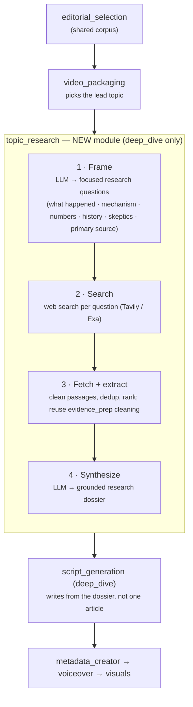

# Deep-Dive Research Architecture (planned)

Status: Design / not built
Last updated: 2026-08-03

## Context

Today a `deep_dive` run **repackages one article**: `video_packaging` picks the
lead story from the shared corpus and `script_generation` expands *that story's
already-collected records* into angle sections. It is deeper than a roundup blurb,
but it is not *researched* — it never looks beyond what ingestion happened to
collect for that one story.

A genuine deep-dive should be **researched before it is written**: given the
selected topic, go to the internet, gather more information from multiple sources
(the primary paper/docs, other outlets, expert takes, counterpoints), and build a
grounded body of material — then write an authoritative, discussion-style script
from *that*.

This is **not a separate system or branch**. It is one new pipeline module that
enriches the source material for the deep_dive format; everything else (the
module contract, orchestration, config, provenance, the deep_dive script format)
is reused unchanged.

## Where it fits

A new content module `topic_research` runs in the deep_dive **Phase-2**, between
`video_packaging` (which picks the topic) and `script_generation` (which writes
it). It is **format-gated**: roundup skips it; deep_dive requires it.



## How it extends the current pipeline (the concrete edits)

Today the **content stage** runs ONE flat module chain for every format — format
routing happens *inside* `video_packaging` and `script_generation`, not in the
chain:

```
evidence_prep → editorial_triage → story_mapping → editorial_selection   ← Phase 1 (shared corpus)
   → video_packaging → script_generation → metadata_creator             ← Phase 2 (per-format)
```

The extension inserts exactly **one module** into Phase 2:

```
… → video_packaging → topic_research → script_generation → metadata_creator
                       ^^^^^^^^^^^^^^  NEW — runs for deep_dive; a no-op for roundup
```

The edits are small and follow patterns already in the codebase (this is why it's
an extension, not a new system):

1. **`orchestration/content_phases.py`** — `topic_research` is Phase-2 (it comes
   *after* `SHARED_CORPUS_MODULES`), so the shared-corpus boundary is unchanged. A
   derived deep_dive reuses the corpus and runs `topic_research` fresh on the topic.
2. **`orchestration/stages/content.py`** —
   - add `topic_research` to `MODULES`, right after `video_packaging`;
   - `_module_function`: map `topic_research → content.topic_research.run`;
   - `_build_input`: build its input from the `video_packaging` result, and extend
     `script_generation`'s input to also carry the `topic_research` result (the
     dossier). (Same shape as how `metadata_creator` already receives both
     `script_generation` + `video_packaging`.)
3. **new `content/topic_research/`** — `app.py` (frame → search → fetch →
   synthesize), `contract.py` (dossier schema), `prompts/v1/{framer,synthesizer}/`,
   `search_client.py` (Tavily/Exa). **Format-gated:** it reads `video_packaging`'s
   `selected_format`; if the format doesn't need research (or config disables it),
   it returns a pass-through — empty dossier, ready handoff — so roundup pays ~nothing.
4. **config** — `profiles/daily_deep_dive/content/topic_research.yaml` (provider,
   depth caps, model, reasoning_effort, prompt_version) registered in the
   `daily_deep_dive` block of `workbench.yaml`. Roundup profiles simply don't enable it.
5. **deep_dive `script_generation`** — its request contract gains an optional
   `topic_research` input; the director + section writers use the dossier as their
   `source_context` in place of / alongside the single story's records.
6. **orchestration + UI (free)** — `topic_research` shows up automatically as a new
   module artifact (`topic_research_result.json`) in `run_state` and the inspector,
   resumable like any module. **No new stage, no runner change, no UI change.**

**Reused unchanged:** the `run(input)->dict` module contract, the runner +
content stage, the config/profile system, provenance + content fingerprints, the
derive flow, and the entire deep_dive script format. **Genuinely new:** one module

+ a search client + one profile YAML.

## The research dossier (module output)

`topic_research.run(input) -> dict` returns a structured, **grounded** dossier
that `script_generation` consumes as its source context in place of (or alongside)
the single story's records:

- **claims** — each with supporting evidence and the source it came from
- **quotes** — verbatim, attributed to a person/outlet
- **numbers / benchmarks** — with units and source
- **timeline** — how the story unfolded (dated events)
- **angles** — candidate facets for the director to build sections around
- **counterpoints / skeptics** — the honest other side
- **sources** — the fetched URLs, each fingerprinted like current provenance

Every item carries a source reference; nothing is un-cited. This keeps the same
source-fidelity discipline the pipeline already enforces (no fabrication; measured
vs claimed preserved; exact quotes).

## Design principles (same as the rest of the pipeline)

- **Pure module.** `run(input_json) -> dict`, Pydantic-validated; the orchestrator
  persists artifacts. No new architecture.
- **LLM for judgment, code for guardrails.** LLM frames questions and synthesizes;
  deterministic code does search/fetch/cleaning, dedup, provenance + fingerprints,
  and caps (max questions, max sources, max depth).
- **Config-driven.** Search provider, research depth (questions × sources), model,
  `reasoning_effort`, and `prompt_version` all live in the profile
  (`profiles/daily_deep_dive/content/topic_research.yaml`). No hardcoding.
- **Grounded + bounded.** Every claim cites a fetched source; a config-driven hard
  cap bounds search/fetch cost and time. No un-sourced synthesis.

## New dependencies / decisions to make

- **Search capability** the *pipeline* owns (distinct from the agent tools used in
  chat). Recommended: **Tavily** or **Exa** — built for agentic research, return
  clean extracted content + citations. Alternative: a general search API (Serper /
  Brave) + the existing fetch/clean stack.
- **Cost + time.** Adds N search calls + fetches + 2 LLM passes (frame, synthesize)
  on top of the ~14 min deep_dive script. Budget it via the depth caps.
- **Embeddings (optional).** Reuse `all-MiniLM` (already in story_mapping) to dedup
  and rank fetched passages before synthesis.
- **Trust / recency.** Prefer primary sources and trusted outlets; timestamp-filter
  to the story window where relevant.

## Build outline

1. `content/topic_research/` module: `contract.py` (dossier schema), `app.py`
   (frame → search → fetch → synthesize), `prompts/v1/{framer,synthesizer}/`,
   a `search_client` (Tavily/Exa) + reuse of evidence_prep cleaning.
2. Wire it into the deep_dive Phase-2 module sequence (format-gated in
   `stages/content.py` / the format's app list), and add
   `topic_research.yaml` to the `daily_deep_dive` profile.
3. Point deep_dive `script_generation` at the dossier as `source_context`.
4. Validate with a real deep_dive run + editorial review (before/after vs the
   current repackage-one-article deep_dive).
