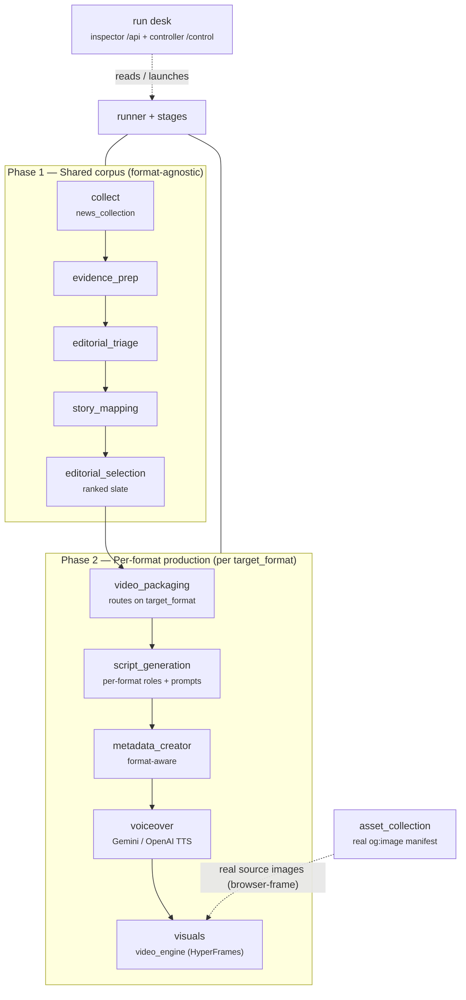
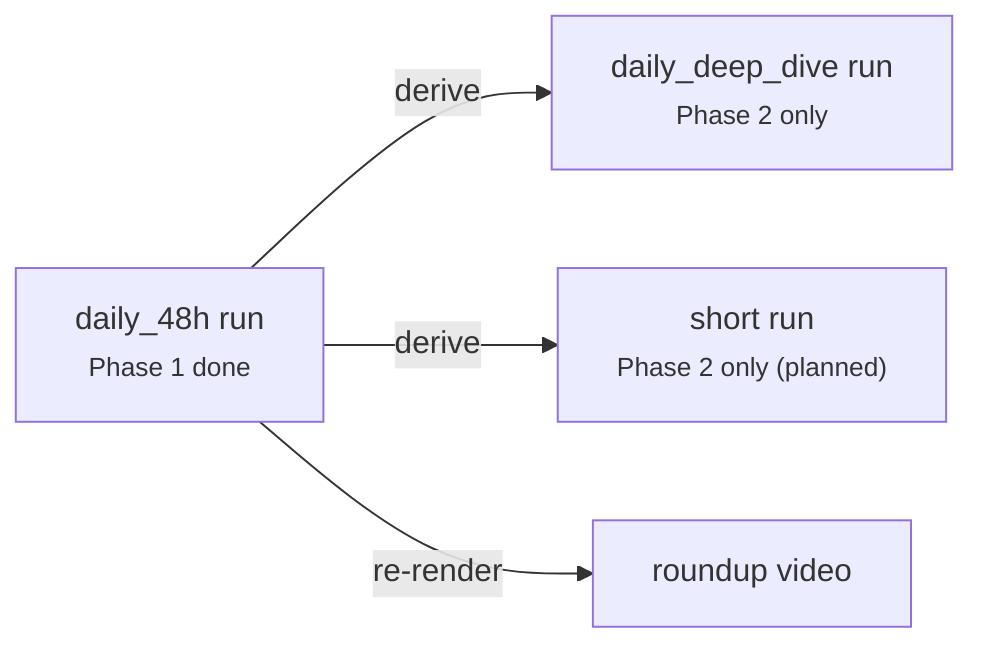

# Current System Architecture

Status: Canonical runtime reference
Last updated: 2026-08-03

## Pipeline at a glance

Every video is produced by one resumable pipeline. It splits into a **shared
corpus phase** (format-agnostic) and a **per-format production phase**, so one
collection run can feed many videos.



**Derived runs** ("one corpus → many formats") are first-class: a `runner derive`
subcommand (and a UI "Derive format" action) seeds a new run from an existing
run's Phase-1 corpus and runs only Phase-2 for a different format.



## Runtime

`src/pipeline/` is the only active pipeline runtime. Every functional app is a
pure `run(input_json: dict) -> dict` boundary validated with Pydantic v2; the
orchestrator (not the app) persists artifacts.

```text
src/pipeline/
├── ingestion/news_collection/          # pluggable collectors, config-selected
├── content/
│   ├── evidence_prep/                  # deterministic cleaning/normalization
│   ├── editorial_triage/               # LLM relevance/tags/decisions
│   ├── story_mapping/                  # embed → event-identity → reconcile → label
│   ├── editorial_selection/formats/…   # LLM slate selection (format-aware)
│   ├── video_packaging/                # format routing → structural packet
│   ├── script_generation/formats/…     # per-format script authoring
│   └── metadata_creator/               # LLM YouTube metadata (draft)
├── publishing/metadata_finalizer/      # audio-timed metadata
├── voiceover/                          # TTS (Gemini/OpenAI); .venv-voiceover subprocess
├── orchestration/                      # runner + stages/ + io + artifact_selection
├── contracts/                          # provenance + content fingerprints
└── config/
    ├── workbench.yaml                  # profile manifest
    ├── environments/{dev|staging|prod}.yaml   # sparse overlays
    └── profiles/{profile}/{ingestion|content|voiceover|visuals}/
```

The **visual layer is `video_engine/`** (Node/HyperFrames motion-graphics), a
self-contained tool triggered only by `orchestration/stages/visuals.py`. Its
input is the selected voiceover package + audio — no dependency on pipeline
internals — so it stays portable to other projects. Inside it, an LLM
**art-director** maps each spoken beat to components from a config-driven menu
(`compositions/<family>/`), a resolver fetches assets (logos, images) and freezes
real source-image URLs, then the build inlines timing + GSAP and renders. The
visuals stage also builds a best-effort **asset manifest** (the real `og:image`
per selected story, via `content/asset_collection`, hardened with retries) and a
deterministic pass guarantees that real image appears as a `browser-frame` at its
source URL — even if the art-director LLM fell back to text.

The **run desk is `ui/`**: a React frontend, a read-only FastAPI inspector
backend (`/api/*`), and a controller (`/control/*`) that launches the runner.
Modules never import the UI or controller.

## Orchestration

One thin CLI router with four resumable stages:

```text
orchestration/runner.py + stages/{ingestion,content,voiceover,visuals}.py

python3 -m src.pipeline.orchestration.runner collect   --run-id … --environment prod
python3 -m src.pipeline.orchestration.runner content   --run-id …
python3 -m src.pipeline.orchestration.runner voiceover --run-id … --synthesis-mode final
python3 -m src.pipeline.orchestration.runner visuals   --run-id …
```

The runner owns sequencing, paths, resumability, run state, and logging, calling
public `run(input_json)` boundaries only. It runs on the main project Python;
the voiceover stage invokes `.venv-voiceover` internally for synthesis. It loads
`<project_root>/.env` without overriding already-exported variables.

Run state and per-stage/module status live in
`output/runs/<run_id>/orchestration/run_state.json`; the controller's run-status
endpoint reads it so the desk only offers stages whose upstream inputs exist.

## Data flow

```text
raw records
  → prepared records (+ reversible decision ledgers)          evidence_prep
  → editorial triage: advance/reserve/quarantine + tags       editorial_triage
  → semantically mapped stories carrying full records         story_mapping
  → LLM-selected roundup slate                                editorial_selection
  → structural video packet (format-routed)                   video_packaging
  → section-aware script package (per format)                 script_generation
  → metadata draft + beat-aware voiceover                     metadata_creator + voiceover
  → audio-timed metadata + rendered episode                   metadata_finalizer + video_engine
```

Script generation receives the full selected story records (no fact-packet
layer). Every canonical script carries a content fingerprint that downstream
stages propagate and verify; artifacts are never selected by modification time.

## Two conceptual phases (design intent)

The stages split cleanly into a shared corpus phase and a per-format production
phase — the basis for multiple formats from one collection run:

- **Phase 1 — Corpus (domain-specific, format-agnostic):** collect → prep →
  enrich (triage) → cluster (story_mapping) → score/select (editorial_selection).
  Output: the ranked, grouped, enriched stories for a window.
- **Phase 2 — Production (per-format, derivable):** video_packaging → script →
  voiceover → visuals.

One Phase-1 run can feed many Phase-2 productions (roundup long video + a
deep-dive on one story + N shorts). **Derived runs are implemented**: `runner derive --from-run <base> --profile <target>` (and the UI "Derive format" action)
seed a new run from a base run's Phase-1 corpus and run only Phase-2 for a
different format. Lineage is validated by manifest path (two profiles share a
corpus when their shared-corpus stage YAMLs match); the shared corpus is
`content_phases.SHARED_CORPUS_MODULES`. A persistence/DB layer to make derived
runs more robust remains on the backlog.

## Formats

Video type is a **config-driven `target_format`**, routed by `video_packaging`
(`SCRIPT_APP_BY_FORMAT`, `SUPPORTED_FORMATS`, `KNOWN_FUTURE_FORMATS`). Format
shapes selection **and** scripting:

```text
content/editorial_selection/formats/<format>/   # slate rules + prompts
content/script_generation/formats/<format>/      # roles + prompts + assembler + checks
```

- `roundup` — implemented: 5 stories, ~9 min, 16:9. Script roles: director,
  source_researcher, story_writer, story_reviewer, bookend_writer,
  bookend_reviewer → deterministic assembler.
- `deep_dive` — **implemented**: the slate's lead story expanded into 3–6 angle
  sections. Roles: director, source_researcher, section_writer, section_reviewer,
  bookend_writer, bookend_reviewer. Profile `daily_deep_dive` reuses the roundup
  Phase-1 corpus (script_generation + metadata_creator route on format).
- `short` — planned: one story, <60s, 9:16 vertical (needs the engine to become
  resolution-aware — currently hardcoded 1920×1080 landscape — plus a shorts
  script format + profile).

Prompts are versioned + per-format + config-selected:
`formats/<format>/prompts/v1/<role>/…`, loaded via `config["prompt_version"]`.
For multiple domains (beyond AI news), the prompt set should become
domain-nameable (a `domain` axis or `prompt_version: "<domain>_v1"`).

## Config policy

Behavior is config-driven — never hardcode names, thresholds, models, prompt
versions, caps, paths, or editorial rules. `workbench.yaml` is the manifest;
module config lives under `profiles/{profile}/{stage}/`; environments are sparse
overlays. The runner loads each module's current YAML before execution and writes
the effective config to `config_snapshot.json` (`--config-mode frozen` reproduces
the run's initial profile). Content apps receive config in the input envelope and
do not read YAML directly. No silent fallbacks — a deliberate fallback is named
in config and visible in the summary. A **profile = domain × format**.

## LLM policy

LLMs make semantic judgments; code enforces stable guardrails. LLM: triage,
story identity/value, slate selection/ordering, episode direction + beat writing

+ bounded repair + bookends, metadata, visual art-direction. Deterministic:
  collection/normalization, provenance + fingerprints, caps after semantic choices,
  section order + observed timing + alignment, Pydantic validation, asset
  resolution + render + assembly. Never gate prose with keyword lists or regexes.
  Review/revision loops have a config-driven hard maximum.

## Voiceover

`--synthesis-mode final` = production (Gemini `gemini-3.1-flash-tts`, Puck);
`preview` = Kokoro (local, dev-only). Note: the Gemini TTS preview model has a
per-project daily request quota (≈100/day) independent of billing; the retry
loop fails fast on daily-quota/billing errors. For reliable production volume,
raise the quota or use OpenAI TTS (`gpt-4o-mini-tts` / `tts-1-hd`) — key and
`openai_tts` provider already present.

## Output layout

```text
output/runs/{run_id}/
├── run_context.json
├── {module}/          # {module}_input.json, {module}_result.json, primary package,
│                      # summary.json, config_snapshot.json, llm_calls.jsonl
├── orchestration/     # run_state.json, {stage}_stage_result.json, voiceover_selection.json, logs/
├── voiceover/         # {variant}/voiceover_package.json + audio/
└── visuals/           # {run_id}-ad.mp4
```

Media stays on disk; do not commit generated media or machine-specific paths.

## Verification

```bash
python3 -B -m compileall src/pipeline
python3 -m pytest -q
cd ui/frontend && npm run typecheck && npm run build && npm run test:browser
```

Quality-affecting changes (reasoning effort, prompt/grouping edits, format
tuning) require a before/after A/B on 1-2 real runs — never trade quality for
speed/cost unverified.
