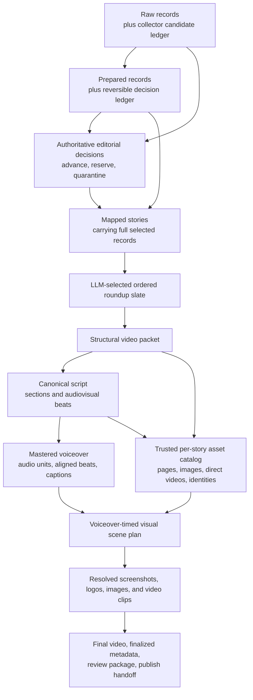
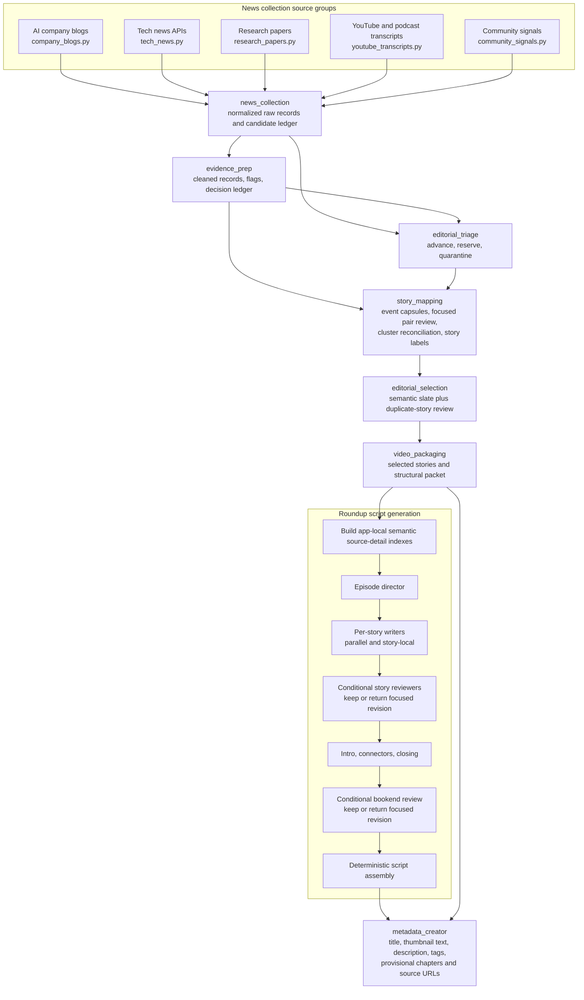
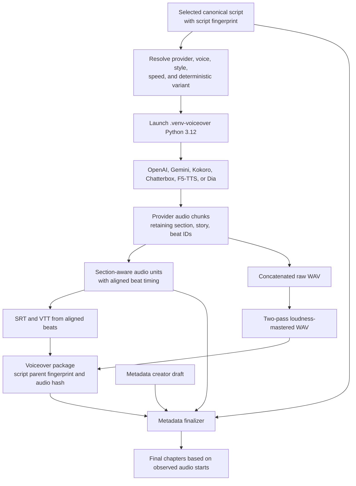
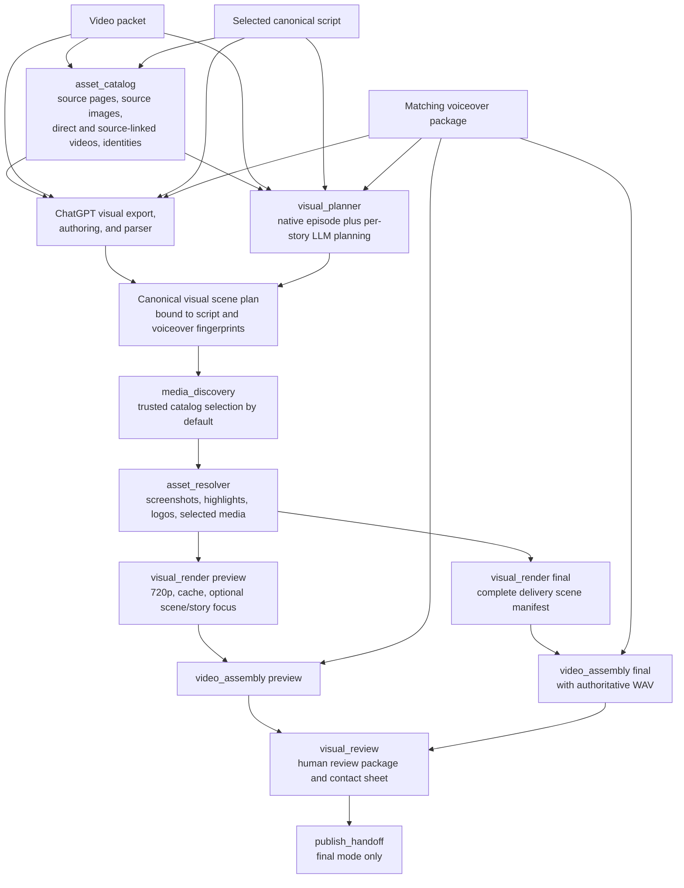
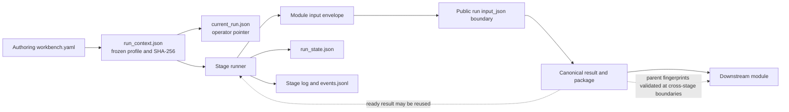

# Current System Architecture

Status: Canonical runtime reference

Last updated: 2026-07-18

## Runtime

`src/pipeline/` is the only active pipeline runtime.

```text
src/pipeline/
|-- apps/
|   |-- news_collection/
|   |-- evidence_prep/
|   |-- editorial_triage/
|   |-- story_mapping/
|   |-- editorial_selection/
|   |-- video_packaging/
|   |-- script_generation/
|   |-- metadata_creator/
|   `-- metadata_finalizer/
|-- contracts/
|-- handoffs/
|-- orchestration/
|-- voiceover/
|-- visuals/
`-- config/workbench.yaml
```

Production automation uses one thin CLI router with three stage modules:

    python3 -m src.pipeline.orchestration.runner content
    python3 -m src.pipeline.orchestration.runner voiceover
    python3 -m src.pipeline.orchestration.runner visuals

The stage modules pass JSON/dict envelopes between public `run(input_json)`
boundaries. They own sequencing, paths, resumability, run state, and logs, but
they do not import an app's private implementation. Focused notebooks remain
interactive operator and debugging surfaces over the same contracts.

The stage runner uses the main project Python environment. `.venv-voiceover`
is a specialized Python 3.12 TTS runtime and must not be activated around the
stage runner; the voiceover stage invokes that interpreter only for synthesis.
The CLI adapter loads `<project_root>/.env` without overriding variables already
exported by the operator. Before network collection, it reports every enabled
source with unresolved credential aliases and never includes secret values.
Run the three commands sequentially and stop when a stage returns non-zero.

Pure apps validate with Pydantic v2, return status/data/summary/handoff
envelopes, and do not write output files. Voiceover and visual modules may
write caller-directed media because WAV, PNG, and MP4 files are their products.

# Production Workflow

```mermaid
flowchart LR
    operator[Operator, notebook, scheduler, or service]
    runner[Three-stage orchestration runner]
    config[workbench.yaml]
    context[run_context.json<br/>frozen profile and config hash]

    operator --> runner
    config --> context
    runner --> context

    subgraph content[1. Content stage]
        collect[Collect news]
        prepare[Prepare evidence]
        triage[Editorial triage]
        map[Map records into stories]
        select[Select roundup slate]
        package[Build video packet]
        script[Generate canonical script]
        metadataDraft[Create metadata draft]
        collect --> prepare
        collect --> triage
        prepare --> triage
        prepare --> map
        triage --> map
        map --> select --> package --> script --> metadataDraft
        package --> metadataDraft
    end

    subgraph audio[2. Voiceover stage]
        scriptSelect[Select app or ChatGPT script<br/>by run and fingerprint]
        synth[Synthesize section-aware audio]
        master[Master final WAV]
        captions[Generate SRT and VTT]
        metadataFinal[Finalize chapters from real audio timing]
        scriptSelect --> synth --> master
        synth --> captions
        master --> metadataFinal
        captions --> metadataFinal
    end

    subgraph visuals[3. Visuals stage]
        assetCatalog[Build trusted story asset catalog]
        visualPlan[visual_planner<br/>generate or load canonical visual plan]
        discover[Resolve catalog media<br/>or deliberate external research]
        resolve[Capture screenshots and resolve assets]
        render[visual_render<br/>render independent Remotion scene clips]
        assemble[video_assembly<br/>assemble clips with authoritative WAV]
        review[visual_review<br/>create review package and contact sheet]
        publish[publish_handoff<br/>final mode only]
        assetCatalog --> visualPlan --> discover --> resolve --> render --> assemble --> review
        review --> publish
    end

    context --> content
    script --> scriptSelect
    metadataDraft --> metadataFinal
    package --> assetCatalog
    scriptSelect --> assetCatalog
    scriptSelect --> visualPlan
    master --> visualPlan
    master --> assemble
    metadataFinal --> publish
```



The simplest mental model is:

- The content stage decides **what the episode says**.
- The voiceover stage decides **when every section and beat is heard**.
- The visuals stage decides **what the viewer sees during those authoritative
  audio intervals**.
- The review and publish handoff decide **whether the resulting episode is
  ready for a human to publish**.

The stages are deliberately separate:

- `content` can stop after any content module and does not require local media
  dependencies.
- `voiceover` selects one canonical script, launches the specialized Python
  3.12 synthesis environment, and makes observed audio timing authoritative.
- `visuals` requires the matching script and voiceover fingerprints. Preview
  and final rendering are explicit modes; only final mode can create the
  publish handoff.

Manual ChatGPT scripts and visual plans use chatgpt_handoffs.ipynb. Parsers
normalize manual output into the same canonical contracts used by native apps.
Downstream media code must not branch on a manual-only schema.

## Canonical Data Flow



The retired fact-packet and numbered-layer paths are not part of this runtime.
Script generation receives selected stories with their full records.

## Detailed Stage Workflows

### Content Stage



Script-generation model routing is role-specific and frozen into each run
context. GPT-4o handles source research and episode direction because those
calls were accurate and comparatively fast in the frozen-packet evaluation.
Kimi K3 handles the per-story writer and reviewer plus the bookend writer and
reviewer, because those calls directly author or replace viewer-facing prose.
The metadata creator also uses one Kimi K3 call for titles, thumbnail text,
description copy, tags, and complete chapter labels; code still owns chapter
timestamps and source URLs. High-volume triage, story mapping, and editorial
selection remain on their configured fast models.

| Module                  | Main input                                                        | Main responsibility                                                                                                                           | Canonical output                           |
| ----------------------- | ----------------------------------------------------------------- | --------------------------------------------------------------------------------------------------------------------------------------------- | ------------------------------------------ |
| `news_collection`     | Frozen collection profile, source config, environment credentials | Collect and normalize all enabled source groups                                                                                               | Raw records and collector candidate ledger |
| `evidence_prep`       | News collection result                                            | Clean article content, retain reversible flags and provenance                                                                                 | Prepared records and decision ledger       |
| `editorial_triage`    | Raw and prepared records plus channel policy                      | Make semantic advance/reserve/quarantine decisions                                                                                            | Authoritative editorial decisions          |
| `story_mapping`       | Prepared records plus triage decisions                            | Nominate related records, extract candidate event identities, adjudicate one pair at a time, reconcile semantic components, and label stories | Stories carrying their full records        |
| `editorial_selection` | All mapped stories                                                | Semantically screen, choose, deduplicate, and order the roundup slate                                                                         | Editorial slate plus reserve               |
| `video_packaging`     | Editorial slate                                                   | Apply roundup structure without writing narration                                                                                             | Video packet with selected stories         |
| `script_generation`   | Video packet and full selected records                            | Direct, write, conditionally review, and assemble story-aware beats                                                                           | Canonical`script_package`                |
| `metadata_creator`    | Script package plus video packet                                  | Draft viewer-facing metadata                                                                                                                  | Metadata draft package                     |

### Story Identity And Slate Reconciliation

Story mapping uses embeddings and triage story keys only to nominate a bounded
candidate set. Candidate records then receive independent LLM event-identity
capsules. Every candidate pair is adjudicated in its own call, and a proposed
`same_event` decision is confirmed against both complete normalized records.
Code validates only schema and opaque record identity at this boundary.

Only confirmed `same_event` merge edges form proposed reconciliation
components; `follow_up` and `broader_story_arc` remain related-story links and
cannot create a giant transitive component. A component-level LLM partitions
every record exactly once using the event capsules already extracted from full
records plus focused pair decisions. Article bodies are not redundantly resent
at this stage. A config-driven token preflight runs before the provider call.
This final partition avoids edge-order-dependent transitive merges while the
canonical stories still preserve full records and event-status distinctions
such as planned versus released. The final roundup
selector performs a second complete-context slate review so separately mapped
versions of one event cannot knowingly occupy two episode slots. Duplicate
judgment remains semantic; code checks only candidate coverage, selected count,
role placement, and stable IDs.

### Canonical Script and Manual Script Branch

```mermaid
flowchart LR
    packet[Video packet]
    native[Native roundup script app]
    export[ChatGPT handoff exporter]
    chatgpt[External ChatGPT authoring]
    parser[ChatGPT script parser]
    appResult[App script_generation_result.json]
    manualResult[ChatGPT script_generation_result.json]
    selector[Explicit script selection<br/>auto only when unambiguous]
    canonical[One canonical script contract<br/>script_package.sections[].beats[]]

    packet --> native --> appResult --> selector
    packet --> export --> chatgpt --> parser --> manualResult --> selector
    selector --> canonical
```

Both paths must produce the same script contract. If both app and ChatGPT
scripts exist, `script_source=auto` deliberately fails instead of choosing the
newest file. The operator must select `app` or `chatgpt`.

Native source research carries explicit semantic meaning boundaries for
material current-versus-planned state, attribution, claim strength, causality,
and terminology. Those LLM-authored boundaries remain in the complete story
packet used by the director, writer, reviewer, and metadata creator. Production
applies one structurally valid reviewer revision directly when the reviewer sets
`rewrite_required=true`. There is no second A/B selector: the reviewer is the
single semantic revision authority, while code checks only the revised object's
schema, stable IDs, source ownership, and section order.

### Voiceover Stage



Synthesis timing, not a requested episode duration, controls every later visual
timestamp. Mastering is accepted only when it preserves duration within the
frozen profile tolerance.

### Visuals Stage



The production planner menu is intentionally compact: source articles,
story-owned images, story-owned direct video, verified identity/logo moments,
clean editorial text, simple explainers, and deterministic story transitions.
The larger Remotion component library remains available to explicit specialist
profiles and visual-lab tests.

### Runtime Boundaries

| Work                                                   | Runtime                         | Why                                                                     |
| ------------------------------------------------------ | ------------------------------- | ----------------------------------------------------------------------- |
| Content apps, LLM planning, orchestration, metadata    | Main project Python             | Canonical Pydantic/LangChain application environment                    |
| Hosted and local TTS synthesis                         | `.venv-voiceover` Python 3.12 | Keeps one stable synthesis boundary for API and local speech providers  |
| Scene rendering                                        | Node, Remotion, Chromium        | Renders each validated scene specification into an MP4 clip             |
| Audio/video probing, mastering, clipping, and assembly | `ffmpeg` and `ffprobe`      | Provides deterministic media transformation and verification            |
| External model calls and enabled news sources          | Configured APIs                 | Credentials are loaded from`.env` and never copied into run artifacts |

### Control, Resume, and Artifact Identity



`--from-module` reruns the named module and every downstream module in that
stage. Earlier ready results may be reused. Cross-stage script, voiceover, and
visual-plan selection verifies run ID, parent fingerprints, and media hashes;
artifacts are never selected by modification time.

Evidence prep normalizes records before they become story or script context.
Domain-scoped article-chrome rules and source-relationship classification are
frozen in the run profile. Cleaning is observable in the evidence summary, and
candidate records retain both raw and cleaned content so a bad cleanup rule is
recoverable.
Self-published and community-launch relationships travel with records instead
of being inferred again downstream. Evidence prep does not classify topics,
promotions, tutorials, relevance, or newsworthiness with regexes or keyword
lists. It removes only empty records, records with valid timestamps outside the
frozen collection window, and exact structural duplicates. Missing or invalid
timestamps remain visible preparation warnings. Collector retrieval diagnostics
and reversible cleaning provenance remain telemetry rather than editorial
approval.

The `editorial_triage` app semantically reviews evidence candidates and
collector quarantines with `gpt-4o-mini` by default. Its advance, reserve, and
quarantine pools are authoritative production inputs. Story mapping consumes
the candidate ledger together with those decisions; unresolved items remain in
a recoverable reserve instead of disappearing. Story mapping retains singleton
clusters so semantic labeling, rather than a lexical singleton rule, can judge
them. Embeddings and triage story keys nominate a high-recall, bounded pair pool;
they do not approve merges. Complete candidate records go to bounded LLM
adjudication, and only `same_event` decisions merge. Explicit `follow_up`,
`broader_story_arc`, and `unrelated` cross-pair decisions block unsafe
transitive merges, while the absence of an un-nominated cross-pair does not
become a false veto. Exact structural identity and objective pair-window checks
remain deterministic.

Story-mapping scores and priority buckets are telemetry, not episode-selection
authority. `editorial_selection.formats.roundup` receives every mapped story
with bounded source-diverse context and uses structured LLM judgment to choose
and order a coherent, diverse slate. When the pool exceeds the configured
per-call context bound, balanced LLM screening batches account for every story
and feed a cross-batch shortlist to the final selector. Screening output names
only the explicit shortlist; its complement is retained as reserve instead of
requiring the model to reproduce a fragile full-batch ledger. The bound
therefore limits one model call rather than rejecting a run or dropping a story
in code.
Prompt bounds compact context; they do not remove candidate story IDs or
downstream full records.
Video packaging then applies only machine-verifiable format structure and caps
to that approved slate. Source authority remains profile-driven and uses each
record's actual relationship and URL; a collector label alone does not turn a
self-published project page into independent reporting.

## Script Contract

The authoritative script representation is:

    script_package.sections[].beats[]

Each beat carries stable section, story, beat, and source identities plus
spoken narration and a visual brief. Native app beats also carry an editorial
beat function, invisible support truth IDs, a creative-device label, and a
visual goal. Section narration and full_script are deterministic projections
of those beats.

The roundup generation flow is:

    selected stories
      -> app-local semantic source-detail indexes with structural IDs
      -> roundup director
      -> parallel creator-led story storytellers
      -> one conditional keep-or-rewrite craft review per story
      -> bookend and continuity writer
      -> one conditional keep-or-rewrite bookend review
      -> deterministic assembly

The director explicitly chooses `shared_tension` or `curated_roundup`. It also
gives each story a concrete detail anchor and a source-meaning boundary. These
are semantic instructions for the writer and reviewer, not code-scored prose
features. They help prevent a useful measured detail from disappearing and
prevent relationships such as several correlated signals from being rewritten
as one signal that proves a conclusion.

No LLM call rewrites the complete episode. Suggested word counts and duration
are guidance and diagnostics, not approval quotas. Content completeness owns
script length, and actual voiceover timing owns downstream media timing.
Director-selected truth IDs guide fact selection but are not coverage quotas.
Code does not score generated prose with keyword lists, semantic-overlap
thresholds, claim-state regexes, metric matching, or generic-language rules.
Those are categorical editorial judgments owned by the LLM director/reviewer
and ultimately by human review.

Hard code checks are limited to machine-verifiable integrity: Pydantic output
shape, selected story order, section and beat identity, non-empty narration,
deterministic beat-to-section projection, selected-story source ownership,
valid source/truth references, absence of production IDs in spoken narration,
and artifact provenance. Review output may refer only to supplied beat IDs, and
a proposed candidate must pass the same Pydantic and ownership contract as the
current draft. Code does not compare wording, punctuation, semantic overlap, or
whether a named beat changed. The reviewer returns either KEEP or a complete
replacement and is the single semantic revision authority. The loop has a
config-driven maximum of one pass.

Script generation uses one versioned story-context packet per selected story.
The packet preserves complete cleaned source records and adds a
semantic source brief produced from those same records. The director, writer,
and reviewer must consume that shared packet rather than
independently rebuilding capped regex- or keyword-ranked source menus. Prompt
payload telemetry records packet version, record keys, and character counts so
context loss can be diagnosed without logging API secrets.

The source brief is trusted as an LLM semantic reading aid. Code does not compare
its notes, quotes, values, or punctuation against article strings and does not
retry semantic wording. Pydantic owns output shape; code owns story/record IDs,
ordering, resource bounds, provenance, and deterministic assembly. Complete
records remain available to every writing and review call.

Metadata creation uses final narration as its content basis. The LLM owns title
quality and complete-episode framing; code only normalizes, deduplicates, and
bounds returned options. Raw-domain tags remain mechanically filtered, and
provisional chapters prefer concise script title-card labels. Voiceover later
remains the authority for final chapter timestamps.

Current implementation work is tracked in:

- docs/build/production_orchestration_and_creative_quality_worklist.md
- docs/build/creator_voice_storytelling_rubric.md

Historical design research and audits are retained under `docs/archive/`.

## Visual Production Contract

Visual production starts with `visuals.asset_catalog`, before the final scene
plan. It derives asset briefs from canonical script beats, registers selected
source pages, and records resolvable local or Simple Icons identities. Page
inspection considers structurally valid OpenGraph/hero and in-article image
candidates, including lazy-loaded and `srcset` images, plus direct MP4, WebM,
MOV, or M4V media exposed by the selected source page. Candidate order remains
declared hero first and then document order; code does not semantically rerank
alt text or filenames. It retains only bounded source-owned assets under byte,
dimension, and aspect-ratio limits and reports every resource-cap omission.
Exact and
perceptual near-duplicate images are filtered with visible summary telemetry.
Retained assets carry dimensions, alt text or media role, source URL, content
hash, and story ownership. Source-page assets also carry screenshot candidates
derived directly from the selected records. Semantic source notes are not
promoted to literal page targets. This stage does
not search the open web or make an additional LLM/vision call. The selected
source page remains a trusted real anchor when no suitable source image or
direct video is exposed.

The visual planner receives canonical script beats, selected-story records,
authoritative voiceover timing, and the trusted asset catalog. It makes one
episode-direction call and bounded story-local planning calls. A config-driven
visual editor may then make at most one additional story-local pass. Its default
decision is keep; it returns a complete replacement only for a material
narration-fit, comprehension, source-proof, or repetition problem. The same
scene, ownership, payload, and slot validators recheck any replacement. An
editor failure keeps an already valid plan under the production policy and
never creates a generic code fallback.

The planner requests at least one available catalog-backed source, image,
direct video, or identity scene per story. Whether a missing anchor warns or
fails is an explicit profile policy, not a hidden semantic code gate. The
default profile uses an
`editorial_minimal` art direction and advertises only source pages,
story-owned images, story-owned direct video, verified identities, clean
editorial text, and a small two-to-four-item explainer to the story planner.
One story transition is inserted deterministically. The larger Remotion
component catalog remains available only to explicit specialist profiles; it
is not the production planner's default menu. The planner may not substitute
an unrelated stock image for an unresolved request. Provider-facing structured
output carries dynamic scene payloads as validated JSON text; the app decodes
them, verifies them through one shared render-kind payload contract, verifies
asset/story/source ownership, and rejects incomplete rich graphics rather than
inventing metrics, chart values, relationships, or process steps in code.
Native planning, manual ChatGPT parsing, visual editing, and render preflight
all use that same nested validator.

When one aligned audio unit is longer than the configured scene cap, the story
planner must return multiple distinct semantic treatments for that same unit.
The deterministic stitcher allocates the authoritative audio time across those
treatments and refuses to copy one render payload into repeated slices.
Adjacent identical effective payloads fail before rendering. This is an
objective render-spec check; text-heavy mix and creative quality remain LLM and
human judgments.

Numeric and explanatory payloads must satisfy renderer shape and use known
story-owned evidence IDs when they claim grounding. Code does not compare LLM
wording, punctuation, labels, or displayed values against article strings and
does not decide whether a chart is editorially wise. Incomplete renderer
payloads return to the bounded story-planning retry rather than being silently
rewritten into another scene family.

Uncovered timing ranges may use only provenance-safe continuity treatments:
exact narration-derived editorial text or an exact selected source proof. A
manual visual response that requires a semantic ownership or substantial
timeline repair returns `needs_repair`; the parser does not silently rewrite it
into an apparently approved plan.

The default production media policy is `trusted_catalog_only`. Catalog-backed
source images are copied directly and source-owned videos are prepared as short
muted clips with their provenance. Unresolved external photo/B-roll requests
remain visible and stop the media stage instead of being chosen by keyword
overlap or replaced with generic text. This avoids both bad semantic matches
and per-candidate vision cost during the current iteration phase. An optional
external-research profile may retrieve a bounded candidate pool and use
structured vision verification for narration fit and exact identity. For
long-form external B-roll, that paid path can use a second bounded vision call
to select among supplied clip windows rather than an arbitrary opening frame.
It must be enabled deliberately in config.

Manual ChatGPT scene beats preserve authored `visual_action` and
`emphasis_words`; timing attachment only binds authoritative voiceover text and
times. Code no longer infers those creative instructions from narration
keywords or emits keyword-list creative warnings.

Logo resolution reports the actual asset class, screenshot capture reports
target-text misses, and fallback usage is budgeted and observable. The LLM
planner selects the target text for the active beat from its supplied source
context. Code preserves that decision instead of remapping it with lexical
overlap.
Narration-derived fallback text is allowed only when the scene carries a real
phrase from the active script; the pipeline does not invent generic labels to
hide an unresolved asset. Text logo fallbacks preserve the complete entity
name and remain visibly classified as unverified identity treatments. Simple
Icons aliases are accepted only when that export exists in the installed
package; otherwise the renderer uses the honest full-name treatment rather
than fabricated initials. Source capture focus zoom and target highlighting are
profile-driven.

After rendering and audio assembly, the review stage samples the final video
into a contact sheet. Human inspection remains required because timing,
legibility, relevance, and creative quality cannot be approved from metadata
alone.

Remotion scenes use a 1920x1080 reference canvas that is uniformly scaled and
centered for each configured 16:9 quality preset. This keeps layout invariant
across 720p fixture renders, 1080p, 2K, and 4K instead of clipping fixed
coordinates or moving graphics off center. The `editorial_minimal` renderer
uses warm paper, near-black ink, one burnt-orange accent, expressive serif
headlines, condensed sans labels, generous whitespace, and no decorative card
containers. Real browser/document surfaces remain permitted because they
represent source material rather than slide furniture.

Rendering has separate `preview` and `final` profiles. Preview uses 720p and a
bitrate-based hardware-friendly encoder, accepts optional scene/story selections, and restores unchanged
clips from a persistent content-addressed cache. Final mode renders the complete
manifest at the configured delivery resolution. The renderer bundles Remotion
once and uses a bounded set of persistent browser workers; each worker renders
multiple scene jobs without paying browser startup for every clip. Cache keys
include scene payload, render settings, resolved asset content, and the Remotion
engine source, so creative or code changes invalidate only affected clips.
The production notebook writes previews under `render_preview`,
`assembly_preview`, and `review_preview`; canonical delivery artifacts remain
under `render`, `assembly`, and `review`. Preview mode cannot create the publish
handoff.

Intermediate Remotion scene clips are video-only. Assembly owns the single
authoritative voiceover track. For historical clips that contain a silent AAC
stream, assembly performs a lossless video-only remux before concatenation so
per-file AAC padding cannot create cumulative audiovisual drift.

## Artifact Identity

Canonical scripts, voiceovers, visual plans, and assembled media carry
deterministic provenance and fingerprints. Artifact selection must match the
selected run and upstream fingerprint. Newest-file-wins behavior is forbidden.

Production artifacts use:

    output/
    |-- current_run.json`-- runs/{run_id}/         |-- run_context.json         |-- inputs/         |-- news_collection/         |-- evidence_prep/         |-- editorial_triage/         |-- story_mapping/         |-- editorial_selection/         |-- video_packaging/         |-- script_generation/         |-- metadata_creator/         |-- metadata_finalizer/         |-- orchestration/         |-- voiceover/         |-- visuals/         `-- handoffs/

Important media subtrees:

    voiceover/{variant}/
      audio/full_voiceover.wav
      audio/chunks/
      audio/units/
      captions/captions.srt
      captions/captions.vtt
      voiceover_package.json

    visuals/
      asset_catalog/
      planning/{generate|chatgpt}/
      media_discovery/
      asset_resolution/
      render_preview/ or render/
      assembly_preview/ or assembly/
      review_preview/ or review/

output_v2/ is historical only. Model caches live under
.cache/ai_content_creation/models/.

## Configuration

Operator-authored configuration lives in src/pipeline/config/workbench.yaml.
The content stage or content notebook freezes the selected profile and config
hash into run_context.json. Apps receive effective config inside their input
envelope and do not read YAML directly.

Channel identity, audience, allowed topics, and excluded topics live once at
the selected profile's `channel` key. The active orchestrator copies that
frozen context into triage, editorial selection, and metadata app envelopes;
app-local news source YAML contains collection mechanics only.

Behavioral values such as providers, models, prompt versions, source policies,
selection limits, voices, visual capabilities, render settings, and bounded
revision loops remain config-driven.

The active visual profile also owns asset-catalog policy, external-media review
policy, preview/final render profiles, worker bounds, and the persistent scene
cache location. Stage routers or notebooks resolve and pass these values;
visual modules do not read YAML directly.

## Orchestration State And Logs

Each stage writes its canonical result and durable state under the selected
run:

    output/runs/{run_id}/orchestration/
    |-- content_stage_result.json
    |-- voiceover_stage_result.json
    |-- visuals_stage_result.json
    |-- run_state.json`-- logs/         |-- content.log         |-- voiceover.log         |-- visuals.log         `-- events.jsonl

The readable stage logs are rotating files. `events.jsonl` provides one shared
structured event stream for module start, completion, failure, duration, and
reuse. Apps do not need logger plumbing: the stage router wraps each public app
call once. Logging behavior is frozen from `profile.orchestration.logging`.
Stage result envelopes expose the readable log, shared event stream, and state
paths directly. Configured dependency log levels suppress routine transport
status noise, while long-running render modules emit scene/batch progress and
retry events through a lightweight runtime logger.

Ready canonical results before the selected `--from-module` boundary may be
reused. Critical cross-stage selection validates run ID, script and voiceover
parent fingerprints, and media hashes. `--from-module` reruns that module and
every downstream module in the same stage, preventing stale downstream media
from surviving an intentional upstream change. The state file is an operator
aid; canonical result files and fingerprints remain the source of truth.

## Synchronization Contract

Voiceover synthesizes the intro, each complete story, and closing as identified
audio units. Provider-level chunks retain their parent section and story
identity. Global timing is derived from concatenated audio units. Loudness
mastering must preserve that duration within the configured tolerance, and
caption cues are projected from the same aligned beats.

Visual planning consumes the same canonical beats and authoritative voiceover
timing. It must not reconstruct story boundaries from full_script, invent raw
episode duration, or select an unrelated voiceover artifact.

Final assembly verifies:

- matching run and script provenance
- complete scene coverage
- no gaps or unintended overlaps
- video duration aligned to voiceover
- valid rendered clips
- audio present in the final media

## Production Entry Points

Repeatable stage commands:

    python3 -m src.pipeline.orchestration.runner content --profile daily_48h_all_sources
    python3 -m src.pipeline.orchestration.runner voiceover --run-id current --script-source app
    python3 -m src.pipeline.orchestration.runner visuals --run-id current --plan-source generate --render-mode preview

After preview review, render delivery media without rerunning upstream visual
work:

    python3 -m src.pipeline.orchestration.runner visuals --run-id current --plan-source generate --render-mode final --from-module visual_render

Exact JSON stage envelopes may be supplied with `--input-json` for service or
scheduler integration.

Interactive notebooks:

- notebooks/production/content_pipeline.ipynb
- notebooks/production/voiceover_generation.ipynb
- notebooks/production/visual_production.ipynb
- notebooks/handoffs/chatgpt_handoffs.ipynb
- notebooks/labs/visual_assets_lab.ipynb

Committed notebooks must have empty outputs and null execution counts.

## Verification

The deterministic media fixture lives at:

    tests/fixtures/media_roundup_reference/

Relevant checks:

    python3 -B -m compileall src/pipeline
    python3 -m pytest -q
    cd src/pipeline/visuals/remotion_engine
    npm run typecheck

Visual changes also require rendering and inspecting fixture frames or clips.
Metadata-only inspection is not sufficient visual QA.
