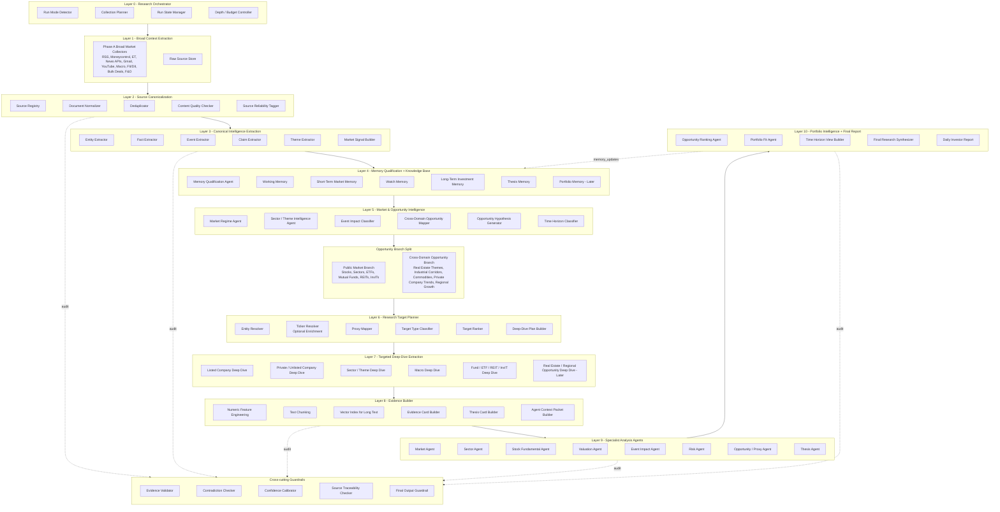
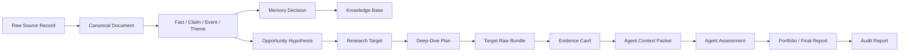

Yes — based on your current repo and the design discussion, I would **not throw away your pipeline**. Your current system is a strong **context extraction foundation**: it already has Phase A broad collectors, Phase B candidate/scoring modules, and Phase C company deep-dive modules like market data, price history, screener, peer comparison, analyst estimates, filings, corporate actions, and SEC filings. 

But the next version should be redesigned as an **investor intelligence system**, not just a stock-market signal extractor. Your own context-layer documentation already says the extraction layer should only extract raw data and save structured JSON, with no analysis in that layer. That principle is correct and should stay. 

Below is the final system design and implementation plan.

---

# 1. Final architecture decision

Your system should become:

```text
Market event / context
   ↓
Facts, entities, themes, events
   ↓
Memory qualification
   ↓
Market intelligence
   ↓
Opportunity discovery
   ↓
Research target planning
   ↓
Deep-dive extraction
   ↓
Evidence building
   ↓
Specialist analysis agents
   ↓
Portfolio / final investor report
   ↓
Audit + hallucination control
```

The most important design change:

```text
Do not go from raw news directly to buy/sell.

Raw news should first become:
- source records
- facts
- events
- entities
- themes
- memories
- evidence cards
- research targets
```

Only after that should agents analyze.

Your discussion file also recommends moving from a “market data collector + stock signal extractor” into an “investor intelligence system” that answers what changed, why it matters, what is noise vs structural, what opportunities may exist, what evidence supports them, and what would invalidate them. 

---

# 2. Final system architecture diagram



---

# 3. Layer-wise implementation plan

## Layer 0 — Research Orchestrator

### Purpose

This is the “brain” that decides **what should run**, **with what parameters**, and **why**.

Your extraction modules should not decide this themselves. As discussed earlier, somebody must decide which modules to run, for which ticker/source/date/depth. That should be the orchestrator. 

### Layer input

```json
{
  "run_mode": "daily_market_scan | ticker_analysis | source_analysis | watchlist_monitoring | portfolio_monitoring",
  "market": "india | us | global",
  "seed_tickers": [],
  "source_urls": [],
  "watchlist": [],
  "portfolio": [],
  "depth": "light | standard | deep",
  "max_targets": 10,
  "run_date": "2026-05-09"
}
```

### Layer output

```json
{
  "research_run_id": "RUN_2026_05_09_DAILY",
  "collection_plan": [],
  "analysis_plan": [],
  "memory_retrieval_plan": [],
  "expected_outputs": [
    "daily_market_report",
    "research_targets",
    "new_memories",
    "evidence_cards"
  ]
}
```

### Modules

| Module               | Purpose                | Questions it answers                                                | Logic                                     | Output                 |
| -------------------- | ---------------------- | ------------------------------------------------------------------- | ----------------------------------------- | ---------------------- |
| `run_mode_detector`  | Identify type of run   | Is this daily scan, ticker analysis, watchlist, or source analysis? | User input / schedule / config            | `run_mode`             |
| `collection_planner` | Decide collectors      | Which collectors should run today?                                  | Rule-based config                         | `collection_plan.json` |
| `depth_controller`   | Control analysis depth | Should we do light or deep research?                                | Based on mode, target score, user setting | `depth_profile`        |
| `run_state_manager`  | Track completed work   | What already ran? What failed?                                      | JSON state file                           | `run_status.json`      |

---

## Layer 1 — Broad Context Extraction

### Purpose

Collect broad raw market data. Do not analyze. Do not summarize deeply. Do not decide buy/sell.

Your current repo already has the right raw collection design. The docs say the context extraction layer collects raw context and saves structured JSON, and that aggregation/calculation/analysis should happen later. 

> **Targeted deep-dive extraction is Layer 7**, not Layer 1. Layer 1 only handles broad market context. Layer 7 runs later, after Layer 6 produces `deep_dive_plan.json`.

### Scope

```text
Layer 1: Broad Market Context Extraction
Layer 7: Targeted Deep-Dive Extraction (separate layer — see layer_7.md)
```

### Existing modules to reuse

Your current repo already has:

```text
phaseA_BMD/
  rss.py
  moneycontrol.py
  economic_times.py
  newsdata_io.py
  mediastack.py
  gmail.py
  yt_transcript.py
  india_macro.py
  us_macro.py
  fii_dii.py
  bulk_deals.py
  fno_data.py

phaseC_CDD/
  market_data.py
  price_history.py
  screener_in.py
  peer_comparison.py
  analyst_estimates.py
  exchange_filings.py
  filing_docs.py
  corporate_actions.py
  sec_filings.py
```

This matches the project dump. 

### Layer input

```json
{
  "collection_plan_id": "PLAN_2026_05_09",
  "modules_to_run": [
    {
      "module": "moneycontrol",
      "params": {
        "categories": ["markets", "stocks", "economy", "commodities"],
        "days_back": 2
      }
    }
  ]
}
```

### Layer output

```json
{
  "raw_context_bundle_id": "RAW_BUNDLE_2026_05_09",
  "raw_files": [],
  "source_records": [],
  "raw_market_snapshots": [],
  "collection_errors": []
}
```

### Module-level design

| Module group           | Modules                                            | Purpose                            | Questions answered                                       | Output                 |
| ---------------------- | -------------------------------------------------- | ---------------------------------- | -------------------------------------------------------- | ---------------------- |
| Market/news collection | RSS, Moneycontrol, ET, News APIs                   | Get broad market context           | What happened today? What are people talking about?      | Raw articles/headlines |
| Newsletter collection  | Gmail                                              | Capture curated market commentary  | What did trusted newsletters highlight?                  | Newsletter bodies      |
| Video collection       | YouTube transcripts                                | Capture spoken market analysis     | What did market analysts discuss?                        | Transcripts            |
| Macro/flows            | India macro, US macro, FII/DII                     | Capture market regime inputs       | Is money flowing in/out? Are macro conditions changing?  | Macro snapshots        |
| Market activity        | Bulk deals, F&O                                    | Capture short-term market activity | Where is institutional or derivatives activity visible?  | Bulk/F&O records       |
| Company deep-dive      | Screener, filings, price, peers, analyst estimates | Fetch company-specific raw data    | What is the company’s actual financial/filing situation? | Target raw bundle      |

---

## Layer 2 — Source Canonicalization

### Purpose

Convert all raw files into one standard source/document format.

This layer does **not** decide meaning. It only standardizes.

### Why this matters

Without canonical source records, later agents cannot trace evidence back to source. Hallucination control becomes weak.

### Layer input

```json
{
  "raw_context_bundle_id": "RAW_BUNDLE_2026_05_09",
  "raw_files": []
}
```

### Layer output

```json
{
  "canonical_document_bundle_id": "DOC_BUNDLE_2026_05_09",
  "documents": [],
  "source_ledger": [],
  "duplicate_map": [],
  "quality_report": {}
}
```

### Modules

| Module                      | Purpose                  | Questions it answers                      | Logic                                         | Output                  |
| --------------------------- | ------------------------ | ----------------------------------------- | --------------------------------------------- | ----------------------- |
| `source_registry`           | Create unique source IDs | Where did this data come from?            | Hash URL/file/module/date                     | `source_id`             |
| `document_normalizer`       | Standardize raw data     | What is the title, body, date, source?    | Field mapping by module                       | `canonical_documents`   |
| `deduplicator`              | Remove duplicates        | Is this same article repeated?            | URL hash + title similarity + body similarity | `duplicate_map`         |
| `content_quality_checker`   | Check usable text        | Is this full article or title-only?       | Length, missing body, extraction quality      | `content_quality_score` |
| `source_reliability_tagger` | Tag reliability          | Is this official, media, opinion, social? | Source rules                                  | `source_reliability`    |

### Canonical document format

```json
{
  "document_id": "DOC_20260509_0001",
  "source_id": "SRC_MONEYCONTROL_001",
  "source_type": "news_article | newsletter | transcript | filing | macro_snapshot | market_data",
  "source_name": "Moneycontrol",
  "url": "",
  "published_at": "",
  "collected_at": "",
  "title": "",
  "body": "",
  "language": "en",
  "market": "india",
  "raw_file_path": "",
  "content_quality_score": 0.84,
  "source_reliability": "medium_high"
}
```

---

## Layer 3 — Canonical Intelligence Extraction

### Purpose

Turn documents into structured intelligence objects.

This is the first true intelligence layer.

### It should extract

```text
entities
facts
claims
events
themes
market signals
```

### Layer input

```json
{
  "documents": [],
  "source_ledger": []
}
```

### Layer output

```json
{
  "entity_registry": [],
  "fact_cards": [],
  "claim_cards": [],
  "event_cards": [],
  "theme_cards": [],
  "market_signal_cards": []
}
```

### Modules

| Module                  | Purpose                                    | Questions it answers              | Logic                              | Output                |
| ----------------------- | ------------------------------------------ | --------------------------------- | ---------------------------------- | --------------------- |
| `entity_extractor`      | Detect companies, sectors, assets, regions | Who/what is mentioned?            | LLM + rules + ticker dictionary    | `entity_registry`     |
| `fact_extractor`        | Extract verifiable facts                   | What factual statement is made?   | LLM strict JSON, no interpretation | `fact_cards`          |
| `claim_extractor`       | Extract opinions/claims                    | What is the author claiming?      | LLM with source type tag           | `claim_cards`         |
| `event_extractor`       | Identify market events                     | What happened?                    | LLM + event taxonomy               | `event_cards`         |
| `theme_extractor`       | Detect themes                              | What broader theme is emerging?   | Clustering + LLM labeling          | `theme_cards`         |
| `market_signal_builder` | Convert structured data to signals         | Is there flow/price/macro signal? | Rule-based numeric logic           | `market_signal_cards` |

### Important rule

Use LLMs for text interpretation only. Use deterministic code for numeric calculations.

### Event card format

```json
{
  "event_id": "EVT_20260509_0001",
  "event_type": "earnings | policy | macro | management_change | capex | legal | product | commodity | flows",
  "title": "",
  "summary": "",
  "entities": [],
  "themes": [],
  "facts": [],
  "source_ids": [],
  "impact_scope": ["company", "sector", "macro", "asset_class"],
  "sentiment": "positive | negative | neutral | mixed",
  "time_horizon": "short | medium | long",
  "structural_score": 0.0,
  "novelty_score": 0.0,
  "confidence": 0.0
}
```

---

## Layer 4 — Memory Qualification + Knowledge Base

### Purpose

Decide what should be remembered for future analysis.

This is one of the most important missing layers.

Your design discussion already identified the need for memory qualification and separate memory classes like short-term memory, watch memory, long-term investment memory, thesis memory, and portfolio memory. 

### Layer input

```json
{
  "event_cards": [],
  "fact_cards": [],
  "theme_cards": [],
  "market_signal_cards": []
}
```

### Layer output

```json
{
  "memory_decisions": [],
  "memory_records_created": [],
  "memory_records_updated": [],
  "ignored_items": []
}
```

### Memory types

| Memory type                 | Used for                           |    Retention | Example                                    |
| --------------------------- | ---------------------------------- | -----------: | ------------------------------------------ |
| Working memory              | Current run state                  |        1 run | unresolved entities                        |
| Short-term market memory    | Daily market moves, F&O, flows     |    7–30 days | FII selling pressure                       |
| Watch memory                | Repeated issues or watch items     |  3–12 months | HDFC margin pressure                       |
| Long-term investment memory | Structural changes                 |    1–5 years | semiconductor policy                       |
| Thesis memory               | Why an investment idea exists      | Until closed | “data center demand benefits power stocks” |
| Portfolio memory            | Holdings, entry thesis, exit rules |    Permanent | user’s HDFC holding thesis                 |

### Memory qualification module

| Module                  | Purpose                  | Questions it answers                     | Logic                                              | Output                  |
| ----------------------- | ------------------------ | ---------------------------------------- | -------------------------------------------------- | ----------------------- |
| `memory_qualifier`      | Store/no-store decision  | Is this useful later?                    | Importance + novelty + persistence + actionability | `memory_decision`       |
| `memory_writer`         | Write memory             | Where should this go?                    | Memory type mapping                                | JSON/JSONL record       |
| `memory_decay_manager`  | Expire old memory        | Is this still relevant?                  | Retention rules                                    | expired/active status   |
| `thesis_memory_manager` | Update investment thesis | Did evidence support or weaken a thesis? | Evidence comparison                                | thesis update           |
| `memory_retriever`      | Retrieve past context    | What previous evidence matters now?      | Entity/theme/time-horizon lookup                   | retrieved memory packet |

### Memory decision format

```json
{
  "memory_decision_id": "MEM_DEC_20260509_001",
  "input_event_id": "EVT_20260509_0001",
  "store": true,
  "memory_type": "long_term_investment_memory",
  "reason": "Structural policy event with likely multi-year sector impact",
  "retention_period": "3_years",
  "linked_entities": [],
  "linked_themes": [],
  "future_questions": [
    "Which listed companies benefit?",
    "Which sectors get capex tailwind?",
    "What data would confirm this thesis?"
  ],
  "confidence": 0.82
}
```

### Store/no-store rules

```text
Store if:
- structural policy change
- macro regime change
- company guidance change
- earnings thesis change
- management change
- major legal/regulatory event
- repeated sector theme
- capex cycle signal
- cross-domain opportunity signal

Do not store if:
- normal daily price movement
- generic commentary
- duplicate article
- unsupported opinion
- low-relevance headline
- no future analytical value
```

---

## Layer 5 — Market & Opportunity Intelligence

### Purpose

Interpret the market and discover investment opportunities.

This layer should not yet perform final buy/sell. It should generate **hypotheses**.

### Layer input

```json
{
  "event_cards": [],
  "theme_cards": [],
  "market_signal_cards": [],
  "memory_context": []
}
```

### Layer output

```json
{
  "market_view": {},
  "sector_views": [],
  "opportunity_hypotheses": [],
  "cross_domain_opportunity_chains": [],
  "time_horizon_views": []
}
```

### Modules

| Module                             | Purpose                          | Questions it answers                                                  | Logic                                 | Output                   |
| ---------------------------------- | -------------------------------- | --------------------------------------------------------------------- | ------------------------------------- | ------------------------ |
| `market_regime_agent`              | Assess market condition          | Risk-on, risk-off, neutral, expensive, cheap?                         | Rules + macro/flow evidence           | `market_view`            |
| `sector_theme_agent`               | Detect sector opportunities      | Which sectors/themes are gaining strength?                            | Theme frequency + macro + sector data | `sector_views`           |
| `event_impact_classifier`          | Classify event impact            | Is this noise, temporary, or structural?                              | Event type + source + memory          | `event_impact_view`      |
| `opportunity_hypothesis_generator` | Create investable hypotheses     | What opportunity may exist?                                           | Evidence-driven LLM reasoning         | `opportunity_hypotheses` |
| `cross_domain_mapper`              | Discover non-stock opportunities | Could this affect real estate, commodities, infra, private companies? | Cause-effect mapping                  | `opportunity_chains`     |
| `time_horizon_classifier`          | Split by horizon                 | Short, medium, or long-term?                                          | Event type + persistence              | `time_horizon_view`      |

### Opportunity branch design

After Layer 5, the system splits into two branches.

```text
Branch A: Public Market Investing
- stocks
- sectors
- ETFs / mutual funds
- REITs / InvITs
- listed proxies

Branch B: Cross-Domain Opportunity Radar
- real estate themes
- industrial corridors
- regional growth
- commodities
- private company trends
- startup themes
```

For MVP, build Branch A deeply and Branch B lightly.

### Cross-domain opportunity format

```json
{
  "opportunity_chain_id": "CHAIN_20260509_INDUSTRIAL_CORRIDOR",
  "trigger_event_id": "EVT_20260509_001",
  "trigger": "Government announces new industrial corridor",
  "chain": [
    {
      "step": 1,
      "claim": "Infrastructure spending may increase",
      "evidence_refs": ["EVID_001"],
      "confidence": 0.74
    },
    {
      "step": 2,
      "claim": "Logistics and warehousing demand may rise",
      "evidence_refs": ["EVID_002"],
      "confidence": 0.63
    },
    {
      "step": 3,
      "claim": "Listed logistics/cement/REIT proxies may benefit",
      "evidence_refs": [],
      "confidence": 0.48
    }
  ],
  "opportunity_targets": [
    {
      "target_type": "listed_stock_group",
      "target_group": "logistics companies"
    },
    {
      "target_type": "real_estate_theme",
      "target_group": "industrial land near corridor"
    },
    {
      "target_type": "reit_or_invit",
      "target_group": "warehousing / infrastructure vehicles"
    }
  ],
  "status": "hypothesis_needs_deep_dive"
}
```

---

## Layer 6 — Research Target Planner

### Purpose

Convert opportunity hypotheses into concrete research targets.

This is where ticker resolution happens, but it should **not block the flow**.

Your earlier discussion explicitly says unresolved/non-listed entities should be preserved and ticker resolution should be enrichment, not a gate. The project discussion also recommends that the system should be opportunity-first, not ticker-first. 

### Layer input

```json
{
  "opportunity_hypotheses": [],
  "cross_domain_opportunity_chains": [],
  "entity_registry": [],
  "memory_context": []
}
```

### Layer output

```json
{
  "research_targets": [],
  "deep_dive_plan": []
}
```

### Modules

| Module                   | Purpose                 | Questions it answers                                     | Logic                                                   | Output              |
| ------------------------ | ----------------------- | -------------------------------------------------------- | ------------------------------------------------------- | ------------------- |
| `entity_resolver`        | Resolve entity identity | Is this a company, sector, commodity, place, policy?     | Alias dictionary + LLM fallback                         | resolved entity     |
| `ticker_resolver`        | Try listed mapping      | Is there NSE/BSE/US ticker?                              | Symbol cache + fuzzy match                              | ticker if available |
| `proxy_mapper`           | Find investable proxies | If no ticker, what listed assets are related?            | Sector/supply-chain mapping                             | proxy candidates    |
| `target_type_classifier` | Classify target         | Listed stock, sector, macro, fund, private, real estate? | Rules + entity type                                     | target type         |
| `target_ranker`          | Prioritize              | Which targets deserve deep dive?                         | score = importance + actionability + evidence + novelty | ranked targets      |
| `deep_dive_plan_builder` | Plan modules            | Which deep-dive collectors should run?                   | target type rules                                       | deep dive plan      |

### Research target types

```text
Type 1: Listed company target
Type 2: Private / unlisted company target
Type 3: Sector / theme target
Type 4: Macro target
Type 5: Mutual fund / ETF / REIT / InvIT target
Type 6: Real estate / regional opportunity target - later
Type 7: Commodity opportunity target - later
```

### Research target format

```json
{
  "target_id": "TARGET_20260509_001",
  "target_type": "listed_company",
  "entity_name": "HDFC Bank",
  "ticker": "HDFCBANK.NS",
  "market": "india",
  "source_opportunity_ids": ["OPP_001"],
  "why_selected": [
    "Repeated banking sector mentions",
    "Margin pressure event detected",
    "High market relevance"
  ],
  "priority_score": 84,
  "deep_dive_required": true,
  "time_horizon": ["medium", "long"],
  "evidence_refs": ["EVID_001", "EVID_002"]
}
```

### Ticker rule

```text
If ticker found:
    route to listed-company deep dive

If ticker not found:
    preserve entity
    classify as private/theme/macro/regional
    map to listed proxies or sector targets
```

---

## Layer 7 — Targeted Deep-Dive Extraction

### Purpose

Fetch deeper context only for selected research targets.

Your current Phase C already supports this for listed companies. The project discussion confirms that company-specific collectors should run only for selected candidates/targets, not for every company in the market. 

### Layer input

```json
{
  "deep_dive_plan": [
    {
      "target_id": "TARGET_001",
      "modules_to_run": []
    }
  ]
}
```

### Layer output

```json
{
  "target_raw_bundles": []
}
```

### Deep-dive routing table

| Target type                | Modules to run                                                                                                                                | Purpose                               |
| -------------------------- | --------------------------------------------------------------------------------------------------------------------------------------------- | ------------------------------------- |
| Listed company             | market_data, price_history, screener_in, peer_comparison, analyst_estimates, exchange_filings, filing_docs, corporate_actions, F&O, SEC if US | Full stock research                   |
| Private/unlisted company   | news search, web scraper, proxy mapper, sector mapper                                                                                         | Find listed beneficiaries/competitors |
| Sector/theme               | sector index data, constituent mapping, commodity/macro context, related companies                                                            | Sector-level opportunity              |
| Macro target               | India macro, US macro, rates, FX, flows, policy docs                                                                                          | Market regime analysis                |
| Fund/ETF/REIT/InvIT        | index exposure, fund facts, sector exposure, asset-class context                                                                              | Investable vehicle analysis           |
| Real estate/regional theme | policy docs, region news, REIT/InvIT proxies, listed infra/logistics/cement proxies                                                           | Later-stage opportunity radar         |

### Deep-dive plan format

```json
{
  "target_id": "TARGET_001",
  "target_type": "listed_company",
  "ticker": "HDFCBANK.NS",
  "modules_to_run": [
    {
      "module": "market_data",
      "params": {
        "ticker": "HDFCBANK.NS"
      }
    },
    {
      "module": "price_history",
      "params": {
        "ticker": "HDFCBANK.NS",
        "period": "1y"
      }
    },
    {
      "module": "screener_in",
      "params": {
        "url": "https://www.screener.in/company/HDFCBANK/"
      }
    },
    {
      "module": "filing_docs",
      "params": {
        "ticker": "HDFCBANK",
        "transcripts": 4,
        "presentations": 2
      }
    }
  ]
}
```

---

## Layer 8 — Evidence Builder

### Purpose

This layer converts raw material into analysis-ready evidence.

This is the key anti-hallucination layer.

### Layer input

```json
{
  "target_raw_bundles": [],
  "event_cards": [],
  "fact_cards": [],
  "memory_records": []
}
```

### Layer output

```json
{
  "evidence_cards": [],
  "numeric_features": [],
  "text_chunks": [],
  "vector_index_records": [],
  "thesis_cards": [],
  "agent_context_packets": []
}
```

### Modules

| Module                     | Purpose                          | Questions it answers                              | Logic                         | Output           |
| -------------------------- | -------------------------------- | ------------------------------------------------- | ----------------------------- | ---------------- |
| `numeric_feature_engineer` | Convert raw numbers into metrics | Is valuation cheap? Is growth improving?          | deterministic calculations    | numeric features |
| `text_chunker`             | Prepare long text                | Which parts of transcript/filing are retrievable? | chunk by section/topic        | text chunks      |
| `vector_indexer`           | Store long text for retrieval    | Can agents retrieve relevant text later?          | embeddings for long text only | vector records   |
| `evidence_card_builder`    | Build atomic evidence            | What verifiable evidence exists?                  | fact + source + confidence    | evidence cards   |
| `thesis_card_builder`      | Create/update thesis             | What idea exists and why?                         | evidence aggregation          | thesis card      |
| `context_packet_builder`   | Prepare agent input              | What should each agent see?                       | target-specific packing       | context packet   |

### Evidence card format

```json
{
  "evidence_id": "EVID_20260509_001",
  "source_id": "SRC_001",
  "document_id": "DOC_001",
  "event_id": "EVT_001",
  "target_id": "TARGET_001",
  "evidence_type": "fact | metric | quote | filing_event | macro_signal | market_signal",
  "statement": "Company reported margin pressure in Q4.",
  "raw_value": null,
  "source_reliability": "high",
  "published_at": "",
  "extracted_at": "",
  "confidence": 0.91,
  "supports": [],
  "contradicts": [],
  "data_quality_notes": []
}
```

### Key rule

```text
Every serious claim must be backed by one or more evidence cards.
```

---

## Layer 9 — Specialist Analysis Agents

### Purpose

Run focused analysis agents on evidence packets.

Do **not** let agents chat freely. They should communicate only through structured JSON.

Your design discussion already recommends structured agent outputs with conclusion, reasoning summary, evidence references, confidence, data gaps, and invalidating conditions — not free-form hidden reasoning. 

### Layer input

```json
{
  "agent_context_packets": []
}
```

### Layer output

```json
{
  "agent_assessments": []
}
```

### Common agent output format

```json
{
  "agent_type": "valuation_agent",
  "target_id": "TARGET_001",
  "conclusion": "",
  "rating": "positive | negative | neutral | mixed | insufficient_evidence",
  "reasoning_summary": [],
  "evidence_refs": [],
  "confidence": 0.0,
  "data_gaps": [],
  "invalidating_conditions": []
}
```

### Agent modules

| Agent                     | Purpose                  | Questions answered                               | Input                                              | Output             |
| ------------------------- | ------------------------ | ------------------------------------------------ | -------------------------------------------------- | ------------------ |
| `market_regime_agent`     | Overall market posture   | Should we be aggressive, selective, cautious?    | macro, flows, breadth, VIX, F&O                    | market assessment  |
| `sector_theme_agent`      | Sector/theme view        | Which sectors/themes are improving or weakening? | themes, sector data, macro links                   | sector assessment  |
| `stock_fundamental_agent` | Business quality         | Is the company fundamentally strong?             | screener, financials, cash flow, shareholding      | quality assessment |
| `valuation_agent`         | Price attractiveness     | Is the stock cheap, fair, expensive?             | PE/PB, peers, history, analyst targets             | valuation view     |
| `event_impact_agent`      | News/event impact        | Is this event temporary or structural?           | event cards, memory, price reaction                | event impact view  |
| `risk_agent`              | Risk analysis            | What can go wrong?                               | filings, debt, volatility, legal/regulatory events | risk assessment    |
| `opportunity_proxy_agent` | Non-listed/theme mapping | What listed proxies express this theme?          | opportunity chain, entity map                      | proxy list         |
| `thesis_agent`            | Thesis tracking          | Is the thesis stronger, weaker, or unchanged?    | thesis memory + new evidence                       | thesis update      |

### Example valuation agent output

```json
{
  "agent_type": "valuation_agent",
  "target_id": "TARGET_RELIANCE_001",
  "conclusion": "Valuation appears fair, not deeply cheap.",
  "rating": "neutral",
  "reasoning_summary": [
    "PE is above several sector peers.",
    "Analyst target upside exists but EPS revisions are mixed.",
    "Current price does not show a deep dislocation."
  ],
  "evidence_refs": ["EVID_PEER_001", "EVID_ANALYST_004"],
  "confidence": 0.71,
  "data_gaps": [
    "Need updated segment-level valuation."
  ],
  "invalidating_conditions": [
    "Strong EPS upgrades over next 30-60 days",
    "Large price correction without thesis damage"
  ]
}
```

---

## Layer 10 — Portfolio Intelligence + Final Report

### Purpose

Convert analysis into investor-facing output.

This is the **only layer** that should say:

```text
buy candidate
add
hold
watchlist
trim
avoid
insufficient evidence
```

If the user does not provide portfolio holdings, the output should be framed as:

```text
candidate / watchlist / avoid / needs deep dive
```

not direct personalized buy/sell.

### Layer input

```json
{
  "agent_assessments": [],
  "market_view": {},
  "portfolio_memory": [],
  "user_risk_profile": {},
  "time_horizon": ["short", "medium", "long"]
}
```

### Layer output

```json
{
  "daily_investor_report": {},
  "portfolio_actions": [],
  "watchlist_updates": [],
  "data_gaps": [],
  "audit_summary": {}
}
```

### Modules

| Module                       | Purpose                        | Questions answered                    | Logic                      | Output               |
| ---------------------------- | ------------------------------ | ------------------------------------- | -------------------------- | -------------------- |
| `opportunity_ranker`         | Rank opportunities             | What is most attractive today?        | weighted score from agents | ranked opportunities |
| `portfolio_fit_agent`        | Fit against portfolio          | Does this create concentration risk?  | holdings + risk profile    | portfolio fit        |
| `time_horizon_builder`       | Separate horizons              | Is this short, medium, or long-term?  | horizon-specific evidence  | horizon views        |
| `final_research_synthesizer` | Generate final report          | What should investor know today?      | structured synthesis       | report JSON/MD       |
| `action_language_controller` | Control recommendation wording | Is evidence strong enough for action? | confidence thresholds      | final action label   |

### Final report format

```json
{
  "report_date": "2026-05-09",
  "market_view": {
    "regime": "neutral_to_cautious",
    "recommended_posture": "selective",
    "confidence": 0.72,
    "evidence_refs": []
  },
  "important_events": [],
  "new_memories_created": [],
  "stock_opportunities": [
    {
      "target": "HDFCBANK.NS",
      "rating": "watchlist",
      "time_horizon": "medium",
      "reasoning_summary": [],
      "evidence_refs": [],
      "risks": [],
      "invalidating_conditions": [],
      "confidence": 0.68
    }
  ],
  "sector_opportunities": [],
  "cross_domain_opportunities": [],
  "portfolio_actions": [],
  "avoid_or_risk_flags": [],
  "data_gaps": [],
  "audit_summary": {}
}
```

---

## Cross-cutting Guardrails

> **Architecture note:** Guardrail validation is NOT a separate numbered layer. There is no Layer 11. Instead, each layer below embeds these guardrail modules directly. This ensures validation happens at the point of generation, not as a post-hoc pass that could miss intermediate failures.

| Guardrail module              | Embedded in               | Purpose                                                   |
| ----------------------------- | ------------------------- | --------------------------------------------------------- |
| `evidence_validator`          | Layer 8, Layer 9, Layer 10 | Does every claim have evidence_refs?                     |
| `source_traceability_checker` | Layer 2, Layer 3          | Can we trace claim → canonical document → raw source?    |
| `contradiction_checker`       | Layer 8, Layer 9          | Does another evidence card contradict this finding?      |
| `confidence_calibrator`       | Layer 3, Layer 9, Layer 10 | Is confidence overstated relative to evidence quality?  |
| `severity_gate`               | Layer 3, Layer 6          | Is this regulatory/legal claim from a reliable source?   |
| `final_output_guardrail`      | Layer 10                  | Is the final report evidence-linked and risk-disclosed?  |
| `hallucination_precheck`      | Layer 3, Layer 5          | Does extracted data match the source document?           |
| `layer9_guardrail`            | Layer 9                   | No unsupported findings; no final buy/sell in agent scope|

### Non-negotiable rules

```text
No evidence_refs → invalid output.
Single weak source → hypothesis only.
Contradiction found → downgrade confidence.
Company accusation → require official source or multiple high-reliability sources.
No portfolio context → avoid personalized buy/sell language.
```

See the per-layer implementation docs (layer_3.md, layer_8.md, layer_9.md, layer_10.md) for the guardrail module implementations.

---

# 4. How all objects should flow



---

# 5. Recommended folder structure

You do not need to rename everything immediately, but this should be your target structure.

```text
Stock_Researcher/
├── orchestration/
│   ├── run_mode_detector.py
│   ├── collection_planner.py
│   ├── run_state_manager.py
│   └── schemas.py
│
├── context_ext_layer/
│   ├── phaseA_BMD/
│   ├── phaseC_CDD/
│   └── utils/
│
├── intelligence_layer/
│   ├── source_canonicalization/
│   │   ├── source_registry.py
│   │   ├── document_normalizer.py
│   │   ├── deduplicator.py
│   │   └── content_quality_checker.py
│   │
│   ├── extraction/
│   │   ├── entity_extractor.py
│   │   ├── fact_extractor.py
│   │   ├── claim_extractor.py
│   │   ├── event_extractor.py
│   │   ├── theme_extractor.py
│   │   └── market_signal_builder.py
│   │
│   ├── memory/
│   │   ├── memory_qualifier.py
│   │   ├── memory_writer.py
│   │   ├── memory_retriever.py
│   │   ├── thesis_memory_manager.py
│   │   └── memory_decay_manager.py
│   │
│   ├── market_opportunity_intelligence/
│   │   ├── market_regime_agent.py
│   │   ├── sector_theme_agent.py
│   │   ├── event_impact_classifier.py
│   │   ├── opportunity_hypothesis_generator.py
│   │   ├── cross_domain_mapper.py
│   │   └── time_horizon_classifier.py
│   │
│   └── research_target_planner/
│       ├── entity_resolver.py
│       ├── ticker_resolver.py
│       ├── proxy_mapper.py
│       ├── target_type_classifier.py
│       ├── target_ranker.py
│       └── deep_dive_plan_builder.py
│
├── evidence_layer/
│   ├── numeric_feature_engineer.py
│   ├── text_chunker.py
│   ├── vector_indexer.py
│   ├── evidence_card_builder.py
│   ├── thesis_card_builder.py
│   └── context_packet_builder.py
│
├── agents/
│   ├── market_agent.py
│   ├── sector_agent.py
│   ├── stock_fundamental_agent.py
│   ├── valuation_agent.py
│   ├── event_impact_agent.py
│   ├── risk_agent.py
│   ├── opportunity_proxy_agent.py
│   └── thesis_agent.py
│
├── portfolio_layer/
│   ├── opportunity_ranker.py
│   ├── portfolio_fit_agent.py
│   ├── time_horizon_view_builder.py
│   └── final_research_synthesizer.py
│
├── guardrails/
│   ├── evidence_validator.py
│   ├── source_traceability_checker.py
│   ├── contradiction_checker.py
│   ├── confidence_calibrator.py
│   ├── severity_gate.py
│   └── final_output_guardrail.py
│
├── db/
│   ├── raw/
│   ├── canonical/
│   ├── memory/
│   ├── evidence/
│   ├── thesis/
│   └── reports/
│
└── run_daily_research.py
```

---

# Final build principle

The final system should follow this rule:

```text
Every stock is an investment opportunity,
but not every investment opportunity starts as a stock.
```

So your system should reason like this:

```text
market event
   ↓
theme / structural change
   ↓
opportunity hypothesis
   ↓
investable target
   ↓
evidence-backed analysis
   ↓
time-horizon-specific recommendation
```

not only:

```text
news headline
   ↓
ticker
   ↓
stock score
```

Your current collection layer is good. The main work now is to build the **intelligence core**: canonical extraction, memory qualification, opportunity discovery, evidence cards, structured specialist agents, and guardrails.
