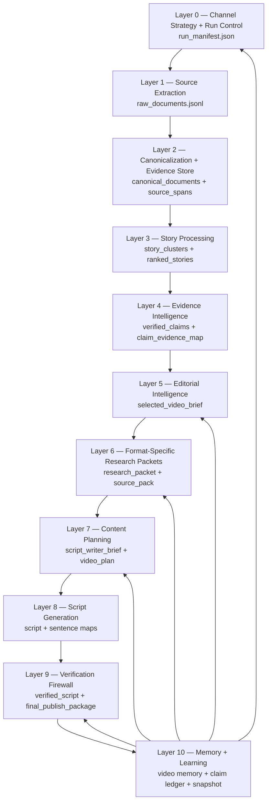

Yes — after reviewing the master design and all Layer 0–10 plans, the **overall architecture is correct and mostly consistent**.

The system is not fundamentally broken. The layers are aligned around the right flow:

```text
Layer 0 — Strategy / Run Control
Layer 1 — Source Extraction
Layer 2 — Canonical Evidence Store
Layer 3 — Story Processing
Layer 4 — Evidence Intelligence
Layer 5 — Editorial Intelligence
Layer 6 — Format-Specific Research Packets
Layer 7 — Content Planning
Layer 8 — Script Generation
Layer 9 — Verification Firewall
Layer 10 — Memory + Learning
```

This matches the master system goal: **shared evidence trunk → story intelligence → editorial router → format-specific branches → verification firewall → script package → memory update**. 

But there are some **important alignment fixes** we should make before implementation.

---

# Final verdict

## Overall status

```text
Architecture correctness: Strong
Layer separation: Strong
Hallucination control: Strong
Format support: Mostly aligned
Handoff contracts: Needs cleanup
Naming consistency: Needs cleanup
Memory integration: Needs cleanup
Implementation readiness: Good after standardization
```

So my answer is:

```text
Yes, the plans fit together.
No, we do not need to redesign the whole system.
Yes, we should make contract-level adjustments before coding.
```

The main issue is not architecture. The issue is **schema consistency**.

---

# 1. What is working correctly

## 1.1 The master architecture and layer plans match

The master design says the system should not be only a script generator. It should be a **YouTube AI Content Operating System** supporting Roundup, Deep Dive, Evergreen, Comparison, and Follow-up formats. 

The individual layer designs support that:

| Layer    | Match status | Notes                                                           |
| -------- | -----------: | --------------------------------------------------------------- |
| Layer 0  |      Matches | Defines run type, eligible formats, quality rules, memory rules |
| Layer 1  |      Matches | Collects raw source material only                               |
| Layer 2  |      Matches | Converts raw content into canonical documents and source spans  |
| Layer 3  |      Matches | Forms story clusters                                            |
| Layer 4  |      Matches | Creates verified claims                                         |
| Layer 5  |      Matches | Routes stories into video formats                               |
| Layer 6  |      Matches | Builds format-specific packets                                  |
| Layer 7  |      Matches | Plans hook, narrative, visuals, title/thumbnail                 |
| Layer 8  |      Matches | Writes script and metadata                                      |
| Layer 9  |      Matches | Verifies script and metadata                                    |
| Layer 10 |      Matches | Stores memory and learning                                      |

The design principle is also consistent: every module should communicate through structured state, not free-form agent conversation. The master design explicitly says the flow should be `source document → source span → atomic claim → story cluster → editorial decision → format packet → script sentence → verification report → memory update`. 

---

## 1.2 The hallucination-control design is correct

Your system has a strong safety chain:

```text
Layer 2 creates source spans.
Layer 4 creates verified claims.
Layer 6 preserves safe/cautious/do-not-use claim boundaries.
Layer 7 plans only from approved evidence.
Layer 8 maps script sentences to claims and sources.
Layer 9 verifies the final script.
Layer 10 stores only verified memory.
```

This is exactly the right structure.

Layer 6 correctly says it should preserve safe/cautious/do-not-use boundaries and should not invent facts or write final script lines. 

Layer 7 correctly says it should plan the video but not write the script or invent unsupported facts. 

Layer 9 correctly verifies factual sentences, claim-source mapping, cautious language, rejected-claim leakage, metadata safety, and source attribution. 

Layer 10 correctly says only Layer 9-approved or clearly labeled records should enter durable memory. 

So the core hallucination-control architecture is solid.

---

# 2. Main mismatches we should fix

These are not fatal, but they should be cleaned before coding.

---

## Issue 1 — Memory file names are inconsistent

Layer 0 currently references memory files like:

```text
memory/published_videos.jsonl
memory/entities.jsonl
memory/claims.jsonl
memory/thesis/channel_thesis.json
```

But Layer 10 produces:

```text
memory/video_memory.jsonl
memory/story_coverage_memory.jsonl
memory/claim_ledger.jsonl
memory/entity_topic_memory.jsonl
memory/source_memory.jsonl
memory/editorial_pattern_memory.jsonl
memory/followups.jsonl
memory/memory_snapshot.json
```

Layer 10’s memory model is better and more complete. 

### Adjustment

Standardize memory names to Layer 10’s naming.

Use this everywhere:

```text
memory/video_memory.jsonl
memory/story_coverage_memory.jsonl
memory/claim_ledger.jsonl
memory/entity_topic_memory.jsonl
memory/source_memory.jsonl
memory/editorial_pattern_memory.jsonl
memory/followups.jsonl
memory/evidence_gap_watchlist.jsonl
memory/rejected_claim_patterns.jsonl
memory/performance_memory.jsonl
memory/learning_signals.jsonl
memory/memory_index.json
memory/memory_snapshot.json
```

Do **not** use:

```text
memory/published_videos.jsonl
memory/entities.jsonl
memory/claims.jsonl
```

unless they are aliases.

Better:

```json
{
  "memory_paths": {
    "video_memory": "memory/video_memory.jsonl",
    "story_coverage_memory": "memory/story_coverage_memory.jsonl",
    "claim_ledger": "memory/claim_ledger.jsonl",
    "entity_topic_memory": "memory/entity_topic_memory.jsonl",
    "followups": "memory/followups.jsonl",
    "memory_snapshot": "memory/memory_snapshot.json"
  }
}
```

---

## Issue 2 — `published_videos` should be replaced with broader `video_memory`

Layer 10 stores both prepared videos and published videos. That is better than only storing published videos because the system also needs to know what was already generated but not yet published.

Layer 10 defines video memory as long-term memory of videos created or prepared, including status and published date if available. 

### Adjustment

Use:

```text
video_memory.jsonl
```

with a `status` field:

```json
{
  "video_id": "video_candidate_20260510_001",
  "status": "prepared_for_human_review",
  "published_video_id": null,
  "published_at": null
}
```

Possible statuses:

```text
draft_generated
verified
prepared_for_human_review
approved_for_publish
published
archived
rejected
```

Then Layer 5 can check all previously prepared/published content, not only published content.

---

## Issue 3 — `sentence_source_map.json` vs `sentence_source_map.jsonl`

Some parts of the master/output contract mention:

```text
sentence_source_map.json
```

But Layer 8 and Layer 9 use:

```text
sentence_source_map.jsonl
sentence_claim_map.jsonl
```

Layer 8’s detailed design is better because sentence-level maps are naturally one row per sentence. Layer 9 also expects `sentence_claim_map.jsonl` and `sentence_source_map.jsonl` as inputs. 

### Adjustment

Standardize as:

```text
sentence_claim_map.jsonl
sentence_source_map.jsonl
```

Optional summary file:

```text
sentence_mapping_summary.json
```

So the final output should be:

```text
script.md
script.txt
generated_script.json
sentence_claim_map.jsonl
sentence_source_map.jsonl
source_pack.json
youtube_description.md
youtube_metadata.json
verification_report.json
final_publish_package.json
layer10_manifest.json
```

---

## Issue 4 — `memory_update.json` should become `layer10_manifest.json`

Layer 0 and the master system mention:

```text
memory_update.json
```

But Layer 10 outputs:

```text
layer10_manifest.json
memory_snapshot.json
memory_index.json
```

Layer 10’s output contract is more complete. 

### Adjustment

Replace this in the master output contract:

```text
memory_update.json
```

with:

```text
layer10_manifest.json
memory_snapshot.json
memory_index.json
```

Or keep a lightweight alias:

```text
memory_update_summary.json
```

Recommended final:

```text
memory_update_summary.json
layer10_manifest.json
memory_snapshot.json
```

---

## Issue 5 — Master Layer 8 diagram does not list all writers

The master diagram’s Layer 8 lists:

```text
Roundup Script Writer
Deep Dive Script Writer
Evergreen Script Writer
Description + Sources Generator
Shorts / Clips Generator
```

But the detailed Layer 8 design includes:

```text
Roundup Script Writer
Deep Dive Script Writer
Evergreen Script Writer
Comparison Script Writer
Follow-up Script Writer
```

The detailed Layer 8 design is more complete and matches the master product definition, which supports five formats.

### Adjustment

Update the master Layer 8 diagram to include all five:

```text
L8A Roundup Script Writer
L8B Deep Dive Script Writer
L8C Evergreen Script Writer
L8D Comparison Script Writer
L8E Follow-up Script Writer
L8F YouTube Metadata Generator
L8G Shorts / Clips Generator
```

---

## Issue 6 — Layer 9 has “Repeated Angle Checker” in master, but not clearly in detailed Layer 9

The master Layer 9 diagram includes:

```text
Repeated Angle Checker
```

But detailed Layer 9 focuses on:

```text
sentence verification
claim support
overclaim detection
cautious language
metadata safety
source attribution
```

Layer 5 and Layer 7 already check novelty and repeated titles/hooks, but Layer 9 should still perform a final metadata repetition check before approval.

### Adjustment

Add a dedicated Layer 9 module:

```text
9.13B — Repetition + Memory Consistency Checker
```

Purpose:

```text
Check if title, thumbnail, hook, and framing are too similar to previous videos.
```

Input:

```text
verified_youtube_metadata.json
title_thumbnail_plan.json
memory/video_memory.jsonl
memory/editorial_pattern_memory.jsonl
memory/memory_snapshot.json
```

Output:

```text
repetition_safety_report.json
```

This module should not block factual correctness, but it can block or warn on channel-quality issues.

---

## Issue 7 — Layer 5 `selected_video_brief` needs stronger support for Roundup

Layer 5’s `selected_video_brief` works very well for Deep Dive because it has:

```text
primary_story_id
supporting_story_ids
selected_format
safe_claim_ids
cautious_claim_ids
do_not_use_claim_ids
```

But for Roundup, we need a clearer structure because Roundup is not one primary story plus supporting stories. It is usually 5–8 selected stories.

Layer 6’s Roundup Packet Builder expects selected story IDs, episode theme, story order, time budgets, and safe claims per story. 

### Adjustment

Update `selected_video_brief.json` with a universal `story_selection` object:

```json
{
  "selection": {
    "selected_format": "roundup",
    "story_selection": {
      "selection_type": "multi_story",
      "primary_story_id": null,
      "selected_story_ids": [
        "story_001",
        "story_002",
        "story_003",
        "story_004",
        "story_005"
      ],
      "supporting_story_ids": [],
      "story_order_strategy": "importance_then_flow"
    }
  }
}
```

For Deep Dive:

```json
{
  "selection": {
    "selected_format": "deep_dive",
    "story_selection": {
      "selection_type": "single_story",
      "primary_story_id": "story_001",
      "selected_story_ids": ["story_001"],
      "supporting_story_ids": []
    }
  }
}
```

This makes Layer 5 → Layer 6 handoff clean for every format.

---

## Issue 8 — `packet_type` naming is inconsistent

Layer 6 sometimes uses:

```text
packet_type: deep_dive
```

and config uses:

```text
deep_dive_packet
roundup_packet
evergreen_packet
comparison_packet
follow_up_packet
```

### Adjustment

Use both fields with clear meaning:

```json
{
  "selected_format": "deep_dive",
  "packet_type": "deep_dive_packet"
}
```

Rules:

```text
selected_format = video format
packet_type = packet schema
```

Examples:

| selected_format | packet_type       |
| --------------- | ----------------- |
| roundup         | roundup_packet    |
| deep_dive       | deep_dive_packet  |
| evergreen       | evergreen_packet  |
| comparison      | comparison_packet |
| follow_up       | follow_up_packet  |

---

## Issue 9 — `retention_plan` vs `pacing_retention_plan`

Layer 7 early section says it creates:

```text
retention_plan.json
```

Later it standardizes around:

```text
pacing_retention_plan.json
```

Layer 7’s folder structure and config use `pacing_retention_plan.json`, which is better. 

### Adjustment

Use only:

```text
pacing_retention_plan.json
```

Do not use:

```text
retention_plan.json
```

---

## Issue 10 — Layer 3 and Layer 4 readiness flags need clearer meaning

Layer 3 output says:

```text
ready_for_layer_4: true
ready_for_layer_5: true
```

But Layer 5 should not really make final editorial decisions until Layer 4 has produced verified claims.

### Adjustment

Layer 3 should say:

```json
{
  "ready_for_layer_4": true,
  "available_for_layer_5_precheck": true
}
```

Layer 4 should say:

```json
{
  "ready_for_layer_5": true,
  "evidence_available_for_layer_6": true
}
```

This prevents accidental bypass of Evidence Intelligence.

---

# 3. Corrected canonical handoff map

This is the cleaned final version we should use.

| From                   | To                    | Canonical handoff files                                                                                                                                            |
| ---------------------- | --------------------- | ------------------------------------------------------------------------------------------------------------------------------------------------------------------ |
| Layer 0 → Layer 1      | Source collection     | `run_manifest.json`                                                                                                                                                |
| Layer 1 → Layer 2      | Raw extraction        | `raw_documents.jsonl`, `raw_payloads/`, `extraction_manifest.json`                                                                                                 |
| Layer 2 → Layer 3      | Evidence-ready docs   | `canonical_documents.jsonl`, `source_spans.jsonl`, `provenance_map.jsonl`, `source_trust_report.json`                                                              |
| Layer 3 → Layer 4      | Stories               | `story_clusters.json`, `ranked_stories.json`, `cluster_membership.jsonl`, `story_timeline.json`                                                                    |
| Layer 4 → Layer 5      | Evidence intelligence | `verified_claims.jsonl`, `rejected_claims.jsonl`, `claim_evidence_map.jsonl`, `story_fact_sheets.json`, `evidence_density_report.json`                             |
| Layer 5 → Layer 6      | Editorial decision    | `selected_video_brief.json`, `format_routing_decisions.json`, `video_opportunity_scores.json`                                                                      |
| Layer 6 → Layer 7      | Research packet       | `research_packet.json`, `source_pack.json`, `claim_section_map.json`, `packet_context_for_layer7.json`, `evidence_boundary_report.json`                            |
| Layer 7 → Layer 8      | Video plan            | `script_writer_brief.json`, `video_plan.json`, `section_plan.json`, `claim_placement_plan.json`, `title_thumbnail_plan.json`, `visual_plan.json`                   |
| Layer 8 → Layer 9      | Generated script      | `script.md`, `generated_script.json`, `section_scripts.json`, `sentence_claim_map.jsonl`, `sentence_source_map.jsonl`, `youtube_metadata.json`, `source_list.json` |
| Layer 9 → Layer 10     | Verified package      | `verified_script.md`, `verification_report.json`, `verified_youtube_metadata.json`, `final_publish_package.json`, `sentence_verification_results.jsonl`            |
| Layer 10 → Future runs | Memory                | `video_memory.jsonl`, `story_coverage_memory.jsonl`, `claim_ledger.jsonl`, `entity_topic_memory.jsonl`, `memory_snapshot.json`                                     |

This should become your official implementation contract.

---

# 4. Corrected final architecture diagram



Add `L10 → L9` because Layer 9 should check repeated angle/title memory in addition to factual verification.

---

# 5. Corrected final output package

Use this final `/video_output/` package:

```text
/video_output/{video_id}/
  script.md
  script.txt
  generated_script.json

  sentence_claim_map.jsonl
  sentence_source_map.jsonl

  source_pack.json
  source_list.json

  youtube_description.md
  youtube_metadata.json
  youtube_chapters.json

  title_options.json
  thumbnail_angles.json
  visual_plan.json

  verification_report.json
  metadata_safety_report.json
  source_attribution_report.json

  final_publish_package.json
  memory_update_summary.json
```

And separately update persistent memory:

```text
/memory/
  video_memory.jsonl
  story_coverage_memory.jsonl
  claim_ledger.jsonl
  entity_topic_memory.jsonl
  source_memory.jsonl
  editorial_pattern_memory.jsonl
  followups.jsonl
  memory_snapshot.json
```

---

# 6. Corrected final schema standards

Use these naming rules everywhere.

## IDs

```text
run_id
raw_document_id
canonical_document_id
span_id
story_id
claim_id
selected_video_id
research_packet_id
video_plan_id
script_id
video_id
```

## Format names

```text
roundup
deep_dive
evergreen
comparison
follow_up
```

## Packet types

```text
roundup_packet
deep_dive_packet
evergreen_packet
comparison_packet
follow_up_packet
```

## Status flags

```text
ready_for_layer_1
ready_for_layer_2
ready_for_layer_3
ready_for_layer_4
ready_for_layer_5
ready_for_layer_6
ready_for_layer_7
ready_for_layer_8
ready_for_layer_9
ready_for_layer_10
ready_for_future_runs
```

## Evidence boundary names

```text
safe_claim_ids
cautious_claim_ids
do_not_use_claim_ids
rejected_claim_ids
evidence_gap_ids
contradiction_ids
```

## Sentence maps

```text
sentence_claim_map.jsonl
sentence_source_map.jsonl
```

---

# 7. What should change in each layer

## Layer 0 changes

Update memory paths and output contract.

Replace:

```text
published_videos.jsonl
entities.jsonl
claims.jsonl
memory_update.json
sentence_source_map.json
```

With:

```text
video_memory.jsonl
entity_topic_memory.jsonl
claim_ledger.jsonl
memory_update_summary.json
sentence_source_map.jsonl
```

Layer 0’s job remains correct: it creates the run manifest, controls formats, quality rules, memory policy, and output contract. 

---

## Layer 1 changes

No major changes.

Layer 1 is good.

Keep it as:

```text
raw acquisition only
no summaries
no claims
no ranking
no script logic
```

---

## Layer 2 changes

No major changes.

Layer 2 is good.

Keep it as:

```text
canonical documents
source spans
provenance
trust tier tagging
content quality
```

---

## Layer 3 changes

Minor change.

Do not mark it as fully ready for Layer 5 final decisions.

Use:

```json
{
  "ready_for_layer_4": true,
  "available_for_layer_5_precheck": true
}
```

Layer 5 should wait for Layer 4.

---

## Layer 4 changes

No major changes.

Layer 4 is good.

It is the main claim verification layer.

---

## Layer 5 changes

Add better multi-story support in `selected_video_brief`.

Layer 5 already correctly receives evidence from Layer 4 and memory from Layer 10, and it is responsible for novelty, evidence safety, format routing, and selected video brief. 

Update `selected_video_brief` with:

```json
{
  "story_selection": {
    "selection_type": "single_story | multi_story",
    "primary_story_id": "string | null",
    "selected_story_ids": [],
    "supporting_story_ids": []
  }
}
```

This makes Roundup and Deep Dive both clean.

---

## Layer 6 changes

Standardize packet naming.

Use:

```json
{
  "selected_format": "deep_dive",
  "packet_type": "deep_dive_packet"
}
```

Layer 6’s role is correct: it converts Layer 5’s editorial decision into a clean production-ready research packet so Layer 7 does not read scattered files. 

---

## Layer 7 changes

Rename:

```text
retention_plan.json
```

to:

```text
pacing_retention_plan.json
```

Layer 7’s role is correct: it creates the blueprint but does not write the final script. 

---

## Layer 8 changes

Standardize sentence maps as JSONL.

Use:

```text
sentence_claim_map.jsonl
sentence_source_map.jsonl
```

Also make sure Layer 8 includes all five writers:

```text
roundup_script_writer.py
deep_dive_script_writer.py
evergreen_script_writer.py
comparison_script_writer.py
followup_script_writer.py
```

---

## Layer 9 changes

Add:

```text
9.13B — Repetition + Memory Consistency Checker
```

Layer 9 already handles factual verification, source mapping, cautious language, rejected-claim leakage, metadata safety, and approval routing. 

Add memory-based checks for:

```text
repeated title angle
repeated hook framing
recently covered story
too-similar thumbnail text
duplicate final takeaway
```

This should use Layer 10 memory.

---

## Layer 10 changes

No architecture change, but make it the official memory naming source.

Layer 10 correctly stores video memory, claim ledger, entity/topic memory, source memory, editorial patterns, follow-ups, evidence gaps, rejected claim patterns, performance memory, learning signals, memory index, and snapshot. 

Make every earlier layer refer to these exact memory files.

---

# 8. Final corrected implementation order

This is the implementation order I recommend now:

```text
1. Standardize schemas and file names first.
2. Implement Layer 0 run_manifest.json.
3. Implement Layer 1 source collectors.
4. Implement Layer 2 canonical documents + source spans.
5. Implement Layer 3 story clustering.
6. Implement Layer 4 atomic claim extraction + verification.
7. Implement Layer 5 selected_video_brief with single-story and multi-story support.
8. Implement Layer 6 deep_dive_packet and roundup_packet first.
9. Implement Layer 7 script_writer_brief.
10. Implement Layer 8 deep_dive and roundup script writers.
11. Implement Layer 8 sentence_claim_map.jsonl and sentence_source_map.jsonl.
12. Implement Layer 9 verification firewall.
13. Implement Layer 10 video_memory + claim_ledger + memory_snapshot.
14. Add evergreen/comparison/follow_up after Roundup + Deep Dive are stable.
15. Add performance memory only after you publish real videos.
```

This also matches the master implementation advice: keep the current Deep Dive pipeline, add source-span chunking, atomic claim extraction, evidence-linked sentence mapping, Roundup branch, Editorial Router, Memory, and Final Verification Firewall before adding Evergreen/Comparison and performance learning. 

---

# 9. Final answer

Your system design is **correct**.

But before implementation, we should adjust these items:

```text
1. Standardize memory file names around Layer 10.
2. Replace published_videos.jsonl with video_memory.jsonl.
3. Use sentence_claim_map.jsonl and sentence_source_map.jsonl everywhere.
4. Replace memory_update.json with memory_update_summary.json or layer10_manifest.json.
5. Add Comparison and Follow-up writers into the master Layer 8 diagram.
6. Add Repetition + Memory Consistency Checker to Layer 9.
7. Update selected_video_brief to support both single-story and multi-story formats.
8. Standardize packet_type naming: deep_dive_packet, roundup_packet, etc.
9. Use pacing_retention_plan.json consistently.
10. Make Layer 5 wait for Layer 4 verified claims before final editorial selection.
```

After these changes, the architecture fits properly.

The final clean system is:

```text
Layer 0 controls the run.
Layer 1 collects raw sources.
Layer 2 creates source spans.
Layer 3 builds story clusters.
Layer 4 verifies claims.
Layer 5 chooses the video opportunity and format.
Layer 6 builds the right research packet.
Layer 7 plans the video.
Layer 8 writes the script.
Layer 9 verifies every factual statement.
Layer 10 stores memory and learning.
```

So we should **not redesign everything**. We should **lock the contracts**, clean the naming, and then start implementing.
