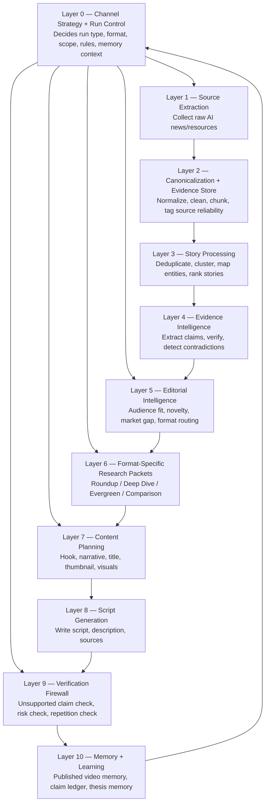
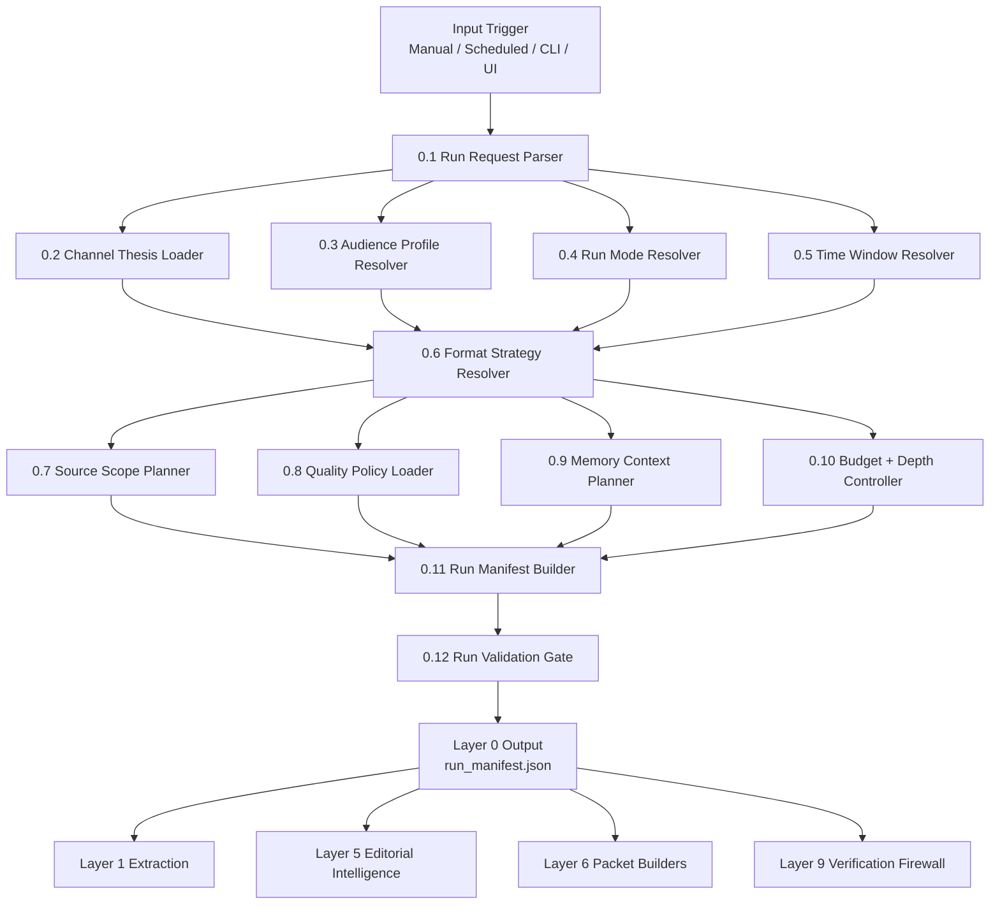

Absolutely — now we will design **Layer 0: Channel Strategy + Run Control** in detail.

Layer 0 is the **brain/control room before the pipeline starts**. It does not collect news, does not summarize, does not write scripts. Its job is to decide:

```text
What kind of run are we doing?
What is the channel trying to create?
What content format is allowed?
What time window should we collect from?
What quality rules must all later layers follow?
What memory should be considered?
What exact instructions should be passed to Layer 1 and later layers?
```

This layer is very important because your earlier architecture already had a scheduled/manual trigger before collection, then source collectors, then cleaning, clustering, scoring, claim extraction, research, verification, and script generation. The earlier design also emphasized that the system should first collect trusted source material and only then ask the LLM to analyze that grounded context. 

---

# Layer 0 — Channel Strategy + Run Control

## 1. Where Layer 0 sits in the full architecture



Layer 0 sends instructions forward to the whole system. Layer 10 sends memory back into Layer 0 so the next run is smarter.

---

# 2. Why Layer 0 is important

Without Layer 0, your pipeline becomes random.

It may collect good news, but it will not know:

```text
Should today’s output be a roundup or deep dive?
Should we collect the last 24 hours or 48 hours?
Should we focus on AI agents, model releases, research papers, or all AI news?
Should we avoid topics already covered?
Should weakly sourced stories be ignored or monitored?
Should the script be beginner-friendly or technical?
Should the final video be 6 minutes, 10 minutes, or 15 minutes?
```

Layer 0 makes the system behave like a **channel operator**, not just a script generator.

---

# 3. Layer 0 purpose

## Main purpose

Layer 0 creates a **Run Manifest**.

The Run Manifest is the official instruction file for the whole pipeline.

Example:

```json
{
  "run_id": "run_2026_05_10_ai_news_48h",
  "run_type": "content_generation",
  "run_mode": "auto",
  "target_format": "auto",
  "eligible_formats": ["roundup", "deep_dive", "follow_up"],
  "collection_window": {
    "start": "2026-05-08T00:00:00Z",
    "end": "2026-05-10T00:00:00Z",
    "lookback_hours": 48
  },
  "channel_thesis_id": "ai_news_channel_v1",
  "audience_profile_id": "technical_but_accessible",
  "source_groups_enabled": [
    "ai_company_blogs",
    "tech_news_apis",
    "research_papers",
    "youtube_podcast_transcripts",
    "community_signals",
    "github_open_source_signals"
  ],
  "quality_policy_id": "evidence_first_v1",
  "memory_policy_id": "standard_memory_check_v1",
  "output_contract_id": "youtube_content_package_v1"
}
```

This file becomes the control document for the complete run.

---

# 4. Layer 0 internal architecture



---

# 5. Layer 0 input and output

## Layer 0 input

Layer 0 receives:

```json
{
  "trigger": {
    "trigger_type": "manual",
    "requested_at": "2026-05-10T10:00:00Z",
    "requested_by": "user"
  },
  "user_request": {
    "target_format": "auto",
    "lookback_hours": 48,
    "topic_focus": "AI news",
    "depth": "standard",
    "max_videos": 1
  },
  "config_paths": {
    "channel_thesis": "config/channel_thesis.yaml",
    "format_config": "config/format_config.yaml",
    "source_strategy": "config/source_strategy.yaml",
    "quality_rules": "config/quality_rules.yaml",
    "memory_policy": "config/memory_policy.yaml"
  },
  "memory_paths": {
    "video_memory": "memory/video_memory.jsonl",
    "entity_topic_memory": "memory/entity_topic_memory.jsonl",
    "claim_ledger": "memory/claim_ledger.jsonl",
    "channel_thesis_memory": "memory/channel_thesis_memory.json"
  }
}
```

## Layer 0 output

Layer 0 produces:

```text
data/runs/{run_id}/run_manifest.json
data/runs/{run_id}/run_config_snapshot.json
data/runs/{run_id}/layer0_validation_report.json
```

Main output:

```json
{
  "run_id": "run_2026_05_10_48h_auto",
  "status": "ready_for_layer_1",
  "run_mode": "auto",
  "target_format": "auto",
  "eligible_formats": ["roundup", "deep_dive", "follow_up"],
  "collection_window": {
    "start": "2026-05-08T00:00:00Z",
    "end": "2026-05-10T00:00:00Z",
    "lookback_hours": 48
  },
  "source_scope": {
    "enabled_source_groups": [
      "ai_company_blogs",
      "tech_news_apis",
      "research_papers",
      "youtube_podcast_transcripts",
      "community_signals",
      "github_open_source_signals"
    ],
    "priority_source_groups": [
      "ai_company_blogs",
      "tech_news_apis",
      "research_papers"
    ]
  },
  "editorial_policy": {
    "audience": "technical_but_accessible",
    "tone": "clear_analytical_evidence_first",
    "avoid": [
      "unsupported rumors",
      "fake certainty",
      "overhyped claims"
    ]
  },
  "quality_policy": {
    "minimum_primary_sources_for_deep_dive": 1,
    "minimum_verified_claims_for_script": 5,
    "allow_community_sources_as_truth": false,
    "require_sentence_source_mapping": true
  },
  "memory_policy": {
    "check_published_video_similarity": true,
    "check_recent_story_overlap_days": 30,
    "update_memory_after_verification": true
  },
  "output_contract": {
    "required_outputs": [
      "script.md",
      "sentence_source_map.jsonl",
      "source_pack.json",
      "youtube_description.md",
      "title_options.json",
      "verification_report.json",
      "layer10_manifest.json"
    ]
  }
}
```

---

# 6. Layer 0 module-by-module implementation design

## Module 0.1 — Run Request Parser

### Purpose

Convert the user/scheduler request into a clean structured run request.

### Why this module matters

The same system can be started in different ways:

```text
Manual run: “Create AI roundup for last 48 hours”
Scheduled run: “Every 2 days, generate AI news”
Research run: “Only collect and analyze, don’t write script”
Deep dive run: “Focus on one major story”
```

This module standardizes all of them.

### Questions it answers

```text
Who triggered the run?
Is this a scheduled run or manual run?
What format did the user request?
What time window should the system use?
Are we generating a video or only collecting/analyzing?
```

### Input

```json
{
  "trigger_type": "manual",
  "requested_at": "2026-05-10T10:00:00Z",
  "request_text": "Create AI news video for last 2 days",
  "params": {
    "target_format": "auto",
    "lookback_hours": 48,
    "max_videos": 1
  }
}
```

### Logic

```text
1. Read trigger type.
2. Parse requested format.
3. Apply defaults if user did not specify something.
4. Validate lookback window.
5. Create run_id.
6. Produce normalized RunRequest.
```

### Output

```json
{
  "run_request_id": "req_2026_05_10_100000",
  "trigger_type": "manual",
  "run_mode": "auto",
  "target_format": "auto",
  "lookback_hours": 48,
  "topic_focus": "AI news",
  "max_videos": 1,
  "requested_at": "2026-05-10T10:00:00Z"
}
```

---

## Module 0.2 — Channel Thesis Loader

### Purpose

Load the channel’s identity, promise, tone, and content boundaries.

### Why this module matters

This is what prevents your channel from sounding different every day.

A good AI channel needs a consistent thesis:

```text
Evidence-first AI news and explainers.
Practical, not hype-based.
Clear enough for normal viewers, but useful for technical people.
Always separate fact, analysis, and opinion.
```

### Questions it answers

```text
What is this channel about?
Who are we creating for?
What type of AI content do we want?
What topics should we avoid?
What tone should every script follow?
```

### Config file

`config/channel_thesis.yaml`

```yaml
channel:
  channel_id: ai_news_channel_v1
  channel_name: AI Signal Brief
  content_promise: >
    Explain the most important AI news with evidence, context,
    practical impact, and low hype.

audience:
  primary: technical_but_accessible
  secondary:
    - software_developers
    - AI_power_users
    - tech_professionals
    - startup_founders

tone:
  style: clear_analytical
  energy: medium_high
  attitude: skeptical_but_constructive
  avoid:
    - panic
    - fake certainty
    - unsupported hype
    - personal attacks

content_boundaries:
  include:
    - AI model releases
    - AI agents
    - AI coding tools
    - AI research
    - open-source AI
    - AI infrastructure
    - AI regulation
    - AI business impact
  exclude:
    - pure crypto unless AI-related
    - random AI tools with no traction
    - rumors without source support
    - celebrity AI gossip
```

### Input

```json
{
  "channel_thesis_path": "config/channel_thesis.yaml"
}
```

### Logic

```text
1. Load YAML file.
2. Validate required sections.
3. Assign thesis version.
4. Convert into machine-readable editorial policy.
```

### Output

```json
{
  "channel_thesis_id": "ai_news_channel_v1",
  "audience": "technical_but_accessible",
  "content_promise": "Explain important AI news with evidence, context, practical impact, and low hype.",
  "tone": {
    "style": "clear_analytical",
    "energy": "medium_high",
    "attitude": "skeptical_but_constructive"
  },
  "allowed_topics": [
    "AI model releases",
    "AI agents",
    "AI coding tools",
    "AI research",
    "open-source AI",
    "AI infrastructure",
    "AI regulation"
  ],
  "excluded_topics": [
    "unsupported rumors",
    "celebrity AI gossip",
    "random AI tools with no traction"
  ]
}
```

---

## Module 0.3 — Audience Profile Resolver

### Purpose

Choose the audience profile for this run.

### Why this module matters

The same AI story can be written differently for different audiences.

Example:

```text
Developer audience:
“What changes in coding workflow?”

General audience:
“What does this mean for regular AI users?”

Founder audience:
“What business opportunity does this create?”

Investor audience:
“What market signal does this create?”
```

### Questions it answers

```text
Who is the primary viewer for this video?
How technical should the explanation be?
Should the script include code-level details, business impact, or simple examples?
```

### Config file

`config/audience_profiles.yaml`

```yaml
profiles:
  technical_but_accessible:
    explanation_depth: medium
    jargon_allowed: limited
    preferred_examples:
      - developer workflow
      - productivity
      - real-world usage
    avoid:
      - unexplained technical acronyms
      - overly academic explanation

  beginner_general:
    explanation_depth: simple
    jargon_allowed: none
    preferred_examples:
      - daily life
      - apps
      - workplace impact

  developer_deep:
    explanation_depth: high
    jargon_allowed: moderate
    preferred_examples:
      - APIs
      - code editors
      - infrastructure
      - benchmarks
```

### Input

```json
{
  "default_audience": "technical_but_accessible",
  "requested_audience": null
}
```

### Logic

```text
1. If user requested audience, use that.
2. Else use channel default.
3. Load audience profile.
4. Produce audience rules for later script planning.
```

### Output

```json
{
  "audience_profile_id": "technical_but_accessible",
  "explanation_depth": "medium",
  "jargon_allowed": "limited",
  "preferred_examples": [
    "developer workflow",
    "productivity",
    "real-world usage"
  ],
  "script_guidance": {
    "define_terms": true,
    "use_analogies": true,
    "include_business_impact": true,
    "include_code_level_detail": false
  }
}
```

---

## Module 0.4 — Run Mode Resolver

### Purpose

Decide what kind of run this is.

### Why this module matters

Not every run should create a full script.

Sometimes you only want:

```text
Collect news
Analyze stories
Generate a roundup
Generate a deep dive
Create only research packets
Verify an existing script
```

### Supported run modes

```text
collect_only
analyze_only
generate_roundup
generate_deep_dive
generate_evergreen
generate_comparison
auto
verification_only
```

### Questions it answers

```text
Are we collecting only?
Are we generating content?
Are we letting the system decide the format?
Are we refreshing memory?
```

### Input

```json
{
  "target_format": "auto",
  "user_requested_mode": null,
  "max_videos": 1
}
```

### Logic

```text
1. If user explicitly requested a format, use that.
2. If user says auto, allow multiple eligible formats.
3. If no format given, default to roundup for frequent runs.
4. If lookback window is large, allow evergreen/deep dive.
5. If only one major story is found later, auto can become deep dive.
6. If several medium stories are found later, auto can become roundup.
```

### Output

```json
{
  "run_mode": "auto",
  "target_format": "auto",
  "eligible_formats": [
    "roundup",
    "deep_dive",
    "follow_up"
  ],
  "max_videos": 1,
  "format_decision_stage": "Layer_5_editorial_router"
}
```

Important: Layer 0 does **not always make the final format decision**. It decides what formats are allowed. Layer 5 decides the best format after seeing the ranked stories.

---

## Module 0.5 — Time Window Resolver

### Purpose

Decide the collection time window.

### Why this module matters

For AI news, timing is very important. If you publish every 2 days, your system should collect the last 48 hours. If you publish weekly, it should collect 7 days. If you are making a deep dive, it may need older background memory too.

### Questions it answers

```text
What time range should Layer 1 collect from?
Should we collect 24h, 48h, 7d, or custom?
Should research papers use a longer lookback than news?
Should memory use a separate historical window?
```

### Recommended defaults

```text
Daily roundup: last 24 hours
Every-2-days roundup: last 48 hours
Weekly roundup: last 7 days
Deep dive: last 7 days + memory lookback 90 days
Evergreen: last 30 days + memory lookback 12 months
Comparison: last 30–90 days depending on topic
```

### Input

```json
{
  "requested_at": "2026-05-10T10:00:00Z",
  "lookback_hours": 48,
  "target_format": "auto"
}
```

### Logic

```text
1. Determine primary collection window.
2. Determine source-specific windows.
3. Determine memory lookback window.
4. Add timezone-safe timestamps.
```

### Output

```json
{
  "collection_window": {
    "start": "2026-05-08T10:00:00Z",
    "end": "2026-05-10T10:00:00Z",
    "lookback_hours": 48
  },
  "source_specific_windows": {
    "ai_company_blogs": {
      "lookback_hours": 48
    },
    "tech_news_apis": {
      "lookback_hours": 48
    },
    "research_papers": {
      "lookback_days": 7
    },
    "youtube_podcast_transcripts": {
      "lookback_days": 7
    },
    "community_signals": {
      "lookback_hours": 72
    },
    "github_open_source_signals": {
      "lookback_days": 7
    }
  },
  "memory_windows": {
    "published_video_similarity_days": 60,
    "entity_context_days": 180,
    "claim_history_days": 365
  }
}
```

---

## Module 0.6 — Format Strategy Resolver

### Purpose

Define format rules before the pipeline starts.

### Why this module matters

Roundup, deep dive, evergreen, comparison, and follow-up videos need different evidence, structure, pacing, and output.

### Questions it answers

```text
What formats are allowed in this run?
What are the requirements for each format?
What makes a story eligible for deep dive vs roundup?
How long should the output be?
```

### Config file

`config/format_config.yaml`

```yaml
formats:
  roundup:
    target_duration_minutes: 8
    min_stories: 5
    max_stories: 8
    min_verified_claims_per_story: 2
    evidence_requirement: medium
    pacing: fast
    structure:
      - intro
      - story_segments
      - final_takeaway

  deep_dive:
    target_duration_minutes: 10
    min_stories: 1
    max_stories: 1
    min_verified_claims: 8
    requires_primary_source: true
    evidence_requirement: high
    pacing: medium
    structure:
      - hook
      - what_happened
      - why_it_matters
      - background
      - implications
      - limitations
      - takeaway

  evergreen:
    target_duration_minutes: 12
    requires_memory_context: true
    evidence_requirement: high
    recency_requirement: medium
    structure:
      - problem
      - concept_explanation
      - timeline
      - examples
      - practical_takeaway

  comparison:
    target_duration_minutes: 12
    min_subjects: 2
    max_subjects: 4
    requires_evidence_matrix: true
    evidence_requirement: high
```

### Input

```json
{
  "run_mode": "auto",
  "target_format": "auto",
  "channel_thesis": {
    "audience": "technical_but_accessible"
  }
}
```

### Logic

```text
1. Load all format rules.
2. Filter formats based on run mode.
3. Attach requirements for each eligible format.
4. Pass format eligibility rules to Layer 5.
```

### Output

```json
{
  "eligible_formats": [
    {
      "format": "roundup",
      "target_duration_minutes": 8,
      "min_stories": 5,
      "max_stories": 8,
      "min_verified_claims_per_story": 2,
      "evidence_requirement": "medium"
    },
    {
      "format": "deep_dive",
      "target_duration_minutes": 10,
      "min_stories": 1,
      "max_stories": 1,
      "min_verified_claims": 8,
      "requires_primary_source": true,
      "evidence_requirement": "high"
    },
    {
      "format": "follow_up",
      "requires_previous_video": true,
      "evidence_requirement": "medium_high"
    }
  ]
}
```

---

## Module 0.7 — Source Scope Planner

### Purpose

Tell Layer 1 which source groups to collect from.

### Why this module matters

Not every run needs every source equally.

Example:

```text
Roundup:
Needs broad news APIs + company blogs + community signals.

Deep dive:
Needs official sources + independent articles + research + transcripts.

Evergreen:
Needs memory + research + historical sources more than breaking news.

Comparison:
Needs product docs + benchmarks + official claims + user/community signals.
```

### Questions it answers

```text
Which source groups are enabled?
Which are priority?
Which are optional?
Should any source group be skipped?
What query themes should be passed to source collectors?
```

### Input

```json
{
  "target_format": "auto",
  "topic_focus": "AI news",
  "collection_window": {
    "lookback_hours": 48
  }
}
```

### Logic

```text
1. Load source strategy config.
2. Match source groups to eligible formats.
3. Apply topic focus.
4. Create source collection plan for Layer 1.
```

### Output

```json
{
  "source_collection_plan": {
    "enabled_source_groups": [
      "ai_company_blogs",
      "tech_news_apis",
      "research_papers",
      "youtube_podcast_transcripts",
      "community_signals",
      "github_open_source_signals"
    ],
    "priority_order": [
      "ai_company_blogs",
      "tech_news_apis",
      "research_papers",
      "github_open_source_signals",
      "community_signals",
      "youtube_podcast_transcripts"
    ],
    "query_themes": [
      "AI agents",
      "LLM releases",
      "AI coding tools",
      "open-source AI",
      "AI regulation",
      "AI chips",
      "AI research"
    ],
    "minimum_expected_documents": 30,
    "maximum_expected_documents": 500
  }
}
```

---

## Module 0.8 — Quality Policy Loader

### Purpose

Load rules that prevent weak, unsupported, or hallucinated output.

### Why this module matters

This is where hallucination control starts.

Layer 0 should define the rules. Later layers enforce them.

### Questions it answers

```text
Can community sources be used as proof?
How many sources are needed for a deep dive?
Can the script include claims without source IDs?
Should every factual sentence map to evidence?
When should the system say “not enough evidence”?
```

### Config file

`config/quality_rules.yaml`

```yaml
quality_policy:
  policy_id: evidence_first_v1

  source_rules:
    allow_community_sources_as_primary_truth: false
    require_primary_source_for_deep_dive: true
    require_independent_source_for_major_claim: true

  claim_rules:
    every_claim_requires_source_span: true
    unsupported_claim_action: remove_or_flag
    weak_claim_language:
      - "appears to"
      - "reportedly"
      - "according to"
      - "not independently verified"

  script_rules:
    require_sentence_source_mapping: true
    allow_unsourced_opinion: true
    allow_unsourced_fact: false

  risk_rules:
    block_unsupported_accusations: true
    flag_words:
      - scam
      - fraud
      - fake
      - illegal
      - lying
      - unsafe
```

### Input

```json
{
  "quality_policy_path": "config/quality_rules.yaml",
  "eligible_formats": ["roundup", "deep_dive"]
}
```

### Logic

```text
1. Load quality rules.
2. Apply stricter rules for deep dive/comparison.
3. Apply moderate rules for roundup.
4. Pass policy to Layer 4, Layer 8, and Layer 9.
```

### Output

```json
{
  "quality_policy_id": "evidence_first_v1",
  "source_rules": {
    "allow_community_sources_as_primary_truth": false,
    "require_primary_source_for_deep_dive": true,
    "require_independent_source_for_major_claim": true
  },
  "claim_rules": {
    "every_claim_requires_source_span": true,
    "unsupported_claim_action": "remove_or_flag"
  },
  "script_rules": {
    "require_sentence_source_mapping": true,
    "allow_unsourced_fact": false,
    "allow_unsourced_opinion": true
  },
  "risk_rules": {
    "block_unsupported_accusations": true
  }
}
```

---

## Module 0.9 — Memory Context Planner

### Purpose

Decide what memory should be loaded for this run.

### Why this module matters

Your system should remember:

```text
What videos we already created
What topics we recently covered
What claims we already used
What entities are recurring
What follow-ups are pending
What thesis the channel follows
```

But you do not want to pass all memory everywhere. Too much memory can confuse the model and cause repeated framing.

### Questions it answers

```text
Should we check previous videos before topic selection?
Should we check previous videos again after script writing?
Which entities need historical context?
Should this run use thesis memory?
Should we update memory after the run?
```

### Input

```json
{
  "run_mode": "auto",
  "target_format": "auto",
  "topic_focus": "AI news",
  "memory_paths": {
    "video_memory": "memory/video_memory.jsonl",
    "claim_ledger": "memory/claim_ledger.jsonl",
    "entity_topic_memory": "memory/entity_topic_memory.jsonl",
    "followups": "memory/followups.jsonl"
  }
}
```

### Logic

```text
1. Always load thesis memory.
2. Load published video memory for novelty checks.
3. Load entity memory only for entities found later in Layer 3.
4. Load claim ledger for verification and repetition checks.
5. Do not pass previous full scripts into early script writer.
6. Use previous video memory mainly in Layer 5 and Layer 9.
```

### Output

```json
{
  "memory_policy": {
    "load_thesis_memory": true,
    "load_published_video_memory": true,
    "load_claim_ledger": true,
    "load_entity_memory_on_demand": true,
    "load_full_previous_scripts": false,
    "check_similarity_before_selection": true,
    "check_similarity_after_script": true,
    "update_memory_after_verification": true
  },
  "memory_windows": {
    "published_video_similarity_days": 60,
    "claim_history_days": 365,
    "entity_context_days": 180,
    "followup_window_days": 90
  }
}
```

---

## Module 0.10 — Budget + Depth Controller

### Purpose

Control how deep each run should go.

This does not mean cloud cost only. It means:

```text
How many stories should be processed?
How many sources per story?
How many claims per story?
How much research expansion?
How many title options?
How many script drafts?
```

### Why this module matters

Without depth control, your system will over-process everything.

A small roundup mention does not need the same research depth as a 12-minute deep dive.

### Questions it answers

```text
How much analysis is enough for this run?
How many stories should pass to Layer 4?
How many claims should be extracted?
How many sources should be required?
How many script drafts should be created?
```

### Input

```json
{
  "target_format": "auto",
  "depth": "standard",
  "max_videos": 1
}
```

### Logic

```text
1. Load default depth profile.
2. Adjust based on format.
3. Adjust based on max videos.
4. Set limits for later layers.
```

### Output

```json
{
  "depth_profile": "standard",
  "limits": {
    "max_raw_documents_to_process": 500,
    "max_story_clusters": 50,
    "max_ranked_stories_to_analyze": 15,
    "max_stories_for_roundup": 8,
    "max_deep_dive_candidates": 3,
    "max_claims_per_story": 20,
    "max_script_drafts": 1,
    "max_title_options": 10
  }
}
```

---

## Module 0.11 — Output Contract Builder

### Purpose

Define exactly what the final run must produce.

### Why this module matters

If you do not define the output contract early, each layer may produce inconsistent files.

### Questions it answers

```text
What files should this run create?
What schema should each file follow?
Where should outputs be stored?
Which outputs are required vs optional?
```

### Input

```json
{
  "run_id": "run_2026_05_10_48h_auto",
  "eligible_formats": ["roundup", "deep_dive"],
  "output_base_path": "output/"
}
```

### Logic

```text
1. Build run-specific folder paths.
2. Define required outputs.
3. Define optional outputs by format.
4. Pass output paths to all layers.
```

### Output

```json
{
  "output_contract": {
    "base_path": "output/run_2026_05_10_48h_auto/",
    "required_layer_outputs": {
      "layer_1": "data/runs/run_2026_05_10_48h_auto/layer_1_raw_documents.jsonl",
      "layer_2": "data/runs/run_2026_05_10_48h_auto/layer_2_canonical_documents.jsonl",
      "layer_3": "data/runs/run_2026_05_10_48h_auto/layer_3_ranked_stories.json",
      "layer_4": "data/runs/run_2026_05_10_48h_auto/layer_4_atomic_claims.jsonl",
      "layer_5": "data/runs/run_2026_05_10_48h_auto/layer_5_editorial_decision.json",
      "layer_6": "data/runs/run_2026_05_10_48h_auto/layer_6_research_packet.json",
      "layer_7": "data/runs/run_2026_05_10_48h_auto/layer_7_video_plan.json",
      "layer_8": "output/run_2026_05_10_48h_auto/script.md",
      "layer_9": "output/run_2026_05_10_48h_auto/verification_report.json"
    },
    "final_package": [
      "script.md",
      "youtube_description.md",
      "title_options.json",
      "thumbnail_angles.json",
      "source_pack.json",
      "sentence_source_map.jsonl",
      "verification_report.json",
      "layer10_manifest.json"
    ]
  }
}
```

---

## Module 0.12 — Run Manifest Builder

### Purpose

Combine outputs from all Layer 0 modules into one official manifest.

### Why this module matters

Downstream layers should not separately read random config files. They should read one `run_manifest.json`.

### Input

```json
{
  "run_request": {},
  "channel_thesis": {},
  "audience_profile": {},
  "format_strategy": {},
  "time_window": {},
  "source_collection_plan": {},
  "quality_policy": {},
  "memory_policy": {},
  "depth_limits": {},
  "output_contract": {}
}
```

### Logic

```text
1. Merge all module outputs.
2. Attach config versions.
3. Attach timestamps.
4. Attach validation status.
5. Write run_manifest.json.
```

### Output

```json
{
  "run_id": "run_2026_05_10_48h_auto",
  "created_at": "2026-05-10T10:00:00Z",
  "status": "pending_validation",
  "run_request": {},
  "channel_strategy": {},
  "audience_strategy": {},
  "format_strategy": {},
  "collection_strategy": {},
  "source_strategy": {},
  "quality_policy": {},
  "memory_policy": {},
  "depth_limits": {},
  "output_contract": {}
}
```

---

## Module 0.13 — Run Validation Gate

### Purpose

Validate that the run is safe and complete before starting Layer 1.

### Why this module matters

This prevents bad runs.

Example failures:

```text
No source groups enabled
No collection window
No output path
No quality policy
Invalid format
Missing channel thesis
Deep dive requested but no primary-source rule configured
```

### Questions it answers

```text
Is the run manifest valid?
Can Layer 1 start?
Are required configs present?
Are there contradictions in the config?
```

### Input

```json
{
  "run_manifest_path": "data/runs/run_2026_05_10_48h_auto/run_manifest.json"
}
```

### Logic

```text
1. Check required fields.
2. Check valid formats.
3. Check source groups.
4. Check time windows.
5. Check quality rules.
6. Check memory paths.
7. Produce pass/fail validation report.
```

### Output

```json
{
  "validation_status": "passed",
  "can_start_layer_1": true,
  "warnings": [
    {
      "type": "memory_optional",
      "message": "Performance memory not available yet. This is okay for early system version."
    }
  ],
  "errors": []
}
```

---

# 7. Layer 0 final input/output contract

## Layer 0 input contract

```json
{
  "trigger": {
    "trigger_type": "manual | scheduled | api",
    "requested_at": "ISO_TIMESTAMP",
    "request_text": "string"
  },
  "user_params": {
    "target_format": "auto | roundup | deep_dive | evergreen | comparison | follow_up",
    "lookback_hours": "number | null",
    "topic_focus": "string | null",
    "depth": "light | standard | deep",
    "max_videos": "number"
  },
  "config_paths": {
    "channel_thesis": "string",
    "audience_profiles": "string",
    "format_config": "string",
    "source_strategy": "string",
    "quality_rules": "string",
    "memory_policy": "string"
  }
}
```

## Layer 0 output contract

```json
{
  "run_id": "string",
  "status": "ready_for_layer_1 | failed_validation",
  "run_mode": "string",
  "eligible_formats": [],
  "collection_window": {},
  "source_collection_plan": {},
  "channel_strategy": {},
  "audience_strategy": {},
  "format_strategy": {},
  "quality_policy": {},
  "memory_policy": {},
  "depth_limits": {},
  "output_contract": {},
  "validation_report": {}
}
```

---

# 8. Recommended config files for Layer 0

Your Layer 0 should mainly be config-driven.

```text
config/
  channel_thesis.yaml
  audience_profiles.yaml
  format_config.yaml
  source_strategy.yaml
  quality_rules.yaml
  memory_policy.yaml
  run_defaults.yaml
```

## `run_defaults.yaml`

```yaml
defaults:
  timezone: "Asia/Kolkata"
  target_format: "auto"
  lookback_hours: 48
  depth: "standard"
  max_videos: 1

scheduled_runs:
  ai_news_roundup:
    frequency: "every_48_hours"
    target_format: "roundup"
    lookback_hours: 48

  weekly_deep_dive:
    frequency: "weekly"
    target_format: "deep_dive"
    lookback_days: 7

  evergreen_research:
    frequency: "biweekly"
    target_format: "evergreen"
    lookback_days: 30
    memory_lookback_days: 365
```

---

# 9. Suggested Layer 0 folder structure

```text
pipelines/
  layer_0_control/
    __init__.py
    run_request_parser.py
    channel_thesis_loader.py
    audience_profile_resolver.py
    run_mode_resolver.py
    time_window_resolver.py
    format_strategy_resolver.py
    source_scope_planner.py
    quality_policy_loader.py
    memory_context_planner.py
    budget_depth_controller.py
    output_contract_builder.py
    run_manifest_builder.py
    run_validation_gate.py
    run_layer_0.py

config/
  channel_thesis.yaml
  audience_profiles.yaml
  format_config.yaml
  source_strategy.yaml
  quality_rules.yaml
  memory_policy.yaml
  run_defaults.yaml

data/
  runs/
    run_2026_05_10_48h_auto/
      run_manifest.json
      run_config_snapshot.json
      layer0_validation_report.json
```

---

# 10. Layer 0 execution flow

```text
Step 1:
Receive trigger.

Step 2:
Parse run request.

Step 3:
Load channel thesis.

Step 4:
Resolve audience profile.

Step 5:
Resolve run mode and eligible formats.

Step 6:
Resolve collection and memory time windows.

Step 7:
Build source collection plan.

Step 8:
Load quality and hallucination-control policy.

Step 9:
Plan memory usage.

Step 10:
Apply depth/budget limits.

Step 11:
Build output contract.

Step 12:
Build run manifest.

Step 13:
Validate manifest.

Step 14:
Pass run_manifest.json to Layer 1.
```

---

# 11. Example final `run_manifest.json`

```json
{
  "run_id": "run_2026_05_10_48h_auto",
  "created_at": "2026-05-10T10:00:00Z",
  "status": "ready_for_layer_1",

  "run_request": {
    "trigger_type": "manual",
    "run_mode": "auto",
    "target_format": "auto",
    "lookback_hours": 48,
    "topic_focus": "AI news",
    "max_videos": 1
  },

  "channel_strategy": {
    "channel_thesis_id": "ai_news_channel_v1",
    "content_promise": "Explain important AI news with evidence, context, practical impact, and low hype.",
    "tone": "clear_analytical",
    "audience": "technical_but_accessible"
  },

  "format_strategy": {
    "eligible_formats": ["roundup", "deep_dive", "follow_up"],
    "format_decision_stage": "layer_5_editorial_router",
    "roundup": {
      "target_duration_minutes": 8,
      "min_stories": 5,
      "max_stories": 8
    },
    "deep_dive": {
      "target_duration_minutes": 10,
      "requires_primary_source": true,
      "min_verified_claims": 8
    }
  },

  "collection_strategy": {
    "collection_window": {
      "start": "2026-05-08T10:00:00Z",
      "end": "2026-05-10T10:00:00Z",
      "lookback_hours": 48
    },
    "enabled_source_groups": [
      "ai_company_blogs",
      "tech_news_apis",
      "research_papers",
      "youtube_podcast_transcripts",
      "community_signals",
      "github_open_source_signals"
    ],
    "query_themes": [
      "AI agents",
      "LLM releases",
      "AI coding tools",
      "open-source AI",
      "AI regulation",
      "AI chips",
      "AI research"
    ]
  },

  "quality_policy": {
    "policy_id": "evidence_first_v1",
    "allow_community_sources_as_primary_truth": false,
    "require_primary_source_for_deep_dive": true,
    "require_independent_source_for_major_claim": true,
    "every_claim_requires_source_span": true,
    "require_sentence_source_mapping": true,
    "allow_unsourced_fact": false,
    "allow_unsourced_opinion": true
  },

  "memory_policy": {
    "load_thesis_memory": true,
    "load_published_video_memory": true,
    "load_claim_ledger": true,
    "load_entity_memory_on_demand": true,
    "load_full_previous_scripts": false,
    "check_similarity_before_selection": true,
    "check_similarity_after_script": true,
    "update_memory_after_verification": true
  },

  "depth_limits": {
    "max_raw_documents_to_process": 500,
    "max_story_clusters": 50,
    "max_ranked_stories_to_analyze": 15,
    "max_stories_for_roundup": 8,
    "max_deep_dive_candidates": 3,
    "max_claims_per_story": 20,
    "max_script_drafts": 1
  },

  "output_contract": {
    "required_outputs": [
      "script.md",
      "sentence_source_map.jsonl",
      "source_pack.json",
      "youtube_description.md",
      "title_options.json",
      "thumbnail_angles.json",
      "verification_report.json",
      "layer10_manifest.json"
    ]
  },

  "validation_report": {
    "validation_status": "passed",
    "can_start_layer_1": true,
    "warnings": [],
    "errors": []
  }
}
```

---

# 12. How Layer 0 affects each downstream layer

| Downstream layer                 | What Layer 0 provides                                            |
| -------------------------------- | ---------------------------------------------------------------- |
| Layer 1 — Extraction             | source groups, time window, query themes, collection limits      |
| Layer 2 — Canonicalization       | quality policy, source trust expectations, output paths          |
| Layer 3 — Story Processing       | scoring priorities, topic scope, max clusters                    |
| Layer 4 — Evidence Intelligence  | claim rules, required source spans, evidence requirements        |
| Layer 5 — Editorial Intelligence | audience profile, eligible formats, memory policy, novelty rules |
| Layer 6 — Packet Builders        | selected format rules, target duration, evidence requirements    |
| Layer 7 — Content Planning       | tone, audience, title/thumbnail rules, narrative style           |
| Layer 8 — Script Generation      | script constraints, allowed opinion/fact rules, output format    |
| Layer 9 — Verification Firewall  | unsupported claim rules, risk rules, source mapping requirements |
| Layer 10 — Memory                | what to update after verification                                |

---

# 13. Most important design decisions for Layer 0

## Decision 1: Layer 0 should not select the final story

Layer 0 should not say:

```text
Make video about OpenAI today.
```

It should say:

```text
Collect last 48 hours of AI news.
Allow roundup, deep dive, or follow-up.
Use evidence-first quality rules.
Let Layer 5 decide the best video after story ranking.
```

## Decision 2: Layer 0 should create one manifest

Do not let every layer read random config files separately.

Correct design:

```text
Layer 0 reads config files
Layer 0 creates run_manifest.json
All other layers read run_manifest.json
```

## Decision 3: Layer 0 should control hallucination rules early

Hallucination control should not start only after script generation.

Layer 0 should already declare:

```text
Every claim needs source span.
Community sources cannot be primary truth.
Sentence-source mapping is required.
Unsupported factual claims must be removed or flagged.
```

## Decision 4: Layer 0 should separate collection window and memory window

Example:

```text
Collect news from last 48 hours.
But check previous videos from last 60 days.
Check entity memory from last 180 days.
Check claim ledger from last 365 days.
```

This is very important for avoiding repeated videos.

---

# 14. Final summary of Layer 0

Layer 0 is the **control layer**.

It produces:

```text
run_manifest.json
```

That manifest tells the whole system:

```text
What we are trying to create
Who we are creating for
What formats are allowed
What time window to collect
What sources to use
What quality rules to enforce
What memory to check
What outputs to produce
What limits to follow
```

So Layer 0 is not just a scheduler. It is the **channel strategy engine** for your AI YouTube system.
