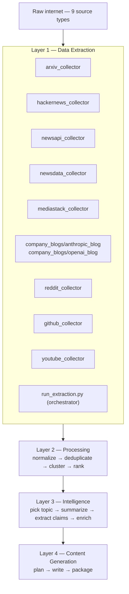
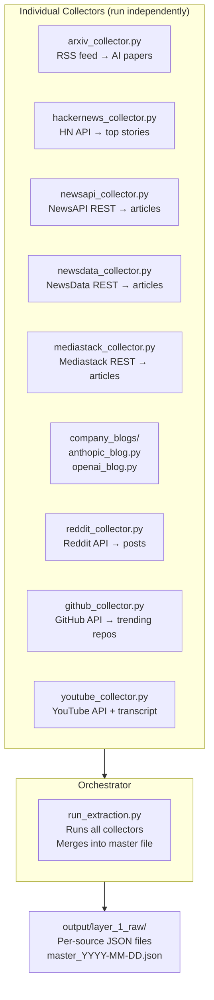

# Layer 1 — Data Extraction

## Layer purpose

Layer 1 is the **raw collection layer**.

Its job is to pull AI news data from 9 different source types and save structured JSON to disk. Nothing else.

It should answer:

```text
What raw data exists today?
Which sources were successfully collected?
What articles, papers, repos, and transcripts are available?
```

It should NOT answer:

```text
Which story is most important?
Is this news significant or noise?
What should the YouTube video be about?
```

Those decisions happen in later layers. Layer 1 only collects and stores.

---

## Where Layer 1 sits in the full architecture



---

## Layer 1 internal architecture



---

## Important rules for Layer 1

```text
1. Every collector saves raw JSON — no summarization, no filtering, no ranking.
2. Every collector is independently runnable via if __name__ == "__main__".
3. Each collector has one job — fetch from one source.
4. The orchestrator (run_extraction.py) merges all outputs into one master file.
5. master_YYYY-MM-DD.json is the ONLY file Layer 2 reads.
```

Source trust tiers (assigned during collection, used by Layer 2):

```text
Tier 1   — Official company blogs (Anthropic, OpenAI) — highest credibility
Tier 1.5 — Research papers (ArXiv) — peer-reviewed
Tier 2   — Established media (NewsAPI, Mediastack, Newsdata) — credible
Tier 3   — Community signals (Reddit, GitHub, HackerNews) — engagement signal
```

---

## Layer 1 input

```text
Environment variables (.env):
  OPENAI_API_KEY_S_M_R
  GOOGLE_API_KEY
  NEWSAPI_KEY
  NEWSDATA_KEY
  MEDIASTACK_KEY
  REDDIT_CLIENT_ID
  REDDIT_CLIENT_SECRET
  GITHUB_TOKEN
  YOUTUBE_API_KEY
```

No structured input file — each collector reads its own config and API keys.

---

## Layer 1 output

```json
{
  "output/layer_1_raw/arxiv/2026-05-08_cs_ai.json":           "[ ...papers ]",
  "output/layer_1_raw/hackernews/2026-05-08_top.json":        "[ ...stories ]",
  "output/layer_1_raw/newsapi/2026-05-08_ai.json":            "[ ...articles ]",
  "output/layer_1_raw/newsdata/2026-05-08_ai.json":           "[ ...articles ]",
  "output/layer_1_raw/mediastack/2026-05-08_ai.json":         "[ ...articles ]",
  "output/layer_1_raw/blogs/anthropic/2026-05-08.json":       "[ ...posts ]",
  "output/layer_1_raw/blogs/openai/2026-05-08.json":          "[ ...posts ]",
  "output/layer_1_raw/reddit/2026-05-08_machinelearning.json":"[ ...posts ]",
  "output/layer_1_raw/github/2026-05-08_llm.json":            "[ ...repos ]",
  "output/layer_1_raw/youtube/VIDEO_ID.json":                 "{ transcript + metadata }",
  "output/layer_1_raw/master_2026-05-08.json":                "[ ...all merged ]"
}
```

`master_YYYY-MM-DD.json` is the Layer 1 final output — the single file Layer 2 reads.

---

## Modules

---

### `arxiv_collector.py`

**Purpose:** Fetch latest AI/ML research papers from ArXiv via RSS.

**Why important:** ArXiv is Tier 1.5 — peer-reviewed research. When a new model or technique is announced, the paper often appears here before the news cycle covers it. Gives the script writer authoritative technical background.

**Questions this module answers:**
```text
What AI research papers dropped today?
What new techniques, models, or benchmarks are being published?
```

**Input:**
```text
ArXiv RSS feeds for categories: cs.AI, cs.LG, cs.CL
Date filter: today and yesterday
```

**Logic:**
```text
Parse ArXiv RSS feed for cs.AI, cs.LG, cs.CL categories.
For each paper: extract title, abstract, authors, arxiv_id, published date, link.
Filter to today + yesterday.
Save as JSON array.
```

**Output:**
```json
[
  {
    "title": "MRI-Eval: A Tiered Benchmark for Evaluating LLM Performance",
    "url": "https://arxiv.org/abs/2605.05175v1",
    "authors": ["..."],
    "abstract": "...",
    "published_at": "2026-05-08",
    "source_type": "research_paper",
    "trust_tier": 1.5
  }
]
```

**Run:**
```bash
python3 pipelines/layer_1_extraction/arxiv_collector.py
```

**Status:** ✅ Built

---

### `hackernews_collector.py`

**Purpose:** Fetch top HackerNews stories filtered to AI/ML topics.

**Why important:** HN is a strong community signal (Tier 3). A story that makes it to the HN front page means the developer community is talking about it — exactly the audience your YouTube channel serves. High HN score = strong engagement signal for the ranker.

**Questions this module answers:**
```text
What AI stories are the developer/tech community actively discussing?
Which stories have high engagement (points, comments)?
```

**Input:**
```text
HN Firebase API — top 500 story IDs
Filter: title keywords matching AI/ML topics
```

**Logic:**
```text
Fetch top 500 story IDs from HN API.
For each story: fetch title, score, url, by, time, descendants (comments).
Filter: title or domain matches AI keyword list.
Return top N by score.
```

**Output:**
```json
[
  {
    "title": "Claude Opus 4.7 Released",
    "url": "https://anthropic.com/...",
    "score": 847,
    "comments": 312,
    "by": "user123",
    "published_at": "2026-05-08",
    "source_type": "community_signal",
    "trust_tier": 3
  }
]
```

**Run:**
```bash
python3 pipelines/layer_1_extraction/hackernews_collector.py
```

**Status:** ✅ Built

---

### `newsapi_collector.py`

**Purpose:** Fetch AI news articles from NewsAPI (70K+ publisher network).

**Why important:** Wide coverage — catches mainstream media reporting on AI stories. Good for understanding how a story is being framed in public discourse vs. the official company announcement.

**Questions this module answers:**
```text
How is mainstream media covering today's AI news?
Which stories are getting broad publisher coverage?
```

**Input:**
```text
NewsAPI /everything endpoint
Query: "artificial intelligence" OR "LLM" OR "generative AI"
Language: en
Date: today and yesterday
```

**Logic:**
```text
Call NewsAPI /everything with AI keywords.
For each article: extract title, description, url, publishedAt, source.name.
Remove articles with no description (title-only).
Save as JSON array.
```

**Output:**
```json
[
  {
    "title": "...",
    "description": "...",
    "url": "...",
    "publisher": "TechCrunch",
    "published_at": "2026-05-08",
    "source_type": "tech_news_api",
    "trust_tier": 2
  }
]
```

**Run:**
```bash
python3 pipelines/layer_1_extraction/newsapi_collector.py
```

**Status:** ✅ Built

---

### `newsdata_collector.py`

**Purpose:** Fetch AI news from NewsData.io as a secondary news API.

**Why important:** Provides additional publisher coverage that NewsAPI might miss. Especially useful for catching non-US tech media.

**Questions this module answers:**
```text
What additional news sources are covering AI today?
Are there regional or non-US perspectives?
```

**Input:**
```text
NewsData.io /news endpoint
Query: "artificial intelligence", "generative AI"
Language: en
```

**Logic:**
```text
Call NewsData /news API with AI keywords.
Extract title, description, content (if available), link, pubDate, source_id.
Save as JSON array.
```

**Output:**
```json
[
  {
    "title": "...",
    "description": "...",
    "url": "...",
    "publisher": "...",
    "published_at": "2026-05-08",
    "source_type": "tech_news_api",
    "trust_tier": 2
  }
]
```

**Run:**
```bash
python3 pipelines/layer_1_extraction/newsdata_collector.py
```

**Status:** ✅ Built

---

### `mediastack_collector.py`

**Purpose:** Third news API — additional breadth in article collection.

**Why important:** Cross-referencing across 3 news APIs (NewsAPI, Newsdata, Mediastack) gives the deduplicator enough signal to identify which stories are truly widely covered vs. one-off mentions.

**Status:** ✅ Built

---

### `company_blogs/anthropic_blog.py` + `company_blogs/openai_blog.py`

**Purpose:** Scrape official Anthropic and OpenAI blog/news pages for new posts.

**Why important:** These are Tier 1 — the highest-trust source in the system. When Anthropic or OpenAI publishes something, that's primary source material. All other articles about the same topic are commentary on this. The script writer cites these directly as authoritative sources.

**Questions these modules answer:**
```text
Did Anthropic or OpenAI publish anything official today?
What is the exact official framing of a new model or product?
```

**Input:**
```text
HTML scrape of:
  https://www.anthropic.com/news
  https://openai.com/blog
```

**Logic:**
```text
Fetch the news/blog page HTML.
Parse article cards — extract title, URL, date, description.
For each new article: fetch the full article page and extract body text.
Save title, url, published_at, raw_text, publisher, trust_tier.
```

**Output:**
```json
[
  {
    "title": "Introducing Claude Opus 4.7",
    "url": "https://www.anthropic.com/news/claude-opus-4-7",
    "published_at": "2026-05-08",
    "raw_text": "...full blog post text (15,000 chars)...",
    "publisher": "Anthropic",
    "source_type": "official_company_blog",
    "trust_tier": 1
  }
]
```

**Note:** Each company needs its own scraper because the HTML structure differs. New companies (Google DeepMind, Meta AI, Mistral) get their own file under `company_blogs/`.

**Run:**
```bash
python3 pipelines/layer_1_extraction/company_blogs/anthropic_blog.py
python3 pipelines/layer_1_extraction/company_blogs/openai_blog.py
```

**Status:** ✅ Built

---

### `reddit_collector.py`

**Purpose:** Fetch top posts from AI-related subreddits (r/MachineLearning, r/artificial, r/LocalLLaMA).

**Why important:** Reddit is a community signal (Tier 3) — shows what the AI practitioner community thinks is important. High Reddit upvotes + comments on a story means it's resonating beyond just the announcement.

**Questions this module answers:**
```text
What AI topics are generating community discussion?
Which announcements sparked debate or excitement?
```

**Input:**
```text
Reddit API — subreddits: MachineLearning, artificial, LocalLLaMA
Sort: hot / top (past 24h)
```

**Logic:**
```text
Authenticate with Reddit OAuth2.
Fetch top N posts per subreddit.
For each post: extract title, url, score, num_comments, selftext, created_utc.
Combine into one list, sort by score.
```

**Output:**
```json
[
  {
    "title": "...",
    "url": "...",
    "score": 1842,
    "comments": 204,
    "subreddit": "MachineLearning",
    "published_at": "2026-05-08",
    "source_type": "community_signal",
    "trust_tier": 3
  }
]
```

**Run:**
```bash
python3 pipelines/layer_1_extraction/reddit_collector.py
```

**Status:** ✅ Built

---

### `github_collector.py`

**Purpose:** Fetch trending AI/LLM GitHub repositories with README content.

**Why important:** GitHub trending repos signal what developers are building and excited about. A repo that goes from 0 to 5,000 stars in a day is news. The README gives context about what the project actually does.

**Questions this module answers:**
```text
What new AI tools or frameworks are developers gravitating towards?
Are there open-source implementations of a newly announced model?
```

**Input:**
```text
GitHub API — trending repos
Topics: llm, artificial-intelligence, generative-ai, langchain
Date: past 7 days
```

**Logic:**
```text
Search GitHub API for repositories by topic and recency.
For each repo: fetch name, description, stars, forks, language, url, topics.
Fetch README.md content for each repo.
Save as JSON array.
```

**Output:**
```json
[
  {
    "name": "anthropic/claude-cookbook",
    "description": "...",
    "url": "https://github.com/...",
    "stars": 5243,
    "readme": "...first 3000 chars of README...",
    "topics": ["llm", "claude"],
    "published_at": "2026-05-08",
    "source_type": "github_trending_ai",
    "trust_tier": 3
  }
]
```

**Run:**
```bash
python3 pipelines/layer_1_extraction/github_collector.py
```

**Status:** ✅ Built

---

### `youtube_collector.py`

**Purpose:** Fetch transcripts and metadata for given YouTube video IDs.

**Why important:** Many AI announcements and explanations are first made on YouTube. Transcripts give the full spoken content — often richer context than the blog post summary.

**Questions this module answers:**
```text
What did this video actually say?
What key points, demos, or numbers were mentioned?
```

**Input:**
```text
Video IDs (from config or manual list)
```

**Logic:**
```text
For each video ID:
  Fetch metadata via YouTube Data API (title, channel, published_at, description).
  Fetch transcript via youtube-transcript-api.
  Clean and join transcript segments into full text.
  Save metadata + transcript together.
```

**Output:**
```json
{
  "video_id": "dQw4w9WgXcQ",
  "title": "...",
  "channel": "...",
  "published_at": "2026-05-08",
  "transcript": "...full spoken text...",
  "source_type": "youtube_transcript",
  "trust_tier": 2
}
```

**Run:**
```bash
python3 pipelines/layer_1_extraction/youtube_collector.py --id VIDEO_ID
```

**Status:** ✅ Built

---

### `run_extraction.py`

**Purpose:** Orchestrator — runs all collectors and merges outputs into one master file.

**Why important:** Layer 2 reads exactly one file (`master_YYYY-MM-DD.json`). The orchestrator's job is to produce that file reliably every day.

**Questions this module answers:**
```text
Did all collectors run?
What is the total document count from all sources?
```

**Input:**
```text
No structured input — reads config for which collectors to enable/disable.
```

**Logic:**
```text
Run each enabled collector.
Collect all output JSON arrays.
Normalize field names to a common schema (title, url, published_at, raw_text, source_type, trust_tier).
Merge into one list.
Save as master_YYYY-MM-DD.json.
Print summary: docs per source, total docs.
```

**Output:**
```json
[
  {
    "document_id": "...",
    "title": "...",
    "url": "...",
    "published_at": "2026-05-08",
    "raw_text": "...",
    "description": "...",
    "publisher": "...",
    "source_type": "official_company_blog",
    "trust_tier": 1
  },
  "...153 total documents..."
]
```

**Run:**
```bash
python3 pipelines/layer_1_extraction/run_extraction.py
```

**Status:** ✅ Built

---

## What to build next in Layer 1

| Priority | Item | Why |
|----------|------|-----|
| 🔴 High | `company_blogs/google_deepmind_blog.py` | Major AI lab — missing from Tier 1 sources |
| 🔴 High | `company_blogs/meta_ai_blog.py` | Llama releases come from here — high value |
| 🔴 High | `company_blogs/mistral_blog.py` | Fast-moving lab, often breaks news |
| 🟡 Medium | `huggingface_papers_collector.py` | Trending HF papers — complements ArXiv |
| 🟡 Medium | Reddit auth fix | Currently limited by API rate — needs OAuth review |
| 🟢 Low | `rss_collector.py` | Generic RSS reader for any AI blog URL |
