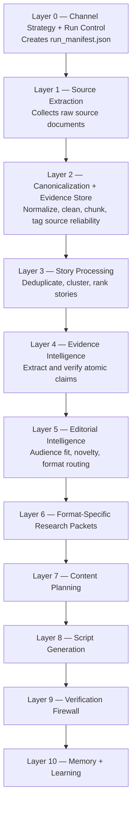
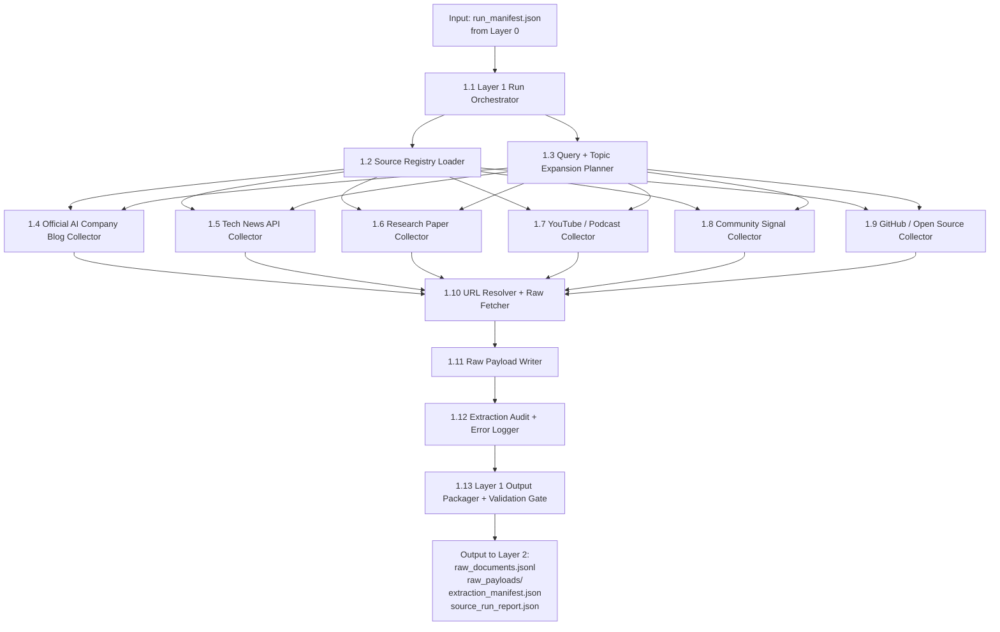

Below is the **detailed implementation design for Layer 1 — Source Extraction**.

This layer fits directly after **Layer 0 — Channel Strategy + Run Control**. Layer 0 creates the `run_manifest.json`; Layer 1 reads that manifest and collects raw AI-related sources from the correct time window, source groups, and query themes.

Your earlier design already defined the main collector groups as AI company blogs, tech news APIs, research papers, YouTube/podcast transcripts, and community signals, with the principle that code should collect sources first and the LLM should only analyze grounded source material later. 

---

# Layer 1 — Source Extraction

## 1. Purpose of Layer 1

Layer 1 is the **raw acquisition layer**.

Its job is to collect AI-related content from multiple source types and preserve the original evidence before any analysis happens.

Layer 1 should answer:

```text
What raw AI news/resources are available in this run window?
Where did each item come from?
When was it published?
How was it collected?
What source group does it belong to?
Can we trace it back to the original URL/API response?
Did extraction succeed, partially succeed, or fail?
```

Layer 1 should **not** answer:

```text
Is this story important?
Is this claim true?
Should this become a video?
Is this a roundup story or deep dive story?
What is the final script angle?
```

Those decisions happen in later layers.

---

# 2. Where Layer 1 sits in the full architecture



Layer 1 is the first real execution layer. If this layer is weak, every later layer becomes weak.

---

# 3. Layer 1 internal architecture



---

# 4. Layer 1 design principle

Layer 1 should be **deterministic and source-first**.

Meaning:

```text
Use APIs, RSS, official pages, feeds, and allowed fetchers.
Do not ask the LLM to “find AI news.”
Do not summarize in Layer 1.
Do not rewrite facts in Layer 1.
Do not decide video angle in Layer 1.
Do not treat community posts as truth.
Preserve raw payloads exactly.
```

This is consistent with the earlier project rule: **code collects, cleans, stores, deduplicates, and schedules; LLM summarizes, extracts claims, explains, and writes scripts later.** 

---

# 5. Layer 1 input and output

## Layer 1 input

Layer 1 receives the `run_manifest.json` from Layer 0.

```json
{
  "run_id": "run_2026_05_10_48h_auto",
  "collection_strategy": {
    "collection_window": {
      "start": "2026-05-08T10:00:00Z",
      "end": "2026-05-10T10:00:00Z",
      "lookback_hours": 48
    },
    "enabled_source_groups": [
      "ai_company_blogs",
      "tech_news_apis",
      "research_papers",
      "youtube_podcast_transcripts",
      "community_signals",
      "github_open_source_signals"
    ],
    "query_themes": [
      "AI agents",
      "LLM releases",
      "AI coding tools",
      "open-source AI",
      "AI regulation",
      "AI chips",
      "AI research"
    ]
  },
  "depth_limits": {
    "max_raw_documents_to_process": 500
  },
  "quality_policy": {
    "allow_community_sources_as_primary_truth": false,
    "every_claim_requires_source_span": true
  },
  "output_contract": {
    "required_layer_outputs": {
      "layer_1": "data/runs/run_2026_05_10_48h_auto/layer_1_raw_documents.jsonl"
    }
  }
}
```

## Layer 1 output

Layer 1 should produce these files:

```text
data/runs/{run_id}/layer_1/
  raw_documents.jsonl
  extraction_manifest.json
  source_run_report.json
  failed_sources.jsonl
  raw_payloads/
    company_blogs/
    tech_news/
    research_papers/
    youtube_podcasts/
    community_signals/
    github/
```

Main Layer 1 output:

```json
{
  "run_id": "run_2026_05_10_48h_auto",
  "layer": "layer_1_source_extraction",
  "status": "completed_with_warnings",
  "raw_documents_path": "data/runs/run_2026_05_10_48h_auto/layer_1/raw_documents.jsonl",
  "raw_payloads_base_path": "data/runs/run_2026_05_10_48h_auto/layer_1/raw_payloads/",
  "document_count": 214,
  "source_group_counts": {
    "ai_company_blogs": 18,
    "tech_news_apis": 96,
    "research_papers": 42,
    "youtube_podcast_transcripts": 14,
    "community_signals": 29,
    "github_open_source_signals": 15
  },
  "failed_sources_path": "data/runs/run_2026_05_10_48h_auto/layer_1/failed_sources.jsonl",
  "ready_for_layer_2": true
}
```

---

# 6. Universal Layer 1 document format

Every collector should output the same base schema.

This is important because Layer 2 should not care whether the item came from NewsAPI, arXiv, YouTube, Hacker News, or an official company blog.

## `RawExtractedDocument`

```json
{
  "raw_document_id": "rawdoc_20260510_openai_001",
  "run_id": "run_2026_05_10_48h_auto",

  "source": {
    "source_id": "openai_news",
    "source_name": "OpenAI News",
    "source_group": "ai_company_blogs",
    "source_type": "official_blog",
    "trust_tier_hint": 1,
    "source_url": "https://openai.com/news/"
  },

  "item": {
    "title": "Article title",
    "url": "https://example.com/article",
    "canonical_url": null,
    "published_at": "2026-05-10T08:00:00Z",
    "updated_at": null,
    "author": "OpenAI",
    "language": "en"
  },

  "content": {
    "raw_text": null,
    "raw_html_path": "data/runs/run_2026_05_10_48h_auto/layer_1/raw_payloads/company_blogs/openai/rawdoc_001.html",
    "raw_json_path": null,
    "raw_xml_path": null,
    "transcript_path": null,
    "api_response_path": null,
    "content_available": true
  },

  "collection": {
    "collector_name": "official_company_blog_collector",
    "collection_method": "rss_then_html_fetch",
    "collected_at": "2026-05-10T10:05:00Z",
    "query_used": null,
    "time_window_start": "2026-05-08T10:00:00Z",
    "time_window_end": "2026-05-10T10:00:00Z",
    "http_status": 200,
    "extraction_status": "success"
  },

  "pre_normalization_hints": {
    "expected_content_type": "announcement",
    "possible_entities": ["OpenAI"],
    "possible_topics": ["AI agents", "AI coding tools"],
    "source_priority": "high"
  },

  "provenance": {
    "original_fetch_url": "https://example.com/article",
    "raw_payload_sha256": "abc123...",
    "license_or_access_note": "public_web_page",
    "terms_sensitive": false
  }
}
```

This is not the final evidence schema. Layer 2 will normalize and clean it. But Layer 1 should already preserve enough metadata for traceability.

---

# 7. Module-by-module design

---

## Module 1.1 — Layer 1 Run Orchestrator

### Purpose

Coordinate all collectors for the current run.

### Why it matters

Layer 1 has many collectors. The orchestrator ensures they all follow the same run window, output format, retry rules, and limits.

### Questions it answers

```text
Which source groups are enabled for this run?
Which collectors should run?
What is the collection window?
What are the query themes?
What are the max document limits?
Where should raw outputs be written?
Did the whole layer complete successfully?
```

### Input

```json
{
  "run_manifest_path": "data/runs/run_2026_05_10_48h_auto/run_manifest.json"
}
```

### Logic

```text
1. Load run_manifest.json.
2. Read enabled source groups.
3. Load source registry.
4. Create per-source collection tasks.
5. Pass query themes and time windows to collectors.
6. Execute collectors.
7. Collect success/failure reports.
8. Enforce max document limits.
9. Write layer-level output package.
```

### Output

```json
{
  "run_id": "run_2026_05_10_48h_auto",
  "started_at": "2026-05-10T10:01:00Z",
  "completed_at": "2026-05-10T10:08:00Z",
  "collectors_executed": [
    "official_company_blog_collector",
    "tech_news_api_collector",
    "research_paper_collector",
    "youtube_podcast_collector",
    "community_signal_collector",
    "github_open_source_collector"
  ],
  "status": "completed_with_warnings"
}
```

---

## Module 1.2 — Source Registry Loader

### Purpose

Load all source definitions from `sources.yaml`.

Your earlier design already proposed a source registry with source ID, type, category, trust score, and fetch frequency. 

### Why it matters

You do not want hardcoded sources inside collectors. Sources should be configurable.

### Questions it answers

```text
What sources exist?
Which collector should handle each source?
What is the trust tier hint?
What is the source URL or API endpoint?
Is the source enabled?
What rate limit or authentication method applies?
```

### Config file

`config/sources.yaml`

```yaml
source_groups:
  ai_company_blogs:
    enabled: true
    default_trust_tier: 1
    sources:
      - source_id: openai_news
        name: OpenAI News
        collector: official_company_blog_collector
        extraction_method: rss_or_html
        url: "https://openai.com/news/"
        priority: high
        trust_tier_hint: 1

      - source_id: anthropic_news
        name: Anthropic News
        collector: official_company_blog_collector
        extraction_method: html
        url: "https://www.anthropic.com/news"
        priority: high
        trust_tier_hint: 1

  tech_news_apis:
    enabled: true
    default_trust_tier: 2
    sources:
      - source_id: newsapi_ai
        name: NewsAPI AI Search
        collector: tech_news_api_collector
        extraction_method: api
        endpoint: "https://newsapi.org/v2/everything"
        priority: medium
        trust_tier_hint: 2

  research_papers:
    enabled: true
    default_trust_tier: 1.5
    sources:
      - source_id: arxiv_ai
        name: arXiv AI Papers
        collector: research_paper_collector
        extraction_method: api
        categories: ["cs.AI", "cs.LG", "cs.CL", "cs.CV"]
        priority: high
        trust_tier_hint: 1.5
```

### Input

```json
{
  "sources_config_path": "config/sources.yaml",
  "enabled_source_groups": [
    "ai_company_blogs",
    "tech_news_apis",
    "research_papers"
  ]
}
```

### Logic

```text
1. Load sources.yaml.
2. Filter only source groups enabled by Layer 0.
3. Validate required fields.
4. Remove inactive sources.
5. Attach source-level collection settings.
6. Return collector task list.
```

### Output

```json
{
  "active_sources": [
    {
      "source_id": "openai_news",
      "source_group": "ai_company_blogs",
      "collector": "official_company_blog_collector",
      "url": "https://openai.com/news/",
      "trust_tier_hint": 1,
      "priority": "high"
    }
  ],
  "source_count": 24
}
```

---

## Module 1.3 — Query + Topic Expansion Planner

### Purpose

Convert Layer 0 query themes into collector-specific queries.

### Why it matters

Each source type needs different query logic.

For example:

```text
NewsAPI needs query strings.
arXiv needs category and keyword filters.
GitHub needs repo search queries.
Reddit needs subreddit + search terms.
Company blogs may not need query terms at all.
```

### Questions it answers

```text
What exact query should each collector run?
Which topics are priority?
Should we search by company names, product names, or generic AI terms?
Should some source groups use broader or narrower queries?
```

### Input

```json
{
  "query_themes": [
    "AI agents",
    "LLM releases",
    "AI coding tools",
    "open-source AI",
    "AI regulation",
    "AI chips",
    "AI research"
  ],
  "source_groups": [
    "tech_news_apis",
    "research_papers",
    "community_signals",
    "github_open_source_signals"
  ]
}
```

### Logic

```text
1. Expand broad themes into query groups.
2. Add entity aliases.
3. Add product keywords.
4. Generate source-specific query formats.
5. Apply query length limits.
6. Save query plan for audit.
```

### Output

```json
{
  "query_plan": {
    "tech_news_apis": [
      "(artificial intelligence OR generative AI OR LLM)",
      "(AI agents OR agentic AI OR autonomous agents)",
      "(OpenAI OR Anthropic OR Gemini OR Claude OR Llama)"
    ],
    "research_papers": [
      "cat:cs.AI OR cat:cs.LG OR cat:cs.CL",
      "agentic AI",
      "large language model"
    ],
    "github_open_source_signals": [
      "topic:llm",
      "topic:ai-agents",
      "topic:rag",
      "topic:transformers"
    ],
    "community_signals": [
      "OpenAI",
      "Claude",
      "Gemini",
      "Llama",
      "AI agents",
      "LLM"
    ]
  }
}
```

---

# 8. Source collector modules

---

## Module 1.4 — Official AI Company Blog Collector

### Purpose

Collect official AI announcements from company and research lab websites.

### Why it matters

Official sources are the strongest source of factual truth for product releases, model launches, research announcements, and company statements.

Your earlier research classified official AI company sources as the highest-priority category, including AI labs, enterprise AI providers, hardware AI companies, and developer platforms. 

### Sources

```text
OpenAI News
Anthropic News
Anthropic Engineering
Google DeepMind Blog
Google Research Blog
Meta AI Blog
Microsoft AI
AWS Machine Learning Blog
NVIDIA Blog
Hugging Face Blog
Mistral AI Blog
Perplexity Blog
GitHub Blog
LangChain Blog
```

### Questions it answers

```text
What did the company officially announce?
Was there a new model, product, research update, partnership, pricing update, safety update, or policy change?
When was the announcement published?
Can we preserve the official source URL and raw page?
```

### Input

```json
{
  "run_id": "run_2026_05_10_48h_auto",
  "collection_window": {
    "start": "2026-05-08T10:00:00Z",
    "end": "2026-05-10T10:00:00Z"
  },
  "sources": [
    {
      "source_id": "openai_news",
      "url": "https://openai.com/news/",
      "extraction_method": "rss_or_html",
      "trust_tier_hint": 1
    }
  ]
}
```

### Logic

```text
1. For each official source, try RSS/feed if configured.
2. If RSS is unavailable, fetch listing page.
3. Extract candidate article links.
4. Filter by publish date if available.
5. Fetch article page.
6. Store raw HTML.
7. Extract basic metadata only: title, URL, date, author if available.
8. Do not summarize.
9. Emit RawExtractedDocument.
```

### Output

```json
{
  "raw_document_id": "rawdoc_openai_news_001",
  "source": {
    "source_id": "openai_news",
    "source_group": "ai_company_blogs",
    "source_type": "official_blog",
    "trust_tier_hint": 1
  },
  "item": {
    "title": "Official announcement title",
    "url": "https://openai.com/news/example",
    "published_at": "2026-05-10T08:00:00Z",
    "author": "OpenAI"
  },
  "content": {
    "raw_html_path": "data/runs/run_2026_05_10_48h_auto/layer_1/raw_payloads/company_blogs/openai/rawdoc_openai_news_001.html",
    "content_available": true
  },
  "collection": {
    "collector_name": "official_company_blog_collector",
    "collection_method": "rss_or_html",
    "extraction_status": "success"
  }
}
```

### Important rule

If an official source page has no clear publish date, do not discard it immediately. Mark it:

```json
{
  "published_at": null,
  "date_confidence": "unknown",
  "needs_date_resolution": true
}
```

Layer 2 or Layer 3 can later decide whether to keep it.

---

## Module 1.5 — Tech News API Collector

### Purpose

Collect broad media coverage around AI topics.

### Why it matters

Official blogs tell you what companies said. News APIs tell you what the broader market is covering and whether multiple independent outlets are discussing the same event.

Earlier research identified NewsAPI, GDELT, Mediastack, and Google News RSS as useful discovery sources.  NewsAPI’s `/v2/everything` endpoint supports searching across articles from many sources and blogs, and supports keyword queries, exact phrases, required terms, excluded terms, and Boolean operators. ([News API][1]) GDELT’s DOC 2.0 API is designed for full-text news search and supports JSON output for near-term news analysis. ([GDELT Project][2])

### Sources

```text
NewsAPI
GDELT
Mediastack
Google News RSS, optional discovery only
Selected publisher RSS feeds, optional
```

### Questions it answers

```text
Which AI stories are being reported by multiple outlets?
Which topics are trending in tech media?
Is there independent coverage of an official announcement?
Are there regulatory, funding, product, or market-impact stories?
```

### Input

```json
{
  "run_id": "run_2026_05_10_48h_auto",
  "collection_window": {
    "start": "2026-05-08T10:00:00Z",
    "end": "2026-05-10T10:00:00Z"
  },
  "queries": [
    "(artificial intelligence OR generative AI OR LLM)",
    "(OpenAI OR Anthropic OR Gemini OR Claude OR Llama)",
    "(AI agents OR agentic AI)"
  ],
  "sources": [
    {
      "source_id": "newsapi_ai",
      "endpoint": "https://newsapi.org/v2/everything",
      "trust_tier_hint": 2
    }
  ]
}
```

### Logic

```text
1. For each query, call configured news APIs.
2. Apply date range from Layer 0.
3. Limit language to English unless configured otherwise.
4. Remove obvious non-AI false positives using keyword filter.
5. Store raw API response.
6. For each article result, create RawExtractedDocument.
7. Optionally fetch article URL through URL Resolver if allowed.
8. Preserve API provider metadata.
```

### Output

```json
{
  "raw_document_id": "rawdoc_newsapi_001",
  "source": {
    "source_id": "newsapi_ai",
    "source_group": "tech_news_apis",
    "source_type": "news_api",
    "trust_tier_hint": 2
  },
  "item": {
    "title": "AI article title",
    "url": "https://publisher.com/article",
    "published_at": "2026-05-09T14:30:00Z",
    "author": "Reporter Name",
    "publisher": "Publisher Name"
  },
  "content": {
    "api_response_path": "data/runs/run_2026_05_10_48h_auto/layer_1/raw_payloads/tech_news/newsapi_batch_001.json",
    "raw_text": "Article description or API content snippet",
    "content_available": "partial"
  },
  "collection": {
    "collector_name": "tech_news_api_collector",
    "collection_method": "news_api",
    "query_used": "AI agents",
    "extraction_status": "success"
  }
}
```

### Important rule

News API content may be partial. Do not pretend it is the full article.

Use:

```json
{
  "content_completeness": "partial_api_snippet",
  "requires_full_text_fetch": true
}
```

---

## Module 1.6 — Research Paper Collector

### Purpose

Collect latest AI research papers and technical evidence.

### Why it matters

This module helps your channel become more analytical than normal AI news channels. It gives you research-backed context for deep dives, evergreen videos, and technical explainers.

Earlier research identified arXiv, Papers with Code, Hugging Face Papers, and Semantic Scholar as important research sources.  arXiv provides an API for programmatic access to paper metadata, while Semantic Scholar’s Academic Graph API provides data about papers, authors, citations, venues, and related scholarly information. ([Semantic Scholar][3])

### Sources

```text
arXiv API
arXiv RSS / Atom
Semantic Scholar API
Hugging Face Papers
Papers with Code / GitHub repo links
Selected conference feeds, optional later
```

### Questions it answers

```text
What new AI papers were published recently?
Which papers are relevant to AI agents, LLMs, coding tools, open-source AI, benchmarks, or safety?
Are any papers connected to current news stories?
Is there a paper, benchmark, or code implementation behind a trending claim?
```

### Input

```json
{
  "run_id": "run_2026_05_10_48h_auto",
  "research_window": {
    "lookback_days": 7
  },
  "categories": ["cs.AI", "cs.LG", "cs.CL", "cs.CV"],
  "queries": [
    "large language model",
    "AI agents",
    "code generation",
    "reasoning model",
    "multimodal model"
  ]
}
```

### Logic

```text
1. Query arXiv categories and keywords.
2. Pull paper metadata: title, authors, abstract, categories, published date, updated date, PDF URL.
3. Query Semantic Scholar for citations, venue, influential citations, related paper metadata where available.
4. Optionally detect code links or Papers with Code references.
5. Store raw API/XML responses.
6. Emit RawExtractedDocument for each paper.
```

### Output

```json
{
  "raw_document_id": "rawdoc_arxiv_001",
  "source": {
    "source_id": "arxiv_ai",
    "source_group": "research_papers",
    "source_type": "paper_api",
    "trust_tier_hint": 1.5
  },
  "item": {
    "title": "Research paper title",
    "url": "https://arxiv.org/abs/...",
    "published_at": "2026-05-09T00:00:00Z",
    "updated_at": "2026-05-09T00:00:00Z",
    "author": "Paper authors"
  },
  "research_metadata": {
    "arxiv_id": "2605.xxxxx",
    "categories": ["cs.LG", "cs.CL"],
    "pdf_url": "https://arxiv.org/pdf/...",
    "abstract": "...",
    "semantic_scholar_paper_id": null,
    "citation_count": null,
    "code_url": null
  },
  "content": {
    "raw_xml_path": "data/runs/run_2026_05_10_48h_auto/layer_1/raw_payloads/research_papers/arxiv/rawdoc_arxiv_001.xml",
    "raw_text": "abstract text",
    "content_available": "abstract_only"
  },
  "collection": {
    "collector_name": "research_paper_collector",
    "collection_method": "arxiv_api",
    "extraction_status": "success"
  }
}
```

### Important rule

Layer 1 does not need to download every PDF immediately. For MVP, store abstract + PDF URL. Download PDFs only for deep-dive candidates later, or when Layer 6 needs full paper context.

---

## Module 1.7 — YouTube / Podcast Collector

### Purpose

Collect video and podcast metadata, and transcripts where legally/technically available.

### Why it matters

AI launches are often explained in keynotes, interviews, podcasts, demos, and conference talks. These sources are useful for quotes, timestamped context, and B-roll planning.

Earlier design included YouTube Data API for metadata, official transcripts where available, user-provided transcripts, and podcast RSS feeds.  The YouTube Data API represents videos, playlists, channels, and captions as resources, and its captions API can list caption tracks, while caption download is a separate method and may require proper authorization. ([Google for Developers][4])

### Sources

```text
YouTube Data API
Official YouTube channel uploads
Podcast RSS feeds
Listen Notes API, optional
Official show websites
User-provided transcript files
```

### Questions it answers

```text
Did official AI channels publish new videos?
Did researchers/founders explain a recent announcement?
Is there a timestamped transcript we can cite?
Are there useful podcast episodes connected to current AI topics?
```

### Input

```json
{
  "run_id": "run_2026_05_10_48h_auto",
  "lookback_days": 7,
  "channels": [
    {
      "source_id": "openai_youtube",
      "platform": "youtube",
      "channel_id": "..."
    }
  ],
  "podcast_feeds": [
    {
      "source_id": "dwarkesh_podcast",
      "rss_url": "https://..."
    }
  ]
}
```

### Logic

```text
1. For YouTube, fetch recent video metadata from configured channels.
2. Store title, video URL, channel, description, publish date, duration, tags if available.
3. Check caption availability through official API where allowed.
4. Download captions only if authorized or if user provided transcript.
5. For podcasts, parse RSS feed and collect episode metadata.
6. If transcript link exists in show notes, store transcript URL.
7. Store transcript chunks only if available from allowed source.
8. Emit RawExtractedDocument.
```

### Output

```json
{
  "raw_document_id": "rawdoc_youtube_001",
  "source": {
    "source_id": "openai_youtube",
    "source_group": "youtube_podcast_transcripts",
    "source_type": "youtube_video",
    "trust_tier_hint": 2
  },
  "item": {
    "title": "AI launch demo video",
    "url": "https://www.youtube.com/watch?v=...",
    "published_at": "2026-05-09T16:00:00Z",
    "author": "OpenAI"
  },
  "video_metadata": {
    "platform": "youtube",
    "video_id": "...",
    "channel_name": "OpenAI",
    "duration_seconds": 1800,
    "description": "...",
    "caption_status": "available_but_not_downloaded"
  },
  "content": {
    "api_response_path": "data/runs/run_2026_05_10_48h_auto/layer_1/raw_payloads/youtube/video_001.json",
    "transcript_path": null,
    "content_available": "metadata_only"
  },
  "collection": {
    "collector_name": "youtube_podcast_collector",
    "collection_method": "youtube_data_api",
    "extraction_status": "success"
  }
}
```

### Important rule

Do not rely on unofficial transcript scraping as your primary design. Prefer:

```text
Official API metadata
Authorized caption access
Official transcript pages
User-provided transcripts
Podcast RSS show notes
```

If transcript is unavailable, still keep metadata. It may help Layer 3 detect that a relevant video exists.

---

## Module 1.8 — Community Signal Collector

### Purpose

Collect discussion and engagement signals from developer/community platforms.

### Why it matters

Community sources tell you what viewers may care about. They are useful for topic selection, not final truth.

Earlier design explicitly marked community signals as trend signals, not proof, including Hacker News, Reddit, X/Twitter where available, and GitHub Trending.  Hacker News has an official Firebase API providing near-real-time public HN data, and Reddit’s API documentation provides listings/search-style access with pagination parameters such as `after`, `before`, and `limit`. ([GitHub][5])

### Sources

```text
Hacker News API
Reddit API
Product Hunt, optional
Stack Overflow / Stack Exchange API, optional for developer pain signals
X/Twitter API, optional only if paid/reliable access exists
```

### Questions it answers

```text
What AI topics are developers discussing?
Which stories are getting high engagement?
Are people excited, skeptical, confused, or angry?
Are there repeated concerns or questions?
Which official/news URLs are being shared?
```

### Input

```json
{
  "run_id": "run_2026_05_10_48h_auto",
  "lookback_hours": 72,
  "queries": [
    "OpenAI",
    "Claude",
    "Gemini",
    "Llama",
    "AI agents",
    "LLM",
    "AI coding"
  ],
  "subreddits": [
    "MachineLearning",
    "LocalLLaMA",
    "OpenAI",
    "ClaudeAI",
    "artificial",
    "singularity"
  ]
}
```

### Logic

```text
1. Fetch HN top/new/best stories.
2. Filter stories by AI-related keywords or linked source domains.
3. Fetch Reddit posts from configured subreddits.
4. Search Reddit within time window where possible.
5. Store post metadata: title, URL, score, comments, author, created_at.
6. Store linked source URL separately.
7. Do not treat comments as factual evidence.
8. Emit RawExtractedDocument with trust_tier_hint = 3.
```

### Output

```json
{
  "raw_document_id": "rawdoc_hn_001",
  "source": {
    "source_id": "hackernews_ai",
    "source_group": "community_signals",
    "source_type": "community_post",
    "trust_tier_hint": 3
  },
  "item": {
    "title": "Show HN: New open-source AI coding agent",
    "url": "https://news.ycombinator.com/item?id=...",
    "published_at": "2026-05-09T18:30:00Z",
    "author": "hn_user"
  },
  "community_metadata": {
    "platform": "hackernews",
    "score": 582,
    "comment_count": 210,
    "linked_source_url": "https://github.com/example/repo"
  },
  "content": {
    "api_response_path": "data/runs/run_2026_05_10_48h_auto/layer_1/raw_payloads/community_signals/hn/rawdoc_hn_001.json",
    "content_available": "metadata_and_discussion"
  },
  "collection": {
    "collector_name": "community_signal_collector",
    "collection_method": "hackernews_api",
    "extraction_status": "success"
  }
}
```

### Important rule

Community posts should be tagged:

```json
{
  "source_role": "trend_signal_only",
  "can_be_used_as_primary_truth": false
}
```

---

## Module 1.9 — GitHub / Open Source Signal Collector

### Purpose

Collect open-source AI project signals.

### Why it matters

Many important AI trends appear first as GitHub repositories, releases, model-serving tools, agent frameworks, RAG tools, eval frameworks, and open-source models.

### Sources

```text
GitHub REST API
GitHub repository search
GitHub releases
GitHub trending, if collected carefully
Hugging Face model/repo pages, optional later
```

GitHub’s REST API supports repository and code-related programmatic access, including search endpoints that can be used for discovering repositories by keyword, topic, stars, and update date. ([Stack Exchange][6])

### Questions it answers

```text
Which AI repos are gaining traction?
Was there a new release?
Are there new open-source agent frameworks or models?
Is there a GitHub project connected to a trending paper or article?
```

### Input

```json
{
  "run_id": "run_2026_05_10_48h_auto",
  "lookback_days": 7,
  "github_queries": [
    "topic:llm",
    "topic:ai-agents",
    "topic:rag",
    "topic:transformers",
    "topic:code-generation"
  ],
  "sort": "stars",
  "min_stars": 100
}
```

### Logic

```text
1. Search repositories by topic and keyword.
2. Filter by recently created or recently updated.
3. Fetch repo metadata: stars, forks, description, language, license, owner, URL.
4. Fetch latest release metadata if available.
5. Store README path or README raw text only if allowed and useful.
6. Emit RawExtractedDocument.
```

### Output

```json
{
  "raw_document_id": "rawdoc_github_001",
  "source": {
    "source_id": "github_search_ai",
    "source_group": "github_open_source_signals",
    "source_type": "github_repository",
    "trust_tier_hint": 2.5
  },
  "item": {
    "title": "owner/repo-name",
    "url": "https://github.com/owner/repo-name",
    "published_at": "2026-05-05T10:00:00Z",
    "updated_at": "2026-05-10T09:00:00Z",
    "author": "owner"
  },
  "github_metadata": {
    "stars": 12500,
    "forks": 900,
    "language": "Python",
    "license": "Apache-2.0",
    "topics": ["llm", "agents", "rag"],
    "latest_release": "v1.2.0"
  },
  "content": {
    "api_response_path": "data/runs/run_2026_05_10_48h_auto/layer_1/raw_payloads/github/rawdoc_github_001.json",
    "content_available": "metadata_and_readme"
  },
  "collection": {
    "collector_name": "github_open_source_collector",
    "collection_method": "github_rest_api",
    "extraction_status": "success"
  }
}
```

---

# 9. Supporting modules

---

## Module 1.10 — URL Resolver + Raw Fetcher

### Purpose

Resolve and fetch full raw pages when a collector only provides a URL or partial snippet.

### Why it matters

News APIs often return partial content. Company blog listings may return article URLs but not body content. GitHub search may return repo metadata but not README content.

### Questions it answers

```text
Can we fetch the original page?
What is the canonical URL?
Was the URL redirected?
What raw payload was stored?
Was the content blocked or inaccessible?
```

### Input

```json
{
  "raw_document_id": "rawdoc_newsapi_001",
  "url": "https://publisher.com/article",
  "fetch_allowed": true,
  "source_group": "tech_news_apis"
}
```

### Logic

```text
1. Normalize URL.
2. Follow safe redirects.
3. Capture canonical URL if available.
4. Fetch page using allowed method.
5. Save raw HTML.
6. Save HTTP status and headers.
7. Do not deeply clean content here.
8. Mark paywall/blocked/failed if applicable.
```

### Output

```json
{
  "raw_document_id": "rawdoc_newsapi_001",
  "original_url": "https://publisher.com/article",
  "canonical_url": "https://publisher.com/article",
  "http_status": 200,
  "raw_html_path": "data/runs/run_2026_05_10_48h_auto/layer_1/raw_payloads/fetched_pages/rawdoc_newsapi_001.html",
  "fetch_status": "success"
}
```

---

## Module 1.11 — Raw Payload Writer

### Purpose

Persist original source payloads.

### Why it matters

This is your audit trail. If the script later says something questionable, you can trace back to the raw source.

### Questions it answers

```text
Where is the original API response?
Where is the raw HTML?
Where is the transcript file?
What hash proves this payload did not change?
```

### Input

```json
{
  "raw_document_id": "rawdoc_001",
  "payload_type": "html",
  "payload": "<html>...</html>",
  "source_group": "ai_company_blogs"
}
```

### Logic

```text
1. Choose path based on run_id/source_group/source_id.
2. Save raw payload.
3. Compute SHA-256 hash.
4. Return storage path and hash.
```

### Output

```json
{
  "raw_document_id": "rawdoc_001",
  "payload_path": "data/runs/run_2026_05_10_48h_auto/layer_1/raw_payloads/company_blogs/openai/rawdoc_001.html",
  "payload_sha256": "abc123...",
  "payload_size_bytes": 48291
}
```

---

## Module 1.12 — Extraction Audit + Error Logger

### Purpose

Track successes, failures, partial extractions, and skipped sources.

### Why it matters

You need to know whether your output is weak because the news was weak or because the extraction failed.

### Questions it answers

```text
Which sources failed?
Which APIs hit rate limits?
Which documents had missing dates?
Which pages were blocked?
Which sources returned zero results?
Was this run healthy enough to continue?
```

### Input

Collector-level event:

```json
{
  "source_id": "newsapi_ai",
  "collector_name": "tech_news_api_collector",
  "event_type": "api_rate_limit",
  "severity": "warning",
  "message": "Rate limit reached after 100 requests"
}
```

### Output

`failed_sources.jsonl`

```json
{
  "run_id": "run_2026_05_10_48h_auto",
  "source_id": "newsapi_ai",
  "collector_name": "tech_news_api_collector",
  "error_type": "rate_limit",
  "severity": "warning",
  "retryable": true,
  "message": "Rate limit reached",
  "occurred_at": "2026-05-10T10:07:30Z"
}
```

---

## Module 1.13 — Layer 1 Output Packager + Validation Gate

### Purpose

Prepare the final Layer 1 handoff to Layer 2.

### Why it matters

Layer 2 should receive one clean package, not scattered collector outputs.

### Questions it answers

```text
Did Layer 1 produce enough documents?
Are required files present?
Are raw payload paths valid?
Is every raw document associated with a source ID?
Can Layer 2 start?
```

### Input

```json
{
  "raw_documents_path": "data/runs/run_2026_05_10_48h_auto/layer_1/raw_documents.jsonl",
  "failed_sources_path": "data/runs/run_2026_05_10_48h_auto/layer_1/failed_sources.jsonl"
}
```

### Logic

```text
1. Count raw documents.
2. Count by source group.
3. Validate every document has source_id, URL or unique external ID, collection timestamp, source group, and raw payload path.
4. Check minimum expected document threshold.
5. Create source_run_report.json.
6. Mark ready_for_layer_2 true/false.
```

### Output

```json
{
  "layer": "layer_1_source_extraction",
  "run_id": "run_2026_05_10_48h_auto",
  "validation_status": "passed",
  "ready_for_layer_2": true,
  "document_count": 214,
  "warnings": [
    {
      "type": "partial_content",
      "message": "38 news API documents contain only snippets and require full text fetch or later exclusion."
    }
  ],
  "errors": []
}
```

---

# 10. Layer 1 source-group output formats

## A. Official company blog format

```json
{
  "raw_document_id": "rawdoc_company_001",
  "source_group": "ai_company_blogs",
  "source_type": "official_blog",
  "trust_tier_hint": 1,
  "title": "...",
  "url": "...",
  "published_at": "...",
  "raw_html_path": "...",
  "content_completeness": "raw_page_fetched"
}
```

## B. Tech news API format

```json
{
  "raw_document_id": "rawdoc_news_001",
  "source_group": "tech_news_apis",
  "source_type": "news_article",
  "trust_tier_hint": 2,
  "publisher": "...",
  "title": "...",
  "url": "...",
  "published_at": "...",
  "api_response_path": "...",
  "raw_html_path": "...",
  "content_completeness": "partial_api_snippet_or_raw_page_fetched"
}
```

## C. Research paper format

```json
{
  "raw_document_id": "rawdoc_research_001",
  "source_group": "research_papers",
  "source_type": "research_paper",
  "trust_tier_hint": 1.5,
  "title": "...",
  "authors": [],
  "abstract": "...",
  "paper_url": "...",
  "pdf_url": "...",
  "published_at": "...",
  "categories": [],
  "raw_api_response_path": "..."
}
```

## D. YouTube / podcast format

```json
{
  "raw_document_id": "rawdoc_media_001",
  "source_group": "youtube_podcast_transcripts",
  "source_type": "youtube_video_or_podcast_episode",
  "trust_tier_hint": 2,
  "title": "...",
  "url": "...",
  "published_at": "...",
  "channel_or_show": "...",
  "duration_seconds": 1800,
  "transcript_path": null,
  "transcript_status": "available | unavailable | authorized_downloaded | user_provided"
}
```

## E. Community signal format

```json
{
  "raw_document_id": "rawdoc_community_001",
  "source_group": "community_signals",
  "source_type": "community_post",
  "trust_tier_hint": 3,
  "platform": "hackernews",
  "title": "...",
  "url": "...",
  "linked_source_url": "...",
  "score": 500,
  "comment_count": 100,
  "published_at": "...",
  "source_role": "trend_signal_only"
}
```

## F. GitHub signal format

```json
{
  "raw_document_id": "rawdoc_github_001",
  "source_group": "github_open_source_signals",
  "source_type": "github_repository",
  "trust_tier_hint": 2.5,
  "repo_full_name": "owner/repo",
  "url": "...",
  "description": "...",
  "stars": 12000,
  "forks": 900,
  "topics": [],
  "created_at": "...",
  "updated_at": "...",
  "latest_release": "..."
}
```

---

# 11. Layer 1 file structure

```text
pipelines/
  layer_1_extraction/
    __init__.py
    run_layer_1.py

    orchestrator/
      layer1_run_orchestrator.py
      source_registry_loader.py
      query_topic_expansion_planner.py

    collectors/
      official_company_blog_collector.py
      tech_news_api_collector.py
      research_paper_collector.py
      youtube_podcast_collector.py
      community_signal_collector.py
      github_open_source_collector.py

    fetchers/
      rss_fetcher.py
      html_fetcher.py
      api_fetcher.py
      youtube_fetcher.py
      podcast_rss_fetcher.py
      github_fetcher.py

    storage/
      raw_payload_writer.py
      raw_document_writer.py

    validation/
      extraction_audit_logger.py
      layer1_output_packager.py
      layer1_validation_gate.py

config/
  sources.yaml
  source_credentials.example.yaml
  query_expansion.yaml

data/
  runs/
    run_2026_05_10_48h_auto/
      layer_1/
        raw_documents.jsonl
        extraction_manifest.json
        source_run_report.json
        failed_sources.jsonl
        raw_payloads/
```

---

# 12. Recommended `extraction_manifest.json`

This is the official Layer 1 handoff file.

```json
{
  "run_id": "run_2026_05_10_48h_auto",
  "layer": "layer_1_source_extraction",
  "created_at": "2026-05-10T10:09:00Z",
  "input_manifest": "data/runs/run_2026_05_10_48h_auto/run_manifest.json",

  "outputs": {
    "raw_documents": "data/runs/run_2026_05_10_48h_auto/layer_1/raw_documents.jsonl",
    "failed_sources": "data/runs/run_2026_05_10_48h_auto/layer_1/failed_sources.jsonl",
    "source_run_report": "data/runs/run_2026_05_10_48h_auto/layer_1/source_run_report.json",
    "raw_payloads_base_path": "data/runs/run_2026_05_10_48h_auto/layer_1/raw_payloads/"
  },

  "counts": {
    "total_raw_documents": 214,
    "by_source_group": {
      "ai_company_blogs": 18,
      "tech_news_apis": 96,
      "research_papers": 42,
      "youtube_podcast_transcripts": 14,
      "community_signals": 29,
      "github_open_source_signals": 15
    }
  },

  "quality_flags": {
    "documents_with_missing_publish_date": 11,
    "documents_with_partial_content": 38,
    "documents_with_failed_full_fetch": 9,
    "community_signal_only_documents": 29
  },

  "handoff": {
    "ready_for_layer_2": true,
    "next_layer": "layer_2_canonicalization"
  }
}
```

---

# 13. Layer 1 validation rules

Layer 1 should pass only if:

```text
run_manifest.json exists.
At least one source group is enabled.
At least one collector executed successfully.
raw_documents.jsonl exists.
Every raw document has raw_document_id.
Every raw document has source_id.
Every raw document has source_group.
Every raw document has title or external ID.
Every raw document has URL or API-native ID.
Every raw document has collected_at.
Every raw payload path exists if content_available is true.
Layer 1 generated extraction_manifest.json.
```

Warnings are acceptable for:

```text
Partial API snippets
Missing author
Missing published date
Transcript unavailable
Full article fetch failed
Some sources rate-limited
```

Failures should happen for:

```text
No documents collected
Missing run manifest
Invalid source registry
No output path
All priority sources failed
Malformed raw_documents.jsonl
```

---

# 14. What Layer 1 should not do

This is very important.

Layer 1 should **not**:

```text
Summarize articles.
Extract claims.
Decide truth.
Cluster stories.
Rank stories.
Choose video format.
Write script.
Compare competitors.
Perform deep reasoning.
Use community discussion as factual evidence.
```

Layer 1 can tag simple metadata hints, but it should not create final analysis.

Correct:

```json
{
  "possible_topics": ["AI agents"],
  "source_role": "trend_signal_only"
}
```

Incorrect:

```json
{
  "final_conclusion": "This is the biggest AI agent breakthrough of the year."
}
```

That conclusion belongs much later, after evidence verification and editorial analysis.

---

# 15. How Layer 1 supports later layers

| Later layer                      | What Layer 1 provides                                                 |
| -------------------------------- | --------------------------------------------------------------------- |
| Layer 2 — Canonicalization       | raw documents, raw payloads, source metadata, content paths           |
| Layer 3 — Story Processing       | enough documents to deduplicate and cluster stories                   |
| Layer 4 — Evidence Intelligence  | source URLs and raw material for source-span extraction               |
| Layer 5 — Editorial Intelligence | community/GitHub/news signals for audience interest                   |
| Layer 6 — Research Packets       | official, research, news, and transcript sources for selected formats |
| Layer 9 — Verification           | original source traceability                                          |
| Layer 10 — Memory                | source history and recurring source reliability                       |

---

# 16. Best implementation order for Layer 1

Do not build all collectors at once.

Build in this order:

```text
1. Layer 1 Orchestrator
2. Source Registry Loader
3. Raw Payload Writer
4. Official Company Blog Collector
5. Tech News API Collector
6. Research Paper Collector
7. Layer 1 Output Packager
8. Community Signal Collector
9. GitHub Open Source Collector
10. YouTube / Podcast Collector
11. Extraction Audit + Error Logger
```

For the first working version, build only:

```text
Official company blog collector
NewsAPI or GDELT collector
arXiv collector
Raw document writer
Extraction manifest
```

That matches your earlier MVP plan: start with RSS/company/news/arXiv collection before moving into deduplication and story ranking. 

---

# 17. Final summary of Layer 1

Layer 1 is your **source acquisition engine**.

It receives:

```text
run_manifest.json from Layer 0
```

It produces:

```text
raw_documents.jsonl
raw_payloads/
extraction_manifest.json
source_run_report.json
failed_sources.jsonl
```

Its job is:

```text
Collect raw AI-related source material.
Preserve exact provenance.
Store raw API/HTML/transcript payloads.
Standardize collector output enough for Layer 2.
Avoid analysis, summaries, and conclusions.
```

The most important Layer 1 rule:

```text
Layer 1 should collect evidence, not create intelligence.
```

That keeps the system reliable, traceable, and ready for hallucination-controlled reasoning in later layers.

[1]: https://newsapi.org/docs/endpoints/everything?utm_source=chatgpt.com "Everything - Documentation - News API"
[2]: https://blog.gdeltproject.org/gdelt-doc-2-0-api-debuts/amp/?utm_source=chatgpt.com "GDELT DOC 2.0 API Debuts! – The GDELT Project"
[3]: https://www.semanticscholar.org/product/api?utm_source=chatgpt.com "Semantic Scholar Academic Graph API | Semantic Scholar"
[4]: https://developers.google.com/youtube/v3/docs?utm_source=chatgpt.com "API Reference  |  YouTube Data API  |  Google for Developers"
[5]: https://github.com/hackernews/api?utm_source=chatgpt.com "GitHub - HackerNews/API: Documentation and Samples for the Official HN API · GitHub"
[6]: https://api.stackexchange.com/docs?utm_source=chatgpt.com "Stack Exchange API"
