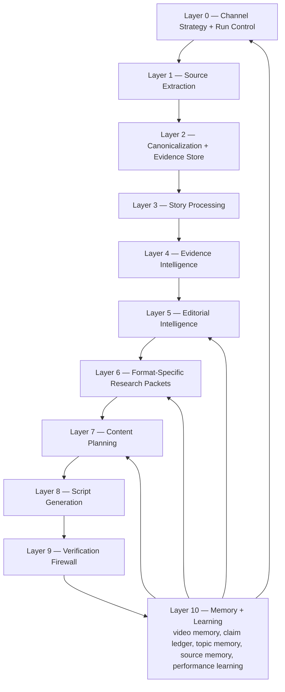
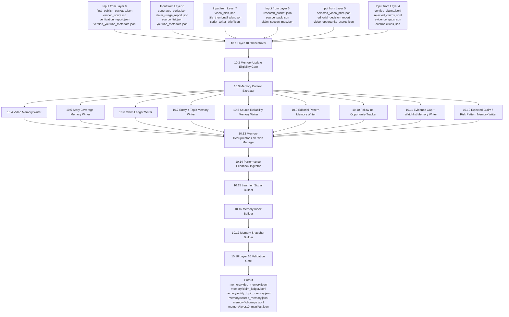

Absolutely — now we will design **Layer 10: Memory + Learning** in detail.

This is the final layer of the system.

Up to Layer 9, the system has created and verified a content package:

```text
Layer 1 → collected sources
Layer 2 → created canonical evidence
Layer 3 → formed stories
Layer 4 → verified claims
Layer 5 → made editorial decisions
Layer 6 → built research packets
Layer 7 → planned the video
Layer 8 → wrote the script
Layer 9 → verified the script
Layer 10 → stores what should be remembered and learned
```

Layer 10 is not just “save files.”
It is the **memory and learning system** for your channel.

It helps the system remember:

```text
What videos were already created
What stories were already covered
What claims were used
What topics are recurring
What sources were reliable
What titles/hooks were used
What angles should not be repeated
What evidence gaps should be monitored
What follow-up opportunities exist
What performed well or poorly
```

---

# Layer 10 — Memory + Learning

## 1. Purpose of Layer 10

Layer 10 answers:

```text
What should this system remember after a run?
What should it learn for future videos?
What should it avoid repeating?
Which verified facts should become long-term knowledge?
Which topics deserve follow-up monitoring?
Which editorial decisions worked?
```

Layer 9 says:

```text
This verified script is safe.
This source list is complete.
This final package is ready for human review.
```

Layer 10 says:

```text
Store this video candidate.
Store used claims.
Store covered story IDs.
Store topic/entity memory.
Store source reliability signals.
Store title/hook/angle memory.
Store follow-up opportunities.
Store lessons for future planning.
```

Layer 10 is the **channel memory layer**.

---

# 2. Why Layer 10 is important

Without Layer 10, every run starts from zero.

That creates problems:

```text
The system may repeat the same video.
It may use the same title angle again.
It may cover the same story twice.
It may forget unresolved evidence gaps.
It may forget that a claim was already used.
It may not recognize follow-up opportunities.
It may not learn which formats perform well.
It may not improve over time.
```

Layer 10 solves this by creating persistent memory.

This is especially important for your YouTube system because you are not just creating one script. You are building a channel.

A successful channel needs continuity:

```text
What have we covered?
What are we tracking?
What are we known for?
What should we revisit?
What should we avoid repeating?
What topics are becoming important over time?
```

---

# 3. What Layer 10 should do and not do

## Layer 10 should do

```text
Store verified video outputs.
Store approved scripts and metadata.
Store used verified claims.
Store topic/entity coverage history.
Store source usage history.
Store follow-up opportunities.
Store rejected claim patterns.
Store editorial decisions.
Store title/hook/thumbnail memory.
Store performance feedback when available.
Store learning signals for future runs.
Feed useful memory back to Layer 0, Layer 5, Layer 6, and Layer 7.
```

## Layer 10 should not do

```text
It should not store unverified claims as truth.
It should not store failed script claims as facts.
It should not update long-term memory from Layer 8 directly.
It should not treat rejected claims as usable knowledge.
It should not overwrite prior memory without versioning.
It should not let one weak source become permanent truth.
It should not automatically publish videos.
```

Most important rule:

```text
Only Layer 9-approved or clearly labeled records should enter durable memory.
```

---

# 4. Where Layer 10 sits in the full architecture



Layer 10 is not only the end. It also feeds future runs.

It helps:

```text
Layer 0 decide run mode and channel strategy.
Layer 5 check novelty and previous coverage.
Layer 6 build evergreen/follow-up packets.
Layer 7 avoid repeated hooks and titles.
```

---

# 5. Layer wise architecture — Layer 10 internal architecture



---

# 6. Layer 10 input and output

## Layer 10 input

Layer 10 mainly receives from Layer 9:

```text
final_publish_package.json
verified_script.md
verified_youtube_metadata.json
verification_report.json
sentence_verification_results.jsonl
source_attribution_report.json
metadata_safety_report.json
layer9_manifest.json
```

It can also read supporting files from previous layers:

```text
Layer 8:
  generated_script.json
  claim_usage_report.json
  source_list.json
  youtube_metadata.json

Layer 7:
  video_plan.json
  title_thumbnail_plan.json
  script_writer_brief.json

Layer 6:
  research_packet.json
  source_pack.json
  claim_section_map.json

Layer 5:
  selected_video_brief.json
  format_routing_decisions.json
  video_opportunity_scores.json

Layer 4:
  verified_claims.jsonl
  rejected_claims.jsonl
  evidence_gaps.json
  contradictions.json

Layer 3:
  story_clusters.json
  ranked_stories.json
  story_entity_topic_map.json
```

Example input:

```json
{
  "run_id": "run_2026_05_10_48h_auto",
  "inputs": {
    "final_publish_package_path": "data/runs/run_2026_05_10_48h_auto/layer_9/final_publish_package.json",
    "verification_report_path": "data/runs/run_2026_05_10_48h_auto/layer_9/verification_report.json",
    "verified_script_path": "data/runs/run_2026_05_10_48h_auto/layer_9/verified_script.md",
    "verified_youtube_metadata_path": "data/runs/run_2026_05_10_48h_auto/layer_9/verified_youtube_metadata.json",
    "claim_usage_report_path": "data/runs/run_2026_05_10_48h_auto/layer_8/claim_usage_report.json",
    "selected_video_brief_path": "data/runs/run_2026_05_10_48h_auto/layer_5/selected_video_brief.json"
  },
  "memory_policy": {
    "update_memory_only_if_layer9_passed": true,
    "allow_approved_with_warnings": true,
    "store_rejected_claims_as_risk_patterns": true,
    "store_unverified_claims_as_truth": false
  }
}
```

---

## Layer 10 output

Layer 10 produces persistent memory files.

For now, because you said you may maintain knowledge in JSON, start with JSON/JSONL.

```text
memory/
  video_memory.jsonl
  story_coverage_memory.jsonl
  claim_ledger.jsonl
  entity_topic_memory.jsonl
  source_memory.jsonl
  editorial_pattern_memory.jsonl
  title_hook_memory.jsonl
  followups.jsonl
  evidence_gap_watchlist.jsonl
  rejected_claim_patterns.jsonl
  performance_memory.jsonl
  learning_signals.jsonl
  memory_index.json
  memory_snapshot.json
  layer10_manifest.json
```

Main output summary:

```json
{
  "run_id": "run_2026_05_10_48h_auto",
  "layer": "layer_10_memory_learning",
  "status": "completed",
  "memory_update_status": "updated",
  "video_memory_updated": true,
  "claim_ledger_updated": true,
  "entity_topic_memory_updated": true,
  "followup_memory_updated": true,
  "memory_snapshot_path": "memory/memory_snapshot.json",
  "ready_for_future_runs": true
}
```

---

# 7. Memory types in Layer 10

Layer 10 should manage several memory types.

## 7.1 Run memory

Short-lived memory for the current run.

```text
Current run ID
Input files
Output files
Selected story
Selected claims
Verification status
Warnings
```

This helps debugging.

---

## 7.2 Video memory

Long-term memory of videos created or prepared.

```text
Video ID
Title
Format
Story IDs
Topic
Entities
Angle
Script path
Status
Published date if available
```

This helps Layer 5 avoid repeating topics.

---

## 7.3 Claim ledger

A persistent list of verified claims used in approved scripts.

```text
Claim ID
Claim text
Story ID
Source span IDs
Used in which video
Confidence
Usage date
```

This helps future videos avoid repeating the same facts unnecessarily.

---

## 7.4 Entity/topic memory

Tracks entities and topics over time.

```text
OpenAI
Anthropic
Gemini
AI agents
AI coding tools
AI regulation
AI chips
Open-source AI
```

This helps detect trends and recurring themes.

---

## 7.5 Source memory

Tracks source usefulness and reliability over time.

```text
Which sources frequently produce useful evidence?
Which sources are partial/snippet-only?
Which sources cause contradictions?
Which sources are trend-signal only?
```

---

## 7.6 Editorial pattern memory

Tracks what angles, hooks, titles, and formats were used.

```text
Previous hook style
Previous title angle
Previous thumbnail text
Previous thesis candidate
Previous video format
```

This prevents repetitive content.

---

## 7.7 Follow-up memory

Tracks stories that may need future videos.

```text
Unresolved story
Evidence gap
Expected update
Possible follow-up angle
Related previous video
```

---

## 7.8 Performance memory

Added after publishing, manually or through YouTube analytics later.

```text
Views
CTR
Average view duration
Retention
Comments
Likes
Subscriber gain
Topic performance
Title performance
Format performance
```

This helps the system learn what works.

---

## 7.9 Thesis memory

Tracks broader channel-level interpretations and recurring theses.

Example:

```text
AI coding tools are moving from autocomplete to workflow assistance.
Open-source AI is becoming more competitive but licensing remains complicated.
AI agents are a recurring theme, but definitions vary across companies.
```

Important: thesis memory should not be treated as hard fact. It should be stored as an editorial pattern with supporting claims.

---

# 8. Core Layer 10 data objects

Layer 10 should mainly produce:

```text
VideoMemoryRecord
StoryCoverageRecord
ClaimLedgerRecord
EntityTopicMemoryRecord
SourceMemoryRecord
EditorialPatternRecord
FollowUpRecord
EvidenceGapWatchlistRecord
RejectedClaimPatternRecord
PerformanceMemoryRecord
LearningSignalRecord
MemorySnapshot
Layer10Manifest
```

---

# 9. Module-by-module Layer 10 design

---

## Module 10.1 — Layer 10 Orchestrator

### Purpose

Coordinate all memory updates.

### Why it matters

Layer 10 updates multiple memory files. The orchestrator ensures only approved records are saved and all memory writers run in the correct order.

### Questions it answers

```text
Did Layer 9 approve the content?
Which memory files should be updated?
Which claims, stories, sources, and topics should be saved?
Should this run update long-term memory or only run memory?
```

### Input

```json
{
  "run_manifest_path": "data/runs/run_2026_05_10_48h_auto/run_manifest.json",
  "layer9_manifest_path": "data/runs/run_2026_05_10_48h_auto/layer_9/layer9_manifest.json",
  "final_publish_package_path": "data/runs/run_2026_05_10_48h_auto/layer_9/final_publish_package.json"
}
```

### Logic

```text
1. Load Layer 9 manifest.
2. Load final publish package.
3. Check final approval status.
4. Load required supporting files.
5. Run memory eligibility gate.
6. Extract memory context.
7. Update memory files.
8. Build memory index.
9. Validate memory output.
10. Write Layer 10 manifest.
```

### Output

```json
{
  "run_id": "run_2026_05_10_48h_auto",
  "memory_update_started": "2026-05-10T12:20:00Z",
  "memory_update_completed": "2026-05-10T12:22:00Z",
  "status": "completed"
}
```

---

## Module 10.2 — Memory Update Eligibility Gate

### Purpose

Decide whether this run is allowed to update memory.

### Why it matters

Not every run should update long-term memory.

Examples:

```text
Layer 9 approved → update memory.
Layer 9 approved with warnings → update memory with warning flags.
Layer 9 requires revision → store run log, but do not store as completed video.
Layer 9 blocked → store failure/risk pattern only.
```

### Questions it answers

```text
Did the script pass Layer 9?
Can this become long-term video memory?
Should claims be stored as used claims?
Should rejected claims be stored as risk patterns?
Should this run be excluded from published-video memory?
```

### Input

```json
{
  "final_approval": {
    "status": "approved_with_warnings",
    "ready_for_layer_10": true,
    "ready_for_human_review": true
  }
}
```

### Logic

```text
1. Read final approval status.
2. If approved or approved_with_warnings, allow durable memory update.
3. If requires_revision, store only run audit memory and correction needs.
4. If blocked, store only risk patterns and failure summary.
5. Apply memory policy from Layer 0.
```

### Output

```json
{
  "memory_update_eligibility": {
    "durable_memory_update_allowed": true,
    "video_memory_update_allowed": true,
    "claim_ledger_update_allowed": true,
    "risk_pattern_update_allowed": true,
    "status": "eligible"
  }
}
```

Blocked example:

```json
{
  "memory_update_eligibility": {
    "durable_memory_update_allowed": false,
    "video_memory_update_allowed": false,
    "claim_ledger_update_allowed": false,
    "risk_pattern_update_allowed": true,
    "status": "blocked_run_risk_only"
  }
}
```

---

## Module 10.3 — Memory Context Extractor

### Purpose

Extract memory-worthy information from all previous layers.

### Why it matters

Layer 10 should not store every raw file. It should extract the useful long-term memory.

### Questions it answers

```text
What video was created?
What was the format?
What story was covered?
Which claims were used?
Which entities and topics were involved?
Which sources were used?
What warnings remain?
What follow-up opportunities exist?
```

### Input

```json
{
  "final_publish_package": {},
  "verified_script": "data/runs/.../verified_script.md",
  "selected_video_brief": {},
  "claim_usage_report": {},
  "source_list": {},
  "verification_report": {}
}
```

### Logic

```text
1. Extract video identity.
2. Extract selected format.
3. Extract story IDs.
4. Extract entities/topics.
5. Extract used claim IDs.
6. Extract source refs.
7. Extract title/hook/thumbnail options.
8. Extract verification warnings.
9. Extract evidence gaps and follow-up records.
10. Build normalized memory context.
```

### Output

```json
{
  "memory_context": {
    "video": {
      "video_id": "video_candidate_20260510_001",
      "selected_format": "deep_dive",
      "working_title": "AI Coding Tools Are Moving Past Autocomplete",
      "primary_story_id": "story_001"
    },
    "claims_used": ["claim_001", "claim_002", "claim_018"],
    "entities": ["OpenAI", "Codex"],
    "topics": ["AI coding tools", "AI agents"],
    "sources_used": ["source_001", "source_002"],
    "verification_status": "approved_with_warnings"
  }
}
```

---

## Module 10.4 — Video Memory Writer

### Purpose

Store the video created or prepared from this run.

### Why it matters

Layer 5 needs this later to avoid duplicate videos.

### Questions it answers

```text
What video did we create?
What was the topic?
What format was used?
What title and angle were used?
Was it published or only prepared?
Which stories and claims were covered?
```

### Input

```json
{
  "video_id": "video_candidate_20260510_001",
  "selected_format": "deep_dive",
  "working_title": "AI Coding Tools Are Moving Past Autocomplete",
  "primary_story_id": "story_001",
  "topics": ["AI coding tools", "AI agents"],
  "entities": ["OpenAI", "Codex"],
  "verification_status": "approved_with_warnings"
}
```

### Output: `memory/video_memory.jsonl`

```json
{
  "video_id": "video_candidate_20260510_001",
  "run_id": "run_2026_05_10_48h_auto",
  "status": "prepared_for_human_review",
  "selected_format": "deep_dive",

  "title": {
    "working_title": "AI Coding Tools Are Moving Past Autocomplete",
    "approved_title_options": [
      "AI Coding Tools Are Moving Past Autocomplete",
      "Is This the Real Start of AI Coding Agents?"
    ]
  },

  "coverage": {
    "primary_story_id": "story_001",
    "supporting_story_ids": [],
    "entities": ["OpenAI", "Codex"],
    "topics": ["AI coding tools", "AI agents"],
    "used_claim_ids": ["claim_001", "claim_002", "claim_018"]
  },

  "assets": {
    "verified_script_path": "data/runs/run_2026_05_10_48h_auto/layer_9/verified_script.md",
    "final_publish_package_path": "data/runs/run_2026_05_10_48h_auto/layer_9/final_publish_package.json"
  },

  "verification": {
    "layer9_status": "approved_with_warnings",
    "risk_level": "low",
    "remaining_warnings": 2
  },

  "timestamps": {
    "created_at": "2026-05-10T12:22:00Z",
    "published_at": null
  }
}
```

---

## Module 10.5 — Story Coverage Memory Writer

### Purpose

Store which stories have been covered.

### Why it matters

The system should not create another video on the same story unless it is a real follow-up.

### Questions it answers

```text
Which story was covered?
Was it covered as a deep dive or roundup segment?
What angle was used?
Should future runs skip it or treat it as follow-up?
```

### Input

```json
{
  "story_id": "story_001",
  "video_id": "video_candidate_20260510_001",
  "coverage_type": "deep_dive",
  "angle": "AI coding tools moving from autocomplete to workflow agents"
}
```

### Output: `memory/story_coverage_memory.jsonl`

```json
{
  "story_id": "story_001",
  "video_id": "video_candidate_20260510_001",
  "run_id": "run_2026_05_10_48h_auto",
  "coverage_type": "deep_dive",
  "coverage_status": "covered_in_prepared_video",

  "story": {
    "canonical_story_title": "OpenAI announces coding-related product updates",
    "story_type": "product_launch",
    "entities": ["OpenAI", "Codex"],
    "topics": ["AI coding tools", "AI agents"]
  },

  "editorial_angle": {
    "angle": "AI coding tools moving from autocomplete to workflow agents",
    "central_viewer_question": "Does this actually change how developers use AI coding tools?"
  },

  "future_handling": {
    "skip_duplicate_for_days": 30,
    "allow_follow_up_if_new_evidence": true,
    "follow_up_conditions": [
      "new independent benchmark",
      "official availability update",
      "major user adoption evidence",
      "contradiction resolution"
    ]
  },

  "created_at": "2026-05-10T12:22:00Z"
}
```

---

## Module 10.6 — Claim Ledger Writer

### Purpose

Store verified claims used in approved scripts.

### Why it matters

The claim ledger helps future scripts know:

```text
This fact was already used.
This claim is verified.
This claim belongs to this story.
This claim has source traceability.
```

### Questions it answers

```text
Which verified claims were used?
Which video used them?
Which source spans support them?
Were they used as core facts, cautious claims, or background?
```

### Input

```json
{
  "used_claim_ids": ["claim_001", "claim_002", "claim_018"],
  "verified_claims": {},
  "sentence_claim_map": {},
  "source_map": {}
}
```

### Output: `memory/claim_ledger.jsonl`

```json
{
  "claim_id": "claim_001",
  "run_id": "run_2026_05_10_48h_auto",
  "video_id": "video_candidate_20260510_001",
  "story_id": "story_001",

  "claim": {
    "claim_text": "OpenAI announced a coding-related product update.",
    "claim_type": "event_fact",
    "confidence": "high",
    "support_level": "direct"
  },

  "usage": {
    "used_in_script": true,
    "used_as": "core_fact",
    "section_keys": ["hook", "what_happened"],
    "sentence_ids": ["sent_001", "sent_004"],
    "usage_count": 2
  },

  "evidence": {
    "source_span_ids": ["span_doc_openai_001_0001"],
    "source_urls": ["https://openai.com/news/example"],
    "source_roles": ["primary_evidence"]
  },

  "memory_policy": {
    "eligible_for_future_reuse": true,
    "avoid_repeating_verbatim": true,
    "must_preserve_caution": false
  },

  "created_at": "2026-05-10T12:22:00Z"
}
```

For cautious claim:

```json
{
  "claim_id": "claim_018",
  "video_id": "video_candidate_20260510_001",
  "story_id": "story_001",

  "claim": {
    "claim_text": "The update may affect developer workflows.",
    "claim_type": "interpretive_claim",
    "confidence": "medium",
    "support_level": "partial"
  },

  "usage": {
    "used_in_script": true,
    "used_as": "cautious_interpretation",
    "section_keys": ["why_it_matters", "limitations"]
  },

  "memory_policy": {
    "eligible_for_future_reuse": true,
    "must_preserve_caution": true,
    "required_qualifiers": ["may", "could", "suggests"]
  }
}
```

---

## Module 10.7 — Entity + Topic Memory Writer

### Purpose

Track entities and topics over time.

### Why it matters

This helps the system detect:

```text
Recurring topics
Over-covered companies
Trend buildup
Evergreen opportunities
Comparison opportunities
Follow-up opportunities
```

### Questions it answers

```text
How often have we covered OpenAI?
How often have we covered AI coding tools?
Is AI agents becoming a recurring theme?
Are we over-covering one company?
Which topics are building enough history for evergreen content?
```

### Input

```json
{
  "entities": ["OpenAI", "Codex"],
  "topics": ["AI coding tools", "AI agents"],
  "video_id": "video_candidate_20260510_001",
  "story_id": "story_001"
}
```

### Output: `memory/entity_topic_memory.jsonl`

```json
{
  "memory_id": "entity_topic_openai_20260510",
  "entity_or_topic": "OpenAI",
  "memory_type": "company",

  "coverage_update": {
    "video_id": "video_candidate_20260510_001",
    "story_id": "story_001",
    "selected_format": "deep_dive",
    "coverage_date": "2026-05-10",
    "angle": "AI coding workflow update"
  },

  "coverage_stats": {
    "times_covered_total": 4,
    "times_covered_last_30_days": 2,
    "last_covered_at": "2026-05-10T12:22:00Z"
  },

  "future_guidance": {
    "watch_for_followups": true,
    "avoid_repeating_same_angle": true,
    "possible_future_formats": ["follow_up", "comparison", "evergreen"]
  }
}
```

Topic example:

```json
{
  "memory_id": "topic_ai_coding_tools_20260510",
  "entity_or_topic": "AI coding tools",
  "memory_type": "topic",

  "coverage_update": {
    "video_id": "video_candidate_20260510_001",
    "story_id": "story_001",
    "coverage_date": "2026-05-10"
  },

  "trend_memory": {
    "trend_status": "building",
    "related_story_ids": ["story_001", "story_014", "story_022"],
    "possible_evergreen_angle": "How AI coding tools are moving beyond autocomplete"
  }
}
```

---

## Module 10.8 — Source Reliability Memory Writer

### Purpose

Track how useful and reliable sources are over time.

### Why it matters

Layer 1 and Layer 2 can improve collection quality if the system remembers which sources are useful.

### Questions it answers

```text
Which sources provided primary evidence?
Which sources were snippet-only?
Which sources produced useful verified claims?
Which sources were trend-only?
Which sources caused contradictions?
```

### Input

```json
{
  "source_list": [],
  "source_attribution_report": {},
  "verified_claims": []
}
```

### Output: `memory/source_memory.jsonl`

```json
{
  "source_id": "openai_news",
  "source_name": "OpenAI News",
  "source_group": "ai_company_blogs",
  "source_role": "primary_evidence",
  "trust_tier": 1,

  "usage_update": {
    "run_id": "run_2026_05_10_48h_auto",
    "video_id": "video_candidate_20260510_001",
    "used_for_claim_ids": ["claim_001", "claim_002"],
    "verified_claim_count": 2,
    "used_in_script": true
  },

  "source_quality_memory": {
    "historical_verified_claim_count": 18,
    "historical_usefulness_score": 0.94,
    "common_content_quality": "complete",
    "recommended_collection_priority": "high"
  },

  "created_at": "2026-05-10T12:22:00Z"
}
```

For community source:

```json
{
  "source_id": "hackernews_ai",
  "source_group": "community_signals",
  "source_role": "trend_signal_only",
  "trust_tier": 3,

  "usage_update": {
    "used_as": "audience_interest_signal",
    "used_for_factual_claims": false
  },

  "source_quality_memory": {
    "recommended_collection_priority": "medium",
    "allowed_usage": "trend_signal_only"
  }
}
```

---

## Module 10.9 — Editorial Pattern Memory Writer

### Purpose

Store the editorial angle, hook type, title style, and structure used.

### Why it matters

This prevents repetitive videos.

### Questions it answers

```text
What hook style did we use?
What title angle did we use?
What thumbnail text did we approve?
What thesis candidate did the video use?
Should future videos avoid this same framing?
```

### Input

```json
{
  "title_thumbnail_plan": {},
  "script_writer_brief": {},
  "video_plan": {},
  "verified_youtube_metadata": {}
}
```

### Output: `memory/editorial_pattern_memory.jsonl`

```json
{
  "editorial_pattern_id": "editorial_pattern_20260510_001",
  "video_id": "video_candidate_20260510_001",
  "run_id": "run_2026_05_10_48h_auto",

  "format": "deep_dive",

  "angle": {
    "central_viewer_question": "Does this actually change how developers use AI coding tools?",
    "viewer_promise": "Understand what changed, what may matter, and what is still not proven.",
    "thesis_candidate": "AI coding tools are moving from autocomplete toward workflow-level assistance."
  },

  "hook": {
    "hook_type": "tension_question",
    "hook_direction": "AI-agent hype vs actual workflow impact"
  },

  "title_thumbnail": {
    "recommended_title": "AI Coding Tools Are Moving Past Autocomplete",
    "thumbnail_text": ["AI CODING SHIFT", "NOT JUST AUTOCOMPLETE"]
  },

  "future_guidance": {
    "avoid_same_hook_for_days": 30,
    "avoid_same_title_angle_for_days": 45,
    "allow_follow_up_with_new_evidence": true
  }
}
```

---

## Module 10.10 — Follow-up Opportunity Tracker

### Purpose

Store future follow-up opportunities.

### Why it matters

AI news develops quickly. Some stories need a future update.

### Questions it answers

```text
What should we check again later?
What evidence gap could become a future video?
Which story deserves follow-up if new data appears?
What previous video should be referenced?
```

### Input

```json
{
  "evidence_gaps": [],
  "contradictions": [],
  "selected_video_brief": {},
  "story_fact_sheets": {}
}
```

### Output: `memory/followups.jsonl`

```json
{
  "followup_id": "followup_story_001_20260510",
  "related_video_id": "video_candidate_20260510_001",
  "story_id": "story_001",

  "followup_reason": "Real-world impact is not yet independently measured.",
  "followup_type": "evidence_gap_monitoring",

  "watch_for": [
    "independent benchmark or productivity analysis",
    "official availability update",
    "developer adoption evidence",
    "major competitor response"
  ],

  "possible_future_angle": "Did this AI coding update actually change developer workflows?",

  "priority": "medium",
  "status": "open",
  "created_at": "2026-05-10T12:22:00Z"
}
```

---

## Module 10.11 — Evidence Gap + Watchlist Memory Writer

### Purpose

Persist unresolved evidence gaps.

### Why it matters

Some stories should not become deep dives yet, but they may become strong later.

### Questions it answers

```text
What was missing?
Which claim could not be verified?
Which source type is needed?
Should future Layer 1 collection look for this?
```

### Input

```json
{
  "evidence_gaps": [
    {
      "gap_id": "gap_001",
      "gap_type": "missing_independent_confirmation"
    }
  ]
}
```

### Output: `memory/evidence_gap_watchlist.jsonl`

```json
{
  "gap_id": "gap_001",
  "run_id": "run_2026_05_10_48h_auto",
  "story_id": "story_001",
  "related_video_id": "video_candidate_20260510_001",

  "gap": {
    "gap_type": "missing_independent_real_world_impact",
    "description": "Sources describe capabilities but do not prove measurable productivity impact.",
    "severity": "medium"
  },

  "future_collection_guidance": {
    "look_for_source_types": [
      "independent benchmarks",
      "developer case studies",
      "official follow-up posts",
      "technical reviews"
    ],
    "query_hints": [
      "AI coding workflow productivity",
      "developer adoption results",
      "independent test"
    ]
  },

  "status": "open",
  "created_at": "2026-05-10T12:22:00Z"
}
```

---

## Module 10.12 — Rejected Claim / Risk Pattern Memory Writer

### Purpose

Store rejected claim patterns and risky wording.

### Why it matters

This helps future Layer 8 and Layer 9 avoid repeating the same mistakes.

### Questions it answers

```text
Which claims were rejected?
Which risky phrases appeared?
Which title angles were blocked?
Which overclaims should future scripts avoid?
```

### Input

```json
{
  "rejected_claims": [],
  "overclaim_report": {},
  "metadata_safety_report": {}
}
```

### Output: `memory/rejected_claim_patterns.jsonl`

```json
{
  "risk_pattern_id": "risk_pattern_20260510_001",
  "run_id": "run_2026_05_10_48h_auto",
  "story_id": "story_001",

  "pattern": {
    "risk_type": "unsupported_replacement_claim",
    "blocked_phrase": "will replace developers",
    "reason": "Available evidence supports workflow assistance, not developer replacement."
  },

  "source": {
    "rejected_claim_id": "claim_099",
    "detected_in": ["layer4_rejected_claims", "layer9_blocked_patterns"]
  },

  "future_guidance": {
    "block_in_scripts": true,
    "block_in_titles": true,
    "block_in_thumbnails": true,
    "safe_alternative": "could affect developer workflows"
  },

  "created_at": "2026-05-10T12:22:00Z"
}
```

---

## Module 10.13 — Memory Deduplicator + Version Manager

### Purpose

Prevent duplicate or conflicting memory records.

### Why it matters

Over time, JSONL memory can become messy. This module keeps it clean.

### Questions it answers

```text
Is this story already in memory?
Is this claim already stored?
Is this a new version of an existing record?
Should we update a record or append a new one?
Should older memory be marked superseded?
```

### Input

```json
{
  "new_memory_records": [],
  "existing_memory_index": "memory/memory_index.json"
}
```

### Logic

```text
1. Compare new story IDs to existing story memory.
2. Compare claim IDs to existing claim ledger.
3. Compare entity/topic keys.
4. If duplicate, update stats or append usage event.
5. If conflict, create new version and mark old status.
6. Rebuild memory index.
```

### Output

```json
{
  "deduplication_result": {
    "new_records_written": 18,
    "existing_records_updated": 7,
    "duplicates_skipped": 3,
    "versions_created": 1
  }
}
```

---

## Module 10.14 — Performance Feedback Ingestor

### Purpose

Ingest YouTube performance data after publishing.

### Why it matters

Layer 10 becomes much more powerful when it learns what actually worked.

This can be manual at first.

### Questions it answers

```text
How many views did the video get?
What was the CTR?
What was the retention?
Which title performed better?
Which topic performed well?
Which format performed well?
```

### Input

Manual or future API input:

```json
{
  "video_id": "video_candidate_20260510_001",
  "published_video_id": "youtube_video_abc123",
  "published_at": "2026-05-11T14:00:00Z",
  "performance": {
    "views_48h": 12000,
    "ctr": 0.071,
    "average_view_duration_seconds": 286,
    "like_count": 620,
    "comment_count": 84,
    "subscribers_gained": 110
  }
}
```

### Output: `memory/performance_memory.jsonl`

```json
{
  "video_id": "video_candidate_20260510_001",
  "published_video_id": "youtube_video_abc123",

  "performance": {
    "views_48h": 12000,
    "ctr": 0.071,
    "average_view_duration_seconds": 286,
    "retention_quality": "good",
    "engagement_quality": "good"
  },

  "content_attributes": {
    "format": "deep_dive",
    "topics": ["AI coding tools", "AI agents"],
    "entities": ["OpenAI", "Codex"],
    "hook_type": "tension_question",
    "title_angle": "trend_shift"
  },

  "learning_value": {
    "use_for_future_ranking": true,
    "positive_signals": [
      "deep_dive format performed well",
      "AI coding tools topic performed well",
      "trend_shift title angle performed well"
    ]
  }
}
```

---

## Module 10.15 — Learning Signal Builder

### Purpose

Convert memory and performance data into future guidance.

### Why it matters

Raw memory is useful, but learning signals make it actionable.

### Questions it answers

```text
Which topics are performing well?
Which formats should be used more?
Which title styles work?
Which hooks should be avoided?
Which sources produce useful claims?
Which topics are over-covered?
```

### Input

```json
{
  "video_memory": [],
  "performance_memory": [],
  "source_memory": [],
  "editorial_pattern_memory": []
}
```

### Output: `memory/learning_signals.jsonl`

```json
{
  "learning_signal_id": "learning_signal_20260510_001",
  "signal_type": "topic_performance",

  "signal": {
    "topic": "AI coding tools",
    "performance_trend": "positive",
    "supporting_video_ids": ["video_candidate_20260510_001"],
    "confidence": "medium"
  },

  "future_guidance": {
    "increase_priority_in_layer5": true,
    "recommended_formats": ["deep_dive", "comparison", "follow_up"],
    "avoid_repeating_same_angle": true
  },

  "created_at": "2026-05-10T12:22:00Z"
}
```

Source learning example:

```json
{
  "learning_signal_id": "learning_signal_source_openai_news",
  "signal_type": "source_quality",

  "signal": {
    "source_id": "openai_news",
    "usefulness": "high",
    "verified_claim_yield": "high"
  },

  "future_guidance": {
    "increase_collection_priority": true,
    "use_as_primary_evidence_when_available": true
  }
}
```

---

## Module 10.16 — Memory Index Builder

### Purpose

Build a searchable index of memory files.

### Why it matters

Future layers should not scan every JSONL file manually. The index helps retrieve relevant memory quickly.

### Questions it answers

```text
Where can I find all videos about OpenAI?
Where can I find all claims about AI agents?
Where can I find previous hooks?
Where can I find follow-up opportunities?
```

### Output: `memory/memory_index.json`

```json
{
  "created_at": "2026-05-10T12:22:00Z",

  "indexes": {
    "by_video_id": {
      "video_candidate_20260510_001": {
        "video_memory_path": "memory/video_memory.jsonl",
        "story_ids": ["story_001"],
        "claim_ids": ["claim_001", "claim_002", "claim_018"]
      }
    },

    "by_story_id": {
      "story_001": {
        "covered_in_video_ids": ["video_candidate_20260510_001"],
        "followup_ids": ["followup_story_001_20260510"]
      }
    },

    "by_entity": {
      "OpenAI": {
        "video_ids": ["video_candidate_20260510_001"],
        "story_ids": ["story_001"]
      }
    },

    "by_topic": {
      "AI coding tools": {
        "video_ids": ["video_candidate_20260510_001"],
        "claim_ids": ["claim_001", "claim_018"]
      }
    }
  }
}
```

---

## Module 10.17 — Memory Snapshot Builder

### Purpose

Create a compact memory summary for future runs.

### Why it matters

Layer 5 and Layer 7 do not need the full memory store every time. They need a compact snapshot.

### Questions it answers

```text
What has the channel covered recently?
What topics are over-covered?
What follow-ups are open?
What title angles were used recently?
What should future runs avoid?
```

### Output: `memory/memory_snapshot.json`

```json
{
  "snapshot_created_at": "2026-05-10T12:22:00Z",

  "recent_coverage": {
    "last_30_days": {
      "videos_prepared": 8,
      "top_entities": ["OpenAI", "Anthropic", "Google"],
      "top_topics": ["AI agents", "AI coding tools", "open-source AI"]
    }
  },

  "avoid_repetition": {
    "recent_title_angles": [
      "AI coding tools moving past autocomplete",
      "AI agents becoming real"
    ],
    "recent_hook_types": [
      "tension_question",
      "hype_vs_reality"
    ],
    "avoid_same_angle_topics": [
      {
        "topic": "AI coding tools",
        "avoid_until": "2026-06-10",
        "unless": "new major evidence or follow-up"
      }
    ]
  },

  "open_followups": [
    {
      "followup_id": "followup_story_001_20260510",
      "topic": "AI coding tools",
      "priority": "medium",
      "watch_for": ["independent benchmark", "adoption evidence"]
    }
  ],

  "source_guidance": {
    "high_priority_sources": ["openai_news", "anthropic_news", "google_deepmind_blog"],
    "trend_signal_sources": ["hackernews_ai", "reddit_machinelearning"]
  },

  "layer_guidance": {
    "for_layer5": {
      "check_novelty_against": "video_memory.jsonl",
      "use_followups": "followups.jsonl",
      "avoid_recent_angles": true
    },
    "for_layer7": {
      "avoid_recent_hook_repetition": true,
      "check_title_similarity": true
    }
  }
}
```

---

## Module 10.18 — Layer 10 Validation Gate

### Purpose

Validate memory updates.

### Why it matters

Memory corruption can damage future runs.

### Validation rules

Layer 10 passes if:

```text
Layer 9 status is recorded.
Video memory is written only if eligible.
Claim ledger contains only verified or cautious approved claims.
Rejected claims are stored only as risk patterns, not facts.
Every memory record has run_id.
Every memory record has created_at.
Story coverage records have story_id and video_id.
Memory index is rebuilt.
Memory snapshot is created.
Layer10 manifest is written.
```

### Output

```json
{
  "validation_status": "passed",
  "memory_files_validated": [
    "video_memory.jsonl",
    "claim_ledger.jsonl",
    "entity_topic_memory.jsonl",
    "source_memory.jsonl",
    "memory_index.json",
    "memory_snapshot.json"
  ],
  "errors": [],
  "warnings": []
}
```

---

# 10. Layer 10 output files in detail

## 10.1 `memory/video_memory.jsonl`

Stores video-level memory.

```json
{
  "video_id": "video_candidate_20260510_001",
  "run_id": "run_2026_05_10_48h_auto",
  "status": "prepared_for_human_review",
  "selected_format": "deep_dive",
  "title": "AI Coding Tools Are Moving Past Autocomplete",
  "primary_story_id": "story_001",
  "entities": ["OpenAI", "Codex"],
  "topics": ["AI coding tools", "AI agents"],
  "verified_script_path": "data/runs/run_2026_05_10_48h_auto/layer_9/verified_script.md",
  "created_at": "2026-05-10T12:22:00Z"
}
```

---

## 10.2 `memory/story_coverage_memory.jsonl`

Stores story coverage.

```json
{
  "story_id": "story_001",
  "video_id": "video_candidate_20260510_001",
  "coverage_type": "deep_dive",
  "angle": "AI coding tools moving from autocomplete to workflow agents",
  "allow_follow_up_if_new_evidence": true,
  "created_at": "2026-05-10T12:22:00Z"
}
```

---

## 10.3 `memory/claim_ledger.jsonl`

Stores used claims.

```json
{
  "claim_id": "claim_001",
  "video_id": "video_candidate_20260510_001",
  "story_id": "story_001",
  "claim_text": "OpenAI announced a coding-related product update.",
  "confidence": "high",
  "source_span_ids": ["span_doc_openai_001_0001"],
  "used_as": "core_fact",
  "created_at": "2026-05-10T12:22:00Z"
}
```

---

## 10.4 `memory/entity_topic_memory.jsonl`

Stores entity and topic coverage.

```json
{
  "entity_or_topic": "AI coding tools",
  "memory_type": "topic",
  "video_id": "video_candidate_20260510_001",
  "story_id": "story_001",
  "trend_status": "building",
  "possible_future_formats": ["follow_up", "comparison", "evergreen"],
  "created_at": "2026-05-10T12:22:00Z"
}
```

---

## 10.5 `memory/source_memory.jsonl`

Stores source usefulness.

```json
{
  "source_id": "openai_news",
  "source_group": "ai_company_blogs",
  "source_role": "primary_evidence",
  "trust_tier": 1,
  "used_for_claim_ids": ["claim_001", "claim_002"],
  "verified_claim_count": 2,
  "recommended_collection_priority": "high",
  "created_at": "2026-05-10T12:22:00Z"
}
```

---

## 10.6 `memory/editorial_pattern_memory.jsonl`

Stores angle, hook, title memory.

```json
{
  "video_id": "video_candidate_20260510_001",
  "format": "deep_dive",
  "hook_type": "tension_question",
  "title_angle": "trend_shift",
  "central_viewer_question": "Does this actually change how developers use AI coding tools?",
  "avoid_same_angle_for_days": 45,
  "created_at": "2026-05-10T12:22:00Z"
}
```

---

## 10.7 `memory/followups.jsonl`

Stores follow-up opportunities.

```json
{
  "followup_id": "followup_story_001_20260510",
  "related_video_id": "video_candidate_20260510_001",
  "story_id": "story_001",
  "followup_reason": "Real-world impact is not yet independently measured.",
  "watch_for": [
    "independent benchmark",
    "developer adoption evidence",
    "official availability update"
  ],
  "priority": "medium",
  "status": "open",
  "created_at": "2026-05-10T12:22:00Z"
}
```

---

## 10.8 `memory/evidence_gap_watchlist.jsonl`

Stores unresolved gaps.

```json
{
  "gap_id": "gap_001",
  "story_id": "story_001",
  "gap_type": "missing_independent_real_world_impact",
  "description": "Sources describe capabilities but do not prove measurable productivity impact.",
  "look_for_source_types": [
    "independent benchmarks",
    "technical reviews",
    "developer case studies"
  ],
  "status": "open",
  "created_at": "2026-05-10T12:22:00Z"
}
```

---

## 10.9 `memory/rejected_claim_patterns.jsonl`

Stores blocked patterns.

```json
{
  "risk_pattern_id": "risk_pattern_20260510_001",
  "risk_type": "unsupported_replacement_claim",
  "blocked_phrase": "will replace developers",
  "safe_alternative": "could affect developer workflows",
  "block_in_scripts": true,
  "block_in_titles": true,
  "created_at": "2026-05-10T12:22:00Z"
}
```

---

## 10.10 `memory/performance_memory.jsonl`

Stores performance after publishing.

```json
{
  "video_id": "video_candidate_20260510_001",
  "published_video_id": "youtube_video_abc123",
  "views_48h": 12000,
  "ctr": 0.071,
  "average_view_duration_seconds": 286,
  "format": "deep_dive",
  "topics": ["AI coding tools", "AI agents"],
  "performance_trend": "positive",
  "created_at": "2026-05-12T12:00:00Z"
}
```

---

## 10.11 `memory/learning_signals.jsonl`

Stores actionable learning.

```json
{
  "learning_signal_id": "learning_signal_20260510_001",
  "signal_type": "topic_performance",
  "topic": "AI coding tools",
  "performance_trend": "positive",
  "future_guidance": {
    "increase_priority_in_layer5": true,
    "recommended_formats": ["deep_dive", "comparison", "follow_up"],
    "avoid_repeating_same_angle": true
  },
  "created_at": "2026-05-10T12:22:00Z"
}
```

---

## 10.12 `memory/memory_index.json`

Searchable lookup index.

```json
{
  "created_at": "2026-05-10T12:22:00Z",
  "by_video_id": {},
  "by_story_id": {},
  "by_claim_id": {},
  "by_entity": {},
  "by_topic": {},
  "by_source_id": {}
}
```

---

## 10.13 `memory/memory_snapshot.json`

Compact summary for future runs.

```json
{
  "snapshot_created_at": "2026-05-10T12:22:00Z",
  "recent_coverage": {},
  "avoid_repetition": {},
  "open_followups": [],
  "source_guidance": {},
  "layer_guidance": {}
}
```

---

## 10.14 `memory/layer10_manifest.json`

```json
{
  "run_id": "run_2026_05_10_48h_auto",
  "layer": "layer_10_memory_learning",
  "created_at": "2026-05-10T12:22:00Z",

  "inputs": {
    "layer9_manifest": "data/runs/run_2026_05_10_48h_auto/layer_9/layer9_manifest.json",
    "final_publish_package": "data/runs/run_2026_05_10_48h_auto/layer_9/final_publish_package.json",
    "verified_script": "data/runs/run_2026_05_10_48h_auto/layer_9/verified_script.md",
    "verification_report": "data/runs/run_2026_05_10_48h_auto/layer_9/verification_report.json"
  },

  "outputs": {
    "video_memory": "memory/video_memory.jsonl",
    "story_coverage_memory": "memory/story_coverage_memory.jsonl",
    "claim_ledger": "memory/claim_ledger.jsonl",
    "entity_topic_memory": "memory/entity_topic_memory.jsonl",
    "source_memory": "memory/source_memory.jsonl",
    "editorial_pattern_memory": "memory/editorial_pattern_memory.jsonl",
    "followups": "memory/followups.jsonl",
    "evidence_gap_watchlist": "memory/evidence_gap_watchlist.jsonl",
    "rejected_claim_patterns": "memory/rejected_claim_patterns.jsonl",
    "memory_index": "memory/memory_index.json",
    "memory_snapshot": "memory/memory_snapshot.json"
  },

  "memory_update_summary": {
    "video_memory_records_written": 1,
    "claim_ledger_records_written": 9,
    "entity_topic_records_written": 4,
    "source_memory_records_written": 6,
    "followup_records_written": 1,
    "risk_pattern_records_written": 2
  },

  "status": {
    "memory_update_status": "completed",
    "ready_for_future_runs": true
  }
}
```

---

# 11. Layer 10 config files

Layer 10 should be config-driven.

```text
config/
  memory_policy.yaml
  memory_schema_rules.yaml
  memory_dedup_rules.yaml
  performance_learning_rules.yaml
  followup_tracking_rules.yaml
  retention_rules.yaml
```

---

## `memory_policy.yaml`

```yaml
memory_policy:
  update_memory_only_if_layer9_passed: true
  allow_approved_with_warnings: true
  store_rejected_claims_as_risk_patterns: true
  store_unverified_claims_as_truth: false

  durable_memory_allowed_statuses:
    - approved
    - approved_with_warnings

  blocked_status_handling:
    store_video_memory: false
    store_claim_ledger: false
    store_risk_patterns: true
    store_failure_summary: true
```

---

## `memory_schema_rules.yaml`

```yaml
memory_schema:
  required_fields:
    all_records:
      - run_id
      - created_at

    video_memory:
      - video_id
      - selected_format
      - status
      - topics
      - entities

    claim_ledger:
      - claim_id
      - claim_text
      - source_span_ids
      - confidence

    story_coverage:
      - story_id
      - video_id
      - coverage_type

  reject_if:
    claim_without_source_span: true
    rejected_claim_stored_as_fact: true
    missing_run_id: true
```

---

## `memory_dedup_rules.yaml`

```yaml
memory_dedup:
  video_memory:
    duplicate_key:
      - video_id

  story_coverage:
    duplicate_key:
      - story_id
      - coverage_type

  claim_ledger:
    duplicate_key:
      - claim_id
      - video_id

  entity_topic_memory:
    update_stats_if_existing: true

  source_memory:
    update_quality_stats_if_existing: true
```

---

## `followup_tracking_rules.yaml`

```yaml
followups:
  create_followup_if:
    unresolved_evidence_gap: true
    unresolved_contradiction: true
    expected_official_update: true
    high_interest_story_with_missing_data: true

  priority_rules:
    high:
      - major_story
      - official_source_present
      - evidence_gap_blocks_deep_dive

    medium:
      - useful_followup_possible
      - topic_relevance_high

    low:
      - weak_story
      - limited_audience_value
```

---

## `performance_learning_rules.yaml`

```yaml
performance_learning:
  metrics:
    - views_48h
    - ctr
    - average_view_duration
    - retention
    - comments
    - subscribers_gained

  positive_signal_thresholds:
    ctr: 0.06
    average_view_duration_percent: 0.40

  learning_outputs:
    update_topic_priority: true
    update_format_priority: true
    update_title_angle_memory: true
    update_hook_memory: true
```

---

## `retention_rules.yaml`

```yaml
retention:
  raw_run_artifacts:
    keep_days: 90

  memory_records:
    keep_indefinitely:
      - video_memory
      - claim_ledger
      - story_coverage_memory
      - performance_memory

  refresh_periodically:
    - memory_snapshot
    - memory_index

  archive_old_records_after_days: 365
```

---

# 12. Suggested Layer 10 folder structure

```text
pipelines/
  layer_10_memory_learning/
    __init__.py
    run_layer_10.py

    orchestrator/
      layer10_orchestrator.py

    gates/
      memory_update_eligibility_gate.py

    extraction/
      memory_context_extractor.py

    writers/
      video_memory_writer.py
      story_coverage_memory_writer.py
      claim_ledger_writer.py
      entity_topic_memory_writer.py
      source_memory_writer.py
      editorial_pattern_memory_writer.py
      followup_opportunity_tracker.py
      evidence_gap_watchlist_writer.py
      rejected_claim_pattern_writer.py

    learning/
      performance_feedback_ingestor.py
      learning_signal_builder.py

    indexing/
      memory_deduplicator.py
      memory_version_manager.py
      memory_index_builder.py
      memory_snapshot_builder.py

    validation/
      layer10_validation_gate.py

    output/
      layer10_manifest_writer.py

config/
  memory_policy.yaml
  memory_schema_rules.yaml
  memory_dedup_rules.yaml
  performance_learning_rules.yaml
  followup_tracking_rules.yaml
  retention_rules.yaml

memory/
  video_memory.jsonl
  story_coverage_memory.jsonl
  claim_ledger.jsonl
  entity_topic_memory.jsonl
  source_memory.jsonl
  editorial_pattern_memory.jsonl
  title_hook_memory.jsonl
  followups.jsonl
  evidence_gap_watchlist.jsonl
  rejected_claim_patterns.jsonl
  performance_memory.jsonl
  learning_signals.jsonl
  memory_index.json
  memory_snapshot.json
  layer10_manifest.json
```

---

# 13. Layer 10 processing flow

```text
Step 1:
Load Layer 9 manifest and final publish package.

Step 2:
Check Layer 9 approval status.

Step 3:
Run memory update eligibility gate.

Step 4:
Load supporting files from Layer 8, Layer 7, Layer 6, Layer 5, and Layer 4.

Step 5:
Extract memory context.

Step 6:
Write video memory.

Step 7:
Write story coverage memory.

Step 8:
Write claim ledger.

Step 9:
Write entity and topic memory.

Step 10:
Write source memory.

Step 11:
Write editorial pattern memory.

Step 12:
Write follow-up opportunities.

Step 13:
Write evidence gap watchlist.

Step 14:
Write rejected claim and risk pattern memory.

Step 15:
Deduplicate and version memory records.

Step 16:
Ingest performance feedback if available.

Step 17:
Build learning signals.

Step 18:
Build memory index.

Step 19:
Build memory snapshot.

Step 20:
Validate memory output.

Step 21:
Write Layer 10 manifest.
```

---

# 14. How Layer 10 supports future layers

| Future layer                     | What Layer 10 provides                                                     |
| -------------------------------- | -------------------------------------------------------------------------- |
| Layer 0 — Channel Strategy       | memory snapshot, recent coverage, format mix, run guidance                 |
| Layer 1 — Source Extraction      | source priority, watchlist queries, follow-up source targets               |
| Layer 3 — Story Processing       | previous story IDs, topic recurrence, story families                       |
| Layer 5 — Editorial Intelligence | novelty checks, previous coverage, portfolio balancing, performance memory |
| Layer 6 — Research Packets       | evergreen memory, follow-up memory, prior claim ledger                     |
| Layer 7 — Content Planning       | previous hooks, title angles, thumbnail text, style repetition checks      |
| Layer 8 — Script Generation      | blocked phrases, risk patterns, previously used claims                     |
| Layer 9 — Verification Firewall  | rejected claim patterns, risky title patterns, cautious language memory    |

---

# 15. Layer 10 and hallucination control

Layer 10 is extremely important for hallucination control because bad memory can poison future runs.

## Rule 1: Only verified claims become reusable facts

Allowed:

```text
Layer 4 verified claim + Layer 9 approved script usage → claim ledger
```

Not allowed:

```text
Layer 8 generated sentence without verification → durable fact memory
```

---

## Rule 2: Rejected claims are stored only as risk patterns

A rejected claim should not be stored as knowledge.

Correct:

```json
{
  "risk_type": "unsupported_replacement_claim",
  "blocked_phrase": "will replace developers"
}
```

Incorrect:

```json
{
  "fact": "This tool will replace developers."
}
```

---

## Rule 3: Editorial thesis is not the same as fact

A thesis can be stored, but it should be labeled correctly.

```json
{
  "memory_type": "editorial_thesis",
  "thesis": "AI coding tools are moving toward workflow-level assistance.",
  "supporting_claim_ids": ["claim_001", "claim_018"],
  "status": "interpretive_not_factual"
}
```

---

## Rule 4: Memory should preserve uncertainty

If a claim was cautious, memory must keep that caution.

```json
{
  "claim_id": "claim_018",
  "must_preserve_caution": true,
  "required_qualifiers": ["may", "could", "suggests"]
}
```

---

## Rule 5: Memory should prevent repetition

Layer 10 should help future runs avoid:

```text
same story
same hook
same title angle
same thesis
same intro framing
same unsupported claim pattern
```

---

# 16. Short-term, long-term, thesis, and performance memory

You specifically asked earlier about memory types. This is how to divide them.

## Short-term memory

Used during one run.

```text
Current selected story
Current claims
Current packet
Current script plan
Current verification warnings
```

Storage:

```text
data/runs/{run_id}/
```

Purpose:

```text
Debugging and current pipeline coordination.
```

---

## Long-term memory

Used across many runs.

```text
Past videos
Past claims
Past stories
Past sources
Past topics
Past follow-ups
```

Storage:

```text
memory/*.jsonl
```

Purpose:

```text
Novelty check, follow-up planning, topic tracking, source prioritization.
```

---

## Thesis memory

Stores recurring editorial interpretations.

Example:

```json
{
  "thesis_id": "thesis_ai_coding_workflow_shift",
  "thesis_text": "AI coding tools are moving from autocomplete toward workflow-level assistance.",
  "supporting_claim_ids": ["claim_001", "claim_018", "claim_mem_011"],
  "confidence": "medium",
  "status": "active_editorial_thesis",
  "not_a_verified_fact": true,
  "last_used_video_id": "video_candidate_20260510_001"
}
```

Purpose:

```text
Help evergreen videos, follow-ups, and deeper analysis.
```

Important:

```text
Thesis memory should guide analysis, not become unquestioned truth.
```

---

## Performance memory

Used after videos are published.

```text
CTR
views
retention
comments
likes
subscriber gain
```

Purpose:

```text
Improve future format selection, title strategy, hook strategy, and topic prioritization.
```

---

# 17. Layer 10 input/output contract

## Layer 10 input contract

```json
{
  "run_id": "string",
  "run_manifest_path": "string",
  "layer9_manifest_path": "string",

  "layer9_inputs": {
    "final_publish_package_path": "string",
    "verification_report_path": "string",
    "verified_script_path": "string",
    "verified_youtube_metadata_path": "string",
    "sentence_verification_results_path": "string"
  },

  "layer8_inputs": {
    "generated_script_path": "string",
    "claim_usage_report_path": "string",
    "source_list_path": "string",
    "youtube_metadata_path": "string"
  },

  "layer7_inputs": {
    "video_plan_path": "string",
    "script_writer_brief_path": "string",
    "title_thumbnail_plan_path": "string"
  },

  "layer6_inputs": {
    "research_packet_path": "string",
    "source_pack_path": "string",
    "claim_section_map_path": "string"
  },

  "layer5_inputs": {
    "selected_video_brief_path": "string",
    "format_routing_decisions_path": "string",
    "video_opportunity_scores_path": "string"
  },

  "layer4_inputs": {
    "verified_claims_path": "string",
    "rejected_claims_path": "string",
    "evidence_gaps_path": "string",
    "contradictions_path": "string"
  }
}
```

---

## Layer 10 output contract

```json
{
  "run_id": "string",
  "layer": "layer_10_memory_learning",
  "status": "completed | completed_with_warnings | skipped | failed",

  "outputs": {
    "video_memory": "memory/video_memory.jsonl",
    "story_coverage_memory": "memory/story_coverage_memory.jsonl",
    "claim_ledger": "memory/claim_ledger.jsonl",
    "entity_topic_memory": "memory/entity_topic_memory.jsonl",
    "source_memory": "memory/source_memory.jsonl",
    "editorial_pattern_memory": "memory/editorial_pattern_memory.jsonl",
    "followups": "memory/followups.jsonl",
    "evidence_gap_watchlist": "memory/evidence_gap_watchlist.jsonl",
    "rejected_claim_patterns": "memory/rejected_claim_patterns.jsonl",
    "performance_memory": "memory/performance_memory.jsonl",
    "learning_signals": "memory/learning_signals.jsonl",
    "memory_index": "memory/memory_index.json",
    "memory_snapshot": "memory/memory_snapshot.json",
    "layer10_manifest": "memory/layer10_manifest.json"
  },

  "memory_update_summary": {
    "video_memory_records_written": "number",
    "claim_ledger_records_written": "number",
    "topic_records_updated": "number",
    "source_records_updated": "number",
    "followup_records_created": "number",
    "risk_pattern_records_created": "number"
  },

  "handoff": {
    "ready_for_future_runs": "boolean"
  }
}
```

---

# 18. Implementation priority for Layer 10

Build Layer 10 in this order:

```text
1. Memory Update Eligibility Gate
2. Memory Context Extractor
3. Video Memory Writer
4. Story Coverage Memory Writer
5. Claim Ledger Writer
6. Entity + Topic Memory Writer
7. Follow-up Opportunity Tracker
8. Evidence Gap Watchlist Writer
9. Rejected Claim Pattern Writer
10. Memory Index Builder
11. Memory Snapshot Builder
12. Layer 10 Validation Gate
13. Source Reliability Memory Writer
14. Editorial Pattern Memory Writer
15. Performance Feedback Ingestor
16. Learning Signal Builder
17. Memory Deduplicator + Version Manager
```

For the first practical version, build only:

```text
memory eligibility gate
video_memory.jsonl
story_coverage_memory.jsonl
claim_ledger.jsonl
entity_topic_memory.jsonl
followups.jsonl
memory_snapshot.json
layer10_manifest.json
```

Then add:

```text
source_memory.jsonl
editorial_pattern_memory.jsonl
evidence_gap_watchlist.jsonl
rejected_claim_patterns.jsonl
performance_memory.jsonl
learning_signals.jsonl
memory_index.json
```

---

# 19. Final summary of Layer 10

Layer 10 is the **memory and learning layer**.

It receives:

```text
final_publish_package.json
verified_script.md
verification_report.json
verified_youtube_metadata.json
claim_usage_report.json
selected_video_brief.json
verified_claims.jsonl
evidence_gaps.json
source_list.json
```

It produces:

```text
video_memory.jsonl
story_coverage_memory.jsonl
claim_ledger.jsonl
entity_topic_memory.jsonl
source_memory.jsonl
editorial_pattern_memory.jsonl
followups.jsonl
evidence_gap_watchlist.jsonl
rejected_claim_patterns.jsonl
performance_memory.jsonl
learning_signals.jsonl
memory_index.json
memory_snapshot.json
layer10_manifest.json
```

Its job is:

```text
remember what was created
remember what was covered
remember what claims were used
remember what topics/entities are recurring
remember what sources were useful
remember what risks and rejected claims to avoid
remember follow-up opportunities
learn from performance later
feed future runs with novelty, source, topic, and editorial guidance
```

The most important Layer 10 rule:

```text
Layer 10 should store verified memory, not hallucinated memory.
```

Once Layer 10 is complete, your system can safely say:

```text
This video is now remembered.
These claims are now in the claim ledger.
This story is marked as covered.
These topics are tracked.
These follow-ups are open.
These risky phrases should be avoided.
Future runs can use this memory to create better, less repetitive, more evidence-grounded videos.
```
