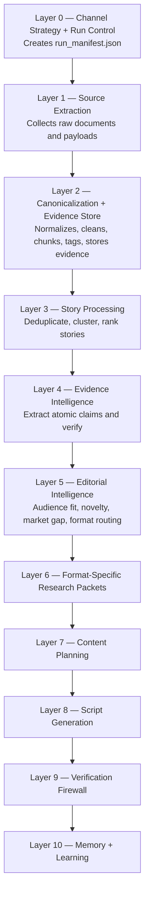
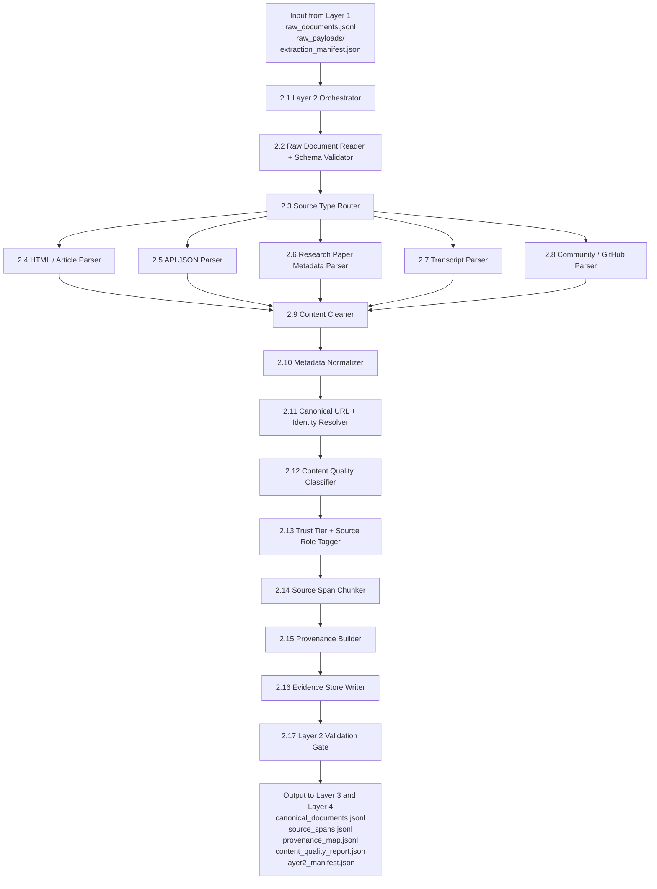

Absolutely — now we will design **Layer 2: Canonicalization + Evidence Store** in detail.

Layer 1 collected raw material from different sources. Layer 2 converts that messy raw material into a **clean, standardized, traceable evidence base**.

This is one of the most important layers in the whole system because your later agents should not reason directly from random raw HTML, API snippets, transcripts, or Reddit posts. They should reason from **canonical documents** and **source spans**.

Your earlier architecture already said that after collection, the system should clean and normalize content, then deduplicate, cluster, score, extract claims, verify, and only then generate the script. It also emphasized that the LLM should not randomly collect or invent AI news; source material should be collected and grounded first. 

---

# Layer 2 — Canonicalization + Evidence Store

## 1. Purpose of Layer 2

Layer 2 transforms raw extracted documents into clean, structured evidence.

Layer 1 says:

```text id="pty29z"
Here are raw items from OpenAI, NewsAPI, arXiv, YouTube, Hacker News, GitHub, etc.
```

Layer 2 says:

```text id="ar6w6r"
Here are clean canonical documents.
Here are exact source spans.
Here are trust labels.
Here is the provenance map.
Here is what content is complete, partial, missing, or weak.
```

Layer 2 does **not** decide which stories are important. That happens in Layer 3.

Layer 2 does **not** write summaries. That happens later.

Layer 2 does **not** create final claims. That happens in Layer 4.

Layer 2 only prepares clean evidence.

---

# 2. Why Layer 2 is important

Without Layer 2, your pipeline becomes unreliable because later layers may read:

```text id="tmb13q"
cookie banners
navigation menus
partial API snippets
duplicate boilerplate
missing publish dates
random comments
wrong source metadata
untrusted community discussions
unclean transcript blocks
```

That leads to hallucination, bad clustering, weak ranking, and unsupported scripts.

Layer 2 solves this by creating a clean evidence store with:

```text id="xiwgu9"
canonical document IDs
clean source text
source spans
source reliability hints
provenance links
content quality flags
traceable raw payload references
```

This is the layer that makes your system **auditable**.

---

# 3. Where Layer 2 sits in the full architecture



Layer 2 is the bridge between **raw collection** and **actual intelligence**.

---

# 4. Layer-wise architecture — Layer 2 internal architecture



---

# 5. Layer 2 design principle

Layer 2 should follow this rule:

```text id="yz66dp"
Preserve the original source.
Clean the content.
Standardize the schema.
Split into citeable source spans.
Never invent missing information.
Never summarize as fact.
```

Very important:

```text id="srn5n9"
Raw data is not evidence yet.
Clean canonical spans are evidence candidates.
Verified claims come later in Layer 4.
```

Layer 2 prepares evidence; it does not conclude.

---

# 6. Layer 2 input and output

## Layer 2 input

Layer 2 receives output from Layer 1:

```text id="u39qxp"
data/runs/{run_id}/layer_1/raw_documents.jsonl
data/runs/{run_id}/layer_1/raw_payloads/
data/runs/{run_id}/layer_1/extraction_manifest.json
data/runs/{run_id}/run_manifest.json
```

Example input:

```json id="ev9rwl"
{
  "run_id": "run_2026_05_10_48h_auto",
  "layer_1_outputs": {
    "raw_documents_path": "data/runs/run_2026_05_10_48h_auto/layer_1/raw_documents.jsonl",
    "raw_payloads_base_path": "data/runs/run_2026_05_10_48h_auto/layer_1/raw_payloads/",
    "extraction_manifest_path": "data/runs/run_2026_05_10_48h_auto/layer_1/extraction_manifest.json"
  },
  "quality_policy": {
    "every_claim_requires_source_span": true,
    "allow_community_sources_as_primary_truth": false
  }
}
```

---

## Layer 2 output

Layer 2 produces:

```text id="u4i255"
data/runs/{run_id}/layer_2/
  canonical_documents.jsonl
  source_spans.jsonl
  provenance_map.jsonl
  content_quality_report.json
  source_trust_report.json
  rejected_documents.jsonl
  layer2_manifest.json
```

Main output:

```json id="uyqmxt"
{
  "run_id": "run_2026_05_10_48h_auto",
  "layer": "layer_2_canonicalization_evidence_store",
  "status": "completed_with_warnings",
  "canonical_documents_path": "data/runs/run_2026_05_10_48h_auto/layer_2/canonical_documents.jsonl",
  "source_spans_path": "data/runs/run_2026_05_10_48h_auto/layer_2/source_spans.jsonl",
  "provenance_map_path": "data/runs/run_2026_05_10_48h_auto/layer_2/provenance_map.jsonl",
  "canonical_document_count": 198,
  "source_span_count": 2430,
  "rejected_document_count": 16,
  "ready_for_layer_3": true,
  "source_spans_available_for_layer_4": true
}
```

---

# 7. Universal Layer 2 data objects

Layer 2 should produce three major data objects:

```text id="47q7qf"
CanonicalDocument
SourceSpan
ProvenanceRecord
```

These are the foundation of your evidence system.

---

## 7.1 CanonicalDocument format

This is the cleaned document-level record.

```json id="xere7a"
{
  "canonical_document_id": "doc_20260510_openai_001",
  "raw_document_id": "rawdoc_openai_news_001",
  "run_id": "run_2026_05_10_48h_auto",

  "source": {
    "source_id": "openai_news",
    "source_name": "OpenAI News",
    "source_group": "ai_company_blogs",
    "source_type": "official_blog",
    "trust_tier": 1,
    "source_role": "primary_evidence"
  },

  "document": {
    "title": "Official announcement title",
    "canonical_url": "https://openai.com/news/example",
    "original_url": "https://openai.com/news/example?utm_source=...",
    "published_at": "2026-05-10T08:00:00Z",
    "updated_at": null,
    "author": "OpenAI",
    "language": "en",
    "content_type": "announcement"
  },

  "content": {
    "clean_text_path": "data/runs/run_2026_05_10_48h_auto/layer_2/clean_text/doc_20260510_openai_001.txt",
    "clean_text_sha256": "abc123...",
    "word_count": 1420,
    "paragraph_count": 18,
    "content_completeness": "complete",
    "content_quality_score": 0.92
  },

  "pre_analysis_hints": {
    "possible_entities": ["OpenAI"],
    "possible_topics": ["AI agents", "AI coding tools"],
    "possible_story_type": "product_announcement"
  },

  "provenance": {
    "raw_payload_path": "data/runs/run_2026_05_10_48h_auto/layer_1/raw_payloads/company_blogs/openai/rawdoc_001.html",
    "raw_payload_sha256": "rawhash123...",
    "canonicalization_version": "layer2_v1"
  },

  "status": {
    "canonicalization_status": "success",
    "warnings": [],
    "rejected": false
  }
}
```

---

## 7.2 SourceSpan format

This is the most important output for hallucination control.

A source span is a small traceable chunk of source text.

```json id="uie8dm"
{
  "span_id": "span_doc_20260510_openai_001_0007",
  "canonical_document_id": "doc_20260510_openai_001",
  "raw_document_id": "rawdoc_openai_news_001",
  "run_id": "run_2026_05_10_48h_auto",

  "source": {
    "source_id": "openai_news",
    "source_group": "ai_company_blogs",
    "trust_tier": 1,
    "source_role": "primary_evidence",
    "canonical_url": "https://openai.com/news/example"
  },

  "span": {
    "span_index": 7,
    "span_type": "paragraph",
    "text": "Exact cleaned paragraph from the source...",
    "char_start": 2140,
    "char_end": 2580,
    "token_estimate": 95
  },

  "media_location": {
    "timestamp_start": null,
    "timestamp_end": null,
    "page_number": null,
    "section_heading": "Product updates"
  },

  "quality": {
    "is_boilerplate": false,
    "is_quote": false,
    "is_statistic_candidate": false,
    "is_claim_candidate": true,
    "span_quality_score": 0.91
  }
}
```

For YouTube/podcast transcript:

```json id="xn1cmx"
{
  "span_id": "span_yt_openai_001_0012",
  "canonical_document_id": "doc_yt_openai_001",
  "span": {
    "span_index": 12,
    "span_type": "transcript_segment",
    "text": "Exact transcript text..."
  },
  "media_location": {
    "timestamp_start": 342.4,
    "timestamp_end": 371.9,
    "speaker": "Speaker name if available"
  }
}
```

---

## 7.3 ProvenanceRecord format

This connects clean evidence back to the raw source.

```json id="ja3471"
{
  "provenance_id": "prov_doc_20260510_openai_001",
  "canonical_document_id": "doc_20260510_openai_001",
  "raw_document_id": "rawdoc_openai_news_001",

  "source_trace": {
    "source_id": "openai_news",
    "original_fetch_url": "https://openai.com/news/example",
    "canonical_url": "https://openai.com/news/example",
    "collected_at": "2026-05-10T10:05:00Z",
    "canonicalized_at": "2026-05-10T10:12:00Z"
  },

  "storage_trace": {
    "raw_payload_path": "data/runs/run_2026_05_10_48h_auto/layer_1/raw_payloads/company_blogs/openai/rawdoc_001.html",
    "clean_text_path": "data/runs/run_2026_05_10_48h_auto/layer_2/clean_text/doc_001.txt",
    "source_spans_path": "data/runs/run_2026_05_10_48h_auto/layer_2/source_spans.jsonl"
  },

  "hashes": {
    "raw_payload_sha256": "rawhash123...",
    "clean_text_sha256": "cleanhash456..."
  },

  "transformation_trace": [
    "html_to_text",
    "boilerplate_removed",
    "metadata_normalized",
    "chunked_into_source_spans"
  ]
}
```

---

# 8. Module-by-module Layer 2 design

---

## Module 2.1 — Layer 2 Orchestrator

### Purpose

Coordinate all Layer 2 modules.

### Why it matters

Layer 2 has many steps: validation, parsing, cleaning, metadata normalization, trust tagging, chunking, provenance building, and storage.

The orchestrator ensures every document passes through the right path.

### Questions it answers

```text id="i3lo8c"
Where is Layer 1 output?
Which raw documents should be processed?
Which parser should handle each source type?
How many documents succeeded, failed, or were rejected?
Can Layer 3 and Layer 4 start?
```

### Input

```json id="8fcydr"
{
  "run_manifest_path": "data/runs/run_2026_05_10_48h_auto/run_manifest.json",
  "layer1_manifest_path": "data/runs/run_2026_05_10_48h_auto/layer_1/extraction_manifest.json"
}
```

### Logic

```text id="wo61wu"
1. Load run_manifest.json.
2. Load Layer 1 extraction_manifest.json.
3. Read raw_documents.jsonl.
4. Send each document through schema validation.
5. Route each document by source type.
6. Collect canonical outputs.
7. Write final Layer 2 package.
8. Validate readiness for Layer 3 and Layer 4.
```

### Output

```json id="0f9w1b"
{
  "run_id": "run_2026_05_10_48h_auto",
  "documents_received": 214,
  "documents_canonicalized": 198,
  "documents_rejected": 16,
  "source_spans_created": 2430,
  "status": "completed_with_warnings"
}
```

---

## Module 2.2 — Raw Document Reader + Schema Validator

### Purpose

Read `raw_documents.jsonl` and validate that each raw record has the minimum required fields.

### Why it matters

Layer 1 collectors may produce partial or failed records. Layer 2 should not blindly process malformed records.

### Questions it answers

```text id="h3ajwk"
Does every raw document have an ID?
Does it have source_id and source_group?
Does it have URL or source-native ID?
Does it point to a raw payload?
Does it have title or enough metadata?
Is it processable?
```

### Input

```json id="qr9cvc"
{
  "raw_documents_path": "data/runs/run_2026_05_10_48h_auto/layer_1/raw_documents.jsonl"
}
```

### Logic

```text id="qlqu9w"
1. Read each JSONL row.
2. Validate required fields.
3. Check raw payload path exists if content_available is true.
4. Mark valid, partially valid, or invalid.
5. Send invalid records to rejected_documents.jsonl.
```

### Output

```json id="odmybr"
{
  "raw_document_id": "rawdoc_newsapi_001",
  "schema_validation_status": "valid_with_warnings",
  "warnings": [
    "content_is_partial_api_snippet"
  ],
  "processable": true
}
```

### Rejection example

```json id="32yogx"
{
  "raw_document_id": "rawdoc_bad_001",
  "rejection_reason": "missing_source_id",
  "processable": false
}
```

---

## Module 2.3 — Source Type Router

### Purpose

Route each raw document to the correct parser.

### Why it matters

Different sources have different formats.

An arXiv XML response, a NewsAPI JSON response, a YouTube transcript, a GitHub repo JSON, and an HTML article cannot be cleaned in the same way.

### Questions it answers

```text id="pzyj92"
Is this raw item HTML, API JSON, XML, transcript, markdown, or metadata only?
Which parser should handle it?
Is the content complete or partial?
```

### Input

```json id="zjvmy1"
{
  "raw_document_id": "rawdoc_arxiv_001",
  "source_group": "research_papers",
  "source_type": "paper_api",
  "content": {
    "raw_xml_path": "...",
    "raw_text": "abstract text",
    "content_available": "abstract_only"
  }
}
```

### Logic

```text id="lz5gr5"
1. Inspect source_group.
2. Inspect source_type.
3. Inspect payload path extension.
4. Choose parser:
   - HTML parser
   - API JSON parser
   - Research metadata parser
   - Transcript parser
   - Community/GitHub parser
5. Send document to parser.
```

### Output

```json id="u1w7ls"
{
  "raw_document_id": "rawdoc_arxiv_001",
  "parser_selected": "research_paper_metadata_parser",
  "parse_mode": "abstract_and_metadata"
}
```

---

# 9. Parser modules

---

## Module 2.4 — HTML / Article Parser

### Purpose

Extract article body and metadata from raw HTML pages.

### Applies to

```text id="6vhz71"
official company blogs
publisher articles
fetched news pages
documentation pages
blog posts
```

### Why it matters

Raw HTML contains navigation, ads, footers, scripts, cookie banners, and unrelated links.

### Questions it answers

```text id="w695gx"
What is the actual article text?
What is the title?
What is the publish date?
What is the author?
What is the canonical URL?
What sections/headings exist?
```

### Input

```json id="zvx1gj"
{
  "raw_document_id": "rawdoc_openai_news_001",
  "raw_html_path": "data/runs/.../rawdoc_openai_news_001.html",
  "source_group": "ai_company_blogs"
}
```

### Logic

```text id="8vqjt6"
1. Load raw HTML.
2. Remove script/style/nav/footer/sidebar elements.
3. Extract title from metadata or h1.
4. Extract canonical URL if available.
5. Extract publish date from metadata, page text, or source record.
6. Extract author/publisher if available.
7. Extract article body paragraphs and headings.
8. Preserve section order.
9. Return ParsedContent.
```

### Output

```json id="2lpoco"
{
  "raw_document_id": "rawdoc_openai_news_001",
  "parsed_content_type": "html_article",
  "title": "Official announcement title",
  "canonical_url": "https://openai.com/news/example",
  "published_at": "2026-05-10T08:00:00Z",
  "author": "OpenAI",
  "sections": [
    {
      "heading": "Introduction",
      "paragraphs": [
        "Paragraph one...",
        "Paragraph two..."
      ]
    }
  ],
  "parse_status": "success"
}
```

---

## Module 2.5 — API JSON Parser

### Purpose

Normalize API JSON records from NewsAPI, GDELT, Mediastack, GitHub, Reddit, Hacker News, etc.

### Why it matters

APIs return different field names. Layer 2 converts them into common metadata.

### Questions it answers

```text id="gs32fl"
What is the title?
What is the URL?
What is the publisher/platform?
What is the published date?
Is the text full content, snippet, metadata only, or discussion text?
```

### Input

```json id="rehnj6"
{
  "raw_document_id": "rawdoc_newsapi_001",
  "api_response_path": "data/runs/.../newsapi_batch_001.json",
  "source_type": "news_api"
}
```

### Logic

```text id="y580vl"
1. Load raw JSON.
2. Map provider-specific fields to standard fields.
3. Extract title, URL, publisher, date, description, content snippet.
4. Mark content completeness.
5. Preserve provider metadata.
```

### Output

```json id="m0q55w"
{
  "raw_document_id": "rawdoc_newsapi_001",
  "parsed_content_type": "api_article_record",
  "title": "AI article title",
  "canonical_url": "https://publisher.com/article",
  "published_at": "2026-05-09T14:30:00Z",
  "author": "Reporter Name",
  "publisher": "Publisher Name",
  "text_blocks": [
    {
      "block_type": "description",
      "text": "API-provided article description..."
    },
    {
      "block_type": "content_snippet",
      "text": "Partial content snippet..."
    }
  ],
  "content_completeness": "partial_api_snippet"
}
```

---

## Module 2.6 — Research Paper Metadata Parser

### Purpose

Normalize research metadata from arXiv, Semantic Scholar, Papers with Code, and Hugging Face Papers.

### Why it matters

Research papers have special fields that normal articles do not have: abstract, authors, categories, PDF URL, DOI, code URL, citations, benchmark references.

### Questions it answers

```text id="a1f374"
What is the paper title?
Who are the authors?
What is the abstract?
Which AI categories does it belong to?
Is there a PDF?
Is there code?
Is it connected to a benchmark or model?
```

### Input

```json id="18wa8l"
{
  "raw_document_id": "rawdoc_arxiv_001",
  "source_group": "research_papers",
  "research_metadata": {
    "arxiv_id": "2605.xxxxx",
    "abstract": "...",
    "categories": ["cs.LG", "cs.CL"],
    "pdf_url": "https://arxiv.org/pdf/..."
  }
}
```

### Logic

```text id="be29th"
1. Extract paper metadata from raw XML/JSON.
2. Normalize author list.
3. Normalize arXiv ID, DOI, PDF URL.
4. Store abstract as primary text if full paper not downloaded.
5. Mark content completeness as abstract_only or full_text.
6. Preserve research-specific metadata.
```

### Output

```json id="5oadv4"
{
  "raw_document_id": "rawdoc_arxiv_001",
  "parsed_content_type": "research_paper",
  "title": "Paper title",
  "authors": ["Author One", "Author Two"],
  "published_at": "2026-05-09T00:00:00Z",
  "updated_at": "2026-05-09T00:00:00Z",
  "abstract": "Paper abstract...",
  "categories": ["cs.LG", "cs.CL"],
  "paper_url": "https://arxiv.org/abs/...",
  "pdf_url": "https://arxiv.org/pdf/...",
  "text_blocks": [
    {
      "block_type": "abstract",
      "text": "Paper abstract..."
    }
  ],
  "content_completeness": "abstract_only"
}
```

---

## Module 2.7 — Transcript Parser

### Purpose

Normalize YouTube/podcast transcript chunks.

### Why it matters

Transcripts need timestamp-level evidence. A transcript is not just text; it has time, speaker, and media location.

### Questions it answers

```text id="wy74df"
What was said?
When was it said?
Who said it, if known?
What video or podcast episode does it belong to?
Can we later cite the timestamp?
```

### Input

```json id="zqocnr"
{
  "raw_document_id": "rawdoc_youtube_001",
  "transcript_path": "data/runs/.../transcript.vtt",
  "video_metadata": {
    "video_id": "abc123",
    "title": "AI launch demo",
    "channel_name": "OpenAI"
  }
}
```

### Logic

```text id="c9tzb8"
1. Load transcript file if available.
2. Parse timestamped segments.
3. Merge very short segments into readable chunks.
4. Preserve start and end timestamps.
5. Preserve speaker labels if available.
6. Mark transcript source as official, authorized, user-provided, or unavailable.
```

### Output

```json id="9rd8q4"
{
  "raw_document_id": "rawdoc_youtube_001",
  "parsed_content_type": "timestamped_transcript",
  "title": "AI launch demo",
  "media_url": "https://youtube.com/watch?v=...",
  "transcript_source": "authorized_caption",
  "transcript_segments": [
    {
      "segment_index": 1,
      "start_time": 12.4,
      "end_time": 25.9,
      "speaker": null,
      "text": "Transcript text..."
    }
  ],
  "content_completeness": "transcript_available"
}
```

If transcript is unavailable:

```json id="8k3ood"
{
  "raw_document_id": "rawdoc_youtube_001",
  "parsed_content_type": "video_metadata_only",
  "content_completeness": "metadata_only",
  "transcript_status": "unavailable"
}
```

---

## Module 2.8 — Community / GitHub Parser

### Purpose

Normalize community posts and GitHub records.

### Why it matters

Community and GitHub records are useful, but they should be labeled correctly. Reddit/Hacker News are trend signals, not truth. GitHub repos may be primary evidence for open-source project facts, but not for broad claims.

### Questions it answers

```text id="k55l7j"
What platform did this come from?
What was the linked source?
How much engagement did it get?
Is this a discussion, repo, issue, release, or README?
Can this be used as truth or only as signal?
```

### Input

```json id="51uknj"
{
  "raw_document_id": "rawdoc_hn_001",
  "source_group": "community_signals",
  "community_metadata": {
    "platform": "hackernews",
    "score": 582,
    "comment_count": 210,
    "linked_source_url": "https://github.com/example/repo"
  }
}
```

### Logic

```text id="kcln60"
1. Normalize platform metadata.
2. Extract post title, linked source, score, comment count.
3. Tag source_role as trend_signal_only.
4. For GitHub repos, normalize stars, forks, license, topics, release date.
5. Preserve discussion text separately from factual source text.
```

### Output

```json id="k7bpos"
{
  "raw_document_id": "rawdoc_hn_001",
  "parsed_content_type": "community_signal",
  "title": "HN discussion title",
  "canonical_url": "https://news.ycombinator.com/item?id=...",
  "linked_source_url": "https://github.com/example/repo",
  "platform": "hackernews",
  "engagement": {
    "score": 582,
    "comment_count": 210
  },
  "source_role": "trend_signal_only",
  "content_completeness": "metadata_and_discussion"
}
```

---

# 10. Cleaning and normalization modules

---

## Module 2.9 — Content Cleaner

### Purpose

Clean parsed content into usable clean text.

### Why it matters

This is where the raw content becomes readable and safe for later chunking.

### Questions it answers

```text id="jkd1uc"
Did we remove boilerplate?
Did we remove duplicate lines?
Did we preserve meaningful headings?
Did we avoid deleting important content?
Is the remaining text useful?
```

### Input

```json id="ofo59w"
{
  "raw_document_id": "rawdoc_openai_news_001",
  "parsed_content_type": "html_article",
  "sections": [
    {
      "heading": "Introduction",
      "paragraphs": ["...", "..."]
    }
  ]
}
```

### Cleaning logic

```text id="zkmckr"
1. Normalize whitespace.
2. Remove repeated lines.
3. Remove navigation/footer/cookie/banner text.
4. Remove unrelated social sharing text.
5. Preserve headings.
6. Preserve quotes.
7. Preserve tables if available as plain text.
8. Preserve transcript timestamps separately.
9. Mark short/low-quality content.
```

### Output

```json id="ss5zvr"
{
  "canonical_document_id": "doc_20260510_openai_001",
  "clean_text": "Clean article text...",
  "clean_sections": [
    {
      "heading": "Introduction",
      "text": "Clean section text..."
    }
  ],
  "cleaning_report": {
    "original_char_count": 18300,
    "clean_char_count": 7200,
    "removed_boilerplate": true,
    "duplicate_lines_removed": 14,
    "content_quality_warning": null
  }
}
```

---

## Module 2.10 — Metadata Normalizer

### Purpose

Standardize metadata across all source types.

### Why it matters

Later layers need consistent fields.

For example:

```text id="knp0p5"
NewsAPI uses source.name.
arXiv uses authors and categories.
YouTube uses channelTitle.
GitHub uses owner/repo.
HTML uses meta tags.
```

Layer 2 converts all of them into one structure.

### Questions it answers

```text id="xfpsj5"
What is the canonical title?
What is the normalized author?
What is the publisher/source?
What is the publish date?
What is the language?
What is the content type?
```

### Input

```json id="h4gebu"
{
  "title": "Article title",
  "author": "OpenAI",
  "published_at": "2026-05-10T08:00:00Z",
  "source_group": "ai_company_blogs",
  "parsed_content_type": "html_article"
}
```

### Logic

```text id="spq1wl"
1. Normalize title.
2. Normalize dates to ISO 8601.
3. Normalize author/publisher fields.
4. Normalize language.
5. Assign content_type:
   - announcement
   - news_article
   - research_paper
   - video_transcript
   - podcast_episode
   - community_post
   - github_repository
   - documentation
6. Add missing metadata warnings.
```

### Output

```json id="yk0p2r"
{
  "metadata": {
    "title": "Official announcement title",
    "author": "OpenAI",
    "publisher": "OpenAI",
    "published_at": "2026-05-10T08:00:00Z",
    "updated_at": null,
    "language": "en",
    "content_type": "announcement"
  },
  "metadata_quality": {
    "has_title": true,
    "has_publish_date": true,
    "has_author_or_publisher": true,
    "date_confidence": "high"
  }
}
```

---

## Module 2.11 — Canonical URL + Identity Resolver

### Purpose

Normalize URLs and generate stable document identity.

### Why it matters

The same article can appear with tracking parameters, redirects, AMP pages, or duplicate URLs.

Layer 3 handles story deduplication, but Layer 2 should still canonicalize document identity.

### Questions it answers

```text id="mpe8r7"
What is the clean canonical URL?
Is this an AMP URL?
Are tracking parameters removed?
What stable document ID should we assign?
What content hash should we compute?
```

### Input

```json id="wwj7qw"
{
  "raw_document_id": "rawdoc_newsapi_001",
  "original_url": "https://publisher.com/article?utm_source=google",
  "title": "AI article title",
  "clean_text": "..."
}
```

### Logic

```text id="6bfdte"
1. Remove common tracking parameters.
2. Prefer canonical link from HTML if available.
3. Normalize trailing slashes.
4. Normalize URL casing where safe.
5. Compute content hash.
6. Generate canonical_document_id from source + URL/hash.
```

### Output

```json id="ytr0qs"
{
  "canonical_document_id": "doc_20260510_publisher_abc123",
  "original_url": "https://publisher.com/article?utm_source=google",
  "canonical_url": "https://publisher.com/article",
  "content_hash": "sha256_clean_text_hash",
  "url_normalization_status": "success"
}
```

Important: this is **document identity**, not story identity. Story clustering happens in Layer 3.

---

## Module 2.12 — Content Quality Classifier

### Purpose

Decide whether the cleaned content is useful enough for later layers.

### Why it matters

Some records may have only a headline. Some may be blocked. Some may be metadata-only. Layer 2 should flag this before later agents over-trust weak data.

### Questions it answers

```text id="9a0ya3"
Is the content complete?
Is it partial?
Is it metadata-only?
Is it mostly boilerplate?
Is it too short?
Should it be allowed into Layer 3?
Can it be used for source spans?
```

### Input

```json id="ebsdta"
{
  "canonical_document_id": "doc_newsapi_001",
  "clean_text": "Short API snippet...",
  "source_group": "tech_news_apis",
  "content_completeness": "partial_api_snippet"
}
```

### Logic

```text id="nmwctc"
1. Check word count.
2. Check paragraph count.
3. Check boilerplate ratio.
4. Check if content is full, partial, abstract-only, metadata-only, transcript, or discussion.
5. Assign quality score.
6. Decide if source spans can be created.
```

### Output

```json id="eaqrmg"
{
  "canonical_document_id": "doc_newsapi_001",
  "content_quality": {
    "content_completeness": "partial_api_snippet",
    "word_count": 74,
    "quality_score": 0.42,
    "usable_for_story_clustering": true,
    "usable_for_claim_extraction": false,
    "usable_for_trend_signal": true,
    "warnings": [
      "partial_content_only",
      "not_enough_text_for_claim_extraction"
    ]
  }
}
```

---

## Module 2.13 — Trust Tier + Source Role Tagger

### Purpose

Assign source trust and allowed usage.

### Why it matters

This is where you prevent community discussions and weak snippets from becoming “facts” later.

### Trust tiers

```text id="fy8l7f"
Tier 1 — official company, official docs, official repo
Tier 1.5 — research paper, academic paper, benchmark paper
Tier 2 — reputable media/news API source
Tier 2.5 — GitHub repo/project metadata
Tier 3 — community signal
Tier 4 — weak/unknown source
```

### Source roles

```text id="0gd7ju"
primary_evidence
secondary_evidence
research_evidence
technical_artifact
trend_signal_only
metadata_only
background_context
not_for_claim_extraction
```

### Questions it answers

```text id="vo1lvh"
Can this source support factual claims?
Can this source support only audience-interest signals?
Can this source be used in a deep dive?
Can this source be used as independent confirmation?
```

### Input

```json id="ybzajv"
{
  "canonical_document_id": "doc_hn_001",
  "source_group": "community_signals",
  "source_type": "community_post",
  "trust_tier_hint": 3
}
```

### Logic

```text id="iv1zyt"
1. Start with trust_tier_hint from Layer 1.
2. Override based on source registry if needed.
3. Assign source_role.
4. Apply quality policy from Layer 0:
   - community cannot be primary truth
   - primary source required for deep dive
   - every claim requires source span
5. Write source trust record.
```

### Output

```json id="r5546a"
{
  "canonical_document_id": "doc_hn_001",
  "trust": {
    "trust_tier": 3,
    "source_role": "trend_signal_only",
    "can_support_factual_claims": false,
    "can_support_audience_interest": true,
    "can_support_script_quote": false,
    "can_support_deep_dive_core_claim": false
  }
}
```

For an official blog:

```json id="lqm6a0"
{
  "canonical_document_id": "doc_openai_001",
  "trust": {
    "trust_tier": 1,
    "source_role": "primary_evidence",
    "can_support_factual_claims": true,
    "can_support_audience_interest": false,
    "can_support_script_quote": true,
    "can_support_deep_dive_core_claim": true
  }
}
```

---

# 11. Evidence construction modules

---

## Module 2.14 — Source Span Chunker

### Purpose

Split clean text into exact, citeable source spans.

### Why it matters

This module is central to hallucination control.

Layer 4 should extract atomic claims from source spans, not from full articles or generated summaries.

### Questions it answers

```text id="r1sxcp"
What exact paragraph supports a future claim?
What exact transcript timestamp supports a quote?
Which source span should be cited?
Is this span useful for claim extraction?
```

### Input

```json id="wdszju"
{
  "canonical_document_id": "doc_openai_001",
  "clean_sections": [
    {
      "heading": "Product updates",
      "text": "Paragraph one. Paragraph two..."
    }
  ],
  "trust": {
    "trust_tier": 1,
    "source_role": "primary_evidence"
  }
}
```

### Chunking logic

Use different chunking by source type:

```text id="n9j9ru"
HTML article:
Chunk by section + paragraph group.

News API snippet:
Keep as one short span; mark partial.

Research abstract:
Chunk abstract into 1–3 spans.

Transcript:
Chunk by timestamp windows, usually 30–90 seconds.

GitHub README:
Chunk by headings and sections.

Community post:
Chunk title, linked source, and discussion metadata separately.
```

### Output

```json id="resgnt"
{
  "span_id": "span_doc_openai_001_0001",
  "canonical_document_id": "doc_openai_001",
  "span_index": 1,
  "span_type": "paragraph_group",
  "section_heading": "Product updates",
  "text": "Exact source text...",
  "source_url": "https://openai.com/news/example",
  "trust_tier": 1,
  "source_role": "primary_evidence",
  "char_start": 0,
  "char_end": 420,
  "token_estimate": 92,
  "is_claim_candidate": true
}
```

### Important span rules

```text id="95540e"
Do not rewrite source text.
Do not summarize source text.
Do not merge unrelated sections.
Do not remove timestamps from transcript spans.
Do not create claim text here.
```

---

## Module 2.15 — Provenance Builder

### Purpose

Create traceability from raw source to clean document to source span.

### Why it matters

This is how you prove where every future claim came from.

### Questions it answers

```text id="tohkkt"
Which raw payload produced this canonical document?
Which clean text file produced this source span?
Which URL should be shown in the final source list?
Which transformations were applied?
Can we audit this later?
```

### Input

```json id="3qcjqc"
{
  "raw_document_id": "rawdoc_openai_001",
  "canonical_document_id": "doc_openai_001",
  "source_spans": ["span_doc_openai_001_0001", "span_doc_openai_001_0002"],
  "raw_payload_path": "data/runs/.../rawdoc_openai_001.html",
  "clean_text_path": "data/runs/.../doc_openai_001.txt"
}
```

### Logic

```text id="cfc7he"
1. Connect raw_document_id to canonical_document_id.
2. Connect canonical_document_id to all span_ids.
3. Save original URL and canonical URL.
4. Save raw and clean hashes.
5. Save transformation list.
```

### Output

```json id="0fv9dv"
{
  "provenance_id": "prov_doc_openai_001",
  "raw_document_id": "rawdoc_openai_001",
  "canonical_document_id": "doc_openai_001",
  "span_ids": [
    "span_doc_openai_001_0001",
    "span_doc_openai_001_0002"
  ],
  "source_url": "https://openai.com/news/example",
  "raw_payload_path": "data/runs/.../rawdoc_openai_001.html",
  "clean_text_path": "data/runs/.../doc_openai_001.txt",
  "transformations": [
    "html_parse",
    "boilerplate_removal",
    "metadata_normalization",
    "source_span_chunking"
  ]
}
```

---

## Module 2.16 — Evidence Store Writer

### Purpose

Write canonical evidence files.

### Why it matters

This creates the actual evidence store that Layer 3, Layer 4, Layer 5, and Layer 9 will use.

### Questions it answers

```text id="ft1z13"
Where are canonical documents stored?
Where are source spans stored?
Where is provenance stored?
Can later layers load everything consistently?
```

### Input

```json id="o4av6o"
{
  "canonical_documents": [],
  "source_spans": [],
  "provenance_records": [],
  "quality_records": []
}
```

### Logic

```text id="cggetp"
1. Write canonical_documents.jsonl.
2. Write source_spans.jsonl.
3. Write provenance_map.jsonl.
4. Write content_quality_report.json.
5. Write rejected_documents.jsonl.
6. Write clean text files.
7. Write layer2_manifest.json.
```

### Output files

```text id="uc72a0"
data/runs/{run_id}/layer_2/
  canonical_documents.jsonl
  source_spans.jsonl
  provenance_map.jsonl
  content_quality_report.json
  source_trust_report.json
  rejected_documents.jsonl
  clean_text/
    doc_001.txt
    doc_002.txt
```

---

## Module 2.17 — Layer 2 Validation Gate

### Purpose

Validate Layer 2 output before Layer 3 starts.

### Why it matters

Layer 3 needs high-quality canonical documents and source spans. If Layer 2 output is malformed, clustering and evidence extraction will fail.

### Questions it answers

```text id="kp4czp"
Are canonical documents valid?
Do source spans map to valid documents?
Are raw payload paths traceable?
Are there enough usable documents?
Can Layer 3 start?
Can Layer 4 later extract claims?
```

### Input

```json id="e2ly8z"
{
  "canonical_documents_path": "data/runs/.../canonical_documents.jsonl",
  "source_spans_path": "data/runs/.../source_spans.jsonl",
  "provenance_map_path": "data/runs/.../provenance_map.jsonl"
}
```

### Validation logic

Layer 2 passes if:

```text id="yf5exb"
canonical_documents.jsonl exists.
source_spans.jsonl exists.
Every canonical document has canonical_document_id.
Every canonical document maps to raw_document_id.
Every source span maps to canonical_document_id.
Every source span has exact text.
Every source span has source_url or source-native reference.
Trust tier exists for every document.
Provenance exists for every canonical document.
Rejected documents are recorded with reasons.
```

### Output

```json id="fxaq8z"
{
  "validation_status": "passed",
  "ready_for_layer_3": true,
  "ready_for_layer_4": true,
  "warnings": [
    {
      "type": "partial_content",
      "count": 38,
      "message": "Some news API documents contain snippets only."
    }
  ],
  "errors": []
}
```

---

# 12. Layer 2 output files in detail

## 12.1 `canonical_documents.jsonl`

One row per canonical document.

```json id="w0yn96"
{
  "canonical_document_id": "doc_001",
  "raw_document_id": "rawdoc_001",
  "source_id": "openai_news",
  "source_group": "ai_company_blogs",
  "trust_tier": 1,
  "source_role": "primary_evidence",
  "title": "Article title",
  "canonical_url": "https://...",
  "published_at": "2026-05-10T08:00:00Z",
  "author": "OpenAI",
  "content_type": "announcement",
  "clean_text_path": "data/runs/.../clean_text/doc_001.txt",
  "content_quality_score": 0.92,
  "content_completeness": "complete"
}
```

---

## 12.2 `source_spans.jsonl`

One row per source span.

```json id="tk6cyj"
{
  "span_id": "span_doc_001_0001",
  "canonical_document_id": "doc_001",
  "source_id": "openai_news",
  "source_group": "ai_company_blogs",
  "trust_tier": 1,
  "source_role": "primary_evidence",
  "source_url": "https://...",
  "section_heading": "Announcement",
  "span_type": "paragraph_group",
  "text": "Exact source paragraph text...",
  "is_claim_candidate": true,
  "span_quality_score": 0.91
}
```

---

## 12.3 `provenance_map.jsonl`

One row per canonical document.

```json id="jxyh1w"
{
  "provenance_id": "prov_doc_001",
  "raw_document_id": "rawdoc_001",
  "canonical_document_id": "doc_001",
  "source_url": "https://...",
  "raw_payload_path": "data/runs/.../rawdoc_001.html",
  "clean_text_path": "data/runs/.../doc_001.txt",
  "span_ids": ["span_doc_001_0001", "span_doc_001_0002"],
  "raw_payload_sha256": "rawhash",
  "clean_text_sha256": "cleanhash"
}
```

---

## 12.4 `content_quality_report.json`

Layer-level quality summary.

```json id="ve11jn"
{
  "run_id": "run_2026_05_10_48h_auto",
  "documents_received": 214,
  "documents_canonicalized": 198,
  "documents_rejected": 16,
  "quality_summary": {
    "complete_documents": 121,
    "partial_documents": 38,
    "abstract_only_documents": 31,
    "metadata_only_documents": 8,
    "transcript_available_documents": 14,
    "community_signal_only_documents": 29
  },
  "warnings": [
    {
      "warning_type": "partial_news_content",
      "count": 38
    },
    {
      "warning_type": "missing_publish_date",
      "count": 11
    }
  ]
}
```

---

## 12.5 `source_trust_report.json`

Trust-level summary.

```json id="ofnw2l"
{
  "trust_summary": {
    "tier_1_primary_evidence": 18,
    "tier_1_5_research_evidence": 42,
    "tier_2_secondary_evidence": 96,
    "tier_2_5_technical_artifact": 15,
    "tier_3_trend_signal_only": 29,
    "tier_4_weak_or_rejected": 16
  },
  "source_role_rules": {
    "community_can_support_factual_claims": false,
    "official_sources_can_support_core_claims": true,
    "research_sources_can_support_technical_claims": true,
    "partial_snippets_can_support_claims": false
  }
}
```

---

## 12.6 `layer2_manifest.json`

Official Layer 2 handoff file.

```json id="hdsjm4"
{
  "run_id": "run_2026_05_10_48h_auto",
  "layer": "layer_2_canonicalization_evidence_store",
  "created_at": "2026-05-10T10:20:00Z",

  "inputs": {
    "run_manifest": "data/runs/run_2026_05_10_48h_auto/run_manifest.json",
    "layer1_manifest": "data/runs/run_2026_05_10_48h_auto/layer_1/extraction_manifest.json",
    "raw_documents": "data/runs/run_2026_05_10_48h_auto/layer_1/raw_documents.jsonl"
  },

  "outputs": {
    "canonical_documents": "data/runs/run_2026_05_10_48h_auto/layer_2/canonical_documents.jsonl",
    "source_spans": "data/runs/run_2026_05_10_48h_auto/layer_2/source_spans.jsonl",
    "provenance_map": "data/runs/run_2026_05_10_48h_auto/layer_2/provenance_map.jsonl",
    "content_quality_report": "data/runs/run_2026_05_10_48h_auto/layer_2/content_quality_report.json",
    "source_trust_report": "data/runs/run_2026_05_10_48h_auto/layer_2/source_trust_report.json",
    "rejected_documents": "data/runs/run_2026_05_10_48h_auto/layer_2/rejected_documents.jsonl"
  },

  "counts": {
    "raw_documents_received": 214,
    "canonical_documents_created": 198,
    "source_spans_created": 2430,
    "rejected_documents": 16
  },

  "handoff": {
    "ready_for_layer_3": true,
    "ready_for_layer_4": true,
    "next_layer": "layer_3_story_processing"
  }
}
```

---

# 13. Layer 2 folder structure

```text id="zv12xm"
pipelines/
  layer_2_canonicalization/
    __init__.py
    run_layer_2.py

    orchestrator/
      layer2_orchestrator.py

    readers/
      raw_document_reader.py
      schema_validator.py

    routers/
      source_type_router.py

    parsers/
      html_article_parser.py
      api_json_parser.py
      research_metadata_parser.py
      transcript_parser.py
      community_github_parser.py

    normalization/
      content_cleaner.py
      metadata_normalizer.py
      canonical_url_resolver.py
      content_quality_classifier.py
      trust_tier_tagger.py

    evidence/
      source_span_chunker.py
      provenance_builder.py
      evidence_store_writer.py

    validation/
      layer2_validation_gate.py

data/
  runs/
    run_2026_05_10_48h_auto/
      layer_2/
        canonical_documents.jsonl
        source_spans.jsonl
        provenance_map.jsonl
        content_quality_report.json
        source_trust_report.json
        rejected_documents.jsonl
        layer2_manifest.json
        clean_text/
          doc_001.txt
          doc_002.txt
```

---

# 14. Layer 2 config files

You should keep Layer 2 configurable.

```text id="ijmh5l"
config/
  canonicalization_rules.yaml
  cleaning_rules.yaml
  trust_tier_rules.yaml
  chunking_rules.yaml
  content_quality_rules.yaml
```

---

## `canonicalization_rules.yaml`

```yaml id="a7nb2u"
canonicalization:
  remove_tracking_params:
    - utm_source
    - utm_medium
    - utm_campaign
    - utm_term
    - utm_content
    - fbclid
    - gclid

  date_policy:
    require_publish_date_for_news: true
    allow_missing_date_for_official_docs: true
    missing_date_action: warn

  language_policy:
    default_language: en
    allowed_languages:
      - en
```

---

## `cleaning_rules.yaml`

```yaml id="sapkr7"
cleaning:
  remove_boilerplate: true
  remove_cookie_banners: true
  remove_nav_text: true
  preserve_quotes: true
  preserve_headings: true
  preserve_tables_as_text: true

  min_word_count:
    full_article: 150
    api_snippet: 20
    research_abstract: 50
    transcript: 100
```

---

## `trust_tier_rules.yaml`

```yaml id="lpsp41"
trust_tiers:
  official_company_blog:
    trust_tier: 1
    source_role: primary_evidence
    can_support_factual_claims: true

  research_paper:
    trust_tier: 1.5
    source_role: research_evidence
    can_support_factual_claims: true

  news_article:
    trust_tier: 2
    source_role: secondary_evidence
    can_support_factual_claims: true

  github_repository:
    trust_tier: 2.5
    source_role: technical_artifact
    can_support_factual_claims: true

  community_post:
    trust_tier: 3
    source_role: trend_signal_only
    can_support_factual_claims: false
```

---

## `chunking_rules.yaml`

```yaml id="2tv0sy"
chunking:
  html_article:
    method: paragraph_group
    max_tokens: 250
    overlap_tokens: 30

  research_abstract:
    method: sentence_group
    max_tokens: 180
    overlap_tokens: 20

  transcript:
    method: timestamp_window
    max_seconds: 90
    overlap_seconds: 10

  github_readme:
    method: heading_section
    max_tokens: 300
    overlap_tokens: 40

  community_signal:
    method: metadata_block
    max_tokens: 150
```

---

# 15. How Layer 2 supports downstream layers

| Downstream layer                 | What Layer 2 provides                                                          |
| -------------------------------- | ------------------------------------------------------------------------------ |
| Layer 3 — Story Processing       | clean canonical documents, normalized metadata, canonical URLs, content hashes |
| Layer 4 — Evidence Intelligence  | exact source spans for atomic claim extraction                                 |
| Layer 5 — Editorial Intelligence | source trust, content quality, source roles, trend-signal flags                |
| Layer 6 — Research Packets       | clean source material grouped by document and span                             |
| Layer 7 — Content Planning       | reliable source references and source types                                    |
| Layer 8 — Script Generation      | source-backed evidence pool                                                    |
| Layer 9 — Verification Firewall  | sentence-to-source-span verification support                                   |
| Layer 10 — Memory                | clean document, entity, and claim-ready storage                                |

---

# 16. What Layer 2 should not do

Layer 2 should **not**:

```text id="9qqasg"
decide story importance
cluster related stories
extract final claims
verify claims
write summaries
decide video format
create YouTube titles
write scripts
make competitive comparisons
```

Layer 2 can mark:

```text id="ylc2j6"
is_claim_candidate: true
```

But it should not create:

```text id="0agese"
claim_text: "This is the biggest AI release of the year."
```

That belongs to Layer 4 after source-span-based extraction.

---

# 17. Layer 2 processing flow

```text id="hdt6ym"
Step 1:
Load run_manifest.json and Layer 1 extraction_manifest.json.

Step 2:
Read raw_documents.jsonl.

Step 3:
Validate raw document schema.

Step 4:
Route each document by source type.

Step 5:
Parse raw payload into structured text blocks.

Step 6:
Clean text and remove boilerplate.

Step 7:
Normalize metadata.

Step 8:
Resolve canonical URL and document identity.

Step 9:
Classify content quality and completeness.

Step 10:
Apply trust tier and source role.

Step 11:
Chunk clean text into source spans.

Step 12:
Build provenance map.

Step 13:
Write canonical documents, source spans, trust report, quality report.

Step 14:
Validate Layer 2 output.

Step 15:
Pass Layer 2 manifest to Layer 3.
```

---

# 18. Example end-to-end transformation

## Input from Layer 1

```json id="i8og26"
{
  "raw_document_id": "rawdoc_openai_news_001",
  "source": {
    "source_id": "openai_news",
    "source_group": "ai_company_blogs",
    "source_type": "official_blog",
    "trust_tier_hint": 1
  },
  "item": {
    "title": "Official announcement title",
    "url": "https://openai.com/news/example?utm_source=feed",
    "published_at": "2026-05-10T08:00:00Z"
  },
  "content": {
    "raw_html_path": "data/runs/.../rawdoc_openai_news_001.html"
  }
}
```

## Output canonical document

```json id="6ptbhv"
{
  "canonical_document_id": "doc_20260510_openai_001",
  "raw_document_id": "rawdoc_openai_news_001",
  "source_id": "openai_news",
  "source_group": "ai_company_blogs",
  "trust_tier": 1,
  "source_role": "primary_evidence",
  "title": "Official announcement title",
  "canonical_url": "https://openai.com/news/example",
  "published_at": "2026-05-10T08:00:00Z",
  "content_type": "announcement",
  "clean_text_path": "data/runs/.../clean_text/doc_20260510_openai_001.txt",
  "content_quality_score": 0.92
}
```

## Output source span

```json id="rsk480"
{
  "span_id": "span_doc_20260510_openai_001_0001",
  "canonical_document_id": "doc_20260510_openai_001",
  "source_url": "https://openai.com/news/example",
  "trust_tier": 1,
  "source_role": "primary_evidence",
  "span_type": "paragraph_group",
  "text": "Exact paragraph from the cleaned source...",
  "is_claim_candidate": true
}
```

## Output provenance record

```json id="6kpcgg"
{
  "provenance_id": "prov_doc_20260510_openai_001",
  "raw_document_id": "rawdoc_openai_news_001",
  "canonical_document_id": "doc_20260510_openai_001",
  "source_url": "https://openai.com/news/example",
  "raw_payload_path": "data/runs/.../rawdoc_openai_news_001.html",
  "clean_text_path": "data/runs/.../clean_text/doc_20260510_openai_001.txt",
  "span_ids": [
    "span_doc_20260510_openai_001_0001"
  ]
}
```

---

# 19. Implementation priority for Layer 2

Build in this order:

```text id="ievpp8"
1. Raw Document Reader + Schema Validator
2. Source Type Router
3. HTML / Article Parser
4. API JSON Parser
5. Content Cleaner
6. Metadata Normalizer
7. Canonical URL + Identity Resolver
8. Content Quality Classifier
9. Trust Tier + Source Role Tagger
10. Source Span Chunker
11. Provenance Builder
12. Evidence Store Writer
13. Layer 2 Validation Gate
14. Transcript Parser
15. Research Metadata Parser
16. Community / GitHub Parser
```

For the first working version, implement only:

```text id="2gkxg4"
HTML parser
API JSON parser
Research abstract parser
Content cleaner
Metadata normalizer
Trust tier tagger
Source span chunker
Evidence store writer
```

That will be enough to support Layer 3 story processing and Layer 4 claim extraction.

---

# 20. Final summary of Layer 2

Layer 2 is the **evidence foundation** of your system.

It receives:

```text id="6gk4x4"
raw_documents.jsonl
raw_payloads/
extraction_manifest.json
run_manifest.json
```

It produces:

```text id="j46kmc"
canonical_documents.jsonl
source_spans.jsonl
provenance_map.jsonl
content_quality_report.json
source_trust_report.json
rejected_documents.jsonl
layer2_manifest.json
```

Its job is:

```text id="wrbtrw"
normalize raw records
clean noisy content
standardize metadata
resolve canonical identity
assign trust and source role
split content into source spans
preserve provenance
prepare an evidence store for later reasoning
```

The most important Layer 2 rule:

```text id="kw0r8g"
Layer 2 should create traceable evidence, not conclusions.
```

Once Layer 2 is designed properly, your later intelligence layers can safely say:

```text id="506e2d"
This claim came from this source span,
which came from this canonical document,
which came from this raw source URL,
which was collected during this run.
```

That is exactly how you control hallucination and build a serious AI YouTube content engine.
