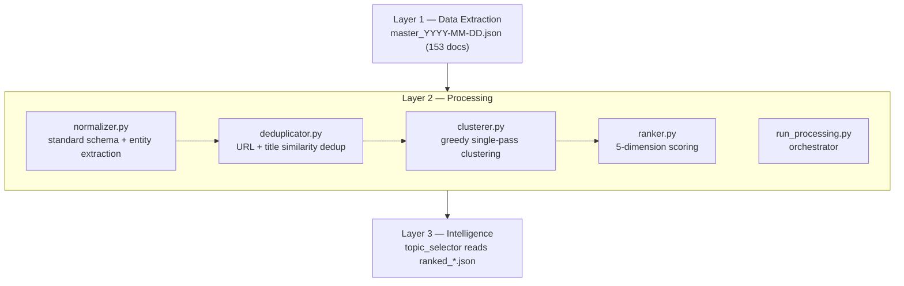
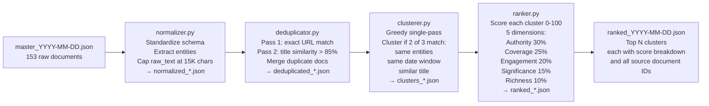

# Layer 2 — Processing

## Layer purpose

Layer 2 is the **signal extraction layer**.

It takes 150+ raw documents from Layer 1 and produces a clean, ranked list of story clusters — each cluster representing a distinct AI story covered by one or more sources.

It should answer:

```text
Which stories are unique vs. duplicates of the same event?
Which stories are the same topic covered by multiple publishers?
Which story is the most important for a YouTube video today?
How do we score stories in a way that rewards credibility, coverage, and depth?
```

It should NOT answer:

```text
What does this story actually say?
What are the key facts and claims in this story?
What is the background context for this story?
```

Those are Layer 3 questions. Layer 2 only processes structure — it doesn't read meaning.

---

## Where Layer 2 sits in the full architecture



---

## Layer 2 internal architecture



---

## Important rules for Layer 2

```text
1. No LLM calls — pure Python, deterministic logic only.
2. Each module is independently runnable.
3. Entity extraction in the normalizer uses keyword lists, not LLM.
4. Deduplication preserves source attribution — when two articles merge, 
   both source URLs are kept in the cluster for later fact-checking.
5. The ranker score is only used by topic_selector to show the top 10 stories.
   The score does NOT decide what gets into the context packet — the human 
   or LLM makes that choice via topic_selector.
6. Layer 2 is extremely fast — should complete in under 5 seconds.
```

---

## Layer 2 input

```json
{
  "source": "output/layer_1_raw/master_YYYY-MM-DD.json",
  "format": "JSON array of documents",
  "typical_count": 153
}
```

---

## Layer 2 output

```json
{
  "normalized":   "output/layer_2_processed/documents/normalized_YYYY-MM-DD.json",
  "deduplicated": "output/layer_2_processed/documents/deduplicated_YYYY-MM-DD.json",
  "clusters":     "output/layer_2_processed/clusters/clusters_YYYY-MM-DD.json",
  "ranked":       "output/layer_2_processed/rankings/ranked_YYYY-MM-DD.json"
}
```

`ranked_YYYY-MM-DD.json` is the Layer 2 final output — the only file Layer 3 reads.

---

## Modules

---

### `normalizer.py`

**Purpose:** Standardize all raw documents from 9 different source formats into one uniform schema.

**Why important:** Each collector produces slightly different field names and structures. The normalizer ensures every downstream module sees the same fields regardless of source. It also extracts structured entities (companies, models, keywords) using simple keyword matching — laying the groundwork for clustering.

**Questions this module answers:**
```text
What is the standard document schema for this pipeline?
Which companies, models, and AI keywords appear in each article?
How long is the actual content of each article?
```

**Input:**
```json
[
  {
    "title": "Introducing Claude Opus 4.7",
    "url": "https://www.anthropic.com/...",
    "published_at": "2026-05-08",
    "raw_text": "...full blog post...",
    "source_type": "official_company_blog",
    "trust_tier": 1,
    "publisher": "Anthropic"
  },
  "...152 more..."
]
```

**Logic:**
```text
For each raw document:
  Map source-specific fields to standard schema.
  Generate a unique document_id (hash of url + date).
  Extract entities:
    companies:  scan title + text for known company names (Anthropic, OpenAI, Google, Meta, Mistral, ...)
    models:     scan for model names (Claude, GPT, Gemini, Llama, ...)
    keywords:   scan for AI topic keywords (LLM, benchmark, fine-tuning, ...)
  Truncate raw_text to 15,000 chars (LLM context window safety).
  Preserve description separately (shorter summary when available).
Save as normalized_*.json.
```

**Output:**
```json
[
  {
    "document_id": "abc123",
    "title": "Introducing Claude Opus 4.7",
    "url": "https://www.anthropic.com/news/claude-opus-4-7",
    "published_at": "2026-05-08T00:00:00",
    "collected_at": "2026-05-08T09:12:00",
    "raw_text": "...up to 15,000 chars...",
    "description": "...shorter summary...",
    "publisher": "Anthropic",
    "source_type": "official_company_blog",
    "trust_tier": 1,
    "community_score": 0,
    "entities": {
      "companies": ["Anthropic"],
      "models": ["Claude", "Claude Opus"],
      "keywords": ["benchmark", "cybersecurity", "tool-use"]
    }
  }
]
```

**Run:**
```bash
python3 pipelines/layer_2_processing/normalizer.py
```

**Status:** ✅ Built

---

### `deduplicator.py`

**Purpose:** Remove duplicate articles that cover the same content.

**Why important:** The same story often appears across multiple API sources. If the clustering step saw 8 copies of "Claude Opus 4.7 launched", it would create a falsely inflated cluster score. Dedup ensures each unique article appears once while preserving information about which sources covered it.

**Questions this module answers:**
```text
Is this the same article appearing from multiple sources?
Is this article a near-duplicate of another (same story, different wording)?
Which sources covered this story (for coverage scoring later)?
```

**Input:**
```json
"normalized_YYYY-MM-DD.json — array of normalized documents"
```

**Logic:**
```text
Pass 1 — URL dedup:
  Hash every URL (normalized: lowercase, strip tracking params).
  If same URL appears twice, keep highest trust_tier version.
  Record all duplicate URLs in duplicate_map.

Pass 2 — Title similarity dedup:
  For each pair of remaining documents:
    Compute title similarity using SequenceMatcher.
    If similarity > 85% AND published within 48h of each other:
      Keep the one with higher trust_tier and more raw_text.
      Merge the other's source_url into the winner's duplicate_sources list.
```

**Output:**
```json
[
  {
    "document_id": "abc123",
    "title": "Introducing Claude Opus 4.7",
    "url": "https://www.anthropic.com/...",
    "duplicate_sources": [
      "https://techcrunch.com/...",
      "https://venturebeat.com/..."
    ],
    "publisher_count": 3,
    "...all other normalized fields..."
  }
]
```

**Run:**
```bash
python3 pipelines/layer_2_processing/deduplicator.py
```

**Status:** ✅ Built

---

### `clusterer.py`

**Purpose:** Group related documents about the same story event into clusters.

**Why important:** One story (e.g., Claude Opus 4.7 launch) may have many articles: the official Anthropic blog post, a TechCrunch article, a HackerNews thread, a Reddit discussion, and an arXiv paper about a related benchmark. These are different documents but the same story. The clusterer groups them so the ranker can score the story holistically.

**Questions this module answers:**
```text
Which documents are about the same underlying story?
How many sources are covering each story?
What is the entity signature of each story cluster?
```

**Input:**
```json
"deduplicated_YYYY-MM-DD.json — array of deduplicated documents"
```

**Logic:**
```text
Greedy single-pass clustering:

For each document (in order of trust_tier, then published_at):
  Try to match it to an existing cluster.
  Matching conditions (need 2 of 3):
    1. Entity overlap: share at least 1 company OR 1 model name in entities
    2. Date proximity: published within 72 hours of cluster's earliest doc
    3. Title similarity: > 60% similarity to cluster's representative title

  If match found: add document to that cluster.
  If no match: create a new cluster with this document as the seed.

After all documents are assigned:
  For each cluster: set best_title = title of highest trust_tier document.
  Record all document_ids and publisher names in cluster.
```

**Output:**
```json
[
  {
    "cluster_id": "CLU_2026_05_08_001",
    "best_title": "Introducing Claude Opus 4.7",
    "document_count": 6,
    "publisher_count": 4,
    "document_ids": ["abc123", "def456", "..."],
    "entities": {
      "companies": ["Anthropic"],
      "models": ["Claude", "Claude Opus", "Claude Sonnet"],
      "keywords": ["benchmark", "cybersecurity"]
    },
    "trust_tiers_present": [1, 1.5, 2, 3],
    "date_range": {
      "earliest": "2026-05-08",
      "latest": "2026-05-08"
    }
  }
]
```

**Run:**
```bash
python3 pipelines/layer_2_processing/clusterer.py
```

**Status:** ✅ Built

---

### `ranker.py`

**Purpose:** Score each story cluster from 0–100 using a 5-dimension scoring system, then sort by score.

**Why important:** The ranker is what decides which story makes the top of the list when topic_selector shows options. A good ranking system surfaces stories that are credible, widely covered, and meaningful — not just the most recent or most hyped.

**Questions this module answers:**
```text
Which story cluster is the best candidate for a YouTube video today?
How authoritative are the sources covering this story?
How widely is this story being covered?
How much community engagement does this story have?
How significant are the entities involved?
How deep is the available content?
```

**Input:**
```json
"clusters_YYYY-MM-DD.json — array of story clusters"
```

**Logic:**

5-dimension scoring:

```text
1. Authority Score (30 points max)
   Score the highest trust tier source in the cluster:
   Tier 1 (official blog)   → 30 pts
   Tier 1.5 (arXiv paper)   → 22 pts
   Tier 2 (established media)→ 15 pts
   Tier 3 (community only)  →  8 pts

2. Coverage Score (25 points max)
   Based on unique publisher count:
   6+ publishers  → 25 pts
   4–5 publishers → 20 pts
   3 publishers   → 15 pts
   2 publishers   → 10 pts
   1 publisher    →  5 pts

3. Engagement Score (20 points max)
   Sum of community_score across cluster documents.
   community_score = Reddit score / 100, HN points / 100, GitHub stars / 1000.
   Normalized to 0–20.

4. Significance Score (15 points max)
   Based on entity prominence:
   Tier 1 company (Anthropic, OpenAI, Google, Meta) → 12 pts
   Tier 2 company (Mistral, Cohere, etc.)           →  8 pts
   Model entity present                              →  3 pts bonus

5. Richness Score (10 points max)
   Based on average raw_text length across cluster docs:
   > 5000 chars avg → 10 pts
   > 2000 chars avg →  7 pts
   > 500 chars avg  →  4 pts
   Title-only       →  1 pt
```

**Output:**
```json
[
  {
    "rank": 1,
    "cluster_id": "CLU_2026_05_08_001",
    "best_title": "Introducing Claude Opus 4.7",
    "score": 95,
    "score_breakdown": {
      "authority": 30,
      "coverage": 20,
      "engagement": 12,
      "significance": 15,
      "richness": 10,
      "penalty": -2
    },
    "document_count": 6,
    "publisher_count": 4,
    "document_ids": ["abc123", "def456", "..."],
    "entities": {"companies": ["Anthropic"], "models": ["Claude Opus"]}
  },
  "...more clusters ranked 2–N..."
]
```

**Run:**
```bash
python3 pipelines/layer_2_processing/ranker.py
```

**Status:** ✅ Built

---

### `run_processing.py`

**Purpose:** Orchestrator — runs all 4 processing modules in sequence.

**Why important:** One command to go from raw master file to ranked story list.

**Logic:**
```text
Find latest master_*.json from Layer 1 output.
Run: normalizer → deduplicator → clusterer → ranker.
Pass output of each step as input to the next.
Print summary: doc counts at each stage, top 5 ranked stories.
```

**Run:**
```bash
python3 pipelines/layer_2_processing/run_processing.py
```

**Status:** ✅ Built

---

## What to build next in Layer 2

| Priority | Item | Why |
|----------|------|-----|
| 🟡 Medium | Smarter entity extraction | Current keyword list is flat — add a tiered entity dictionary (Tier 1 companies vs startups) |
| 🟡 Medium | Title similarity tuning | 85% threshold may be too strict — some paraphrased titles of the same story miss dedup |
| 🟢 Low | Cluster quality score | Flag clusters where all docs are title-only (very thin content) as "low richness" |
