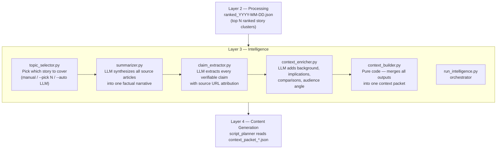
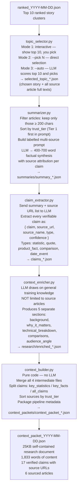

# Layer 3 — Intelligence

## Layer purpose

Layer 3 is the **research and intelligence layer**.

It takes a ranked story list from Layer 2 and produces one comprehensive, research-grade context packet — the single document that Layer 4's script writer reads.

It should answer:

```text
Which story is the best YouTube video topic today?
What do all the sources collectively say about this story?
What are the specific verifiable facts with source attribution?
What background, context, and competitive comparisons can add depth?
What is the final structured research packet for this story?
```

It should NOT answer:

```text
How should the video be structured?
What should the hook be?
How should the script sound?
```

Those are Layer 4 questions. Layer 3 only researches and packages knowledge.

---

## Where Layer 3 sits in the full architecture



---

## Layer 3 internal architecture



---

## Important rules for Layer 3

```text
1. Modules 2 and 3 (summarizer, claim_extractor) work STRICTLY from source articles.
   They only extract and reorganize what the sources say — no invention.

2. Module 4 (context_enricher) deliberately goes BEYOND the sources.
   It uses the LLM's training knowledge for competitive context and background.
   This is intentional and clearly labelled in the output.

3. Every claim in claims_*.json must have a source_url.
   No claim without a traceable source is allowed into the context packet.

4. The context_builder is pure code — the only module in Layer 3 with no LLM.

5. All LLM calls are logged to output/llm_logs/ with full prompt + response.
   You can always inspect exactly what was sent and what came back.

6. Module 1 (topic_selector) has 3 modes — --auto is the recommended mode
   for daily automated runs.
```

---

## Layer 3 input

```json
{
  "source": "output/layer_2_processed/rankings/ranked_YYYY-MM-DD.json",
  "top_n_stories_to_consider": 10
}
```

---

## Layer 3 output

```json
{
  "topic":               "Introducing Claude Opus 4.7",
  "headline":            "Claude Opus 4.7: What's New in AI?",
  "date":                "2026-05-09",
  "story_score":         95,
  "summary":             "935-word narrative synthesis with source attribution",
  "background":          "203-word history and competitive timeline",
  "why_it_matters":      "153-word implications for developers and enterprises",
  "technical_breakdown": "194-word plain-language technical explanation",
  "comparisons":         "234-word vs GPT-5, Gemini, Llama comparison",
  "audience_angle":      "114-word developer takeaway and call to action",
  "key_statistics":      "[ 3 benchmark numbers with exact wording + source URLs ]",
  "key_facts":           "[ 14 product facts with source attribution ]",
  "all_claims":          "[ 17 total verified claims ]",
  "sources":             "[ 6 sources sorted Tier 1 → Tier 3 ]",
  "pipeline_metadata":   "{ models used, word counts, file paths used }"
}
```

---

## Modules

---

### `topic_selector.py`

**Purpose:** Pick which story from the top 10 ranked clusters to turn into a YouTube video.

**Why important:** This is the entry decision point for the entire intelligence layer. Picking the wrong story means all the downstream LLM work is wasted. The selector has 3 modes: you choose manually, you specify by rank, or the LLM picks for you automatically.

**Questions this module answers:**
```text
Which of today's top stories would make the best YouTube video?
What is the video's angle and suggested headline?
Which source articles should be passed to the summarizer?
```

**Input:**
```json
{
  "source": "ranked_YYYY-MM-DD.json",
  "top_n": 10
}
```

**Logic:**

Mode 1 — Interactive:
```text
Load top 10 ranked clusters.
Display table: rank, score, title, source count.
User types a number → select that story.
```

Mode 2 — Direct pick (`--pick N`):
```text
Load top 10 clusters.
Select story with rank == N.
No user interaction.
```

Mode 3 — LLM auto (`--auto`):
```text
Load top 10 clusters.
Build prompt: "You are a YouTube content strategist. Pick the best story."
Include: rank, score, title, source types, entity list for each story.
LLM responds: PICK: N, REASON: ..., HEADLINE: ...
Parse response → extract selected story.
```

After selection (all modes):
```text
Load all source articles for the selected cluster from deduplicated_*.json.
Filter: keep only articles with raw_text ≥ 200 chars.
Save: selected_topic_*.json (story metadata + all article full texts).
```

**Output:**
```json
{
  "selected_at": "2026-05-08T02:49:29",
  "selection_mode": "auto",
  "selected_rank": 1,
  "selected_score": 95,
  "topic": "Introducing Claude Opus 4.7",
  "best_title": "Introducing Claude Opus 4.7",
  "headline_suggestion": "Claude Opus 4.7: What's New in AI?",
  "selection_reason": "...",
  "entities": {"companies": ["Anthropic"], "models": ["Claude Opus"]},
  "source_count": 6,
  "source_articles": [
    {
      "document_id": "...",
      "title": "...",
      "url": "...",
      "publisher": "Anthropic",
      "source_type": "official_company_blog",
      "trust_tier": 1,
      "raw_text": "...15,000 chars..."
    }
  ]
}
```

**LLM config:** `MODULE_OVERRIDES["topic_selector"]` — uses dev model by default (decision is simple, cheap model works).

**Run:**
```bash
python3 pipelines/layer_3_intelligence/topic_selector.py            # interactive
python3 pipelines/layer_3_intelligence/topic_selector.py --pick 1  # direct
python3 pipelines/layer_3_intelligence/topic_selector.py --auto    # LLM
```

**Status:** ✅ Built

---

### `summarizer.py`

**Purpose:** Read all source articles for the selected story and produce a single comprehensive narrative synthesis.

**Why important:** This is the first real research work. The summarizer takes 5–6 articles from different perspectives (official announcement, news coverage, research paper, community discussion) and produces one coherent, factually accurate narrative with source attribution throughout. Without this, later modules would need to re-read all articles repeatedly.

**Questions this module answers:**
```text
What do all the sources collectively say about this story?
Where do sources agree or provide unique angles?
What specific numbers, dates, and quotes are stated in the sources?
```

**Input:**
```json
{
  "source": "selected_topic_YYYY-MM-DD.json",
  "articles": "5 filtered articles (≥ 200 chars each)",
  "total_source_chars": "26,840"
}
```

**Logic:**
```text
Filter articles: remove any with raw_text < 200 chars (title-only, no content).
Sort articles by trust_tier ascending (Tier 1 appears first in the prompt).
Build labelled source block:
  --- SOURCE 1: Anthropic [Official Company Source] ---
  Title: Introducing Claude Opus 4.7
  URL: https://anthropic.com/...
  Content: ...full text...

  --- SOURCE 2: arxiv_cs_cl [Research Paper / Academic] ---
  ...

Prompt: "You are a senior research analyst. Synthesize these {N} sources..."
Rules in prompt:
  - Preserve all numbers, percentages, benchmark scores exactly
  - Attribute each key fact to its source ("According to Anthropic's official blog...")
  - Cover all angles — each source may add unique information
  - Note if sources disagree
  - 400–700 words, factual, journalistic, neutral tone
```

**Output:**
```json
{
  "topic": "Introducing Claude Opus 4.7",
  "generated_at": "2026-05-09T22:40:40",
  "llm_profile": {"provider": "openai", "model": "gpt-5-nano"},
  "articles_used": 5,
  "articles_skipped": 1,
  "source_urls": ["https://anthropic.com/...", "..."],
  "summary_text": "935-word synthesis with source attribution...",
  "word_count": 935
}
```

**LLM config:** `MODULE_OVERRIDES["summarizer"]` — large context input (~7,000 tokens), benefits from a capable model.

**Run:**
```bash
python3 pipelines/layer_3_intelligence/summarizer.py
python3 pipelines/layer_3_intelligence/summarizer.py --input path/to/selected_topic.json
```

**Status:** ✅ Built

---

### `claim_extractor.py`

**Purpose:** Extract every verifiable factual claim from the synthesized summary and map each claim to its source URL.

**Why important:** This is the credibility backbone of the entire pipeline. Every number, benchmark, quote, or product fact the script writer uses on camera must trace to a source URL. The claim extractor enforces this — it produces a structured list of 15–20 claims, each with its source attribution. Without this, the script writer might paraphrase numbers incorrectly or cite them without knowing where they came from.

**Questions this module answers:**
```text
What are the specific verifiable facts in this story?
Which source URL supports each fact?
What type is each claim (statistic, product fact, comparison, quote)?
How confident are we in each claim?
```

**Input:**
```json
{
  "summary": "summary_YYYY-MM-DD.json (935-word synthesis)",
  "sources": "selected_topic_YYYY-MM-DD.json (for URL reference list)"
}
```

**Logic:**
```text
Build compact source reference:
  "Source 1: Anthropic | official_company_blog | Tier 1 | https://..."
  "Source 2: arxiv_cs_cl | research_paper | Tier 1.5 | https://..."

Prompt: "You are a fact-checking analyst. Extract every verifiable claim from this summary."
  Rules:
    - ONLY extract claims directly stated in the summary (from sources)
    - Do NOT extract opinions or speculation
    - Do NOT invent — if a fact isn't stated, don't include it
    - One claim per entry (split compound statements)
    - Map to the most specific supporting source

Output format: pure JSON array — no other text.
[
  {
    "claim": "exact statement",
    "source_url": "https://...",
    "source_name": "Anthropic",
    "type": "statistic | quote | product_fact | comparison | date_event | other",
    "confidence": "high | medium | low"
  }
]

Parse response:
  Strip any markdown code fences.
  json.loads() the array.
  Validate: skip any claim missing the "claim" field.
```

**Output:**
```json
{
  "topic": "Introducing Claude Opus 4.7",
  "generated_at": "2026-05-09T22:58:16",
  "llm_profile": {"provider": "openai", "model": "gpt-5-nano"},
  "total_claims": 17,
  "claims": [
    {
      "claim": "On our 93-task coding benchmark, Claude Opus 4.7 lifted resolution by 13% over Opus 4.6, including four tasks neither Opus 4.6 nor Sonnet 4.6 could solve.",
      "source_url": "https://www.anthropic.com/news/claude-opus-4-7",
      "source_name": "Anthropic",
      "type": "statistic",
      "confidence": "high"
    }
  ],
  "by_type":       {"product_fact": 13, "comparison": 1, "statistic": 3},
  "by_confidence": {"high": 17},
  "by_source":     {"Anthropic": 17}
}
```

**LLM config:** `MODULE_OVERRIDES["claim_extractor"]` — moderate context (~2,000 tokens), needs accurate structured output.

**Run:**
```bash
python3 pipelines/layer_3_intelligence/claim_extractor.py
```

**Status:** ✅ Built

---

### `context_enricher.py`

**Purpose:** Add context, background, and implications that go BEYOND what the source articles say.

**Why important:** Source articles tell you what happened. But a good YouTube video also explains WHY it matters, HOW it compares to competitors, and WHAT your audience should do about it. The enricher uses the LLM's general training knowledge to add this layer. This is the only module that deliberately goes beyond the sources — and it's clearly labelled in the output so Layer 4 knows which content is sourced vs. enriched.

**Questions this module answers:**
```text
What is the history that led to this announcement?
Why does this matter for developers and enterprises?
What is the technical explanation in plain language?
How does this compare to GPT-5, Gemini, Llama right now?
What should our YouTube audience specifically do or watch for?
```

**Input:**
```json
{
  "summary": "summary_YYYY-MM-DD.json",
  "claims": "claims_YYYY-MM-DD.json (for grounding the prompt)",
  "selected_topic": "selected_topic_YYYY-MM-DD.json (for entity list)"
}
```

**Logic:**
```text
Build claims digest from key_statistics + key_facts (top 15).
Build prompt with: topic, claims digest, summary excerpt, entity list.

Prompt: "You are a senior AI industry analyst writing for a YouTube audience.
Add CONTEXT that makes this story meaningful. Draw on your training knowledge."

5 sections requested:
  BACKGROUND         — history, previous versions, competitive timeline
  WHY IT MATTERS     — implications for developers and enterprises
  TECHNICAL BREAKDOWN — explain technical aspects in plain language
  COMPETITIVE COMPARISONS — vs GPT-5, Gemini, Llama — specific benchmarks
  AUDIENCE ANGLE     — what developers/practitioners should specifically do

Parse response by exact header labels (BACKGROUND, WHY IT MATTERS, etc.)
Each section stored separately so Layer 4 can pick and choose.
```

**Output:**
```json
{
  "topic": "Introducing Claude Opus 4.7",
  "generated_at": "2026-05-09T23:26:59",
  "llm_profile": {"provider": "openai", "model": "gpt-5-nano"},
  "section_word_counts": {
    "background": 203,
    "why_it_matters": 153,
    "technical_breakdown": 194,
    "comparisons": 234,
    "audience_angle": 114
  },
  "total_enrichment_words": 898,
  "background": "...203 words...",
  "why_it_matters": "...153 words...",
  "technical_breakdown": "...194 words...",
  "comparisons": "...234 words...",
  "audience_angle": "...114 words..."
}
```

**LLM config:** `MODULE_OVERRIDES["context_enricher"]` — moderate context, creative task, good candidate for production model.

**Run:**
```bash
python3 pipelines/layer_3_intelligence/context_enricher.py
```

**Status:** ✅ Built

---

### `context_builder.py`

**Purpose:** Pure code assembler — merges all 4 Layer 3 intermediate files into one self-contained context packet.

**Why important:** Layer 4 reads exactly ONE file. The context builder is what creates that file. It standardizes the final packet structure, splits claims into useful groupings (key_statistics / key_facts / all_claims), sorts sources by trust tier, and packages all pipeline metadata so Layer 4 and the human reviewer know exactly what models were used and how much content was generated.

**Questions this module answers:**
```text
Is the context packet complete (all 15 required fields)?
Are claims correctly split by type for easy script writer access?
Are sources in the right order (most authoritative first)?
```

**Input:**
```json
{
  "selected_topic": "selected_topic_YYYY-MM-DD.json",
  "summary":        "summaries/summary_YYYY-MM-DD.json",
  "claims":         "claims_YYYY-MM-DD.json",
  "enriched":       "research/enriched_YYYY-MM-DD.json"
}
```

**Logic:**
```text
Load all 4 files.
Check for missing files — exit with clear message if any missing.

Build context packet:
  - Identity: topic, headline, date, story_score, story_rank, entities
  - Content: summary, background, why_it_matters, technical_breakdown, comparisons, audience_angle
  - Claims: split into key_statistics (type==statistic), key_facts (type in product_fact/comparison), all_claims (full list)
  - Sources: filter to docs with URLs, sort by trust_tier ascending
  - Pipeline metadata: models used, word counts, all input file paths

Save as context_packets/context_packet_YYYY-MM-DD.json.
```

**Output:**
```json
{
  "topic": "Introducing Claude Opus 4.7",
  "headline": "Claude Opus 4.7: What's New in AI?",
  "date": "2026-05-09",
  "built_at": "2026-05-09T23:33:41",
  "story_score": 95,
  "story_rank": 1,
  "source_count": 6,
  "entities": {"companies": ["Anthropic"], "models": ["Claude Opus"]},
  "summary": "...935 words...",
  "background": "...203 words...",
  "why_it_matters": "...153 words...",
  "technical_breakdown": "...194 words...",
  "comparisons": "...234 words...",
  "audience_angle": "...114 words...",
  "key_statistics": [
    {
      "claim": "On our 93-task coding benchmark, Claude Opus 4.7 lifted resolution by 13% over Opus 4.6...",
      "source_url": "https://www.anthropic.com/news/claude-opus-4-7",
      "source_name": "Anthropic",
      "type": "statistic",
      "confidence": "high"
    }
  ],
  "key_facts": ["...14 items..."],
  "all_claims": ["...17 items..."],
  "sources": [
    {"title": "Introducing Claude Opus 4.7", "url": "...", "publisher": "Anthropic", "trust_tier": 1},
    "...5 more..."
  ],
  "pipeline_metadata": {
    "layer3_files_used": {"selected": "...", "summary": "...", "claims": "...", "enriched": "..."},
    "summary_words": 935,
    "total_claims": 17,
    "claims_by_confidence": {"high": 17},
    "enrichment_words": 898,
    "llm_models_used": {
      "summarizer": "gpt-5-nano",
      "claim_extractor": "gpt-5-nano",
      "context_enricher": "gpt-5-nano"
    }
  }
}
```

**Run:**
```bash
python3 pipelines/layer_3_intelligence/context_builder.py
```

**Status:** ✅ Built

---

### `run_intelligence.py`

**Purpose:** Orchestrator — runs all 5 modules in sequence with one command.

**Logic:**
```text
Find latest ranked_*.json from Layer 2.
Find latest deduplicated_*.json for article loading.
Run: topic_selector → summarizer → claim_extractor → context_enricher → context_builder.
Thread outputs between steps as Python function calls (not file paths).
Print summary at each step.
```

**Run:**
```bash
python3 pipelines/layer_3_intelligence/run_intelligence.py --auto    # LLM picks topic
python3 pipelines/layer_3_intelligence/run_intelligence.py --pick 2  # pick rank 2
python3 pipelines/layer_3_intelligence/run_intelligence.py           # interactive
```

**Status:** ✅ Built

---

## LLM call reference (per run)

| Module | In (tokens) | Out (tokens) | Duration | Notes |
|--------|------------|-------------|----------|-------|
| topic_selector (--auto) | ~761 | ~91 | ~10s | Small prompt — just titles and scores |
| summarizer | ~7,180 | ~1,578 | ~35s | Large input — full article texts |
| claim_extractor | ~2,037 | ~1,281 | ~108s | Structured JSON output — slower |
| context_enricher | ~1,538 | ~1,656 | ~24s | Creative task — longer output |
| **Total** | **~11,516** | **~4,606** | **~177s** | |

All calls logged to `output/llm_logs/YYYY-MM-DD_{module}_{HHMMSS}.json`

---

## What to build next in Layer 3

| Priority | Item | Why |
|----------|------|-----|
| 🟡 Medium | Switch summarizer to production model | 7K token input benefits most from a stronger model |
| 🟡 Medium | Multiple topic support | Run Layer 3 for top 3 stories simultaneously, let human pick |
| 🟢 Low | Claim confidence calibration | Currently the model marks everything "high" — needs better guidance |
| 🟢 Low | Source reliability filter in summarizer | Currently includes Tier 3 sources (Reddit/GitHub) in the synthesis prompt |
