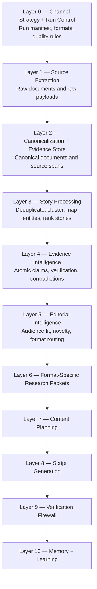
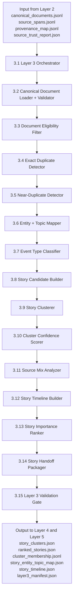

Absolutely — now we will design **Layer 3: Story Processing** in detail.

Layer 1 collected raw sources.
Layer 2 cleaned and canonicalized them into evidence-ready documents and source spans.
**Layer 3 now turns those documents into actual “stories.”**

This is where your system stops thinking in terms of individual articles and starts thinking in terms of **news events / story clusters**.

Your earlier system design already included this exact need: after cleaning and normalization, the system should deduplicate similar stories, perform topic clustering, score importance, and only later move into claim extraction, research expansion, verification, and script generation. 

---

# Layer 3 — Story Processing

## 1. Purpose of Layer 3

Layer 3 answers this question:

```text id="0qyrmy"
From all the clean documents we collected, what are the actual AI stories?
```

Layer 2 may produce 200 canonical documents, but many of them may be about the same event.

Example:

```text id="mat41j"
OpenAI official blog announces a new coding agent.
The Verge writes about the same launch.
TechCrunch writes about the same launch.
Hacker News discusses the same launch.
A YouTube demo explains the same launch.
A GitHub repo appears related to the same launch.
```

Layer 3 should group these into **one story cluster**, not six separate stories.

So Layer 3’s purpose is:

```text id="j5tm6g"
Deduplicate documents.
Group related documents into story clusters.
Identify entities, topics, and event types.
Build story timelines.
Score and rank story candidates.
Prepare structured story outputs for Layer 4 and Layer 5.
```

---

# 2. Why Layer 3 is important

Without Layer 3, your system will either:

```text id="6mu2nx"
repeat the same story multiple times in a roundup,
miss that different sources are talking about the same event,
treat minor reposts as separate news,
fail to understand what the top stories are,
or select topics based only on individual article quality instead of story-level importance.
```

Layer 3 creates the bridge between:

```text id="rza1t7"
documents → stories
```

This is critical because YouTube content is not created from random documents. It is created from **stories with context, source mix, impact, and timing**.

---

# 3. What Layer 3 should do and not do

## Layer 3 should do

```text id="wmek4q"
Group documents into story clusters.
Detect duplicates and near-duplicates.
Identify companies, models, products, people, topics, and sectors.
Classify the type of event.
Build source mix for each story.
Score story importance.
Create ranked story candidates.
Preserve document IDs and source span IDs for traceability.
```

## Layer 3 should not do

```text id="xhk6ty"
It should not extract final atomic claims.
It should not verify claims.
It should not write summaries as final facts.
It should not decide final video format.
It should not write the YouTube script.
It should not make unsupported conclusions like “this is revolutionary.”
```

Layer 3 can say:

```json id="ipk0co"
{
  "story_type": "product_launch",
  "importance_score": 84,
  "reason_codes": ["official_source_present", "multiple_independent_sources", "high_developer_relevance"]
}
```

But it should not say:

```json id="cxum0v"
{
  "final_thesis": "This product will replace software developers."
}
```

That type of thesis belongs later, after evidence intelligence and editorial analysis.

---

# 4. Where Layer 3 sits in the full architecture



Layer 3 is the **story formation layer**.

It does not create final content. It creates the structured story candidates that later layers can analyze.

---

# 5. Layer wise architecture — Layer 3 internal architecture



---

# 6. Layer 3 input and output

## Layer 3 input

Layer 3 receives the output of Layer 2:

```text id="c5f14z"
data/runs/{run_id}/layer_2/canonical_documents.jsonl
data/runs/{run_id}/layer_2/source_spans.jsonl
data/runs/{run_id}/layer_2/provenance_map.jsonl
data/runs/{run_id}/layer_2/content_quality_report.json
data/runs/{run_id}/layer_2/source_trust_report.json
data/runs/{run_id}/run_manifest.json
```

Example Layer 3 input package:

```json id="f8etv4"
{
  "run_id": "run_2026_05_10_48h_auto",
  "inputs": {
    "canonical_documents_path": "data/runs/run_2026_05_10_48h_auto/layer_2/canonical_documents.jsonl",
    "source_spans_path": "data/runs/run_2026_05_10_48h_auto/layer_2/source_spans.jsonl",
    "provenance_map_path": "data/runs/run_2026_05_10_48h_auto/layer_2/provenance_map.jsonl",
    "source_trust_report_path": "data/runs/run_2026_05_10_48h_auto/layer_2/source_trust_report.json"
  },
  "run_manifest": {
    "eligible_formats": ["roundup", "deep_dive", "follow_up"],
    "collection_window": {
      "start": "2026-05-08T10:00:00Z",
      "end": "2026-05-10T10:00:00Z"
    },
    "depth_limits": {
      "max_story_clusters": 50,
      "max_ranked_stories_to_analyze": 15
    }
  }
}
```

---

## Layer 3 output

Layer 3 should produce:

```text id="580wzv"
data/runs/{run_id}/layer_3/
  story_clusters.json
  ranked_stories.json
  cluster_membership.jsonl
  duplicate_groups.jsonl
  story_entity_topic_map.json
  story_timeline.json
  story_rank_report.json
  rejected_story_candidates.jsonl
  layer3_manifest.json
```

Main Layer 3 output:

```json id="iw6ncx"
{
  "run_id": "run_2026_05_10_48h_auto",
  "layer": "layer_3_story_processing",
  "status": "completed",
  "story_clusters_path": "data/runs/run_2026_05_10_48h_auto/layer_3/story_clusters.json",
  "ranked_stories_path": "data/runs/run_2026_05_10_48h_auto/layer_3/ranked_stories.json",
  "cluster_membership_path": "data/runs/run_2026_05_10_48h_auto/layer_3/cluster_membership.jsonl",
  "story_cluster_count": 34,
  "ranked_story_count": 15,
  "ready_for_layer_4": true,
  "available_for_layer_5_precheck": true
}
```

---

# 7. Core Layer 3 data objects

Layer 3 should mainly produce these objects:

```text id="51h4qz"
DuplicateGroup
DocumentEntityTopicMap
StoryCandidate
StoryCluster
ClusterMembership
StoryTimeline
RankedStory
Layer3Manifest
```

---

## 7.1 StoryCluster format

This is the main output.

```json id="o69dyz"
{
  "story_id": "story_20260510_openai_coding_agent",
  "run_id": "run_2026_05_10_48h_auto",

  "story_identity": {
    "canonical_story_title": "OpenAI announces new AI coding agent updates",
    "story_slug": "openai-coding-agent-updates",
    "story_type": "product_launch",
    "story_status": "active_news",
    "first_seen_at": "2026-05-10T08:00:00Z",
    "last_seen_at": "2026-05-10T10:00:00Z"
  },

  "cluster_members": {
    "canonical_document_ids": [
      "doc_openai_001",
      "doc_theverge_001",
      "doc_hn_001",
      "doc_youtube_001"
    ],
    "primary_document_id": "doc_openai_001",
    "supporting_document_ids": [
      "doc_theverge_001",
      "doc_youtube_001"
    ],
    "trend_signal_document_ids": [
      "doc_hn_001"
    ],
    "source_span_ids": [
      "span_doc_openai_001_0001",
      "span_doc_openai_001_0002",
      "span_doc_theverge_001_0003"
    ]
  },

  "entities": {
    "companies": ["OpenAI"],
    "products": ["Codex"],
    "models": [],
    "people": [],
    "topics": ["AI coding tools", "AI agents", "developer workflow"]
  },

  "source_mix": {
    "official_sources": 1,
    "research_sources": 0,
    "news_sources": 2,
    "community_sources": 1,
    "github_sources": 0,
    "video_transcript_sources": 1
  },

  "ranking": {
    "story_importance_score": 84,
    "evidence_availability_score": 78,
    "audience_signal_score": 72,
    "novelty_signal_score": 65,
    "ranking_bucket": "high_priority"
  },

  "traceability": {
    "created_from_layer": "layer_3_story_processing",
    "input_layer2_manifest": "data/runs/run_2026_05_10_48h_auto/layer_2/layer2_manifest.json"
  }
}
```

---

## 7.2 ClusterMembership format

This explains why each document belongs to a story.

```json id="7e0evc"
{
  "story_id": "story_20260510_openai_coding_agent",
  "canonical_document_id": "doc_theverge_001",
  "membership_type": "supporting_source",
  "membership_confidence": 0.86,
  "match_reasons": [
    "same_primary_entity_openai",
    "same_topic_ai_coding_tools",
    "similar_title_embedding",
    "published_within_24h",
    "links_to_same_official_announcement"
  ],
  "source_role": "secondary_evidence",
  "trust_tier": 2
}
```

This is important because if the cluster is wrong, you can inspect exactly why a document was grouped.

---

## 7.3 RankedStory format

This is the output used by Layer 4 and Layer 5.

```json id="78c9ld"
{
  "rank": 1,
  "story_id": "story_20260510_openai_coding_agent",
  "canonical_story_title": "OpenAI announces new AI coding agent updates",
  "story_type": "product_launch",
  "ranking_bucket": "high_priority",

  "scores": {
    "total_story_score": 84,
    "authority_score": 25,
    "coverage_score": 17,
    "evidence_availability_score": 16,
    "audience_signal_score": 12,
    "novelty_signal_score": 7,
    "impact_signal_score": 7
  },

  "recommended_next_step": {
    "send_to_layer_4": true,
    "reason": "High authority, official source present, strong developer relevance, multiple supporting sources."
  },

  "not_final_video_decision": true
}
```

Important: Layer 3 ranking is **not the final video decision**. It only decides which story candidates deserve deeper evidence intelligence and editorial review.

---

# 8. Module-by-module Layer 3 design

---

## Module 3.1 — Layer 3 Orchestrator

### Purpose

Coordinate all Layer 3 processing.

### Why it matters

Layer 3 has multiple stages: filtering, duplicate detection, entity mapping, clustering, timeline building, and ranking. The orchestrator ensures consistent flow.

### Questions it answers

```text id="xg82kg"
Where are Layer 2 outputs?
How many canonical documents are available?
Which documents should be processed?
Which modules should run?
Where should Layer 3 outputs be written?
Can Layer 4 and Layer 5 start?
```

### Input

```json id="q2vr4w"
{
  "run_manifest_path": "data/runs/run_2026_05_10_48h_auto/run_manifest.json",
  "layer2_manifest_path": "data/runs/run_2026_05_10_48h_auto/layer_2/layer2_manifest.json"
}
```

### Logic

```text id="n36uy9"
1. Load run manifest.
2. Load Layer 2 manifest.
3. Read canonical documents.
4. Read source spans.
5. Apply Layer 3 processing order.
6. Write story clusters and ranked story outputs.
7. Validate Layer 3 outputs.
```

### Output

```json id="6p2rz7"
{
  "run_id": "run_2026_05_10_48h_auto",
  "documents_received": 198,
  "eligible_documents": 182,
  "duplicate_groups": 21,
  "story_clusters_created": 34,
  "ranked_stories_created": 15,
  "status": "completed"
}
```

---

## Module 3.2 — Canonical Document Loader + Validator

### Purpose

Load and validate canonical documents and source spans from Layer 2.

### Why it matters

Layer 3 should not start clustering if documents are missing IDs, URLs, timestamps, source groups, or trust tiers.

### Questions it answers

```text id="t6mw5k"
Can we load all canonical documents?
Does every document have a source ID?
Does every document have a canonical URL or source-native ID?
Does every document have trust tier and source role?
Can every document be traced back to Layer 2?
```

### Input

```json id="woic9a"
{
  "canonical_documents_path": "data/runs/.../layer_2/canonical_documents.jsonl",
  "source_spans_path": "data/runs/.../layer_2/source_spans.jsonl"
}
```

### Logic

```text id="tp5oeb"
1. Load canonical documents.
2. Validate required fields.
3. Load source spans.
4. Build document-to-span index.
5. Validate each source span maps to a canonical document.
6. Mark invalid documents for rejection.
```

### Output

```json id="k8hpts"
{
  "loaded_documents": 198,
  "valid_documents": 192,
  "invalid_documents": 6,
  "loaded_source_spans": 2430,
  "document_span_index_created": true
}
```

---

## Module 3.3 — Document Eligibility Filter

### Purpose

Decide which Layer 2 documents are eligible for story processing.

### Why it matters

Not every canonical document should influence story clustering.

Examples:

```text id="wyhgv7"
A metadata-only YouTube record may help identify a source but not form a full story.
A tiny NewsAPI snippet may be useful but weak.
A community signal should not create a story alone unless linked to a real source.
A blocked article should not dominate clustering.
```

### Questions it answers

```text id="oueqi9"
Is this document usable for story clustering?
Is it only usable as a trend signal?
Is it too weak, too short, or metadata-only?
Can this document form a story by itself?
```

### Input

```json id="pw63yh"
{
  "canonical_document_id": "doc_hn_001",
  "source_group": "community_signals",
  "source_role": "trend_signal_only",
  "content_quality_score": 0.58,
  "content_completeness": "metadata_and_discussion"
}
```

### Logic

```text id="7hbj2m"
1. Accept Tier 1 official docs for clustering.
2. Accept Tier 1.5 research docs for clustering.
3. Accept Tier 2 news docs if title, URL, and date exist.
4. Accept GitHub docs as technical artifacts.
5. Accept community docs only as supporting/trend signals.
6. Reject documents with missing ID, missing title, missing URL/native ID, or very low content quality.
```

### Output

```json id="8cep7k"
{
  "canonical_document_id": "doc_hn_001",
  "eligibility": {
    "eligible_for_story_creation": false,
    "eligible_for_story_support": true,
    "eligible_for_ranking_signal": true,
    "reason": "community_signal_only"
  }
}
```

For official source:

```json id="2lqbes"
{
  "canonical_document_id": "doc_openai_001",
  "eligibility": {
    "eligible_for_story_creation": true,
    "eligible_for_story_support": true,
    "eligible_for_ranking_signal": true,
    "reason": "primary_evidence_source"
  }
}
```

---

## Module 3.4 — Exact Duplicate Detector

### Purpose

Remove exact duplicate documents.

### Why it matters

The same article may be collected more than once from RSS, NewsAPI, Google News, or direct webpage fetch.

### Questions it answers

```text id="vsgjyy"
Do two documents have the same canonical URL?
Do two documents have the same content hash?
Is this an AMP/canonical duplicate?
Is this a repost of the same source item?
```

### Input

```json id="0l2bhy"
{
  "canonical_documents": [
    {
      "canonical_document_id": "doc_001",
      "canonical_url": "https://publisher.com/article",
      "content_hash": "abc"
    },
    {
      "canonical_document_id": "doc_002",
      "canonical_url": "https://publisher.com/article?utm_source=feed",
      "content_hash": "abc"
    }
  ]
}
```

### Logic

```text id="5gzjk4"
1. Group by canonical URL.
2. Group by content hash.
3. Group by source-native ID where available.
4. Select canonical representative:
   - prefer complete content
   - prefer higher trust tier
   - prefer earliest collected
   - prefer direct source over aggregator
5. Store duplicates in duplicate_groups.jsonl.
```

### Output

```json id="jywyty"
{
  "duplicate_group_id": "dup_001",
  "representative_document_id": "doc_001",
  "duplicate_document_ids": ["doc_002"],
  "duplicate_type": "same_canonical_url_and_content_hash",
  "confidence": 1.0
}
```

---

## Module 3.5 — Near-Duplicate Detector

### Purpose

Detect near-identical articles that are not exact duplicates.

### Why it matters

Many publishers syndicate or rewrite the same story with nearly identical headlines and text.

### Questions it answers

```text id="t3tcs9"
Are these two articles basically the same article?
Are they syndicated versions?
Are they copied press release rewrites?
Should they count as separate sources or duplicate coverage?
```

### Input

```json id="rjpvvg"
{
  "document_a": {
    "canonical_document_id": "doc_010",
    "title": "OpenAI launches new coding agent"
  },
  "document_b": {
    "canonical_document_id": "doc_011",
    "title": "OpenAI unveils coding agent for developers"
  }
}
```

### Logic

Use a combination of:

```text id="9lqkmz"
title similarity
clean-text similarity
embedding similarity
same source/publisher
same publish date range
same canonical linked official URL
same named entities
```

### Output

```json id="nxxu3x"
{
  "near_duplicate_group_id": "near_dup_001",
  "representative_document_id": "doc_010",
  "near_duplicate_document_ids": ["doc_011"],
  "similarity_score": 0.91,
  "reason": "high_title_and_embedding_similarity"
}
```

Important: near duplicates may still count as **coverage signal**, but they should not inflate story importance too much.

---

## Module 3.6 — Entity + Topic Mapper

### Purpose

Extract and map important entities and topics from each document.

### Why it matters

Story clustering depends heavily on entities.

Example:

```text id="utgu5c"
OpenAI + Codex + coding agents
Anthropic + Claude + enterprise
Meta + Llama + open source
NVIDIA + GPUs + AI chips
EU + AI Act + regulation
```

### Questions it answers

```text id="36rgzp"
Which companies are mentioned?
Which models are mentioned?
Which products are mentioned?
Which people are mentioned?
Which topics does this document belong to?
Which sector/theme is involved?
```

### Input

```json id="g64x2g"
{
  "canonical_document_id": "doc_openai_001",
  "title": "OpenAI launches new coding agent updates",
  "clean_text_path": "data/runs/.../doc_openai_001.txt",
  "source_spans": ["span_001", "span_002"]
}
```

### Logic

Use a hybrid approach:

```text id="20iq99"
1. Dictionary matching for known AI companies, models, and products.
2. Pattern matching for model names and versions.
3. Keyword/topic mapping from config.
4. Optional LLM-based structured extraction only if needed.
5. Output structured entities with confidence.
```

### Config example

`config/entity_topic_taxonomy.yaml`

```yaml id="0vyxme"
entities:
  companies:
    - OpenAI
    - Anthropic
    - Google DeepMind
    - Meta
    - Microsoft
    - NVIDIA
    - Mistral
    - Hugging Face

topics:
  ai_agents:
    keywords:
      - AI agent
      - agentic AI
      - autonomous agent
      - tool use
  ai_coding_tools:
    keywords:
      - coding assistant
      - code generation
      - developer workflow
      - IDE
  ai_research:
    keywords:
      - benchmark
      - arXiv
      - reasoning
      - multimodal
  ai_regulation:
    keywords:
      - regulation
      - AI Act
      - policy
      - safety
```

### Output

```json id="tmg2wz"
{
  "canonical_document_id": "doc_openai_001",
  "entities": {
    "companies": [
      {
        "name": "OpenAI",
        "confidence": 0.98,
        "matched_spans": ["span_001"]
      }
    ],
    "products": [
      {
        "name": "Codex",
        "confidence": 0.86,
        "matched_spans": ["span_002"]
      }
    ],
    "models": [],
    "people": []
  },
  "topics": [
    {
      "topic_id": "ai_coding_tools",
      "label": "AI coding tools",
      "confidence": 0.91
    },
    {
      "topic_id": "ai_agents",
      "label": "AI agents",
      "confidence": 0.82
    }
  ]
}
```

---

## Module 3.7 — Event Type Classifier

### Purpose

Classify what kind of story/event the document is about.

### Why it matters

A model release, research paper, regulation update, funding story, GitHub project, and controversy require different treatment later.

### Event types

```text id="gl11pr"
model_release
product_launch
research_paper
benchmark_result
open_source_release
funding_or_acquisition
regulation_or_policy
partnership
pricing_or_plan_change
safety_or_risk_issue
community_controversy
infrastructure_or_chip_news
tutorial_or_demo
unknown
```

### Questions it answers

```text id="sirl5b"
What type of AI news is this?
Is it an official launch, research update, business story, or community controversy?
Does this event type make it better for roundup, deep dive, evergreen, or comparison later?
```

### Input

```json id="l8kbdy"
{
  "canonical_document_id": "doc_meta_001",
  "title": "Meta releases new Llama model",
  "source_group": "ai_company_blogs",
  "entities": {
    "companies": ["Meta"],
    "models": ["Llama"]
  },
  "topics": ["open-source AI", "model release"]
}
```

### Logic

```text id="t4i17e"
1. Use source group and content type.
2. Use title keywords.
3. Use entity/topic signals.
4. Use source role.
5. Optional LLM classifier for ambiguous items.
6. Output event type with confidence.
```

### Output

```json id="xg8dbk"
{
  "canonical_document_id": "doc_meta_001",
  "event_type": "model_release",
  "event_type_confidence": 0.92,
  "event_type_reasons": [
    "official_company_source",
    "model_entity_detected",
    "release_keyword_detected"
  ]
}
```

---

## Module 3.8 — Story Candidate Builder

### Purpose

Create initial story candidates before clustering.

### Why it matters

Before clustering, the system needs possible story identities. These are based on high-quality documents that can create a story.

### Questions it answers

```text id="aoiout"
Which documents can start a story?
What is the initial story key?
What is the possible story title?
What entities and event type define the story?
```

### Input

```json id="8sgrd0"
{
  "canonical_document_id": "doc_openai_001",
  "eligible_for_story_creation": true,
  "entities": {
    "companies": ["OpenAI"],
    "products": ["Codex"]
  },
  "topics": ["AI coding tools"],
  "event_type": "product_launch"
}
```

### Logic

```text id="px9e99"
1. Select documents eligible for story creation.
2. Create a story key from:
   - primary entity
   - product/model/topic
   - event type
   - publish date
3. Generate candidate title from source title.
4. Attach initial document IDs and span IDs.
```

### Output

```json id="hc0by1"
{
  "story_candidate_id": "candidate_openai_codex_product_launch_20260510",
  "seed_document_id": "doc_openai_001",
  "candidate_title": "OpenAI announces new coding agent updates",
  "candidate_story_key": {
    "primary_entity": "OpenAI",
    "secondary_entity": "Codex",
    "event_type": "product_launch",
    "date_bucket": "2026-05-10"
  },
  "seed_confidence": 0.94
}
```

---

## Module 3.9 — Story Clusterer

### Purpose

Group related canonical documents into story clusters.

### Why it matters

This is the heart of Layer 3. It turns documents into story clusters.

### Questions it answers

```text id="f65t78"
Which documents are about the same story?
Which official source, news articles, research papers, videos, GitHub repos, and community posts belong together?
Which document should be the primary source?
```

### Input

```json id="7m7l43"
{
  "story_candidates": ["candidate_001", "candidate_002"],
  "canonical_documents": ["doc_001", "doc_002", "doc_003"],
  "entity_topic_maps": "story_entity_topic_map.json",
  "duplicate_groups": "duplicate_groups.jsonl"
}
```

### Clustering logic

Documents should be clustered together based on:

```text id="84ogzw"
same primary entity
same product/model/research paper
same event type
similar title
similar source span embeddings
same linked source URL
similar publish date/time window
same GitHub repo or arXiv paper ID
community post links to clustered source
video transcript mentions clustered entity/product
```

### Strong match examples

```text id="ambkr7"
Official OpenAI blog + news article linking to that blog
arXiv paper + GitHub repo with same paper title
HN post linking to the same GitHub repo
YouTube demo mentioning same product launch
```

### Weak match examples

```text id="a4hcyj"
Both mention “AI agents” but different companies
Both mention “OpenAI” but unrelated topics
Both published same day but different events
```

### Output

```json id="0vmq7t"
{
  "story_id": "story_20260510_openai_codex_update",
  "canonical_story_title": "OpenAI announces Codex-related coding agent updates",
  "cluster_confidence": 0.89,
  "primary_document_id": "doc_openai_001",
  "member_document_ids": [
    "doc_openai_001",
    "doc_news_014",
    "doc_news_029",
    "doc_hn_006",
    "doc_youtube_004"
  ],
  "match_summary": {
    "same_primary_entity": true,
    "same_product_or_topic": true,
    "same_event_type": true,
    "time_window_match": true,
    "linked_source_match": true
  }
}
```

---

## Module 3.10 — Cluster Confidence Scorer

### Purpose

Score how confident the system is that a story cluster is valid.

### Why it matters

Bad clustering creates bad videos. If two unrelated stories are merged, later layers will build incorrect research packets and scripts.

### Questions it answers

```text id="rj2uzy"
Are all documents really about the same story?
Is the cluster too broad?
Is the cluster too weak?
Does the cluster need human review?
```

### Input

```json id="xa5wqv"
{
  "story_id": "story_001",
  "member_document_ids": ["doc_001", "doc_002", "doc_003"],
  "match_features": {
    "entity_overlap": 0.92,
    "topic_overlap": 0.81,
    "title_similarity": 0.74,
    "time_proximity": 0.95,
    "linked_source_match": true
  }
}
```

### Logic

Score using:

```text id="10fq92"
entity overlap
topic overlap
event type agreement
title similarity
embedding similarity
URL/link relationship
time proximity
source-type compatibility
```

### Output

```json id="0iiisf"
{
  "story_id": "story_001",
  "cluster_confidence_score": 0.89,
  "cluster_quality": "high",
  "warnings": [],
  "requires_manual_review": false
}
```

For weak cluster:

```json id="o23dox"
{
  "story_id": "story_weak_001",
  "cluster_confidence_score": 0.52,
  "cluster_quality": "low",
  "warnings": [
    "broad_topic_match_only",
    "different_primary_products"
  ],
  "requires_manual_review": true
}
```

---

## Module 3.11 — Source Mix Analyzer

### Purpose

Analyze the type and quality of sources inside each story cluster.

### Why it matters

A story with one Reddit post is not equal to a story with an official announcement, three independent articles, one research paper, and strong community discussion.

### Questions it answers

```text id="8efqgv"
Does this story have an official source?
Does it have independent coverage?
Does it have research backing?
Does it have community interest?
Does it have enough sources for deep analysis later?
```

### Input

```json id="k57sbo"
{
  "story_id": "story_001",
  "member_document_ids": ["doc_openai_001", "doc_news_001", "doc_hn_001"]
}
```

### Logic

Count source roles:

```text id="mhv2w1"
primary_evidence sources
secondary_evidence sources
research_evidence sources
technical_artifact sources
trend_signal_only sources
metadata_only sources
```

### Output

```json id="bdyhya"
{
  "story_id": "story_001",
  "source_mix": {
    "official_source_count": 1,
    "independent_news_count": 3,
    "research_source_count": 0,
    "github_source_count": 1,
    "video_transcript_count": 1,
    "community_signal_count": 2
  },
  "source_strength": {
    "has_primary_source": true,
    "has_independent_confirmation": true,
    "has_technical_artifact": true,
    "has_only_community_signal": false
  }
}
```

---

## Module 3.12 — Story Timeline Builder

### Purpose

Build a chronological timeline for each story.

### Why it matters

News stories develop over time. A timeline helps later layers explain what happened first, what followed, and how the story evolved.

### Questions it answers

```text id="qswfdo"
When did the story first appear?
What was the official announcement time?
When did media coverage start?
When did community discussion spike?
Are there updates or follow-ups?
```

### Input

```json id="5572tq"
{
  "story_id": "story_001",
  "member_documents": [
    {
      "canonical_document_id": "doc_openai_001",
      "published_at": "2026-05-10T08:00:00Z",
      "source_role": "primary_evidence"
    },
    {
      "canonical_document_id": "doc_news_001",
      "published_at": "2026-05-10T09:30:00Z",
      "source_role": "secondary_evidence"
    }
  ]
}
```

### Logic

```text id="aed3ev"
1. Sort member documents by published_at.
2. Identify first source.
3. Identify first official source.
4. Identify first independent source.
5. Identify first community signal.
6. Create timeline events.
7. Mark missing/uncertain dates.
```

### Output

```json id="oqaq38"
{
  "story_id": "story_001",
  "timeline": [
    {
      "event_order": 1,
      "event_time": "2026-05-10T08:00:00Z",
      "event_label": "Official announcement published",
      "canonical_document_id": "doc_openai_001",
      "source_role": "primary_evidence"
    },
    {
      "event_order": 2,
      "event_time": "2026-05-10T09:30:00Z",
      "event_label": "Independent media coverage begins",
      "canonical_document_id": "doc_news_001",
      "source_role": "secondary_evidence"
    },
    {
      "event_order": 3,
      "event_time": "2026-05-10T10:15:00Z",
      "event_label": "Community discussion appears",
      "canonical_document_id": "doc_hn_001",
      "source_role": "trend_signal_only"
    }
  ],
  "timeline_quality": {
    "has_official_time": true,
    "has_independent_coverage_time": true,
    "missing_dates_count": 0
  }
}
```

---

## Module 3.13 — Story Importance Ranker

### Purpose

Rank story clusters by story-level importance.

### Why it matters

Layer 4 and Layer 5 should not analyze every weak cluster deeply. The ranker decides which stories deserve deeper evidence extraction and editorial review.

### Questions it answers

```text id="4p1cy1"
Which stories matter most?
Which stories have enough reliable sources?
Which stories are relevant to the audience?
Which stories are likely roundup candidates?
Which stories may become deep-dive candidates later?
```

### Input

```json id="iijwyx"
{
  "story_id": "story_001",
  "story_type": "product_launch",
  "source_mix": {},
  "entities": {},
  "topics": {},
  "cluster_confidence_score": 0.89,
  "timeline": {}
}
```

### Scoring dimensions

```text id="ki7400"
authority_score
coverage_score
evidence_availability_score
audience_signal_score
impact_signal_score
novelty_signal_score
recency_score
cluster_confidence_score
```

### Suggested scoring model

```text id="aij89j"
authority_score:
  official source present: +25
  research source present: +18
  official GitHub/repo artifact present: +12

coverage_score:
  3+ independent news sources: +15
  2 independent news sources: +10
  1 independent news source: +5

audience_signal_score:
  strong community engagement: +10
  moderate community engagement: +5
  no signal: +0

impact_signal_score:
  affects developers: +10
  affects AI users broadly: +10
  affects enterprise/business: +8
  affects regulation/policy: +8
  niche technical-only: +4

evidence_availability_score:
  many clean source spans: +10
  partial snippets only: -8
  no primary source: -10

recency_score:
  within active collection window: +10
  older but relevant: +4
```

### Output

```json id="1g91wr"
{
  "story_id": "story_001",
  "rank": 1,
  "total_story_score": 84,
  "ranking_bucket": "high_priority",
  "score_breakdown": {
    "authority_score": 25,
    "coverage_score": 15,
    "evidence_availability_score": 14,
    "audience_signal_score": 10,
    "impact_signal_score": 10,
    "novelty_signal_score": 4,
    "recency_score": 6
  },
  "ranking_reasons": [
    "official_source_present",
    "multiple_independent_sources",
    "developer_relevance",
    "strong_community_signal",
    "high_cluster_confidence"
  ],
  "recommended_for_layer_4": true
}
```

### Important distinction

Layer 3 ranking is **story importance**, not final YouTube opportunity.

Layer 5 later evaluates:

```text id="t9hv7f"
audience fit
market gap
novelty against previous videos
format routing
video opportunity
```

So Layer 3 says:

```text id="v24nps"
This is an important story.
```

Layer 5 says:

```text id="4dwivf"
This should become a roundup segment, deep dive, follow-up, or be skipped.
```

---

## Module 3.14 — Story Handoff Packager

### Purpose

Prepare final Layer 3 outputs for Layer 4 and Layer 5.

### Why it matters

Layer 4 needs source spans and story clusters for claim extraction.
Layer 5 needs ranked stories, source mix, topics, and story signals for editorial routing.

### Questions it answers

```text id="cxgt17"
Which stories should go to Layer 4?
Which source spans are attached to each story?
Which stories are high, medium, or low priority?
Which clusters need manual review?
```

### Input

```json id="bnu6vr"
{
  "story_clusters": [],
  "ranked_stories": [],
  "cluster_membership": [],
  "story_timelines": []
}
```

### Logic

```text id="kfjmbf"
1. Write story_clusters.json.
2. Write ranked_stories.json.
3. Write cluster_membership.jsonl.
4. Write story_entity_topic_map.json.
5. Write story_timeline.json.
6. Write story_rank_report.json.
7. Create layer3_manifest.json.
```

### Output

```json id="5r3tp6"
{
  "handoff": {
    "top_ranked_story_ids": [
      "story_001",
      "story_002",
      "story_003"
    ],
    "stories_for_layer_4": [
      "story_001",
      "story_002",
      "story_003",
      "story_004",
      "story_005"
    ],
    "stories_for_layer_5": [
      "story_001",
      "story_002",
      "story_003",
      "story_004",
      "story_005",
      "story_006",
      "story_007",
      "story_008"
    ]
  }
}
```

---

## Module 3.15 — Layer 3 Validation Gate

### Purpose

Validate Layer 3 outputs before Layer 4 and Layer 5 start.

### Why it matters

Layer 4 should not extract claims from broken clusters. Layer 5 should not route invalid story candidates.

### Questions it answers

```text id="a7fsqm"
Does every story have at least one member document?
Does every story map back to Layer 2 source spans?
Does every ranked story have score breakdown?
Are cluster confidence scores present?
Are story IDs unique?
Are low-confidence clusters flagged?
```

### Input

```json id="rsvm35"
{
  "story_clusters_path": "data/runs/.../layer_3/story_clusters.json",
  "ranked_stories_path": "data/runs/.../layer_3/ranked_stories.json",
  "cluster_membership_path": "data/runs/.../layer_3/cluster_membership.jsonl"
}
```

### Validation rules

Layer 3 passes if:

```text id="vpe40c"
story_clusters.json exists.
ranked_stories.json exists.
Every story has story_id.
Every story has at least one canonical_document_id.
Every story has source_mix.
Every story has cluster_confidence_score.
Every ranked story has total_story_score.
Every story links back to Layer 2 document IDs.
Top-ranked stories have enough source spans for Layer 4.
Low-confidence clusters are flagged.
```

### Output

```json id="3n6t96"
{
  "validation_status": "passed",
  "ready_for_layer_4": true,
  "available_for_layer_5_precheck": true,
  "warnings": [
    {
      "type": "low_confidence_cluster",
      "story_id": "story_017",
      "message": "Cluster is based mostly on broad topic similarity and should not be used for deep dive without review."
    }
  ],
  "errors": []
}
```

---

# 9. Layer 3 output files in detail

## 9.1 `story_clusters.json`

```json id="9evr72"
{
  "run_id": "run_2026_05_10_48h_auto",
  "story_clusters": [
    {
      "story_id": "story_001",
      "canonical_story_title": "OpenAI announces new AI coding agent updates",
      "story_type": "product_launch",
      "cluster_confidence_score": 0.89,
      "member_document_ids": [
        "doc_openai_001",
        "doc_news_001",
        "doc_hn_001"
      ],
      "source_span_ids": [
        "span_doc_openai_001_0001",
        "span_doc_news_001_0002"
      ],
      "entities": {
        "companies": ["OpenAI"],
        "products": ["Codex"],
        "topics": ["AI coding tools", "AI agents"]
      },
      "source_mix": {
        "official_source_count": 1,
        "independent_news_count": 2,
        "community_signal_count": 1
      }
    }
  ]
}
```

---

## 9.2 `ranked_stories.json`

```json id="vvd8fv"
{
  "run_id": "run_2026_05_10_48h_auto",
  "ranked_stories": [
    {
      "rank": 1,
      "story_id": "story_001",
      "canonical_story_title": "OpenAI announces new AI coding agent updates",
      "story_type": "product_launch",
      "total_story_score": 84,
      "ranking_bucket": "high_priority",
      "score_breakdown": {
        "authority_score": 25,
        "coverage_score": 15,
        "evidence_availability_score": 14,
        "audience_signal_score": 10,
        "impact_signal_score": 10,
        "recency_score": 10
      },
      "recommended_for_layer_4": true,
      "recommended_for_layer_5": true
    }
  ]
}
```

---

## 9.3 `cluster_membership.jsonl`

```json id="sl6fp5"
{
  "story_id": "story_001",
  "canonical_document_id": "doc_news_001",
  "membership_type": "supporting_source",
  "membership_confidence": 0.86,
  "match_reasons": [
    "same_primary_entity",
    "same_topic",
    "similar_title",
    "same_publish_window"
  ]
}
```

---

## 9.4 `duplicate_groups.jsonl`

```json id="kejjff"
{
  "duplicate_group_id": "dup_001",
  "representative_document_id": "doc_001",
  "duplicate_document_ids": ["doc_002", "doc_003"],
  "duplicate_type": "same_canonical_url",
  "confidence": 1.0
}
```

---

## 9.5 `story_entity_topic_map.json`

```json id="ngup3f"
{
  "run_id": "run_2026_05_10_48h_auto",
  "story_entity_topic_map": [
    {
      "story_id": "story_001",
      "entities": {
        "companies": ["OpenAI"],
        "products": ["Codex"],
        "models": [],
        "people": []
      },
      "topics": [
        "AI coding tools",
        "AI agents",
        "developer productivity"
      ],
      "event_type": "product_launch"
    }
  ]
}
```

---

## 9.6 `story_timeline.json`

```json id="x7pkk1"
{
  "story_id": "story_001",
  "timeline": [
    {
      "event_order": 1,
      "event_time": "2026-05-10T08:00:00Z",
      "event_label": "Official announcement",
      "canonical_document_id": "doc_openai_001"
    },
    {
      "event_order": 2,
      "event_time": "2026-05-10T09:30:00Z",
      "event_label": "Independent coverage",
      "canonical_document_id": "doc_news_001"
    }
  ]
}
```

---

## 9.7 `layer3_manifest.json`

```json id="x0ps0r"
{
  "run_id": "run_2026_05_10_48h_auto",
  "layer": "layer_3_story_processing",
  "created_at": "2026-05-10T10:35:00Z",

  "inputs": {
    "run_manifest": "data/runs/run_2026_05_10_48h_auto/run_manifest.json",
    "layer2_manifest": "data/runs/run_2026_05_10_48h_auto/layer_2/layer2_manifest.json",
    "canonical_documents": "data/runs/run_2026_05_10_48h_auto/layer_2/canonical_documents.jsonl",
    "source_spans": "data/runs/run_2026_05_10_48h_auto/layer_2/source_spans.jsonl"
  },

  "outputs": {
    "story_clusters": "data/runs/run_2026_05_10_48h_auto/layer_3/story_clusters.json",
    "ranked_stories": "data/runs/run_2026_05_10_48h_auto/layer_3/ranked_stories.json",
    "cluster_membership": "data/runs/run_2026_05_10_48h_auto/layer_3/cluster_membership.jsonl",
    "duplicate_groups": "data/runs/run_2026_05_10_48h_auto/layer_3/duplicate_groups.jsonl",
    "story_entity_topic_map": "data/runs/run_2026_05_10_48h_auto/layer_3/story_entity_topic_map.json",
    "story_timeline": "data/runs/run_2026_05_10_48h_auto/layer_3/story_timeline.json",
    "story_rank_report": "data/runs/run_2026_05_10_48h_auto/layer_3/story_rank_report.json"
  },

  "counts": {
    "canonical_documents_received": 198,
    "eligible_documents": 182,
    "story_clusters_created": 34,
    "ranked_stories_created": 15,
    "low_confidence_clusters": 3
  },

  "handoff": {
    "ready_for_layer_4": true,
    "available_for_layer_5_precheck": true,
    "next_layer": "layer_4_evidence_intelligence"
  }
}
```

---

# 10. Layer 3 config files

Layer 3 should be config-driven.

```text id="998f8p"
config/
  story_processing_rules.yaml
  entity_topic_taxonomy.yaml
  duplicate_detection_rules.yaml
  clustering_rules.yaml
  story_ranking_rules.yaml
```

---

## `story_processing_rules.yaml`

```yaml id="rqddxe"
story_processing:
  min_cluster_confidence_for_ranked_story: 0.65
  min_documents_for_cluster: 1
  allow_single_source_story: true
  single_source_story_requires:
    - trust_tier_lte: 1.5
    - source_role_in:
        - primary_evidence
        - research_evidence

  community_signal_rules:
    can_create_story: false
    can_support_story: true
    can_influence_audience_signal: true
```

---

## `duplicate_detection_rules.yaml`

```yaml id="wc4rfz"
duplicate_detection:
  exact_duplicate:
    use_canonical_url: true
    use_content_hash: true
    use_source_native_id: true

  near_duplicate:
    title_similarity_threshold: 0.88
    embedding_similarity_threshold: 0.90
    same_publisher_penalty: true
    same_day_bonus: true
```

---

## `clustering_rules.yaml`

```yaml id="2dfew4"
clustering:
  strong_match:
    require_any:
      - same_official_source_url
      - same_arxiv_id
      - same_github_repo
      - same_primary_entity_and_product
    min_similarity_score: 0.78

  weak_match:
    broad_topic_only_allowed: false
    same_company_only_allowed: false

  time_window:
    default_hours: 72
    research_related_days: 14
    evergreen_related_days: 365
```

---

## `story_ranking_rules.yaml`

```yaml id="oc4k14"
ranking:
  weights:
    authority_score: 0.25
    coverage_score: 0.18
    evidence_availability_score: 0.18
    audience_signal_score: 0.12
    impact_signal_score: 0.12
    novelty_signal_score: 0.08
    recency_score: 0.07

  thresholds:
    high_priority: 75
    medium_priority: 55
    low_priority: 35

  penalties:
    only_community_sources: -30
    low_cluster_confidence: -20
    partial_content_only: -10
    missing_publish_date: -5
```

---

# 11. Suggested Layer 3 folder structure

```text id="l479jr"
pipelines/
  layer_3_story_processing/
    __init__.py
    run_layer_3.py

    orchestrator/
      layer3_orchestrator.py

    loaders/
      canonical_document_loader.py
      source_span_index_loader.py

    filtering/
      document_eligibility_filter.py

    deduplication/
      exact_duplicate_detector.py
      near_duplicate_detector.py
      duplicate_group_builder.py

    mapping/
      entity_topic_mapper.py
      event_type_classifier.py

    clustering/
      story_candidate_builder.py
      story_clusterer.py
      cluster_confidence_scorer.py
      cluster_membership_writer.py

    analysis/
      source_mix_analyzer.py
      story_timeline_builder.py
      story_importance_ranker.py

    output/
      story_handoff_packager.py
      layer3_manifest_writer.py

    validation/
      layer3_validation_gate.py

config/
  story_processing_rules.yaml
  entity_topic_taxonomy.yaml
  duplicate_detection_rules.yaml
  clustering_rules.yaml
  story_ranking_rules.yaml

data/
  runs/
    run_2026_05_10_48h_auto/
      layer_3/
        story_clusters.json
        ranked_stories.json
        cluster_membership.jsonl
        duplicate_groups.jsonl
        story_entity_topic_map.json
        story_timeline.json
        story_rank_report.json
        rejected_story_candidates.jsonl
        layer3_manifest.json
```

---

# 12. Layer 3 processing flow

```text id="voa8yg"
Step 1:
Load run_manifest.json and layer2_manifest.json.

Step 2:
Load canonical_documents.jsonl and source_spans.jsonl.

Step 3:
Validate document and source-span mappings.

Step 4:
Filter documents by eligibility.

Step 5:
Detect exact duplicates.

Step 6:
Detect near duplicates.

Step 7:
Extract/map entities and topics.

Step 8:
Classify event type.

Step 9:
Build initial story candidates.

Step 10:
Cluster related documents into story clusters.

Step 11:
Score cluster confidence.

Step 12:
Analyze source mix.

Step 13:
Build story timeline.

Step 14:
Rank story importance.

Step 15:
Package story outputs.

Step 16:
Validate Layer 3 output.

Step 17:
Pass story clusters and ranked stories to Layer 4 and Layer 5.
```

---

# 13. How Layer 3 supports downstream layers

| Downstream layer                 | What Layer 3 provides                                              |
| -------------------------------- | ------------------------------------------------------------------ |
| Layer 4 — Evidence Intelligence  | story IDs, member documents, source span IDs for each story        |
| Layer 5 — Editorial Intelligence | ranked stories, source mix, topics, event types, importance scores |
| Layer 6 — Research Packets       | story cluster context and ordered story candidates                 |
| Layer 7 — Content Planning       | story title, story type, timeline, entities, topics                |
| Layer 8 — Script Generation      | indirect support through research packets and story structure      |
| Layer 9 — Verification Firewall  | story-to-source-span mapping for traceability                      |
| Layer 10 — Memory                | story IDs, entity maps, topic recurrence, event history            |

---

# 14. Layer 3 and hallucination control

Layer 3 helps hallucination control in a very specific way:

```text id="6dc04z"
It prevents the system from mixing unrelated sources.
It records why each document belongs to a story.
It keeps source spans attached to story clusters.
It does not produce unsupported claims.
It does not summarize beyond structural metadata.
It gives Layer 4 a clean story-to-evidence mapping.
```

The most important rule:

```text id="46lpwo"
Layer 3 should create story structure, not story conclusions.
```

For example, this is safe:

```json id="m27j2a"
{
  "story_type": "product_launch",
  "entities": ["OpenAI", "Codex"],
  "source_mix": {
    "official_source_count": 1,
    "news_source_count": 3
  }
}
```

This is unsafe for Layer 3:

```json id="nqby2r"
{
  "conclusion": "This proves OpenAI has won the AI coding market."
}
```

That kind of conclusion requires evidence intelligence, editorial analysis, and verification.

---

# 15. Layer 3 final input/output contract

## Layer 3 input contract

```json id="pn8we5"
{
  "run_id": "string",
  "run_manifest_path": "string",
  "layer2_manifest_path": "string",
  "canonical_documents_path": "string",
  "source_spans_path": "string",
  "provenance_map_path": "string",
  "content_quality_report_path": "string",
  "source_trust_report_path": "string"
}
```

## Layer 3 output contract

```json id="2uo5f7"
{
  "run_id": "string",
  "layer": "layer_3_story_processing",
  "status": "completed | completed_with_warnings | failed",
  "outputs": {
    "story_clusters": "string",
    "ranked_stories": "string",
    "cluster_membership": "string",
    "duplicate_groups": "string",
    "story_entity_topic_map": "string",
    "story_timeline": "string",
    "story_rank_report": "string",
    "layer3_manifest": "string"
  },
  "counts": {
    "canonical_documents_received": "number",
    "eligible_documents": "number",
    "story_clusters_created": "number",
    "ranked_stories_created": "number"
  },
  "handoff": {
    "ready_for_layer_4": "boolean",
    "available_for_layer_5_precheck": "boolean"
  }
}
```

---

# 16. What Layer 3 should produce for different video formats

Layer 3 itself does not select the final format, but it should produce enough signals for Layer 5.

## For roundup

Layer 3 should produce:

```text id="mcbv2a"
top 10–15 ranked stories
story type
one structural title per story
source mix
importance score
timeline
entities/topics
```

Layer 5 will later choose the best 5–8 stories.

## For deep dive

Layer 3 should identify:

```text id="g27bf5"
top stories with high authority
official source present
enough source spans
high cluster confidence
strong impact signal
multiple supporting sources
```

Layer 5 will later decide if one becomes a deep dive.

## For evergreen

Layer 3 should identify:

```text id="ksnbra"
recurring topics
topic clusters across multiple stories
entity patterns
trend buildup
story families
```

Example:

```text id="doow8x"
AI agents appeared in 8 stories across OpenAI, Anthropic, GitHub, and research sources.
```

## For comparison

Layer 3 should identify:

```text id="wch2bh"
multiple products/models/entities in the same topic space
similar event types
competing company updates
available source mix for each subject
```

Example:

```text id="t1m3j5"
Claude, Gemini, and ChatGPT all had coding-related updates in the same week.
```

---

# 17. Implementation priority for Layer 3

Build in this order:

```text id="zg9u10"
1. Canonical Document Loader + Validator
2. Document Eligibility Filter
3. Exact Duplicate Detector
4. Entity + Topic Mapper
5. Event Type Classifier
6. Story Candidate Builder
7. Story Clusterer
8. Source Mix Analyzer
9. Story Importance Ranker
10. Story Handoff Packager
11. Layer 3 Validation Gate
12. Near-Duplicate Detector
13. Cluster Confidence Scorer
14. Story Timeline Builder
```

For the first practical implementation, build:

```text id="qy54ub"
canonical document loader
exact duplicate detector
simple entity/topic mapper
simple story clusterer
source mix analyzer
story ranker
ranked_stories.json output
```

Then improve it with:

```text id="kvspgw"
embedding similarity
near-duplicate detection
timeline builder
cluster confidence scoring
advanced topic taxonomy
```

This matches the earlier MVP direction where deduplication, topic clustering, importance scoring, and top-story selection were the next step after daily AI news collection. 

---

# 18. Final summary of Layer 3

Layer 3 is the **story processing layer**.

It receives:

```text id="6q6x6t"
canonical_documents.jsonl
source_spans.jsonl
provenance_map.jsonl
source_trust_report.json
run_manifest.json
```

It produces:

```text id="xuj9me"
story_clusters.json
ranked_stories.json
cluster_membership.jsonl
duplicate_groups.jsonl
story_entity_topic_map.json
story_timeline.json
story_rank_report.json
layer3_manifest.json
```

Its job is:

```text id="4n9tyf"
deduplicate documents
map entities and topics
classify event types
build story candidates
cluster related documents
analyze source mix
build timelines
rank story importance
prepare clean story handoff for evidence and editorial layers
```

The most important Layer 3 rule:

```text id="qj6rlo"
Layer 3 should identify and rank stories, not make final claims or write content.
```

Once Layer 3 is complete, your system can finally say:

```text id="3dfj39"
These are the actual AI stories from this run.
These are the documents and source spans behind each story.
These are the top stories worth deeper evidence analysis.
```

That is exactly what Layer 4 and Layer 5 need.
