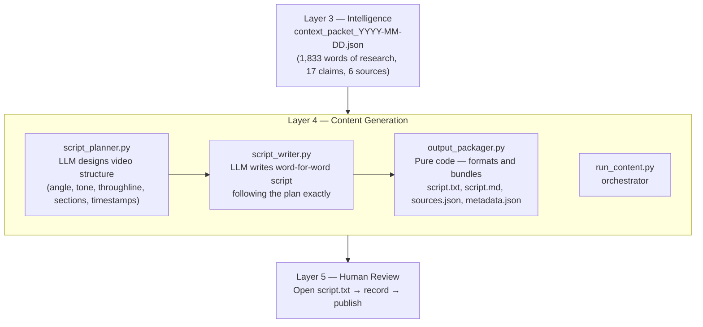
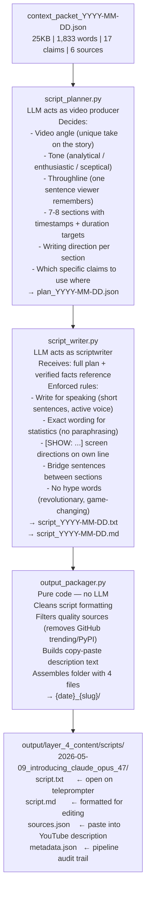

# Layer 4 — Content Generation

## Layer purpose

Layer 4 is the **script production layer**.

It takes the research-grade context packet from Layer 3 and produces a ready-to-record YouTube video script — with proper narrative structure, verified facts, screen directions, and a formatted package of everything the creator needs.

It should answer:

```text
What should the video's narrative angle be?
How should the story be structured for a 10-minute YouTube video?
What exact words should the host read on camera?
Which sources should appear in the YouTube description?
What was the estimated duration and word count of this script?
```

It should NOT answer:

```text
Is the script factually accurate? (That was Layer 3's job — Layer 4 uses verified claims only)
Should we cover this topic? (That was Layer 3's topic_selector)
What image should the thumbnail use? (Not yet implemented)
```

---

## Where Layer 4 sits in the full architecture



---

## Layer 4 internal architecture



---

## Important rules for Layer 4

```text
1. The planner runs FIRST — never ask the writer to plan and write simultaneously.
   Planning before writing produces significantly better structure.

2. The writer uses ONLY verified claims for statistics.
   It receives a curated "VERIFIED FACTS REFERENCE" block with exact wording.
   Numbers in the script must match claims_*.json exactly — no rounding, no paraphrasing.

3. [SHOW: ...] directions are for the video editor.
   They are placed right where the stat is mentioned so the editor knows when to cut.

4. No LLM is called in output_packager.py — it is pure deterministic code.
   This ensures the final package is always created even if LLM calls had issues.

5. Source filtering in the packager:
   - Always include: Tier 1 (official blogs) and Tier 1.5 (arXiv)
   - Include if credible: Tier 2 (established media)
   - Exclude from description: GitHub trending, PyPI, Reddit raw posts
   Sources in the script can come from anywhere — but the YouTube description
   only shows sources a viewer would want to click.

6. The script_writer is the highest-value LLM call in the pipeline.
   It produces what you actually read on camera.
   Use the production model (gpt-4o or Claude Sonnet) for real recordings.
```

---

## Layer 4 input

```json
{
  "source": "output/layer_3_intelligence/context_packets/context_packet_YYYY-MM-DD.json",
  "size": "~25KB",
  "content_words": 1833,
  "claims": 17,
  "sources": 6
}
```

---

## Layer 4 output

```text
output/layer_4_content/scripts/
├── plan_YYYY-MM-DD.json                          ← planner output (intermediate)
├── script_YYYY-MM-DD.txt                         ← writer output (intermediate)
├── script_YYYY-MM-DD.md                          ← writer output formatted (intermediate)
└── 2026-05-09_introducing_claude_opus_47/        ← FINAL PACKAGE (Layer 4 output)
    ├── script.txt                                  ← open on teleprompter, record
    ├── script.md                                   ← formatted, for editing
    ├── sources.json                                ← paste into YouTube description
    └── metadata.json                               ← full pipeline audit trail
```

---

## Modules

---

### `script_planner.py`

**Purpose:** Design the complete video structure before any writing begins. The LLM acts as a video producer — it thinks about narrative arc, not script language.

**Why important:** Without a plan, the script writer invents structure while writing — and compromises on both structure quality and language quality simultaneously. By separating planning from writing, each LLM call can focus on one thing. The planner output gives the writer an exact section-by-section blueprint with direction, timing, and specific claims to use per section.

**Questions this module answers:**
```text
What is the unique angle on this story? (Not just "what happened" but "what lens do we use?")
What is the one sentence a viewer should remember 24 hours after watching?
How should the 10 minutes be divided across sections?
What should each section accomplish emotionally and informationally?
Which specific verified claims should appear in which section?
```

**Input:**
```json
{
  "source": "context_packet_YYYY-MM-DD.json",
  "target_duration_minutes": 10
}
```

**Logic:**
```text
Build claims digest from context packet (statistics block + top 8 key facts).
Truncate summary, background, why_it_matters, tech, comparisons, audience_angle 
  to 400-800 chars each (context window management).
Build prompt:
  Role: YouTube video producer for 500K sub AI channel
  Task: Design the VIDEO STRUCTURE — not the script
  Content: topic, angle, claims digest, section content excerpts
  Request: 3 meta decisions (angle, tone, throughline) 
           + 7-8 sections each with: id, title, timestamp, duration_seconds, 
             direction (2-4 sentences), claims_to_use list

Parse response by strict label format:
  SECTION: hook
  TITLE: Hook: The Reliability Shift
  TIMESTAMP: 00:00
  DURATION_SECONDS: 30
  DIRECTION: Start with a provocative question...
  CLAIMS_TO_USE: STAT: 13% benchmark, STAT: 0.715 score

  ANGLE: Security-first, reliability-driven upgrade...
  TONE: analytical
  THROUGHLINE: Claude Opus 4.7 marks a shift from "better AI" to...
```

**Output:**
```json
{
  "topic": "Introducing Claude Opus 4.7",
  "generated_at": "2026-05-10T00:17:57",
  "target_duration_minutes": 10,
  "estimated_duration_seconds": 600,
  "estimated_duration_minutes": 10.0,
  "angle": "Security-first, reliability-driven upgrade: Opus 4.7 redefines production AI for complex, long-running tasks with automated verification.",
  "tone": "analytical",
  "throughline": "Claude Opus 4.7 marks a shift from 'better AI' to 'reliable, auditable automation' for complex workflows.",
  "section_count": 8,
  "sections": [
    {
      "id": "hook",
      "title": "Hook: The Reliability Shift in Claude Opus 4.7",
      "timestamp": "00:00",
      "duration_seconds": 30,
      "direction": "Start with a provocative question: could your production AI finally handle long, complex workflows with automatic self-checks?...",
      "claims_to_use": ["STAT: On our 93-task coding benchmark...", "STAT: Claude Opus 4.7 tied for top..."]
    },
    "...7 more sections..."
  ]
}
```

**LLM config:** `MODULE_OVERRIDES["script_planner"]` — planning task, dev model sufficient.

**Run:**
```bash
python3 pipelines/layer_4_content/script_planner.py
python3 pipelines/layer_4_content/script_planner.py --duration 8   # 8-minute video
```

**Status:** ✅ Built

---

### `script_writer.py`

**Purpose:** Write the full word-for-word YouTube script in a single LLM call, following the plan's section-by-section blueprint exactly.

**Why important:** This is the most important module in the entire pipeline — it's what the host reads on camera. The quality of this output directly determines the quality of the video. The writer must follow the plan's structure, use exact wording for statistics, write in a natural speaking style, and add screen directions for the editor. A single focused LLM call (not section-by-section) ensures consistent voice and natural flow across the whole script.

**Questions this module answers:**
```text
What exact words should the host say in each section?
Where should the editor cut to a chart or graphic?
How do sections flow into each other naturally?
Does the script sound like a real person talking, not a textbook?
```

**Input:**
```json
{
  "plan": "plan_YYYY-MM-DD.json",
  "context_packet": "context_packet_YYYY-MM-DD.json"
}
```

**Logic:**
```text
Build sections block from plan:
  For each section:
    SECTION {N}: {title}
    Timestamp: {ts} | Duration: {dur}s | Target words: ~{words}
    Direction: {direction}
    Facts to include: {claims_to_use[:4]}

Build verified facts reference from context packet:
  STATISTICS — use these verbatim when citing numbers:
    • {stat_claim}  [source: {source_name}]
  KEY PRODUCT FACTS:
    • {fact_claim}

Build prompt with:
  - Channel context (500K sub AI news channel, developer audience)
  - Topic, angle, tone, throughline from plan
  - Target word count (target_duration * 130 words/min)
  - Verified facts reference block
  - Section-by-section blueprint
  - 7 strict writing rules (speaking voice, numbers need context, exact stat wording,
    [SHOW:] directions, bridge sentences, no hype words, section markers format)

Parse response by [SECTION: Title | Timestamp] markers.
Count words per section and total.
Calculate estimated duration (total_words / 130).
```

**Writing rules enforced in prompt:**

| Rule | What it means |
|------|--------------|
| Write for speaking | Short sentences, active voice, contractions OK, natural rhythm |
| Numbers need context | Don't say "0.715" — say "0.715 out of 1.0 — that's the top score across all six evaluation categories" |
| Exact wording for stats | Copy benchmark numbers verbatim from the facts reference — no rounding or paraphrasing |
| Screen directions | `[SHOW: coding benchmark chart]` on its own line right when stat is mentioned |
| Section bridges | Every section ends with one sentence flowing naturally to the next |
| No hype words | Forbidden: "game-changing", "revolutionary", "groundbreaking", "as we can see", "in conclusion" |
| Section markers | `[SECTION: Title | Timestamp]` at the start of each section — for parsing and editing |

**Output (two files):**
```text
script_YYYY-MM-DD.txt  — raw output with section markers
script_YYYY-MM-DD.md   — same content with H2 headers and callout blocks

script.txt format:
  TOPIC: Introducing Claude Opus 4.7
  DATE: 2026-05-09
  WORDS: 1242 (~9.6 min)
  ANGLE: Security-first, reliability-driven upgrade...
  THROUGHLINE: ...
  =================================================================
  [SECTION: Hook | Timestamp: 00:00]
  Could your production AI finally handle long, complex workflows...
  [SHOW: 93-task coding benchmark chart]
  ...bridge sentence to next section.

  ─────────────────────────────────────────────────────────────────
  [SECTION: Intro: What Opus 4.7 Adds for Builders | Timestamp: 00:30]
  ...
```

**LLM config:** `MODULE_OVERRIDES["script_writer"]` — **use production model for recorded videos**. This is the highest-value LLM call in the pipeline. The difference between dev and production model is immediately visible in the final recording.

**Run:**
```bash
python3 pipelines/layer_4_content/script_writer.py
python3 pipelines/layer_4_content/script_writer.py --plan path/to/plan.json
```

**Status:** ✅ Built

---

### `output_packager.py`

**Purpose:** Pure code — take the written script and package it into a clean folder with 4 ready-to-use files.

**Why important:** The packager is what turns intermediate outputs into a finished product. It handles formatting (clean teleprompter version, markdown version), source filtering (only include sources worth linking in the YouTube description), and assembles the metadata document that serves as the pipeline audit trail. Zero LLM calls — deterministic and instant.

**Questions this module answers:**
```text
Is the script ready to read on a teleprompter? (clean formatting, visual separators)
Which sources should appear in the YouTube description?
What is the copy-paste ready description text?
What models were used and how long is the script?
```

**Input:**
```json
{
  "script_txt": "script_YYYY-MM-DD.txt",
  "plan":       "plan_YYYY-MM-DD.json",
  "packet":     "context_packet_YYYY-MM-DD.json"
}
```

**Logic:**
```text
Parse script.txt header lines (TOPIC, DATE, WORDS, ANGLE, THROUGHLINE).
Extract raw script body (after the ===== separator).

Clean for script.txt (teleprompter version):
  [SECTION: ...] markers → visual separator (─────) + section header
  [SHOW: ...] lines → indented: "    [SHOW: ...]"
  Max 1 consecutive blank line.

Build script.md (formatted version):
  [SECTION: ...] markers → H2 header: ## SECTION: Title | Timestamp
  [SHOW: ...] lines → callout block: > 📺 On screen: description
  Full markdown document with title, metadata, dividers.

Filter sources for YouTube description:
  Always include: Tier 1, Tier 1.5
  Include if credible: Tier 2 with non-generic publisher name
  Exclude: GitHub trending (trust_tier >= 3 and "github" in publisher)
           PyPI (any source from pypi.org)

Build sources.json:
  description_text: copy-paste ready bullet list:
    "• Introducing Claude Opus 4.7 — https://anthropic.com/..."
  sources array with title, url, publisher, tier

Build metadata.json:
  topic, date, headline, story_score, story_rank
  script: total_words, est_duration_min, section_count
  video_plan: angle, tone, throughline
  pipeline: models used, claims count, enrichment words

Create folder: {date}_{slug}/
  slug = topic.lower() → replace spaces/special chars with _ → cap at 50 chars
Save 4 files into folder.
```

**Output:**
```text
2026-05-09_introducing_claude_opus_47/
├── script.txt      (10,476 bytes)
├── script.md       (9,165 bytes)
├── sources.json    (1,528 bytes)
└── metadata.json   (992 bytes)
```

`sources.json` content:
```json
{
  "topic": "Introducing Claude Opus 4.7",
  "date": "2026-05-09",
  "description_text": "• Introducing Claude Opus 4.7 — https://www.anthropic.com/news/claude-opus-4-7\n• Introducing Claude Design by Anthropic Labs — https://...\n• MRI-Eval: A Tiered Benchmark... — https://arxiv.org/...",
  "sources": [
    {"title": "Introducing Claude Opus 4.7", "url": "...", "publisher": "Anthropic", "tier": 1},
    "...3 more..."
  ]
}
```

**Run:**
```bash
python3 pipelines/layer_4_content/output_packager.py
python3 pipelines/layer_4_content/output_packager.py --date 2026-05-09
```

**Status:** ✅ Built

---

### `run_content.py`

**Purpose:** Orchestrator — runs all 3 modules in sequence with one command.

**Logic:**
```text
Find latest context_packet_*.json from Layer 3.
Run: script_planner → script_writer → output_packager.
Pass outputs between steps as Python function calls (not file re-loads).
Print step-by-step progress and final summary.
```

**Run:**
```bash
python3 pipelines/layer_4_content/run_content.py
python3 pipelines/layer_4_content/run_content.py --duration 8   # 8-min video
```

**Status:** ✅ Built

---

## LLM call reference (per run)

| Module | In (tokens) | Out (tokens) | Duration | Notes |
|--------|------------|-------------|----------|-------|
| script_planner | ~1,680 | ~2,334 | ~67s | Large output — detailed section plan |
| script_writer | ~3,261 | ~2,127 | ~52s | Full script — ~1,200 words out |
| output_packager | 0 | 0 | <1s | Pure code |
| **Total** | **~4,941** | **~4,461** | **~120s** | |

---

## What to build next in Layer 4

| Priority | Item | Why |
|----------|------|-----|
| 🔴 High | Switch `script_writer` to production model profile | This is what goes on camera — quality matters most here |
| 🟡 Medium | Thumbnail prompt generator | From the angle + topic, generate a DALL-E prompt for the thumbnail concept |
| 🟡 Medium | YouTube description generator | Auto-format full description: intro, bullet points, sources, timestamps |
| 🟢 Low | Script linter | Word count check, flag forbidden phrases, verify all stats have sources |
| 🟢 Low | Multiple script variants | Run writer twice with different angles — human picks the better one |
