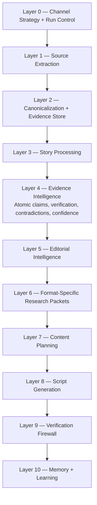
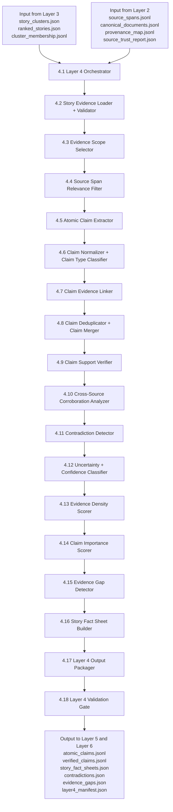

([Files][1])([Files][2])([Files][3])

Absolutely — now we will design **Layer 4: Evidence Intelligence** in detail.

Layers so far:

```text
Layer 1 collected raw AI sources.
Layer 2 cleaned them into canonical documents and source spans.
Layer 3 grouped those documents into story clusters and ranked the stories.
Layer 4 now turns story evidence into verified, usable claims.
```

This is one of the most important layers in the entire system because this is where hallucination control becomes real.

Your earlier design already said the final script should be built from **verified claims, not loose summaries**, and that the fact-checking step should verify that major statements map back to sources. 

---

# Layer 4 — Evidence Intelligence

## 1. Purpose of Layer 4

Layer 4 answers:

```text
What factual claims can we safely make about each story?
Which source span supports each claim?
Is the claim directly supported, weakly supported, contradicted, or unsupported?
Do multiple sources agree?
Are there any conflicts?
Is there enough evidence to use this story in a video?
```

Layer 3 says:

```text
This is an important story about OpenAI / Anthropic / Gemini / Llama / AI regulation / AI chips.
```

Layer 4 says:

```text
These are the verified facts we can safely say about that story.
These are the uncertain points.
These are the contradictions.
These are the claims we must avoid or phrase carefully.
```

---

# 2. Why Layer 4 is important

Without Layer 4, your system may do this:

```text
Source article → loose summary → script
```

That is risky because the LLM may:

```text
overstate a company claim,
merge two unrelated facts,
invent benchmarks,
treat Reddit/Hacker News as truth,
turn speculation into certainty,
or write strong conclusions without evidence.
```

Layer 4 forces this safer flow:

```text
source span → atomic claim → evidence link → verification → confidence → usable fact
```

This is the core hallucination-control layer.

---

# 3. What Layer 4 should do and not do

## Layer 4 should do

```text
Extract atomic claims from source spans.
Attach every claim to exact source spans.
Normalize duplicate claims.
Classify claim type.
Verify support level.
Detect contradictions.
Classify uncertainty.
Score evidence density.
Produce story-level fact sheets.
Produce evidence packets for Layer 5 and Layer 6.
```

## Layer 4 should not do

```text
It should not select the final video format.
It should not write the YouTube script.
It should not create catchy titles.
It should not make unsupported strategic conclusions.
It should not use community posts as factual proof.
It should not allow agents to pass free-form opinions as evidence.
```

Layer 4 can say:

```json
{
  "claim_text": "OpenAI announced a new coding-related product update.",
  "verification_status": "verified",
  "support_level": "direct",
  "source_span_ids": ["span_doc_openai_001_0001"]
}
```

Layer 4 should not say:

```json
{
  "final_take": "This proves OpenAI will dominate software development."
}
```

That kind of interpretation belongs later, and only if supported by evidence.

---

# 4. Where Layer 4 sits in the full architecture



Layer 4 sits between **story ranking** and **editorial decision-making**.

This matters because Layer 5 should not decide “this is a great deep dive” unless Layer 4 confirms there is enough reliable evidence.

---

# 5. Layer wise architecture — Layer 4 internal architecture



---

# 6. Layer 4 input and output

## Layer 4 input

Layer 4 receives from Layer 3:

```text
story_clusters.json
ranked_stories.json
cluster_membership.jsonl
story_entity_topic_map.json
story_timeline.json
layer3_manifest.json
```

Layer 4 also reads from Layer 2:

```text
canonical_documents.jsonl
source_spans.jsonl
provenance_map.jsonl
content_quality_report.json
source_trust_report.json
```

And from Layer 0:

```text
run_manifest.json
quality_policy
memory_policy
depth_limits
```

Example input package:

```json
{
  "run_id": "run_2026_05_10_48h_auto",
  "inputs": {
    "story_clusters_path": "data/runs/run_2026_05_10_48h_auto/layer_3/story_clusters.json",
    "ranked_stories_path": "data/runs/run_2026_05_10_48h_auto/layer_3/ranked_stories.json",
    "source_spans_path": "data/runs/run_2026_05_10_48h_auto/layer_2/source_spans.jsonl",
    "canonical_documents_path": "data/runs/run_2026_05_10_48h_auto/layer_2/canonical_documents.jsonl",
    "provenance_map_path": "data/runs/run_2026_05_10_48h_auto/layer_2/provenance_map.jsonl"
  },
  "quality_policy": {
    "every_claim_requires_source_span": true,
    "allow_community_sources_as_primary_truth": false,
    "require_primary_source_for_deep_dive": true,
    "allow_unsourced_fact": false
  },
  "depth_limits": {
    "max_ranked_stories_to_analyze": 15,
    "max_claims_per_story": 20
  }
}
```

---

## Layer 4 output

Layer 4 produces:

```text
data/runs/{run_id}/layer_4/
  atomic_claims.jsonl
  verified_claims.jsonl
  rejected_claims.jsonl
  claim_evidence_map.jsonl
  claim_dedup_groups.jsonl
  contradictions.json
  uncertainty_report.json
  evidence_density_report.json
  evidence_gaps.json
  story_fact_sheets.json
  layer4_manifest.json
```

Main output summary:

```json
{
  "run_id": "run_2026_05_10_48h_auto",
  "layer": "layer_4_evidence_intelligence",
  "status": "completed_with_warnings",
  "stories_analyzed": 15,
  "atomic_claim_count": 312,
  "verified_claim_count": 221,
  "rejected_claim_count": 46,
  "uncertain_claim_count": 45,
  "contradiction_count": 6,
  "story_fact_sheets_path": "data/runs/run_2026_05_10_48h_auto/layer_4/story_fact_sheets.json",
  "ready_for_layer_5": true,
  "evidence_available_for_layer_6": true
}
```

---

# 7. Core Layer 4 data objects

Layer 4 should create these core objects:

```text
AtomicClaim
ClaimEvidenceMap
VerifiedClaim
RejectedClaim
ContradictionRecord
UncertaintyRecord
EvidenceDensityRecord
StoryFactSheet
EvidenceGapRecord
```

---

## 7.1 AtomicClaim format

An atomic claim is a small factual statement that can be verified.

Bad claim:

```text
OpenAI changed software development forever.
```

Good atomic claims:

```text
OpenAI announced a coding-related product update.
The update was published on a specific date.
The announcement describes support for code editing.
The source says the tool can run or assist with developer workflows.
```

Schema:

```json
{
  "claim_id": "claim_story001_0001",
  "run_id": "run_2026_05_10_48h_auto",
  "story_id": "story_20260510_openai_codex_update",

  "claim": {
    "claim_text": "OpenAI announced a coding-related product update.",
    "claim_type": "event_fact",
    "claim_scope": "story_specific",
    "claim_subject": "OpenAI",
    "claim_object": "coding-related product update",
    "claim_verb": "announced",
    "time_reference": "2026-05-10",
    "numeric_value": null,
    "unit": null
  },

  "evidence": {
    "source_span_ids": ["span_doc_openai_001_0001"],
    "canonical_document_ids": ["doc_openai_001"],
    "source_urls": ["https://openai.com/news/example"],
    "source_roles": ["primary_evidence"],
    "trust_tiers": [1]
  },

  "extraction": {
    "extracted_from_span_id": "span_doc_openai_001_0001",
    "extractor_version": "atomic_claim_extractor_v1",
    "extracted_at": "2026-05-10T10:45:00Z"
  },

  "status": {
    "verification_status": "pending",
    "confidence": null,
    "usable_in_script": false
  }
}
```

---

## 7.2 VerifiedClaim format

A verified claim is an atomic claim after support checking.

```json
{
  "claim_id": "claim_story001_0001",
  "story_id": "story_20260510_openai_codex_update",

  "claim_text": "OpenAI announced a coding-related product update.",
  "claim_type": "event_fact",

  "verification": {
    "verification_status": "verified",
    "support_level": "direct",
    "confidence": "high",
    "confidence_score": 0.92,
    "reason": "Directly supported by official company source span."
  },

  "evidence": {
    "primary_supporting_spans": ["span_doc_openai_001_0001"],
    "secondary_supporting_spans": [],
    "contradicting_spans": [],
    "source_urls": ["https://openai.com/news/example"]
  },

  "usage_rules": {
    "usable_in_roundup": true,
    "usable_in_deep_dive": true,
    "usable_as_core_claim": true,
    "requires_cautious_language": false,
    "recommended_wording": "OpenAI announced..."
  }
}
```

---

## 7.3 RejectedClaim format

```json
{
  "claim_id": "claim_story001_0042",
  "story_id": "story_20260510_openai_codex_update",
  "claim_text": "This product will replace most software developers.",
  "rejection": {
    "rejection_reason": "unsupported_prediction",
    "support_level": "none",
    "risk_level": "high",
    "required_action": "do_not_use"
  },
  "evidence_checked": {
    "source_span_ids": ["span_doc_openai_001_0007"],
    "issue": "Source discusses product capability but does not support job replacement prediction."
  }
}
```

---

## 7.4 StoryFactSheet format

This is the most useful Layer 4 output for later layers.

```json
{
  "story_id": "story_20260510_openai_codex_update",
  "canonical_story_title": "OpenAI announces coding-related product updates",

  "fact_sheet": {
    "verified_facts": [
      {
        "claim_id": "claim_story001_0001",
        "claim_text": "OpenAI announced a coding-related product update.",
        "confidence": "high",
        "source_span_ids": ["span_doc_openai_001_0001"]
      }
    ],
    "uncertain_points": [
      {
        "claim_id": "claim_story001_0017",
        "claim_text": "The update may significantly change developer workflows.",
        "uncertainty_reason": "Interpretive impact claim; source supports capability but not measured impact."
      }
    ],
    "contradictions": [],
    "do_not_use_claims": [
      {
        "claim_id": "claim_story001_0042",
        "reason": "Unsupported prediction."
      }
    ]
  },

  "evidence_summary": {
    "primary_source_count": 1,
    "secondary_source_count": 3,
    "research_source_count": 0,
    "community_signal_count": 2,
    "verified_claim_count": 14,
    "evidence_density_score": 82
  },

  "handoff_recommendation": {
    "safe_for_roundup": true,
    "safe_for_deep_dive": true,
    "needs_more_research": false,
    "caution_level": "low"
  }
}
```

---

# 8. Claim taxonomy

Layer 4 should classify every claim.

## Claim types

```text
event_fact
timeline_fact
product_fact
model_capability
feature_claim
benchmark_claim
research_claim
business_claim
partnership_claim
funding_claim
regulation_claim
pricing_claim
quote_claim
statistic_claim
limitation_claim
risk_claim
community_signal_claim
interpretive_claim
prediction_claim
opinion_claim
```

## Claim support levels

```text
direct
indirect
corroborated
single_source
conflicting
unsupported
not_verifiable_from_current_sources
trend_signal_only
```

## Verification statuses

```text
verified
partially_supported
uncertain
contradicted
unsupported
rejected
needs_more_evidence
```

## Confidence labels

```text
high
medium
low
unknown
```

---

# 9. Module-by-module Layer 4 design

---

## Module 4.1 — Layer 4 Orchestrator

### Purpose

Coordinate claim extraction, verification, contradiction detection, and story fact-sheet creation.

### Why it matters

Layer 4 has several dependent steps. The orchestrator ensures claims are only verified against the correct story’s evidence and that output files are consistent.

### Questions it answers

```text
Which stories should be analyzed?
Where are their source spans?
How many claims should be extracted per story?
Which quality policy applies?
Can Layer 5 and Layer 6 safely use this output?
```

### Input

```json
{
  "run_manifest_path": "data/runs/run_2026_05_10_48h_auto/run_manifest.json",
  "layer3_manifest_path": "data/runs/run_2026_05_10_48h_auto/layer_3/layer3_manifest.json",
  "layer2_manifest_path": "data/runs/run_2026_05_10_48h_auto/layer_2/layer2_manifest.json"
}
```

### Logic

```text
1. Load run_manifest.json.
2. Load Layer 3 story clusters and ranked stories.
3. Load Layer 2 source spans and canonical documents.
4. Select top ranked stories based on depth limits.
5. Run evidence intelligence modules.
6. Write claims, verification results, contradictions, and fact sheets.
7. Validate outputs.
```

### Output

```json
{
  "run_id": "run_2026_05_10_48h_auto",
  "stories_selected_for_evidence_analysis": 15,
  "atomic_claims_extracted": 312,
  "verified_claims": 221,
  "status": "completed_with_warnings"
}
```

---

## Module 4.2 — Story Evidence Loader + Validator

### Purpose

Load all evidence for each story cluster.

### Why it matters

Layer 4 must only use source spans that belong to the story being analyzed. This prevents evidence leakage between stories.

### Questions it answers

```text
Which source spans belong to this story?
Which documents are official, research, media, GitHub, or community?
Are any source spans missing?
Are source roles and trust tiers available?
```

### Input

```json
{
  "story_id": "story_20260510_openai_codex_update",
  "story_cluster": {
    "member_document_ids": ["doc_openai_001", "doc_news_001", "doc_hn_001"],
    "source_span_ids": ["span_doc_openai_001_0001", "span_doc_news_001_0002"]
  },
  "source_spans_path": "data/runs/.../layer_2/source_spans.jsonl"
}
```

### Logic

```text
1. Load story cluster.
2. Load all source spans attached to the story.
3. Validate span IDs exist.
4. Load document-level metadata.
5. Build story evidence bundle.
6. Separate factual evidence from trend signals.
```

### Output

```json
{
  "story_id": "story_20260510_openai_codex_update",
  "evidence_bundle": {
    "primary_evidence_spans": ["span_doc_openai_001_0001", "span_doc_openai_001_0002"],
    "secondary_evidence_spans": ["span_doc_news_001_0001"],
    "research_evidence_spans": [],
    "technical_artifact_spans": [],
    "trend_signal_spans": ["span_doc_hn_001_0001"]
  },
  "validation": {
    "span_count": 22,
    "valid_span_count": 22,
    "missing_span_count": 0
  }
}
```

---

## Module 4.3 — Evidence Scope Selector

### Purpose

Limit evidence processing to the most relevant spans.

### Why it matters

A story may have hundreds of spans. You do not want to extract every possible minor claim. You want high-signal claims.

### Questions it answers

```text
Which source spans are worth claim extraction?
Which spans are primary evidence?
Which spans are only trend signals?
Should community spans be excluded from factual claim extraction?
```

### Input

```json
{
  "story_id": "story_001",
  "evidence_bundle": {
    "primary_evidence_spans": ["span_001", "span_002"],
    "secondary_evidence_spans": ["span_010", "span_011"],
    "trend_signal_spans": ["span_030"]
  },
  "depth_limits": {
    "max_claims_per_story": 20
  }
}
```

### Logic

```text
1. Prioritize official and research evidence.
2. Include independent news spans that add new facts.
3. Include GitHub/technical artifact spans for technical claims.
4. Exclude community spans from factual claim extraction.
5. Preserve community spans only for audience-signal claims.
6. Limit low-quality or partial snippets.
```

### Output

```json
{
  "story_id": "story_001",
  "selected_spans_for_claim_extraction": [
    "span_001",
    "span_002",
    "span_010"
  ],
  "excluded_spans": [
    {
      "span_id": "span_030",
      "reason": "trend_signal_only_not_primary_fact"
    }
  ]
}
```

---

## Module 4.4 — Source Span Relevance Filter

### Purpose

Filter out spans that are attached to the story but not useful for factual extraction.

### Why it matters

Some spans may be boilerplate, author bio, generic background, or vague commentary.

### Questions it answers

```text
Does this span contain extractable facts?
Does it describe the actual event?
Is it background only?
Is it boilerplate?
Is it opinion?
```

### Input

```json
{
  "span_id": "span_doc_openai_001_0004",
  "text": "We believe AI will transform the future of work...",
  "source_role": "primary_evidence"
}
```

### Logic

```text
1. Check span quality flags from Layer 2.
2. Detect boilerplate or marketing-only language.
3. Detect factual density.
4. Mark span as:
   - fact_candidate
   - quote_candidate
   - background_context
   - opinion_only
   - ignore
```

### Output

```json
{
  "span_id": "span_doc_openai_001_0004",
  "relevance_status": "background_context",
  "claim_extraction_allowed": false,
  "reason": "marketing_language_without_specific_factual_claim"
}
```

---

## Module 4.5 — Atomic Claim Extractor

### Purpose

Extract small, verifiable claims from selected source spans.

### Why it matters

This is the heart of evidence intelligence. Claims should be extracted from exact source spans, not from generated summaries.

### Questions it answers

```text
What factual statement does this source span make?
Can the statement be verified?
Is it small enough to be checked independently?
What type of claim is it?
```

### Input

```json
{
  "span_id": "span_doc_openai_001_0001",
  "story_id": "story_001",
  "source_role": "primary_evidence",
  "trust_tier": 1,
  "text": "Exact source text from official announcement..."
}
```

### Logic

```text
1. Read one source span at a time.
2. Extract only claims explicitly present in the span.
3. Split compound statements into separate atomic claims.
4. Preserve source_span_id.
5. Avoid adding interpretation.
6. Mark claims that are quotes, numbers, dates, features, limitations, etc.
7. If the span has no extractable claim, return no claims.
```

### Output

```json
{
  "claim_id": "claim_story001_0001",
  "story_id": "story_001",
  "claim_text": "OpenAI announced a coding-related product update.",
  "claim_type": "event_fact",
  "extracted_from_span_id": "span_doc_openai_001_0001",
  "source_role": "primary_evidence",
  "trust_tier": 1,
  "extraction_confidence": 0.91,
  "verification_status": "pending"
}
```

---

## Module 4.6 — Claim Normalizer + Claim Type Classifier

### Purpose

Standardize claim wording and classify claim type.

### Why it matters

Different sources may phrase the same fact differently. Normalization makes deduplication and verification easier.

### Questions it answers

```text
What is the normalized version of this claim?
What type of claim is it?
Is it a fact, quote, number, opinion, prediction, or community signal?
Does it contain a date, entity, product, or metric?
```

### Input

```json
{
  "claim_id": "claim_001",
  "claim_text": "The company says the tool can help developers edit code."
}
```

### Logic

```text
1. Normalize entity names.
2. Normalize dates.
3. Normalize product/model names.
4. Classify claim type.
5. Extract structured fields:
   - subject
   - verb
   - object
   - time reference
   - numeric value
   - unit
6. Flag risky claim categories.
```

### Output

```json
{
  "claim_id": "claim_001",
  "normalized_claim": {
    "claim_text": "OpenAI says the tool can help developers edit code.",
    "claim_type": "feature_claim",
    "subject": "OpenAI",
    "verb": "says",
    "object": "tool can help developers edit code",
    "time_reference": null,
    "numeric_value": null,
    "unit": null
  },
  "risk_flags": []
}
```

---

## Module 4.7 — Claim Evidence Linker

### Purpose

Attach each claim to its supporting source spans, documents, URLs, trust tiers, and source roles.

### Why it matters

A claim without a source span is not allowed into later content generation.

### Questions it answers

```text
Which exact source span supports this claim?
Which document did that span come from?
What is the original URL?
Is this primary, secondary, research, technical, or community evidence?
```

### Input

```json
{
  "claim_id": "claim_001",
  "extracted_from_span_id": "span_doc_openai_001_0001"
}
```

### Logic

```text
1. Look up source span.
2. Look up canonical document.
3. Look up provenance record.
4. Attach source URL, document ID, source role, and trust tier.
5. Reject claim if source span is missing.
```

### Output

```json
{
  "claim_id": "claim_001",
  "evidence_map": {
    "source_span_ids": ["span_doc_openai_001_0001"],
    "canonical_document_ids": ["doc_openai_001"],
    "source_urls": ["https://openai.com/news/example"],
    "source_roles": ["primary_evidence"],
    "trust_tiers": [1],
    "provenance_ids": ["prov_doc_openai_001"]
  }
}
```

---

## Module 4.8 — Claim Deduplicator + Claim Merger

### Purpose

Merge duplicate or near-duplicate claims across sources.

### Why it matters

If five sources say the same basic thing, you do not want five separate facts. You want one claim with multiple supporting sources.

### Questions it answers

```text
Are these claims saying the same thing?
Do multiple sources support one normalized claim?
Should these claims be merged?
Are there minor differences that should be preserved?
```

### Input

```json
{
  "claims": [
    {
      "claim_id": "claim_001",
      "claim_text": "OpenAI announced a coding-related product update."
    },
    {
      "claim_id": "claim_014",
      "claim_text": "OpenAI released an update for its coding tools."
    }
  ]
}
```

### Logic

```text
1. Compare normalized subject, verb, object, date, and entity.
2. Compare semantic similarity.
3. Merge if same factual meaning.
4. Preserve all source_span_ids.
5. Choose canonical wording from highest-trust source.
```

### Output

```json
{
  "claim_group_id": "claim_group_001",
  "canonical_claim_id": "claim_001",
  "merged_claim_ids": ["claim_001", "claim_014"],
  "canonical_claim_text": "OpenAI announced a coding-related product update.",
  "supporting_source_span_ids": [
    "span_doc_openai_001_0001",
    "span_doc_news_001_0003"
  ],
  "merge_confidence": 0.88
}
```

---

## Module 4.9 — Claim Support Verifier

### Purpose

Verify whether each claim is actually supported by its source spans.

### Why it matters

The extractor may overstate a source span. This module checks the claim against the evidence.

### Questions it answers

```text
Does the source span actually say this?
Is the claim too broad?
Is the claim directly supported or only implied?
Is the claim unsupported?
Should the wording be softened?
```

### Input

```json
{
  "claim_id": "claim_001",
  "claim_text": "OpenAI announced a coding-related product update.",
  "source_spans": [
    {
      "span_id": "span_doc_openai_001_0001",
      "text": "Exact source text..."
    }
  ]
}
```

### Logic

```text
1. Compare claim against source span.
2. Classify support:
   - direct
   - indirect
   - partial
   - none
3. Detect overclaiming.
4. Recommend safe wording.
5. Reject unsupported claims.
```

### Output

```json
{
  "claim_id": "claim_001",
  "verification": {
    "verification_status": "verified",
    "support_level": "direct",
    "confidence": "high",
    "confidence_score": 0.94,
    "overclaim_detected": false,
    "recommended_wording": "OpenAI announced a coding-related product update."
  }
}
```

Overclaim example:

```json
{
  "claim_id": "claim_099",
  "verification": {
    "verification_status": "partially_supported",
    "support_level": "partial",
    "confidence": "low",
    "overclaim_detected": true,
    "problem": "Source supports that the tool has coding features, but does not support that it will replace developers.",
    "recommended_wording": "The update is aimed at coding workflows, but its real-world impact is not yet independently measured."
  }
}
```

---

## Module 4.10 — Cross-Source Corroboration Analyzer

### Purpose

Check whether multiple reliable sources support the same claim.

### Why it matters

A claim supported only by a company blog is still useful, but should be phrased differently from a claim supported by official + independent + research sources.

### Questions it answers

```text
Is this claim only from an official source?
Is there independent confirmation?
Is there research support?
Is there only community discussion?
How strong is the source mix behind this claim?
```

### Input

```json
{
  "claim_group_id": "claim_group_001",
  "canonical_claim_text": "OpenAI announced a coding-related product update.",
  "supporting_source_span_ids": [
    "span_doc_openai_001_0001",
    "span_doc_news_001_0003"
  ]
}
```

### Logic

```text
1. Count supporting source roles.
2. Count unique publishers.
3. Check if support is independent or syndicated.
4. Classify corroboration level.
5. Generate usage guidance.
```

### Output

```json
{
  "claim_group_id": "claim_group_001",
  "corroboration": {
    "corroboration_level": "official_plus_independent",
    "primary_source_count": 1,
    "independent_source_count": 2,
    "research_source_count": 0,
    "community_source_count": 0,
    "usage_guidance": "Can be stated as a verified event fact."
  }
}
```

---

## Module 4.11 — Contradiction Detector

### Purpose

Detect conflicts between claims or sources.

### Why it matters

Some AI stories have conflicting claims:

```text
Company says benchmark improved.
Independent tester says result is not reproducible.

A news article says the model is open-source.
Official license says usage is restricted.

Community says feature is available to everyone.
Official docs say it is limited rollout.
```

### Questions it answers

```text
Do sources disagree?
Are two claims mutually inconsistent?
Is there a benchmark conflict?
Is there a date/version conflict?
Is there a difference between official claim and independent testing?
```

### Input

```json
{
  "story_id": "story_001",
  "verified_and_pending_claims": [
    {
      "claim_id": "claim_001",
      "claim_text": "The feature is available to all users."
    },
    {
      "claim_id": "claim_002",
      "claim_text": "The feature is available only to paid users."
    }
  ]
}
```

### Logic

```text
1. Compare claims inside the same story.
2. Detect incompatible values:
   - dates
   - versions
   - availability
   - pricing
   - benchmark numbers
   - license terms
   - release status
3. Compare official vs independent vs community sources.
4. Assign severity.
5. Recommend cautious wording.
```

### Output

```json
{
  "contradiction_id": "contradiction_story001_001",
  "story_id": "story_001",
  "contradiction_type": "availability_conflict",
  "severity": "medium",
  "claim_a": {
    "claim_id": "claim_001",
    "claim_text": "The feature is available to all users."
  },
  "claim_b": {
    "claim_id": "claim_002",
    "claim_text": "The feature is available only to paid users."
  },
  "resolution_status": "unresolved",
  "recommended_script_handling": "Mention that availability details are unclear and avoid definitive wording."
}
```

---

## Module 4.12 — Uncertainty + Confidence Classifier

### Purpose

Classify how confidently each claim can be used.

### Why it matters

Not all claims should be written the same way.

High-confidence claim:

```text
OpenAI announced X.
```

Medium-confidence claim:

```text
The announcement suggests X may be aimed at developer workflows.
```

Low-confidence claim:

```text
Some users are discussing whether X could affect developers, but that impact is not yet proven.
```

### Questions it answers

```text
How confident are we?
Does the claim require cautious language?
Is it official-only, independently confirmed, or speculative?
Should it be excluded from script?
```

### Input

```json
{
  "claim_id": "claim_001",
  "support_level": "direct",
  "source_roles": ["primary_evidence"],
  "contradictions": [],
  "claim_type": "event_fact"
}
```

### Logic

```text
Confidence increases with:
- direct support
- high-trust source
- multiple independent sources
- no contradictions
- clear wording

Confidence decreases with:
- indirect support
- low-trust source
- community-only evidence
- partial snippets
- contradictions
- prediction or interpretation
```

### Output

```json
{
  "claim_id": "claim_001",
  "confidence": {
    "confidence_label": "high",
    "confidence_score": 0.92,
    "uncertainty_level": "low",
    "requires_cautious_language": false,
    "safe_usage": "can_state_directly"
  }
}
```

For uncertain claim:

```json
{
  "claim_id": "claim_018",
  "confidence": {
    "confidence_label": "medium",
    "confidence_score": 0.61,
    "uncertainty_level": "medium",
    "requires_cautious_language": true,
    "safe_usage": "use_with_qualifier",
    "recommended_qualifier": "The available sources suggest..."
  }
}
```

---

## Module 4.13 — Evidence Density Scorer

### Purpose

Score whether each story has enough evidence for different video formats.

### Why it matters

A story may be fine for a 45-second roundup segment but not strong enough for a 10-minute deep dive.

### Questions it answers

```text
Does this story have enough verified facts?
Does it have a primary source?
Does it have independent sources?
Are there enough source spans?
Can this support a deep dive?
Should it only be a roundup mention?
```

### Input

```json
{
  "story_id": "story_001",
  "verified_claims": ["claim_001", "claim_002"],
  "source_mix": {
    "official_source_count": 1,
    "independent_news_count": 2,
    "research_source_count": 0,
    "community_signal_count": 4
  }
}
```

### Logic

```text
Score based on:
- verified claim count
- primary source count
- independent source count
- source span count
- contradiction severity
- uncertainty count
- content quality
- usable claim diversity
```

### Output

```json
{
  "story_id": "story_001",
  "evidence_density": {
    "evidence_density_score": 82,
    "verified_claim_count": 14,
    "primary_source_count": 1,
    "independent_source_count": 3,
    "contradiction_count": 0,
    "uncertain_claim_count": 2,
    "safe_for_roundup": true,
    "safe_for_deep_dive": true,
    "safe_for_evergreen": false,
    "reason": "Strong official source and enough verified claims for detailed coverage."
  }
}
```

---

## Module 4.14 — Claim Importance Scorer

### Purpose

Rank claims by usefulness for content creation.

### Why it matters

Not every verified claim belongs in the video. Some facts are minor. Layer 4 should identify which facts matter most.

### Questions it answers

```text
Which facts are central to the story?
Which facts are background?
Which facts are useful for hook, explanation, limitation, or takeaway?
Which claims should be prioritized for Layer 6 packets?
```

### Input

```json
{
  "claim_id": "claim_001",
  "claim_type": "event_fact",
  "confidence": "high",
  "source_role": "primary_evidence",
  "story_type": "product_launch"
}
```

### Logic

```text
Higher importance:
- event-defining claim
- official announcement fact
- capability/feature fact
- limitation or caveat
- business/user impact fact
- timeline fact
- contradiction/resolution fact

Lower importance:
- generic background
- repeated boilerplate
- vague marketing claim
- weak speculation
```

### Output

```json
{
  "claim_id": "claim_001",
  "claim_importance": {
    "importance_score": 88,
    "content_use": "core_fact",
    "recommended_sections": [
      "what_happened",
      "why_it_matters"
    ]
  }
}
```

---

## Module 4.15 — Evidence Gap Detector

### Purpose

Identify missing evidence before editorial decisions.

### Why it matters

Sometimes a story looks important but lacks enough proof. The system should not blindly proceed.

### Questions it answers

```text
What evidence is missing?
Do we need an official source?
Do we need independent confirmation?
Do we need benchmark details?
Do we need pricing, release date, limitations, or technical docs?
Should Layer 5 avoid deep dive because evidence is incomplete?
```

### Input

```json
{
  "story_id": "story_001",
  "verified_claims": [],
  "source_mix": {},
  "contradictions": [],
  "uncertain_claims": []
}
```

### Logic

```text
1. Compare story type against required evidence checklist.
2. Identify missing source types.
3. Identify missing facts.
4. Mark whether gaps block deep dive, roundup, or all usage.
```

### Output

```json
{
  "story_id": "story_001",
  "evidence_gaps": [
    {
      "gap_type": "missing_independent_confirmation",
      "severity": "medium",
      "blocks_roundup": false,
      "blocks_deep_dive": true,
      "description": "Official source exists, but no independent coverage was found."
    }
  ],
  "recommendation": "Use as roundup mention or monitor for more sources."
}
```

---

## Module 4.16 — Story Fact Sheet Builder

### Purpose

Create the final fact sheet for each story.

### Why it matters

Layer 5 and Layer 6 should not read raw claims randomly. They should receive a structured fact sheet.

### Questions it answers

```text
What can we safely say?
What should we not say?
What is uncertain?
What is contradicted?
What source spans support the story?
Which format is evidence-safe?
```

### Input

```json
{
  "story_id": "story_001",
  "verified_claims": [],
  "uncertain_claims": [],
  "contradictions": [],
  "evidence_density": {},
  "evidence_gaps": []
}
```

### Output

```json
{
  "story_id": "story_001",
  "story_fact_sheet": {
    "safe_facts": [
      {
        "claim_id": "claim_001",
        "claim_text": "OpenAI announced a coding-related product update.",
        "confidence": "high",
        "source_span_ids": ["span_doc_openai_001_0001"]
      }
    ],
    "cautious_facts": [
      {
        "claim_id": "claim_018",
        "claim_text": "The update may affect developer workflows.",
        "required_language": "The available sources suggest..."
      }
    ],
    "do_not_use": [
      {
        "claim_id": "claim_099",
        "reason": "Unsupported prediction."
      }
    ],
    "contradictions": [],
    "evidence_gaps": []
  },
  "format_safety": {
    "roundup": "safe",
    "deep_dive": "safe",
    "evergreen": "needs_more_context",
    "comparison": "not_applicable"
  }
}
```

---

## Module 4.17 — Layer 4 Output Packager

### Purpose

Write all Layer 4 output files in consistent formats.

### Output files

```text
atomic_claims.jsonl
verified_claims.jsonl
rejected_claims.jsonl
claim_evidence_map.jsonl
claim_dedup_groups.jsonl
contradictions.json
uncertainty_report.json
evidence_density_report.json
evidence_gaps.json
story_fact_sheets.json
layer4_manifest.json
```

### Output example

```json
{
  "run_id": "run_2026_05_10_48h_auto",
  "outputs": {
    "atomic_claims": "data/runs/run_2026_05_10_48h_auto/layer_4/atomic_claims.jsonl",
    "verified_claims": "data/runs/run_2026_05_10_48h_auto/layer_4/verified_claims.jsonl",
    "story_fact_sheets": "data/runs/run_2026_05_10_48h_auto/layer_4/story_fact_sheets.json",
    "contradictions": "data/runs/run_2026_05_10_48h_auto/layer_4/contradictions.json"
  }
}
```

---

## Module 4.18 — Layer 4 Validation Gate

### Purpose

Validate that Layer 4 output is usable by Layer 5 and Layer 6.

### Why it matters

Layer 5 should not make editorial decisions from unverified or malformed claim data.

### Validation rules

Layer 4 passes if:

```text
Every atomic claim has claim_id.
Every atomic claim has story_id.
Every claim has at least one source_span_id.
Every verified claim has verification_status.
Every verified claim has support_level.
Every rejected claim has rejection_reason.
Every story fact sheet links to a valid story_id.
Every safe fact has supporting source spans.
Community-only claims are not marked as verified factual claims.
Contradictions are documented.
Evidence density exists for every analyzed story.
```

### Output

```json
{
  "validation_status": "passed",
  "ready_for_layer_5": true,
  "evidence_available_for_layer_6": true,
  "warnings": [
    {
      "story_id": "story_009",
      "type": "low_evidence_density",
      "message": "Safe for roundup but not recommended for deep dive."
    }
  ],
  "errors": []
}
```

---

# 10. Layer 4 output files in detail

## 10.1 `atomic_claims.jsonl`

```json
{
  "claim_id": "claim_001",
  "story_id": "story_001",
  "claim_text": "OpenAI announced a coding-related product update.",
  "claim_type": "event_fact",
  "source_span_ids": ["span_doc_openai_001_0001"],
  "verification_status": "pending"
}
```

---

## 10.2 `verified_claims.jsonl`

```json
{
  "claim_id": "claim_001",
  "story_id": "story_001",
  "claim_text": "OpenAI announced a coding-related product update.",
  "claim_type": "event_fact",
  "verification_status": "verified",
  "support_level": "direct",
  "confidence": "high",
  "source_span_ids": ["span_doc_openai_001_0001"],
  "usable_in_script": true,
  "recommended_wording": "OpenAI announced a coding-related product update."
}
```

---

## 10.3 `rejected_claims.jsonl`

```json
{
  "claim_id": "claim_099",
  "story_id": "story_001",
  "claim_text": "This update will replace software developers.",
  "verification_status": "rejected",
  "rejection_reason": "unsupported_prediction",
  "required_action": "do_not_use"
}
```

---

## 10.4 `claim_evidence_map.jsonl`

```json
{
  "claim_id": "claim_001",
  "story_id": "story_001",
  "source_span_ids": ["span_doc_openai_001_0001"],
  "canonical_document_ids": ["doc_openai_001"],
  "source_urls": ["https://openai.com/news/example"],
  "source_roles": ["primary_evidence"],
  "trust_tiers": [1],
  "provenance_ids": ["prov_doc_openai_001"]
}
```

---

## 10.5 `contradictions.json`

```json
{
  "run_id": "run_2026_05_10_48h_auto",
  "contradictions": [
    {
      "contradiction_id": "contradiction_story001_001",
      "story_id": "story_001",
      "contradiction_type": "availability_conflict",
      "severity": "medium",
      "claim_ids": ["claim_011", "claim_012"],
      "resolution_status": "unresolved",
      "recommended_script_handling": "Avoid definitive availability wording."
    }
  ]
}
```

---

## 10.6 `evidence_density_report.json`

```json
{
  "run_id": "run_2026_05_10_48h_auto",
  "stories": [
    {
      "story_id": "story_001",
      "evidence_density_score": 82,
      "verified_claim_count": 14,
      "primary_source_count": 1,
      "independent_source_count": 3,
      "contradiction_count": 0,
      "safe_for_roundup": true,
      "safe_for_deep_dive": true
    }
  ]
}
```

---

## 10.7 `story_fact_sheets.json`

```json
{
  "run_id": "run_2026_05_10_48h_auto",
  "story_fact_sheets": [
    {
      "story_id": "story_001",
      "canonical_story_title": "OpenAI announces coding-related product updates",
      "safe_facts": [],
      "cautious_facts": [],
      "do_not_use": [],
      "contradictions": [],
      "evidence_gaps": [],
      "format_safety": {
        "roundup": "safe",
        "deep_dive": "safe",
        "evergreen": "needs_more_context"
      }
    }
  ]
}
```

---

## 10.8 `layer4_manifest.json`

```json
{
  "run_id": "run_2026_05_10_48h_auto",
  "layer": "layer_4_evidence_intelligence",
  "created_at": "2026-05-10T10:55:00Z",

  "inputs": {
    "run_manifest": "data/runs/run_2026_05_10_48h_auto/run_manifest.json",
    "layer2_manifest": "data/runs/run_2026_05_10_48h_auto/layer_2/layer2_manifest.json",
    "layer3_manifest": "data/runs/run_2026_05_10_48h_auto/layer_3/layer3_manifest.json",
    "story_clusters": "data/runs/run_2026_05_10_48h_auto/layer_3/story_clusters.json",
    "ranked_stories": "data/runs/run_2026_05_10_48h_auto/layer_3/ranked_stories.json",
    "source_spans": "data/runs/run_2026_05_10_48h_auto/layer_2/source_spans.jsonl"
  },

  "outputs": {
    "atomic_claims": "data/runs/run_2026_05_10_48h_auto/layer_4/atomic_claims.jsonl",
    "verified_claims": "data/runs/run_2026_05_10_48h_auto/layer_4/verified_claims.jsonl",
    "rejected_claims": "data/runs/run_2026_05_10_48h_auto/layer_4/rejected_claims.jsonl",
    "claim_evidence_map": "data/runs/run_2026_05_10_48h_auto/layer_4/claim_evidence_map.jsonl",
    "contradictions": "data/runs/run_2026_05_10_48h_auto/layer_4/contradictions.json",
    "evidence_density_report": "data/runs/run_2026_05_10_48h_auto/layer_4/evidence_density_report.json",
    "story_fact_sheets": "data/runs/run_2026_05_10_48h_auto/layer_4/story_fact_sheets.json"
  },

  "counts": {
    "stories_analyzed": 15,
    "atomic_claims_extracted": 312,
    "verified_claims": 221,
    "rejected_claims": 46,
    "uncertain_claims": 45,
    "contradictions": 6
  },

  "handoff": {
    "ready_for_layer_5": true,
    "evidence_available_for_layer_6": true,
    "next_layer": "layer_5_editorial_intelligence"
  }
}
```

---

# 11. Layer 4 config files

Layer 4 should be config-driven.

```text
config/
  evidence_intelligence_rules.yaml
  claim_taxonomy.yaml
  verification_rules.yaml
  contradiction_rules.yaml
  evidence_density_rules.yaml
```

---

## `claim_taxonomy.yaml`

```yaml
claim_types:
  event_fact:
    description: "Something happened or was announced."
    allow_core_script_use: true

  product_fact:
    description: "A product feature, release, or availability fact."
    allow_core_script_use: true

  benchmark_claim:
    description: "A performance or benchmark claim."
    requires_numeric_source: true
    requires_extra_verification: true

  community_signal_claim:
    description: "What community users are discussing."
    can_support_factual_claims: false
    can_support_audience_interest: true

  prediction_claim:
    description: "A future-looking claim."
    requires_cautious_language: true
    allow_as_fact: false
```

---

## `verification_rules.yaml`

```yaml
verification:
  every_claim_requires_source_span: true
  allow_unsourced_claims: false

  support_levels:
    direct:
      usable_in_script: true
    indirect:
      usable_in_script: true
      requires_cautious_language: true
    partial:
      usable_in_script: true
      requires_cautious_language: true
    none:
      usable_in_script: false

  community_rules:
    community_can_verify_fact: false
    community_can_support_trend_signal: true

  overclaim_rules:
    unsupported_prediction_action: reject
    unsupported_benchmark_action: reject
    unsupported_accusation_action: reject
```

---

## `evidence_density_rules.yaml`

```yaml
evidence_density:
  roundup:
    min_verified_claims_per_story: 2
    primary_source_required: false
    allow_secondary_only: true

  deep_dive:
    min_verified_claims: 8
    primary_source_required: true
    min_independent_sources: 1
    max_high_severity_contradictions: 0

  evergreen:
    min_verified_claims: 10
    requires_background_context: true
    requires_memory_context: true

  comparison:
    requires_evidence_per_subject: true
    min_verified_claims_per_subject: 4
```

---

# 12. Suggested Layer 4 folder structure

```text
pipelines/
  layer_4_evidence_intelligence/
    __init__.py
    run_layer_4.py

    orchestrator/
      layer4_orchestrator.py

    loaders/
      story_evidence_loader.py
      source_span_loader.py
      claim_context_builder.py

    filtering/
      evidence_scope_selector.py
      source_span_relevance_filter.py

    extraction/
      atomic_claim_extractor.py
      claim_normalizer.py
      claim_type_classifier.py
      claim_evidence_linker.py

    verification/
      claim_deduplicator.py
      claim_support_verifier.py
      cross_source_corroboration_analyzer.py
      contradiction_detector.py
      uncertainty_confidence_classifier.py

    scoring/
      evidence_density_scorer.py
      claim_importance_scorer.py
      evidence_gap_detector.py

    output/
      story_fact_sheet_builder.py
      layer4_output_packager.py
      layer4_manifest_writer.py

    validation/
      layer4_validation_gate.py

config/
  evidence_intelligence_rules.yaml
  claim_taxonomy.yaml
  verification_rules.yaml
  contradiction_rules.yaml
  evidence_density_rules.yaml

data/
  runs/
    run_2026_05_10_48h_auto/
      layer_4/
        atomic_claims.jsonl
        verified_claims.jsonl
        rejected_claims.jsonl
        claim_evidence_map.jsonl
        claim_dedup_groups.jsonl
        contradictions.json
        uncertainty_report.json
        evidence_density_report.json
        evidence_gaps.json
        story_fact_sheets.json
        layer4_manifest.json
```

---

# 13. Layer 4 processing flow

```text
Step 1:
Load run_manifest.json, layer2_manifest.json, and layer3_manifest.json.

Step 2:
Load ranked stories and story clusters.

Step 3:
Load source spans for selected stories.

Step 4:
Build story evidence bundles.

Step 5:
Filter source spans for claim extraction.

Step 6:
Extract atomic claims from source spans.

Step 7:
Normalize and classify claims.

Step 8:
Link every claim back to source spans, documents, URLs, and provenance.

Step 9:
Deduplicate and merge repeated claims.

Step 10:
Verify claim support against source spans.

Step 11:
Analyze cross-source corroboration.

Step 12:
Detect contradictions.

Step 13:
Classify uncertainty and confidence.

Step 14:
Score evidence density.

Step 15:
Score claim importance.

Step 16:
Detect evidence gaps.

Step 17:
Build story fact sheets.

Step 18:
Write Layer 4 output package.

Step 19:
Validate Layer 4 output.

Step 20:
Pass verified facts and fact sheets to Layer 5 and Layer 6.
```

---

# 14. How Layer 4 supports downstream layers

| Downstream layer                 | What Layer 4 provides                                                                  |
| -------------------------------- | -------------------------------------------------------------------------------------- |
| Layer 5 — Editorial Intelligence | evidence density, safe facts, uncertainty, contradictions, format safety               |
| Layer 6 — Research Packets       | verified claims, cautious facts, do-not-use claims, source maps                        |
| Layer 7 — Content Planning       | safe facts for narrative planning and hook boundaries                                  |
| Layer 8 — Script Generation      | verified claim pool and recommended wording                                            |
| Layer 9 — Verification Firewall  | claim IDs, source span IDs, contradiction records, rejected claims                     |
| Layer 10 — Memory                | verified claims, claim ledger updates, unresolved contradictions, follow-up candidates |

---

# 15. Layer 4 and hallucination control

Layer 4 is where your hallucination-control architecture becomes strict.

## Rule 1: Claims must come from source spans

Correct:

```text
source_span_id → extracted claim → verified claim
```

Incorrect:

```text
summary paragraph → model opinion → script fact
```

## Rule 2: Every factual claim must have evidence

A claim without a source span should be rejected.

```json
{
  "claim_text": "This model is the fastest coding model available.",
  "source_span_ids": [],
  "verification_status": "rejected",
  "rejection_reason": "no_source_span"
}
```

## Rule 3: Community is signal, not truth

Hacker News, Reddit, and comments can support:

```text
people are discussing this
developers are reacting strongly
this topic has audience interest
```

They cannot support:

```text
the product works better than competitors
the company lied
the model is unsafe
the benchmark is fake
```

## Rule 4: Distinguish fact, analysis, and opinion

Layer 4 should classify:

```text
fact: directly supported by source
analysis: later interpretation based on multiple facts
opinion: host framing, not factual claim
prediction: future-looking, requires caution
```

## Rule 5: Contradictions must be preserved

Do not hide contradictions. Store them so later layers can use careful wording.

Example:

```text
“Availability details are still unclear.”
“Independent testing has not yet confirmed the benchmark.”
“The company claims X, but external validation is limited.”
```

---

# 16. What Layer 4 should produce for different video formats

## For roundup videos

Layer 4 should produce:

```text
2–4 verified claims per story
short safe fact summary
one caution note if needed
source URLs
evidence density score
```

Roundup does not need every tiny claim. It needs enough verified facts to briefly explain each story.

## For deep dive videos

Layer 4 should produce:

```text
8–20 verified claims
background claims
timeline claims
capability claims
limitation claims
counterpoint claims
contradiction records
evidence gaps
```

A deep dive requires much stronger evidence.

## For evergreen videos

Layer 4 should produce:

```text
stable claims
historical claims
definition-like claims
trend evidence
claims suitable for long-term memory
```

Avoid fragile breaking-news claims unless they are clearly timestamped.

## For comparison videos

Layer 4 should produce:

```text
evidence matrix per product/model/company
verified claim count per subject
confidence per comparison dimension
missing evidence warnings
```

Example:

```json
{
  "comparison_dimension": "coding capability",
  "subjects": {
    "Claude": {
      "verified_claim_ids": ["claim_101", "claim_102"],
      "confidence": "medium"
    },
    "Gemini": {
      "verified_claim_ids": ["claim_201"],
      "confidence": "low"
    }
  }
}
```

---

# 17. Final Layer 4 input/output contract

## Layer 4 input contract

```json
{
  "run_id": "string",
  "run_manifest_path": "string",
  "layer2_manifest_path": "string",
  "layer3_manifest_path": "string",
  "story_clusters_path": "string",
  "ranked_stories_path": "string",
  "source_spans_path": "string",
  "canonical_documents_path": "string",
  "provenance_map_path": "string",
  "source_trust_report_path": "string"
}
```

## Layer 4 output contract

```json
{
  "run_id": "string",
  "layer": "layer_4_evidence_intelligence",
  "status": "completed | completed_with_warnings | failed",
  "outputs": {
    "atomic_claims": "string",
    "verified_claims": "string",
    "rejected_claims": "string",
    "claim_evidence_map": "string",
    "claim_dedup_groups": "string",
    "contradictions": "string",
    "uncertainty_report": "string",
    "evidence_density_report": "string",
    "evidence_gaps": "string",
    "story_fact_sheets": "string",
    "layer4_manifest": "string"
  },
  "counts": {
    "stories_analyzed": "number",
    "atomic_claims_extracted": "number",
    "verified_claims": "number",
    "rejected_claims": "number",
    "contradictions": "number"
  },
  "handoff": {
    "ready_for_layer_5": "boolean",
    "evidence_available_for_layer_6": "boolean"
  }
}
```

---

# 18. Implementation priority for Layer 4

Build Layer 4 in this order:

```text
1. Story Evidence Loader + Validator
2. Evidence Scope Selector
3. Atomic Claim Extractor
4. Claim Evidence Linker
5. Claim Type Classifier
6. Claim Support Verifier
7. Verified Claims Writer
8. Story Fact Sheet Builder
9. Evidence Density Scorer
10. Layer 4 Validation Gate
11. Claim Deduplicator + Merger
12. Contradiction Detector
13. Uncertainty + Confidence Classifier
14. Evidence Gap Detector
15. Claim Importance Scorer
```

For the first practical version, implement only:

```text
story evidence loader
atomic claim extractor
claim evidence linker
basic claim verifier
verified_claims.jsonl
story_fact_sheets.json
evidence_density_report.json
```

Then add:

```text
deduplication
contradiction detection
uncertainty classifier
evidence gap detection
claim importance scoring
```

---

# 19. Final summary of Layer 4

Layer 4 is the **evidence intelligence layer**.

It receives:

```text
story_clusters.json
ranked_stories.json
source_spans.jsonl
canonical_documents.jsonl
provenance_map.jsonl
source_trust_report.json
run_manifest.json
```

It produces:

```text
atomic_claims.jsonl
verified_claims.jsonl
rejected_claims.jsonl
claim_evidence_map.jsonl
contradictions.json
uncertainty_report.json
evidence_density_report.json
evidence_gaps.json
story_fact_sheets.json
layer4_manifest.json
```

Its job is:

```text
extract atomic claims
link every claim to exact source spans
verify claim support
deduplicate repeated claims
detect contradictions
classify uncertainty
score evidence density
identify evidence gaps
build story-level fact sheets
```

The most important Layer 4 rule:

```text
Layer 4 should convert story evidence into verified claims, not generate opinions or scripts.
```

Once Layer 4 is complete, your system can safely say:

```text
These are the facts we can use.
These are the claims we must avoid.
These are the uncertain points.
These are the source spans behind every statement.
```

That is the foundation for a serious, evidence-first AI YouTube content engine.

[1]: file://my_files/file_00000000769c71fb813e3f85fac6fc52 "Jeff_on_10th_PIR_v2.pdf"
[2]: file://my_files/file_00000000042c71fb841d882dd10f939b "Jeff_on_10th_PIR_v2.pdf"
[3]: file://my_files/file_0000000096ac71f7ab82015d4d9c71af "Pasted text.txt"
