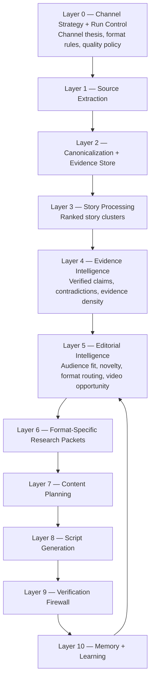
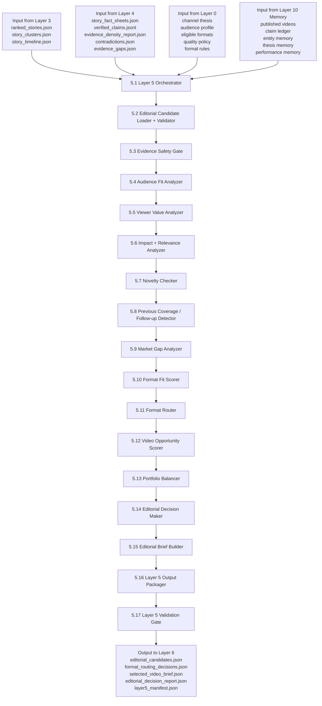

Absolutely — now we will design **Layer 5: Editorial Intelligence** in detail.

Up to Layer 4, your system is mostly evidence-driven:

```text id="sc77xn"
Layer 1 → collect sources
Layer 2 → clean and create source spans
Layer 3 → group documents into stories
Layer 4 → extract and verify claims
```

**Layer 5 is different.**
Layer 5 is where the system starts thinking like a **YouTuber / editor / content strategist**.

The earlier design already established that not every AI article deserves a video, stories should be scored, verified claims should be created before script writing, and the final package should include title options, hook, script, sources, risk notes, and tags. 

So Layer 5 should answer:

```text id="p7v66e"
Which verified stories are actually worth making into a video?
What format should each story become?
Is this better as a roundup segment, deep dive, evergreen explainer, comparison, or follow-up?
Has the channel already covered this angle?
Is there a strong viewer promise?
Is the evidence strong enough for the selected format?
What is the best editorial direction?
```

---

# Layer 5 — Editorial Intelligence

## 1. Purpose of Layer 5

Layer 5 converts **evidence-safe story candidates** into **video opportunities**.

Layer 4 gives us:

```text id="h5q2hh"
verified facts
uncertain claims
contradictions
evidence gaps
story fact sheets
evidence density scores
```

Layer 5 decides:

```text id="bjvito"
Should we make content from this?
What kind of content should it be?
Why would viewers care?
What angle is strongest?
Is it new compared to our previous videos?
Is there enough evidence for deep dive?
Should this only be a roundup mention?
Should we skip it?
```

Layer 5 is the **editorial decision layer**.

---

# 2. Why Layer 5 is important

Without Layer 5, your system may generate videos that are:

```text id="jgnx8g"
factually correct but boring,
important but not interesting,
interesting but weakly sourced,
too similar to your previous videos,
too shallow for a deep dive,
too detailed for a roundup,
or not aligned with your channel thesis.
```

Layer 5 prevents that.

It makes the difference between:

```text id="n9buwv"
“Here is a summary of AI news.”
```

and:

```text id="2161us"
“Here is a strategically selected AI video topic with a clear viewer promise, evidence safety, novelty, format fit, and content angle.”
```

This is the layer where your system starts behaving like a **content strategist**, not just an AI summarizer.

---

# 3. What Layer 5 should do and not do

## Layer 5 should do

```text id="ozwz1h"
Evaluate audience fit.
Evaluate video opportunity.
Check novelty against previous videos.
Check evidence safety by format.
Analyze market/content gap.
Route each story to the right format.
Select final video candidate or candidates.
Create editorial brief.
Define viewer promise.
Define angle direction.
Define why this video should exist.
```

## Layer 5 should not do

```text id="fqg1vj"
It should not write the script.
It should not invent new claims.
It should not verify facts again from scratch.
It should not override Layer 4 evidence rules.
It should not use community hype as truth.
It should not decide title/thumbnail final copy in detail.
```

Layer 5 can say:

```json id="v7pioc"
{
  "recommended_format": "deep_dive",
  "viewer_promise": "Explain what actually changed in AI coding workflows.",
  "angle": "From autocomplete to workflow agent",
  "evidence_safe": true
}
```

Layer 5 should not say:

```json id="xl0g7r"
{
  "script_intro": "OpenAI has just destroyed the software industry..."
}
```

That belongs nowhere unless evidence strongly supports it — and usually that wording should be blocked later.

---

# 4. Where Layer 5 sits in the full architecture



Layer 5 receives evidence from Layer 4 and memory from Layer 10.

That memory connection is important because Layer 5 must know:

```text id="brif3r"
Have we already made this video?
Have we already used this angle?
Is this a follow-up opportunity?
Which topics are becoming recurring trends?
What has performed well before?
```

---

# 5. Layer wise architecture — Layer 5 internal architecture



---

# 6. Layer 5 input and output

## Layer 5 input

Layer 5 receives from Layer 3:

```text id="sq8o2b"
story_clusters.json
ranked_stories.json
cluster_membership.jsonl
story_entity_topic_map.json
story_timeline.json
```

Layer 5 receives from Layer 4:

```text id="gqtwyu"
story_fact_sheets.json
verified_claims.jsonl
rejected_claims.jsonl
contradictions.json
evidence_density_report.json
evidence_gaps.json
```

Layer 5 receives from Layer 0:

```text id="0x2vpv"
channel thesis
audience profile
eligible formats
format config
quality policy
memory policy
depth limits
```

Layer 5 receives from memory:

```text id="asvp0p"
video_memory.jsonl
story_coverage_memory.jsonl
claim_ledger.jsonl
entity_topic_memory.jsonl
performance_memory.jsonl
followups.jsonl
```

Example Layer 5 input package:

```json id="yfh782"
{
  "run_id": "run_2026_05_10_48h_auto",
  "inputs": {
    "ranked_stories_path": "data/runs/run_2026_05_10_48h_auto/layer_3/ranked_stories.json",
    "story_clusters_path": "data/runs/run_2026_05_10_48h_auto/layer_3/story_clusters.json",
    "story_fact_sheets_path": "data/runs/run_2026_05_10_48h_auto/layer_4/story_fact_sheets.json",
    "verified_claims_path": "data/runs/run_2026_05_10_48h_auto/layer_4/verified_claims.jsonl",
    "evidence_density_report_path": "data/runs/run_2026_05_10_48h_auto/layer_4/evidence_density_report.json",
    "video_memory_path": "memory/video_memory.jsonl"
  },
  "channel_strategy": {
    "audience": "technical_but_accessible",
    "tone": "clear_analytical_evidence_first",
    "content_promise": "Explain important AI news with evidence, context, practical impact, and low hype."
  },
  "format_strategy": {
    "eligible_formats": ["roundup", "deep_dive", "follow_up"],
    "roundup": {
      "min_stories": 5,
      "max_stories": 8,
      "target_duration_minutes": 8
    },
    "deep_dive": {
      "min_verified_claims": 8,
      "requires_primary_source": true,
      "target_duration_minutes": 10
    }
  }
}
```

---

## Layer 5 output

Layer 5 produces:

```text id="8pj8x5"
data/runs/{run_id}/layer_5/
  editorial_candidates.json
  evidence_safety_decisions.json
  audience_fit_report.json
  novelty_report.json
  market_gap_report.json
  format_routing_decisions.json
  video_opportunity_scores.json
  selected_video_brief.json
  rejected_editorial_candidates.jsonl
  layer5_manifest.json
```

Main output summary:

```json id="p9qjwm"
{
  "run_id": "run_2026_05_10_48h_auto",
  "layer": "layer_5_editorial_intelligence",
  "status": "completed",
  "candidate_story_count": 15,
  "selected_video_count": 1,
  "selected_format": "roundup",
  "selected_video_brief_path": "data/runs/run_2026_05_10_48h_auto/layer_5/selected_video_brief.json",
  "ready_for_layer_6": true
}
```

---

# 7. Core Layer 5 data objects

Layer 5 should mainly produce these objects:

```text id="nldmom"
EditorialCandidate
EvidenceSafetyDecision
AudienceFitRecord
NoveltyRecord
MarketGapRecord
FormatFitScore
FormatRoutingDecision
VideoOpportunityScore
SelectedVideoBrief
EditorialDecisionReport
```

---

## 7.1 EditorialCandidate format

This is the base object Layer 5 evaluates.

```json id="0ygmt9"
{
  "editorial_candidate_id": "candidate_story_001",
  "run_id": "run_2026_05_10_48h_auto",
  "story_id": "story_20260510_openai_codex_update",

  "story_context": {
    "canonical_story_title": "OpenAI announces coding-related product updates",
    "story_type": "product_launch",
    "ranking_bucket": "high_priority",
    "layer3_story_score": 84,
    "entities": {
      "companies": ["OpenAI"],
      "products": ["Codex"],
      "topics": ["AI coding tools", "AI agents"]
    }
  },

  "evidence_context": {
    "verified_claim_count": 14,
    "evidence_density_score": 82,
    "safe_for_roundup": true,
    "safe_for_deep_dive": true,
    "contradiction_count": 0,
    "uncertain_claim_count": 2,
    "primary_source_count": 1,
    "independent_source_count": 3
  },

  "editorial_status": {
    "status": "pending_evaluation",
    "eligible_formats": []
  }
}
```

---

## 7.2 FormatRoutingDecision format

```json id="z87lvg"
{
  "story_id": "story_20260510_openai_codex_update",
  "recommended_format": "deep_dive",
  "secondary_format": "roundup",
  "routing_confidence": 0.86,

  "routing_reasons": [
    "high_evidence_density",
    "primary_source_present",
    "strong_developer_relevance",
    "clear_viewer_question",
    "enough_verified_claims_for_10_min_video"
  ],

  "format_rejections": [
    {
      "format": "evergreen",
      "reason": "Topic is currently breaking news; not enough historical context yet."
    },
    {
      "format": "comparison",
      "reason": "No comparable competitor packet available in this run."
    }
  ]
}
```

---

## 7.3 SelectedVideoBrief format

This is the most important Layer 5 output.

It is the handoff to Layer 6.

```json id="53vq7l"
{
  "selected_video_id": "video_brief_20260510_001",
  "run_id": "run_2026_05_10_48h_auto",

  "selection": {
    "selected_format": "deep_dive",
    "primary_story_id": "story_20260510_openai_codex_update",
    "supporting_story_ids": [],
    "selection_confidence": 0.88
  },

  "editorial_direction": {
    "working_title_angle": "AI coding is moving from autocomplete to workflow agents",
    "central_viewer_question": "Does this actually change how developers use AI coding tools?",
    "viewer_promise": "By the end, viewers will understand what changed, what is useful, and what is still hype.",
    "editorial_thesis_candidate": "The update matters less as a single feature release and more as a sign that AI coding tools are becoming workflow-level agents.",
    "tone_guidance": "analytical, practical, not hype-driven"
  },

  "evidence_boundaries": {
    "safe_claim_ids": ["claim_001", "claim_002", "claim_003"],
    "cautious_claim_ids": ["claim_018"],
    "do_not_use_claim_ids": ["claim_099"],
    "contradiction_ids": [],
    "evidence_gap_ids": []
  },

  "format_requirements": {
    "target_duration_minutes": 10,
    "required_sections": [
      "hook",
      "what_happened",
      "why_it_matters",
      "technical_context",
      "limitations",
      "final_takeaway"
    ]
  },

  "handoff": {
    "next_layer": "layer_6_format_specific_research_packets",
    "packet_type_to_build": "deep_dive_packet"
  }
}
```

---

# 8. Module-by-module Layer 5 design

---

## Module 5.1 — Layer 5 Orchestrator

### Purpose

Coordinate the editorial evaluation flow.

### Why it matters

Layer 5 has to combine story ranking, evidence quality, channel strategy, format rules, and memory. The orchestrator keeps that process structured.

### Questions it answers

```text id="yx4xld"
Which stories should be evaluated?
Which evidence files are available?
What formats are eligible for this run?
Which memory files should be checked?
Where should Layer 5 outputs be stored?
Can Layer 6 start?
```

### Input

```json id="61fbe1"
{
  "run_manifest_path": "data/runs/run_2026_05_10_48h_auto/run_manifest.json",
  "layer3_manifest_path": "data/runs/run_2026_05_10_48h_auto/layer_3/layer3_manifest.json",
  "layer4_manifest_path": "data/runs/run_2026_05_10_48h_auto/layer_4/layer4_manifest.json",
  "memory_paths": {
    "video_memory": "memory/video_memory.jsonl",
    "entity_topic_memory": "memory/entity_topic_memory.jsonl",
    "claim_ledger": "memory/claim_ledger.jsonl",
    "performance_memory": "memory/performance_memory.jsonl"
  }
}
```

### Logic

```text id="w2ay43"
1. Load Layer 0 run manifest.
2. Load Layer 3 ranked stories.
3. Load Layer 4 fact sheets and evidence density report.
4. Load configured memory files.
5. Build editorial candidates.
6. Run editorial evaluation modules.
7. Select final video brief.
8. Validate and package outputs.
```

### Output

```json id="ql2qpo"
{
  "run_id": "run_2026_05_10_48h_auto",
  "candidate_story_count": 15,
  "evaluated_candidate_count": 15,
  "selected_video_count": 1,
  "status": "completed"
}
```

---

## Module 5.2 — Editorial Candidate Loader + Validator

### Purpose

Build editorial candidates by joining Layer 3 story data with Layer 4 evidence data.

### Why it matters

Layer 5 should evaluate complete candidates, not raw story rankings alone.

### Questions it answers

```text id="guky31"
Does every ranked story have a fact sheet?
Does every story have evidence density?
Does every story have format safety flags?
Are contradiction and evidence gap records attached?
```

### Input

```json id="x2uvri"
{
  "ranked_stories_path": "data/runs/.../layer_3/ranked_stories.json",
  "story_fact_sheets_path": "data/runs/.../layer_4/story_fact_sheets.json",
  "evidence_density_report_path": "data/runs/.../layer_4/evidence_density_report.json"
}
```

### Logic

```text id="7fzajf"
1. Load top ranked stories.
2. Join each story with Layer 4 fact sheet.
3. Attach evidence density, contradictions, uncertainty, evidence gaps.
4. Reject candidates missing fact sheets.
5. Create EditorialCandidate records.
```

### Output

```json id="sn494s"
{
  "editorial_candidate_id": "candidate_story_001",
  "story_id": "story_001",
  "canonical_story_title": "OpenAI announces coding-related product updates",
  "layer3_story_score": 84,
  "verified_claim_count": 14,
  "evidence_density_score": 82,
  "format_safety": {
    "roundup": "safe",
    "deep_dive": "safe",
    "evergreen": "needs_more_context"
  },
  "candidate_status": "ready_for_editorial_evaluation"
}
```

---

## Module 5.3 — Evidence Safety Gate

### Purpose

Block or limit stories that are not evidence-safe.

### Why it matters

Layer 5 should never choose a deep dive topic if Layer 4 says evidence is weak.

### Questions it answers

```text id="0v3tge"
Is this story safe for any video?
Is it safe only for roundup?
Is it safe for deep dive?
Are there unresolved contradictions?
Are there evidence gaps that block the format?
```

### Input

```json id="i4gngt"
{
  "story_id": "story_001",
  "evidence_density_score": 82,
  "verified_claim_count": 14,
  "contradiction_count": 0,
  "evidence_gaps": [],
  "format_safety": {
    "roundup": "safe",
    "deep_dive": "safe"
  }
}
```

### Logic

```text id="sssfpc"
1. Check evidence density score.
2. Check verified claim count.
3. Check primary source presence.
4. Check contradiction severity.
5. Check evidence gaps.
6. Produce format-specific evidence safety decisions.
```

### Output

```json id="zpj9ck"
{
  "story_id": "story_001",
  "evidence_safety": {
    "overall_status": "safe",
    "roundup": {
      "status": "safe",
      "reason": "Enough verified claims for short segment."
    },
    "deep_dive": {
      "status": "safe",
      "reason": "Primary source and 8+ verified claims available."
    },
    "evergreen": {
      "status": "needs_more_context",
      "reason": "Not enough historical context."
    },
    "comparison": {
      "status": "not_applicable",
      "reason": "No comparable subjects."
    }
  }
}
```

If unsafe:

```json id="msjq8t"
{
  "story_id": "story_weak_001",
  "evidence_safety": {
    "overall_status": "blocked",
    "reason": "Only community sources available; no verified factual claims.",
    "allowed_action": "monitor_only"
  }
}
```

---

## Module 5.4 — Audience Fit Analyzer

### Purpose

Evaluate whether a story fits your intended audience.

### Why it matters

A story can be important in the AI industry but irrelevant to your audience.

Example:

```text id="bzxxws"
A niche academic paper may be important but too technical for a general AI news roundup.
A pricing update may be boring for general viewers but very useful for developers.
A model release may be good for everyone.
```

### Questions it answers

```text id="26pzo8"
Will my target viewers care?
Is this useful for developers, AI users, founders, or general tech viewers?
Is it too technical?
Is it too shallow?
Does it match the channel thesis?
```

### Input

```json id="35o02x"
{
  "story_id": "story_001",
  "story_type": "product_launch",
  "topics": ["AI coding tools", "AI agents"],
  "entities": ["OpenAI", "Codex"],
  "audience_profile": {
    "primary": "technical_but_accessible",
    "preferred_examples": ["developer workflow", "productivity", "real-world usage"]
  }
}
```

### Logic

Score audience fit based on:

```text id="3glogj"
topic relevance to channel
entity relevance
practical usefulness
technical accessibility
viewer familiarity
current interest signal
alignment with content promise
```

### Output

```json id="eq6kk6"
{
  "story_id": "story_001",
  "audience_fit": {
    "audience_fit_score": 91,
    "best_audience_segment": "AI-curious developers and tech professionals",
    "fit_reasons": [
      "Topic directly affects developer workflow.",
      "Entity is widely recognized.",
      "Practical impact can be explained clearly."
    ],
    "audience_risk": "low"
  }
}
```

---

## Module 5.5 — Viewer Value Analyzer

### Purpose

Define what the viewer gains from watching the video.

### Why it matters

A successful YouTube video needs a clear viewer payoff.

Not enough:

```text id="wvcvlx"
“This happened.”
```

Better:

```text id="znswkl"
“Here is what changed, why it matters, and whether you should care.”
```

### Questions it answers

```text id="i7jejz"
What question will this video answer for viewers?
What confusion does it solve?
What insight does it provide?
What practical value does the viewer get?
```

### Input

```json id="f7oakd"
{
  "story_id": "story_001",
  "safe_facts": [],
  "topics": ["AI coding tools", "AI agents"],
  "story_type": "product_launch"
}
```

### Logic

Identify viewer value types:

```text id="1g2a0b"
understand_what_happened
understand_why_it_matters
decide_whether_to_use_tool
compare_options
avoid_hype
learn_technical_context
track_industry_shift
```

### Output

```json id="b3qquw"
{
  "story_id": "story_001",
  "viewer_value": {
    "primary_viewer_question": "Does this actually change how developers use AI coding tools?",
    "viewer_promise": "By the end, viewers will understand what changed, what is useful, and what is still hype.",
    "value_type": [
      "understand_why_it_matters",
      "avoid_hype",
      "track_industry_shift"
    ],
    "viewer_value_score": 88
  }
}
```

---

## Module 5.6 — Impact + Relevance Analyzer

### Purpose

Estimate why the story matters beyond the headline.

### Why it matters

A story may be true but not impactful. This module checks the possible impact dimensions.

### Questions it answers

```text id="pzglbe"
Who is affected?
Developers?
AI users?
Enterprises?
Researchers?
Open-source community?
Investors?
Policy makers?
Does this change workflows, cost, availability, regulation, or competition?
```

### Input

```json id="q0eeom"
{
  "story_id": "story_001",
  "story_type": "product_launch",
  "verified_claims": [
    {
      "claim_type": "feature_claim",
      "claim_text": "The update supports coding workflow features."
    }
  ],
  "topics": ["AI coding tools"]
}
```

### Logic

Score impact dimensions:

```text id="m8fvv6"
developer_impact
consumer_impact
enterprise_impact
research_impact
open_source_impact
regulatory_impact
business_impact
technical_shift_impact
```

### Output

```json id="imwy9d"
{
  "story_id": "story_001",
  "impact": {
    "impact_score": 84,
    "impact_dimensions": {
      "developer_impact": 92,
      "enterprise_impact": 70,
      "consumer_impact": 45,
      "research_impact": 30,
      "regulatory_impact": 10
    },
    "main_impact_statement": "This story is most relevant because it may affect how developers use AI tools inside coding workflows.",
    "impact_confidence": "medium_high"
  }
}
```

Important: this is editorial analysis, so it must stay tied to evidence boundaries. If Layer 4 only supports “may affect,” Layer 5 should not turn it into “will transform.”

---

## Module 5.7 — Novelty Checker

### Purpose

Check whether this topic or angle is new for your channel.

### Why it matters

You do not want to publish the same video again.

The user already raised this concern: if the system already created a video on a topic, it should not create the same video again. Layer 5 is where that check should happen.

### Questions it answers

```text id="nn6ix0"
Have we already covered this exact story?
Have we already covered this company recently?
Have we already used the same angle?
Is this a meaningful update or a duplicate?
Should this become a follow-up?
```

### Input

```json id="b1p8yn"
{
  "story_id": "story_001",
  "canonical_story_title": "OpenAI announces coding-related product updates",
  "entities": ["OpenAI", "Codex"],
  "topics": ["AI coding tools", "AI agents"],
  "video_memory_path": "memory/video_memory.jsonl"
}
```

### Logic

Compare against memory:

```text id="k9sams"
story_id similarity
title similarity
entity overlap
topic overlap
claim overlap
thesis overlap
hook overlap
recent coverage window
```

### Output

```json id="x3zo5z"
{
  "story_id": "story_001",
  "novelty": {
    "novelty_score": 72,
    "coverage_status": "related_but_new",
    "previous_related_videos": [
      {
        "video_id": "video_2026_04_25_ai_agents",
        "similarity_score": 0.61,
        "relationship": "same_broad_topic_different_story"
      }
    ],
    "recommendation": "safe_to_cover_with_new_angle"
  }
}
```

If duplicate:

```json id="utl7m3"
{
  "story_id": "story_duplicate_001",
  "novelty": {
    "novelty_score": 18,
    "coverage_status": "already_covered",
    "recommendation": "skip_or_update_existing_followup_memory"
  }
}
```

---

## Module 5.8 — Previous Coverage / Follow-up Detector

### Purpose

Determine whether the story should be treated as a follow-up to a previous video.

### Why it matters

Follow-up videos can be strong because they build continuity:

```text id="d4g0ti"
“Last week we talked about X. Now there is a major update.”
```

But they should only happen when there is real new evidence.

### Questions it answers

```text id="x9s5ka"
Is this new story connected to a previous video?
Is it a meaningful update?
Does it resolve an open question?
Does it contradict something from a previous video?
Does it continue a trend we are tracking?
```

### Input

```json id="k9t9xo"
{
  "story_id": "story_001",
  "entities": ["OpenAI", "Codex"],
  "topics": ["AI coding tools"],
  "claim_ids": ["claim_001", "claim_002"],
  "followup_memory_path": "memory/followups.jsonl"
}
```

### Logic

```text id="1fy5zx"
1. Search previous videos by entities and topics.
2. Check unresolved questions from memory.
3. Check claim ledger for related claims.
4. Determine if current story updates, corrects, or extends prior coverage.
5. Assign follow-up suitability.
```

### Output

```json id="wqt9os"
{
  "story_id": "story_001",
  "follow_up": {
    "is_follow_up_candidate": true,
    "related_video_id": "video_2026_04_25_ai_agents",
    "follow_up_type": "trend_continuation",
    "follow_up_value": "Shows how the AI agents trend is moving into coding workflows.",
    "follow_up_score": 74
  }
}
```

---

## Module 5.9 — Market Gap Analyzer

### Purpose

Identify what angle is under-covered or valuable compared to existing content.

### Why it matters

A lot of AI news channels cover the same stories. To stand out, your system needs to find a better angle.

This module does not need to be perfect in MVP. Initially, it can use your own memory and maybe manually collected competitor notes. Later, it can use external search or YouTube metadata if you choose to add it.

### Questions it answers

```text id="5wlkmu"
Are many creators already covering this?
What angle are they likely using?
What angle is missing?
Can we make a more evidence-based, practical, or technical version?
```

### Input

```json id="vsx49h"
{
  "story_id": "story_001",
  "canonical_story_title": "OpenAI announces coding-related product updates",
  "topics": ["AI coding tools", "AI agents"],
  "viewer_value": {
    "primary_viewer_question": "Does this actually change how developers use AI coding tools?"
  },
  "channel_positioning": "evidence-first AI news and explainers"
}
```

### Logic

Market gap can be estimated by:

```text id="8po7cs"
story popularity
common clickbait angles
your channel thesis
verified evidence available
practical usefulness
technical differentiation
previous competitor patterns if stored
```

### Output

```json id="ae953p"
{
  "story_id": "story_001",
  "market_gap": {
    "market_saturation": "medium",
    "likely_common_angles": [
      "AI agents will replace developers",
      "OpenAI launches new coding tool"
    ],
    "recommended_gap_angle": "What actually changed in the coding workflow, based on verified sources.",
    "gap_strength_score": 81,
    "differentiation_strategy": "Avoid hype and focus on practical developer impact."
  }
}
```

---

## Module 5.10 — Format Fit Scorer

### Purpose

Score each story against each eligible format.

### Why it matters

The same story may be:

```text id="zgut3d"
good for a roundup,
not deep enough for deep dive,
good as a follow-up,
not suitable for evergreen yet.
```

### Questions it answers

```text id="wwznji"
How well does this story fit roundup?
How well does it fit deep dive?
How well does it fit evergreen?
How well does it fit comparison?
How well does it fit follow-up?
```

### Input

```json id="27c2kf"
{
  "story_id": "story_001",
  "evidence_safety": {},
  "audience_fit": {},
  "viewer_value": {},
  "impact": {},
  "novelty": {},
  "follow_up": {},
  "format_strategy": {
    "eligible_formats": ["roundup", "deep_dive", "follow_up"]
  }
}
```

### Logic

Format scoring:

```text id="sgxv3r"
Roundup score increases when:
- story is timely
- story is important but not too complex
- at least 2 verified claims exist
- story can be explained in 60–120 seconds

Deep dive score increases when:
- story has high evidence density
- primary source exists
- many verified claims exist
- strong viewer question exists
- story has implications, limitations, and context

Evergreen score increases when:
- topic is durable
- memory has historical context
- story connects to broader trend
- not too tied to breaking news

Comparison score increases when:
- multiple comparable products/entities exist
- evidence matrix can be built
- viewer wants a decision or ranking

Follow-up score increases when:
- previous related video exists
- new evidence changes or extends prior story
```

### Output

```json id="q0cbsn"
{
  "story_id": "story_001",
  "format_fit_scores": {
    "roundup": {
      "score": 78,
      "fit": "good",
      "reason": "Timely and explainable in short segment."
    },
    "deep_dive": {
      "score": 88,
      "fit": "strong",
      "reason": "High evidence density and strong viewer question."
    },
    "follow_up": {
      "score": 74,
      "fit": "good",
      "reason": "Connected to previous AI agents coverage."
    },
    "evergreen": {
      "score": 52,
      "fit": "weak",
      "reason": "Needs more historical context."
    }
  }
}
```

---

## Module 5.11 — Format Router

### Purpose

Make the format recommendation.

### Why it matters

This is where the system decides:

```text id="4wlapv"
This story should be a deep dive.
This group of stories should become a roundup.
This story should become a follow-up.
This topic should be saved for evergreen.
This story should be skipped.
```

### Questions it answers

```text id="ul7lqb"
What is the best format for this story?
Should it be included in a roundup instead of standalone?
Should it be saved for later?
Should it be monitored only?
```

### Input

```json id="v2664w"
{
  "story_id": "story_001",
  "format_fit_scores": {},
  "evidence_safety": {},
  "novelty": {},
  "viewer_value": {}
}
```

### Logic

Routing rules:

```text id="3ysfw9"
If deep_dive_score >= 80 and evidence safe → deep_dive.
If roundup_score >= 65 but deep_dive_score < 80 → roundup_segment.
If follow_up_score >= 70 and previous video exists → follow_up.
If evergreen_score >= 75 and topic durable → evergreen_candidate.
If comparison_score >= 75 and multiple subjects exist → comparison_candidate.
If evidence unsafe → monitor_or_skip.
If novelty too low → skip_or_follow_up_only.
```

### Output

```json id="oa9k3q"
{
  "story_id": "story_001",
  "format_routing": {
    "recommended_format": "deep_dive",
    "secondary_format": "roundup_segment",
    "routing_confidence": 0.86,
    "reason": "Strong evidence, strong audience fit, high viewer value, and enough depth for standalone video.",
    "allowed_formats": ["deep_dive", "roundup_segment", "follow_up"],
    "blocked_formats": [
      {
        "format": "evergreen",
        "reason": "Needs more historical context."
      }
    ]
  }
}
```

---

## Module 5.12 — Video Opportunity Scorer

### Purpose

Score the actual YouTube opportunity.

### Why it matters

A story can be important and evidence-safe but still not a strong YouTube video.

This module checks whether it has:

```text id="y73paf"
hook potential
viewer curiosity
clear tension
practical relevance
retention potential
visual potential
differentiated angle
```

### Questions it answers

```text id="e7077b"
Can this become a compelling video?
Is there a clear hook?
Is there a tension or question?
Can we explain it visually?
Will viewers stay?
Does it fit the channel brand?
```

### Input

```json id="vlkuwb"
{
  "story_id": "story_001",
  "audience_fit_score": 91,
  "viewer_value_score": 88,
  "impact_score": 84,
  "novelty_score": 72,
  "market_gap_score": 81,
  "format_routing": {
    "recommended_format": "deep_dive"
  }
}
```

### Logic

Score components:

```text id="c9r7ms"
hook_potential
viewer_value
impact
novelty
market_gap
evidence_safety
format_fit
visual_potential
retention_potential
```

### Output

```json id="mzcv2j"
{
  "story_id": "story_001",
  "video_opportunity": {
    "video_opportunity_score": 87,
    "hook_potential": 84,
    "retention_potential": 82,
    "visual_potential": 70,
    "differentiation_score": 81,
    "risk_score": 18,
    "overall_recommendation": "strong_video_candidate"
  }
}
```

---

## Module 5.13 — Portfolio Balancer

### Purpose

Balance the selected output across formats, topics, and channel strategy.

### Why it matters

If your system always selects OpenAI stories, the channel may become repetitive. If it always selects deep dives, you may miss roundup opportunities.

### Questions it answers

```text id="8fm82f"
Are we covering too much of one company?
Are we repeating AI agents too often?
Should we choose a roundup instead of another deep dive?
Do we need variety across model releases, open source, AI research, AI tools, and regulation?
```

### Input

```json id="pftc36"
{
  "candidate_scores": [
    {
      "story_id": "story_001",
      "company": "OpenAI",
      "recommended_format": "deep_dive",
      "video_opportunity_score": 87
    }
  ],
  "memory": {
    "recent_videos": [
      {
        "company": "OpenAI",
        "topic": "AI agents",
        "published_at": "2026-05-01"
      }
    ]
  }
}
```

### Logic

```text id="9r9u8z"
1. Check recent company/topic distribution.
2. Penalize over-covered entities unless story is major.
3. Prefer variety if scores are close.
4. Do not override very high-impact breaking news.
5. Recommend final selection set.
```

### Output

```json id="i8a7ra"
{
  "portfolio_decision": {
    "selected_story_ids": ["story_001"],
    "portfolio_notes": [
      "OpenAI was covered recently, but this story has high evidence and strong impact, so it remains selected."
    ],
    "diversity_penalty_applied": false
  }
}
```

---

## Module 5.14 — Editorial Decision Maker

### Purpose

Make the final editorial selection.

### Why it matters

This is the final decision point before building the research packet.

### Questions it answers

```text id="t5w7x8"
What video should we create from this run?
What format should it use?
Which story or stories are selected?
Which candidates were rejected and why?
```

### Input

```json id="lxi6kp"
{
  "format_routing_decisions": [],
  "video_opportunity_scores": [],
  "portfolio_decision": {},
  "run_config": {
    "max_videos": 1
  }
}
```

### Logic

```text id="fth56l"
1. Filter blocked/unsafe candidates.
2. Sort by video opportunity score.
3. Apply portfolio balancing.
4. If roundup selected, choose top 5–8 compatible stories.
5. If deep dive selected, choose one story.
6. If no candidate passes threshold, output no-video decision.
7. Create selected_video_brief.
```

### Output

For deep dive:

```json id="55k7hn"
{
  "editorial_decision": {
    "decision": "create_video",
    "selected_format": "deep_dive",
    "primary_story_id": "story_001",
    "supporting_story_ids": [],
    "decision_confidence": 0.88,
    "decision_reasons": [
      "High video opportunity score",
      "Strong evidence density",
      "Clear viewer promise",
      "Good novelty"
    ]
  }
}
```

For roundup:

```json id="j2nndu"
{
  "editorial_decision": {
    "decision": "create_video",
    "selected_format": "roundup",
    "selected_story_ids": [
      "story_001",
      "story_002",
      "story_003",
      "story_004",
      "story_005"
    ],
    "episode_theme": "AI agents, open-source models, and infrastructure updates moved forward together.",
    "decision_confidence": 0.83
  }
}
```

If no video:

```json id="i7yk9v"
{
  "editorial_decision": {
    "decision": "no_video",
    "reason": "No story met evidence, novelty, and audience-value thresholds.",
    "recommended_action": "continue_monitoring"
  }
}
```

---

## Module 5.15 — Editorial Brief Builder

### Purpose

Create the structured brief that Layer 6 will use to build the correct research packet.

### Why it matters

Layer 6 should not figure out editorial direction from scratch. It should receive a clear brief.

### Questions it answers

```text id="xc9wtd"
What are we making?
Why are we making it?
Who is it for?
What is the viewer promise?
What claims are safe?
What claims require caution?
What angle should the packet builder use?
```

### Input

```json id="p6lwmf"
{
  "editorial_decision": {},
  "story_fact_sheets": {},
  "format_routing": {},
  "audience_fit": {},
  "viewer_value": {}
}
```

### Output for deep dive

```json id="buqqg5"
{
  "selected_video_brief": {
    "selected_format": "deep_dive",
    "primary_story_id": "story_001",

    "content_direction": {
      "working_angle": "From autocomplete to workflow agents",
      "central_viewer_question": "Does this actually change how developers use AI coding tools?",
      "viewer_promise": "Viewers will understand what changed, what is useful, and what is still hype.",
      "suggested_thesis": "This matters less as one feature update and more as a sign that AI coding tools are moving toward workflow-level automation.",
      "tone": "analytical, practical, evidence-first"
    },

    "evidence_boundaries": {
      "safe_claim_ids": ["claim_001", "claim_002", "claim_003"],
      "cautious_claim_ids": ["claim_018"],
      "do_not_use_claim_ids": ["claim_099"],
      "contradiction_ids": [],
      "evidence_gap_ids": []
    },

    "format_guidance": {
      "target_duration_minutes": 10,
      "required_packet_type": "deep_dive_packet",
      "required_sections": [
        "what_happened",
        "why_it_matters",
        "technical_context",
        "limitations",
        "final_takeaway"
      ]
    }
  }
}
```

### Output for roundup

```json id="p3997f"
{
  "selected_video_brief": {
    "selected_format": "roundup",
    "selected_story_ids": [
      "story_001",
      "story_002",
      "story_003",
      "story_004",
      "story_005"
    ],

    "content_direction": {
      "episode_theme": "This week’s AI updates show agentic tools moving from demos into real workflows.",
      "viewer_promise": "Viewers will quickly understand the most important AI updates and why each one matters.",
      "tone": "fast, clear, analytical"
    },

    "story_segment_guidance": [
      {
        "story_id": "story_001",
        "segment_role": "lead_story",
        "target_duration_seconds": 100,
        "safe_claim_ids": ["claim_001", "claim_002"]
      },
      {
        "story_id": "story_002",
        "segment_role": "short_update",
        "target_duration_seconds": 70,
        "safe_claim_ids": ["claim_021", "claim_022"]
      }
    ],

    "format_guidance": {
      "target_duration_minutes": 8,
      "required_packet_type": "roundup_packet",
      "max_stories": 8
    }
  }
}
```

---

## Module 5.16 — Layer 5 Output Packager

### Purpose

Write all Layer 5 output files.

### Output files

```text id="wywv4b"
editorial_candidates.json
evidence_safety_decisions.json
audience_fit_report.json
viewer_value_report.json
impact_relevance_report.json
novelty_report.json
followup_report.json
market_gap_report.json
format_fit_scores.json
format_routing_decisions.json
video_opportunity_scores.json
selected_video_brief.json
rejected_editorial_candidates.jsonl
layer5_manifest.json
```

### Output example

```json id="35ubuw"
{
  "run_id": "run_2026_05_10_48h_auto",
  "outputs": {
    "editorial_candidates": "data/runs/run_2026_05_10_48h_auto/layer_5/editorial_candidates.json",
    "format_routing_decisions": "data/runs/run_2026_05_10_48h_auto/layer_5/format_routing_decisions.json",
    "video_opportunity_scores": "data/runs/run_2026_05_10_48h_auto/layer_5/video_opportunity_scores.json",
    "selected_video_brief": "data/runs/run_2026_05_10_48h_auto/layer_5/selected_video_brief.json"
  }
}
```

---

## Module 5.17 — Layer 5 Validation Gate

### Purpose

Validate that Layer 5 selected a valid, evidence-safe editorial direction.

### Why it matters

Layer 6 should not build research packets from broken or unsafe editorial decisions.

### Validation rules

Layer 5 passes if:

```text id="p8l5lx"
Every editorial candidate has story_id.
Every selected story has a Layer 4 fact sheet.
Every selected story has evidence safety status.
Selected format is one of Layer 0 eligible formats.
Selected format is not blocked by Layer 4 evidence safety.
Selected video brief has viewer promise.
Selected video brief has evidence boundaries.
Selected video brief includes safe_claim_ids.
Rejected candidates have rejection reasons.
No do_not_use claims are included as safe claims.
```

### Output

```json id="vc3sin"
{
  "validation_status": "passed",
  "ready_for_layer_6": true,
  "warnings": [
    {
      "type": "cautious_claims_present",
      "message": "Selected brief contains cautious claims; Layer 6 should preserve qualifier guidance."
    }
  ],
  "errors": []
}
```

---

# 9. Layer 5 output files in detail

## 9.1 `editorial_candidates.json`

```json id="vc2zbe"
{
  "run_id": "run_2026_05_10_48h_auto",
  "editorial_candidates": [
    {
      "editorial_candidate_id": "candidate_story_001",
      "story_id": "story_001",
      "canonical_story_title": "OpenAI announces coding-related product updates",
      "story_type": "product_launch",
      "layer3_story_score": 84,
      "verified_claim_count": 14,
      "evidence_density_score": 82,
      "candidate_status": "evaluated"
    }
  ]
}
```

---

## 9.2 `evidence_safety_decisions.json`

```json id="6jihg0"
{
  "run_id": "run_2026_05_10_48h_auto",
  "evidence_safety_decisions": [
    {
      "story_id": "story_001",
      "overall_status": "safe",
      "roundup": "safe",
      "deep_dive": "safe",
      "evergreen": "needs_more_context",
      "comparison": "not_applicable"
    }
  ]
}
```

---

## 9.3 `audience_fit_report.json`

```json id="ctik8w"
{
  "run_id": "run_2026_05_10_48h_auto",
  "audience_fit": [
    {
      "story_id": "story_001",
      "audience_fit_score": 91,
      "best_audience_segment": "AI-curious developers and tech professionals",
      "fit_reasons": [
        "Developer workflow relevance",
        "Recognizable company/entity",
        "Practical explanation possible"
      ]
    }
  ]
}
```

---

## 9.4 `novelty_report.json`

```json id="6m951a"
{
  "run_id": "run_2026_05_10_48h_auto",
  "novelty": [
    {
      "story_id": "story_001",
      "novelty_score": 72,
      "coverage_status": "related_but_new",
      "previous_related_videos": [
        {
          "video_id": "video_2026_04_25_ai_agents",
          "similarity_score": 0.61,
          "relationship": "same_broad_topic_different_story"
        }
      ],
      "recommendation": "safe_to_cover_with_new_angle"
    }
  ]
}
```

---

## 9.5 `format_routing_decisions.json`

```json id="0aq3kl"
{
  "run_id": "run_2026_05_10_48h_auto",
  "format_routing_decisions": [
    {
      "story_id": "story_001",
      "recommended_format": "deep_dive",
      "secondary_format": "roundup_segment",
      "routing_confidence": 0.86,
      "routing_reasons": [
        "High evidence density",
        "Strong audience fit",
        "Clear viewer question",
        "Good novelty"
      ]
    }
  ]
}
```

---

## 9.6 `video_opportunity_scores.json`

```json id="mpx2sb"
{
  "run_id": "run_2026_05_10_48h_auto",
  "video_opportunity_scores": [
    {
      "story_id": "story_001",
      "video_opportunity_score": 87,
      "hook_potential": 84,
      "viewer_value_score": 88,
      "impact_score": 84,
      "novelty_score": 72,
      "market_gap_score": 81,
      "overall_recommendation": "strong_video_candidate"
    }
  ]
}
```

---

## 9.7 `selected_video_brief.json`

```json id="5ztp16"
{
  "run_id": "run_2026_05_10_48h_auto",
  "selected_video_brief": {
    "selected_video_id": "video_brief_20260510_001",
    "selected_format": "deep_dive",
    "primary_story_id": "story_001",
    "supporting_story_ids": [],

    "editorial_direction": {
      "working_title_angle": "AI coding is moving from autocomplete to workflow agents",
      "central_viewer_question": "Does this actually change how developers use AI coding tools?",
      "viewer_promise": "By the end, viewers will understand what changed, what is useful, and what is still hype.",
      "editorial_thesis_candidate": "The update matters less as one feature release and more as a sign that AI coding tools are becoming workflow-level agents.",
      "tone_guidance": "analytical, practical, evidence-first"
    },

    "evidence_boundaries": {
      "safe_claim_ids": ["claim_001", "claim_002", "claim_003"],
      "cautious_claim_ids": ["claim_018"],
      "do_not_use_claim_ids": ["claim_099"],
      "contradiction_ids": [],
      "evidence_gap_ids": []
    },

    "handoff": {
      "next_layer": "layer_6_format_specific_research_packets",
      "packet_type_to_build": "deep_dive_packet"
    }
  }
}
```

---

## 9.8 `rejected_editorial_candidates.jsonl`

```json id="v9td1e"
{
  "story_id": "story_009",
  "canonical_story_title": "Unverified AI benchmark rumor",
  "rejection_reason": "evidence_unsafe",
  "details": "Only community sources and no verified claims. Not safe for roundup or deep dive.",
  "recommended_action": "monitor_only"
}
```

---

## 9.9 `layer5_manifest.json`

```json id="e7s8lp"
{
  "run_id": "run_2026_05_10_48h_auto",
  "layer": "layer_5_editorial_intelligence",
  "created_at": "2026-05-10T11:10:00Z",

  "inputs": {
    "run_manifest": "data/runs/run_2026_05_10_48h_auto/run_manifest.json",
    "layer3_manifest": "data/runs/run_2026_05_10_48h_auto/layer_3/layer3_manifest.json",
    "layer4_manifest": "data/runs/run_2026_05_10_48h_auto/layer_4/layer4_manifest.json",
    "ranked_stories": "data/runs/run_2026_05_10_48h_auto/layer_3/ranked_stories.json",
    "story_fact_sheets": "data/runs/run_2026_05_10_48h_auto/layer_4/story_fact_sheets.json",
    "verified_claims": "data/runs/run_2026_05_10_48h_auto/layer_4/verified_claims.jsonl",
    "video_memory": "memory/video_memory.jsonl"
  },

  "outputs": {
    "editorial_candidates": "data/runs/run_2026_05_10_48h_auto/layer_5/editorial_candidates.json",
    "evidence_safety_decisions": "data/runs/run_2026_05_10_48h_auto/layer_5/evidence_safety_decisions.json",
    "audience_fit_report": "data/runs/run_2026_05_10_48h_auto/layer_5/audience_fit_report.json",
    "novelty_report": "data/runs/run_2026_05_10_48h_auto/layer_5/novelty_report.json",
    "format_routing_decisions": "data/runs/run_2026_05_10_48h_auto/layer_5/format_routing_decisions.json",
    "video_opportunity_scores": "data/runs/run_2026_05_10_48h_auto/layer_5/video_opportunity_scores.json",
    "selected_video_brief": "data/runs/run_2026_05_10_48h_auto/layer_5/selected_video_brief.json",
    "rejected_editorial_candidates": "data/runs/run_2026_05_10_48h_auto/layer_5/rejected_editorial_candidates.jsonl"
  },

  "counts": {
    "candidate_story_count": 15,
    "evaluated_candidate_count": 15,
    "rejected_candidate_count": 4,
    "selected_video_count": 1
  },

  "decision": {
    "create_video": true,
    "selected_format": "deep_dive",
    "selected_video_brief": "data/runs/run_2026_05_10_48h_auto/layer_5/selected_video_brief.json"
  },

  "handoff": {
    "ready_for_layer_6": true,
    "next_layer": "layer_6_format_specific_research_packets"
  }
}
```

---

# 10. Layer 5 config files

Layer 5 should be config-driven.

```text id="1q9fe3"
config/
  editorial_intelligence_rules.yaml
  audience_fit_rules.yaml
  format_routing_rules.yaml
  novelty_rules.yaml
  video_opportunity_rules.yaml
  market_gap_rules.yaml
  portfolio_balance_rules.yaml
```

---

## `editorial_intelligence_rules.yaml`

```yaml id="3prwf7"
editorial:
  minimum_video_opportunity_score: 70
  minimum_audience_fit_score: 60
  minimum_novelty_score: 45

  rejection_rules:
    block_if_evidence_unsafe: true
    block_if_no_verified_claims: true
    block_if_duplicate_recent_video: true

  allowed_decisions:
    - create_video
    - monitor_only
    - skip
    - save_for_evergreen
    - follow_up_candidate
```

---

## `format_routing_rules.yaml`

```yaml id="o6kx6d"
format_routing:
  roundup:
    min_score: 65
    min_verified_claims_per_story: 2
    max_segment_seconds: 120
    allow_medium_evidence: true

  deep_dive:
    min_score: 80
    min_verified_claims: 8
    requires_primary_source: true
    requires_clear_viewer_question: true
    max_high_severity_contradictions: 0

  evergreen:
    min_score: 75
    requires_memory_context: true
    requires_durable_topic: true
    avoid_breaking_news_only: true

  comparison:
    min_score: 75
    min_subjects: 2
    requires_evidence_matrix: true

  follow_up:
    min_score: 70
    requires_previous_related_video: true
    requires_new_evidence: true
```

---

## `novelty_rules.yaml`

```yaml id="gpbdcw"
novelty:
  recent_video_window_days: 60
  duplicate_threshold: 0.85
  related_but_new_threshold: 0.55

  similarity_signals:
    - title_similarity
    - entity_overlap
    - topic_overlap
    - claim_overlap
    - thesis_overlap
    - hook_overlap

  actions:
    duplicate: skip
    related_but_new: allow_with_new_angle
    follow_up_candidate: route_to_follow_up
```

---

## `video_opportunity_rules.yaml`

```yaml id="hybu1d"
video_opportunity:
  weights:
    audience_fit: 0.20
    viewer_value: 0.20
    impact: 0.15
    novelty: 0.15
    market_gap: 0.10
    evidence_safety: 0.15
    visual_potential: 0.05

  thresholds:
    strong_video_candidate: 80
    acceptable_candidate: 70
    weak_candidate: 50
```

---

## `portfolio_balance_rules.yaml`

```yaml id="hlge5q"
portfolio_balance:
  recent_window_days: 30

  max_same_company_videos_per_window: 3
  max_same_topic_videos_per_window: 4

  allow_override_if:
    story_score_above: 90
    evidence_density_above: 85
    breaking_news: true
```

---

# 11. Suggested Layer 5 folder structure

```text id="yhw47h"
pipelines/
  layer_5_editorial_intelligence/
    __init__.py
    run_layer_5.py

    orchestrator/
      layer5_orchestrator.py

    loaders/
      editorial_candidate_loader.py
      memory_context_loader.py
      layer3_layer4_joiner.py

    gates/
      evidence_safety_gate.py

    analysis/
      audience_fit_analyzer.py
      viewer_value_analyzer.py
      impact_relevance_analyzer.py
      novelty_checker.py
      previous_coverage_followup_detector.py
      market_gap_analyzer.py

    routing/
      format_fit_scorer.py
      format_router.py
      video_opportunity_scorer.py
      portfolio_balancer.py
      editorial_decision_maker.py

    output/
      editorial_brief_builder.py
      layer5_output_packager.py
      layer5_manifest_writer.py

    validation/
      layer5_validation_gate.py

config/
  editorial_intelligence_rules.yaml
  audience_fit_rules.yaml
  format_routing_rules.yaml
  novelty_rules.yaml
  video_opportunity_rules.yaml
  market_gap_rules.yaml
  portfolio_balance_rules.yaml

data/
  runs/
    run_2026_05_10_48h_auto/
      layer_5/
        editorial_candidates.json
        evidence_safety_decisions.json
        audience_fit_report.json
        viewer_value_report.json
        impact_relevance_report.json
        novelty_report.json
        followup_report.json
        market_gap_report.json
        format_fit_scores.json
        format_routing_decisions.json
        video_opportunity_scores.json
        selected_video_brief.json
        rejected_editorial_candidates.jsonl
        layer5_manifest.json
```

---

# 12. Layer 5 processing flow

```text id="gymf4l"
Step 1:
Load run_manifest.json, layer3_manifest.json, and layer4_manifest.json.

Step 2:
Load ranked stories, story clusters, fact sheets, verified claims, evidence density, contradictions, and evidence gaps.

Step 3:
Load channel thesis, audience profile, eligible formats, and memory policy.

Step 4:
Load memory: published videos, claim ledger, entity memory, follow-up memory, and performance memory if available.

Step 5:
Create editorial candidates.

Step 6:
Run evidence safety gate.

Step 7:
Analyze audience fit.

Step 8:
Analyze viewer value.

Step 9:
Analyze impact and relevance.

Step 10:
Check novelty against previous videos and claims.

Step 11:
Detect follow-up opportunities.

Step 12:
Analyze market/content gap.

Step 13:
Score format fit for roundup, deep dive, evergreen, comparison, and follow-up.

Step 14:
Route each candidate to recommended format.

Step 15:
Score video opportunity.

Step 16:
Apply portfolio balancing.

Step 17:
Make final editorial decision.

Step 18:
Build selected video brief.

Step 19:
Validate Layer 5 output.

Step 20:
Pass selected_video_brief.json to Layer 6.
```

---

# 13. How Layer 5 supports downstream layers

| Downstream layer                           | What Layer 5 provides                                                                             |
| ------------------------------------------ | ------------------------------------------------------------------------------------------------- |
| Layer 6 — Format-Specific Research Packets | selected format, selected story IDs, safe/cautious/do-not-use claims, viewer promise, packet type |
| Layer 7 — Content Planning                 | editorial angle, central viewer question, target audience, tone, thesis candidate                 |
| Layer 8 — Script Generation                | evidence boundaries and content direction                                                         |
| Layer 9 — Verification Firewall            | intended format, selected claims, rejected claims, editorial rules to validate against            |
| Layer 10 — Memory                          | selected story and editorial decision to be saved after publishing                                |

---

# 14. Layer 5 and hallucination control

Layer 5 does not directly verify facts, but it protects the system from hallucination in five ways.

## 1. It respects Layer 4 evidence safety

If Layer 4 says:

```text id="yp7q3o"
safe_for_deep_dive = false
```

Layer 5 should not route it to deep dive.

## 2. It carries evidence boundaries forward

Layer 5 selected brief must include:

```text id="9lx4e3"
safe_claim_ids
cautious_claim_ids
do_not_use_claim_ids
contradiction_ids
evidence_gap_ids
```

## 3. It prevents hype-based routing

A story with high community buzz but no verified facts should be:

```text id="z8bkve"
monitor_only
```

not:

```text id="nel196"
deep_dive
```

## 4. It checks novelty and previous coverage

This prevents the model from accidentally recreating the same video.

## 5. It separates editorial angle from factual claim

Layer 5 can propose:

```text id="kdb1ky"
“AI coding is moving toward workflow agents.”
```

But it must mark this as:

```text id="026f0w"
editorial_thesis_candidate
```

not as a verified fact. Layer 6 and Layer 9 must later ensure the thesis is supported by evidence.

---

# 15. What Layer 5 should produce for each format

## For Roundup

Layer 5 should select:

```text id="1w2xtp"
5–8 stories
episode theme
story order
segment role
time budget per story
safe claims per story
transition logic
```

Example:

```json id="8s0wjw"
{
  "selected_format": "roundup",
  "episode_theme": "AI agents, open-source models, and infrastructure updates moved forward together.",
  "selected_story_ids": ["story_001", "story_002", "story_003", "story_004", "story_005"],
  "story_segment_guidance": [
    {
      "story_id": "story_001",
      "segment_role": "lead_story",
      "target_duration_seconds": 100
    }
  ]
}
```

---

## For Deep Dive

Layer 5 should select:

```text id="a5t0sr"
one primary story
central viewer question
viewer promise
thesis candidate
safe claims
cautious claims
required sections
```

Example:

```json id="gfa9a0"
{
  "selected_format": "deep_dive",
  "primary_story_id": "story_001",
  "central_viewer_question": "Does this actually change how developers use AI coding tools?",
  "viewer_promise": "Understand what changed, what is useful, and what is still hype."
}
```

---

## For Evergreen

Layer 5 should select:

```text id="3a4eh7"
topic, not just one story
historical memory requirement
recent supporting stories
durable viewer question
educational angle
```

Example:

```json id="st0q7q"
{
  "selected_format": "evergreen",
  "topic": "AI agents",
  "supporting_story_ids": ["story_001", "story_004", "story_009"],
  "viewer_promise": "Understand what AI agents are and why companies keep using this term."
}
```

---

## For Comparison

Layer 5 should select:

```text id="b996k2"
comparison subjects
comparison dimensions
evidence requirement per subject
viewer decision question
```

Example:

```json id="z4wweq"
{
  "selected_format": "comparison",
  "comparison_subjects": ["ChatGPT", "Claude", "Gemini"],
  "comparison_dimensions": ["coding", "context window", "tool use", "workflow integration"],
  "viewer_question": "Which AI assistant is strongest for coding workflows?"
}
```

---

## For Follow-up

Layer 5 should select:

```text id="q2op1i"
previous video reference
new evidence
what changed
why follow-up is justified
```

Example:

```json id="qvxvw1"
{
  "selected_format": "follow_up",
  "previous_video_id": "video_2026_04_25_ai_agents",
  "primary_story_id": "story_001",
  "follow_up_reason": "New evidence shows the AI agents trend moving into coding workflows."
}
```

---

# 16. Final Layer 5 input/output contract

## Layer 5 input contract

```json id="pj9yjs"
{
  "run_id": "string",
  "run_manifest_path": "string",
  "layer3_manifest_path": "string",
  "layer4_manifest_path": "string",

  "layer3_inputs": {
    "story_clusters_path": "string",
    "ranked_stories_path": "string",
    "story_entity_topic_map_path": "string",
    "story_timeline_path": "string"
  },

  "layer4_inputs": {
    "story_fact_sheets_path": "string",
    "verified_claims_path": "string",
    "rejected_claims_path": "string",
    "evidence_density_report_path": "string",
    "contradictions_path": "string",
    "evidence_gaps_path": "string"
  },

  "memory_inputs": {
    "video_memory_path": "string",
    "claim_ledger_path": "string",
    "entity_topic_memory_path": "string",
    "followup_memory_path": "string",
    "performance_memory_path": "string"
  }
}
```

---

## Layer 5 output contract

```json id="0mu9k9"
{
  "run_id": "string",
  "layer": "layer_5_editorial_intelligence",
  "status": "completed | completed_with_warnings | failed",

  "outputs": {
    "editorial_candidates": "string",
    "evidence_safety_decisions": "string",
    "audience_fit_report": "string",
    "viewer_value_report": "string",
    "impact_relevance_report": "string",
    "novelty_report": "string",
    "followup_report": "string",
    "market_gap_report": "string",
    "format_fit_scores": "string",
    "format_routing_decisions": "string",
    "video_opportunity_scores": "string",
    "selected_video_brief": "string",
    "rejected_editorial_candidates": "string",
    "layer5_manifest": "string"
  },

  "decision": {
    "create_video": "boolean",
    "selected_format": "roundup | deep_dive | evergreen | comparison | follow_up | null",
    "selected_story_ids": ["string"],
    "selected_video_brief_path": "string | null"
  },

  "handoff": {
    "ready_for_layer_6": "boolean",
    "next_layer": "layer_6_format_specific_research_packets"
  }
}
```

---

# 17. Implementation priority for Layer 5

Build Layer 5 in this order:

```text id="5c26q9"
1. Editorial Candidate Loader + Validator
2. Evidence Safety Gate
3. Audience Fit Analyzer
4. Viewer Value Analyzer
5. Format Fit Scorer
6. Format Router
7. Video Opportunity Scorer
8. Editorial Decision Maker
9. Editorial Brief Builder
10. Layer 5 Validation Gate
11. Novelty Checker
12. Previous Coverage / Follow-up Detector
13. Market Gap Analyzer
14. Portfolio Balancer
```

For the first practical version, build only:

```text id="fov782"
candidate loader
evidence safety gate
audience fit analyzer
format router
video opportunity scorer
selected_video_brief.json
```

Then add:

```text id="78me48"
novelty memory
follow-up detection
market gap
portfolio balancing
performance memory
```

---

# 18. Final summary of Layer 5

Layer 5 is the **editorial intelligence layer**.

It receives:

```text id="to7teu"
ranked stories
story clusters
verified claims
story fact sheets
evidence density reports
contradictions
evidence gaps
channel thesis
format rules
memory
```

It produces:

```text id="9v0y9f"
editorial candidates
evidence safety decisions
audience fit reports
novelty reports
market gap reports
format routing decisions
video opportunity scores
selected video brief
editorial decision report
layer5 manifest
```

Its job is:

```text id="rsggbn"
decide which story is worth making into content
decide which format fits best
protect against weak evidence
protect against repeated topics
define viewer promise
define editorial angle
prepare selected_video_brief.json for Layer 6
```

The most important Layer 5 rule:

```text id="g3c3td"
Layer 5 should decide the editorial opportunity, not write the content.
```

Once Layer 5 is complete, your system can safely say:

```text id="2x5qti"
This is the video we should make.
This is the format.
This is why viewers will care.
These are the safe claims.
These are the claims to avoid.
This is the editorial angle.
Now Layer 6 can build the correct research packet.
```
