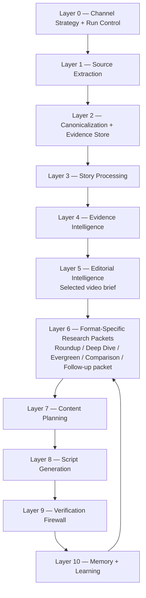
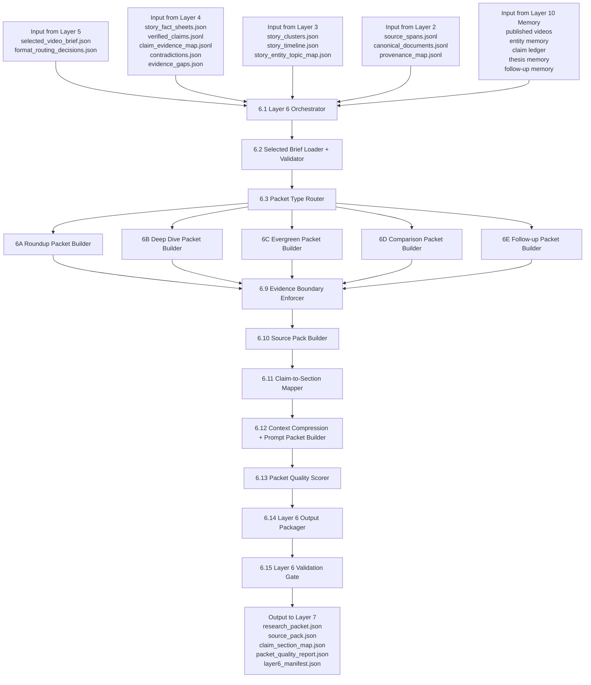

Absolutely — now we will design **Layer 6: Format-Specific Research Packets** in detail.

Up to Layer 5, the system has decided:

```text
This is the video we should create.
This is the selected format.
These are the selected stories.
These are the safe claims.
These are the cautious claims.
These are the claims we must not use.
This is the viewer promise and editorial direction.
```

**Layer 6 now converts that editorial decision into a production-ready research packet.**

This is important because Layer 7 should not plan a video from scattered files like `verified_claims.jsonl`, `story_clusters.json`, `source_spans.jsonl`, and `selected_video_brief.json`. Layer 6 combines all of that into one clean, format-specific packet.

Your earlier design already had “Research packet generator” as a major milestone, where each selected story should produce a reliable brief with summary, source list, confirmed facts, uncertain facts, why it matters, technical explanation, and business impact before script writing. 

---

# Layer 6 — Format-Specific Research Packets

## 1. Purpose of Layer 6

Layer 6 answers:

```text
Given the selected video format, what exact research packet should we build for the next content-planning layer?
```

Layer 5 says:

```text
Make a deep dive about this one story.
```

Layer 6 says:

```text
Here is the deep-dive packet:
- what happened
- safe claims
- cautious claims
- source-backed background
- timeline
- technical context
- implications
- limitations
- counterpoints
- source map
- claims not allowed
```

For a roundup, Layer 6 says:

```text
Here is the roundup packet:
- top 5–8 stories
- story order
- segment time budget
- safe claims per story
- one-line summary per story
- transition logic
- episode theme
```

Layer 6 is the **research-packaging layer**.

---

# 2. Why Layer 6 is important

Without Layer 6, Layer 7 and Layer 8 may read too much scattered context and lose control.

Bad flow:

```text
Layer 7 reads all claims, all stories, all memory, all source spans
↓
Planner becomes confused
↓
Script writer may overuse weak facts or repeat content
```

Better flow:

```text
Layer 5 selected_video_brief
+ Layer 4 verified claims
+ Layer 3 story structure
+ Layer 2 source spans
+ Layer 10 memory, only where needed
↓
Layer 6 creates one clean packet
↓
Layer 7 plans video from only the right evidence
```

This prevents:

```text
wrong format structure
unsupported claims
overloaded prompts
duplicate angles
weak source usage
mixing roundup logic with deep-dive logic
```

Layer 6 is the **controlled handoff** between editorial decision-making and content planning.

---

# 3. What Layer 6 should do and not do

## Layer 6 should do

```text
Build format-specific packets.
Collect selected story/stories into a clean packet.
Attach verified claim IDs and source span IDs.
Preserve safe / cautious / do-not-use boundaries.
Create story summaries only from verified claims.
Create source-backed context sections.
Create evidence maps for Layer 7 and Layer 8.
Prepare packet-level warnings and restrictions.
```

## Layer 6 should not do

```text
It should not select the video topic.
It should not change the selected format.
It should not invent new facts.
It should not write the final script.
It should not create final titles/thumbnails.
It should not use do-not-use claims.
It should not turn cautious claims into facts.
```

Layer 6 can say:

```json
{
  "section_need": "limitations",
  "allowed_claim_ids": ["claim_018", "claim_019"],
  "language_guidance": "Use cautious wording."
}
```

Layer 6 should not say:

```json
{
  "final_script_line": "This tool will replace developers."
}
```

---

# 4. Where Layer 6 sits in the full architecture



Layer 6 sits after editorial routing and before content planning.

It is the final “research preparation” layer before the system starts planning hooks, narrative, titles, sections, and scripts.

---

# 5. Layer wise architecture — Layer 6 internal architecture



---

# 6. Layer 6 input and output

## Layer 6 input

Layer 6 receives from Layer 5:

```text
selected_video_brief.json
format_routing_decisions.json
video_opportunity_scores.json
editorial_candidates.json
```

Layer 6 receives from Layer 4:

```text
story_fact_sheets.json
verified_claims.jsonl
rejected_claims.jsonl
claim_evidence_map.jsonl
contradictions.json
evidence_gaps.json
evidence_density_report.json
```

Layer 6 receives from Layer 3:

```text
story_clusters.json
story_timeline.json
story_entity_topic_map.json
cluster_membership.jsonl
```

Layer 6 receives from Layer 2:

```text
canonical_documents.jsonl
source_spans.jsonl
provenance_map.jsonl
source_trust_report.json
```

Layer 6 may receive from Layer 10:

```text
video_memory.jsonl
entity_topic_memory.jsonl
claim_ledger.jsonl
followups.jsonl
channel_thesis_memory.json
```

Example Layer 6 input package:

```json
{
  "run_id": "run_2026_05_10_48h_auto",
  "inputs": {
    "selected_video_brief_path": "data/runs/run_2026_05_10_48h_auto/layer_5/selected_video_brief.json",
    "story_fact_sheets_path": "data/runs/run_2026_05_10_48h_auto/layer_4/story_fact_sheets.json",
    "verified_claims_path": "data/runs/run_2026_05_10_48h_auto/layer_4/verified_claims.jsonl",
    "claim_evidence_map_path": "data/runs/run_2026_05_10_48h_auto/layer_4/claim_evidence_map.jsonl",
    "story_clusters_path": "data/runs/run_2026_05_10_48h_auto/layer_3/story_clusters.json",
    "source_spans_path": "data/runs/run_2026_05_10_48h_auto/layer_2/source_spans.jsonl",
    "canonical_documents_path": "data/runs/run_2026_05_10_48h_auto/layer_2/canonical_documents.jsonl"
  },
  "selected_video": {
    "selected_format": "deep_dive",
    "primary_story_id": "story_001",
    "safe_claim_ids": ["claim_001", "claim_002", "claim_003"],
    "cautious_claim_ids": ["claim_018"],
    "do_not_use_claim_ids": ["claim_099"]
  }
}
```

---

## Layer 6 output

Layer 6 produces:

```text
data/runs/{run_id}/layer_6/
  research_packet.json
  source_pack.json
  claim_section_map.json
  evidence_boundary_report.json
  packet_quality_report.json
  packet_context_for_layer7.json
  layer6_manifest.json
```

Main output summary:

```json
{
  "run_id": "run_2026_05_10_48h_auto",
  "layer": "layer_6_format_specific_research_packets",
  "status": "completed",
  "selected_format": "deep_dive",
  "research_packet_path": "data/runs/run_2026_05_10_48h_auto/layer_6/research_packet.json",
  "source_pack_path": "data/runs/run_2026_05_10_48h_auto/layer_6/source_pack.json",
  "claim_section_map_path": "data/runs/run_2026_05_10_48h_auto/layer_6/claim_section_map.json",
  "ready_for_layer_7": true
}
```

---

# 7. Core Layer 6 data objects

Layer 6 should mainly produce these objects:

```text
ResearchPacket
RoundupPacket
DeepDivePacket
EvergreenPacket
ComparisonPacket
FollowUpPacket
SourcePack
ClaimSectionMap
EvidenceBoundaryReport
PacketQualityReport
Layer6Manifest
```

---

# 8. Universal ResearchPacket format

Every packet, no matter the format, should share a common outer schema.

```json
{
  "research_packet_id": "packet_20260510_001",
  "run_id": "run_2026_05_10_48h_auto",
  "selected_video_id": "video_brief_20260510_001",

  "packet_identity": {
    "packet_type": "deep_dive",
    "selected_format": "deep_dive",
    "primary_story_id": "story_001",
    "supporting_story_ids": [],
    "created_at": "2026-05-10T11:25:00Z"
  },

  "editorial_direction": {
    "central_viewer_question": "Does this actually change how developers use AI coding tools?",
    "viewer_promise": "By the end, viewers will understand what changed, what is useful, and what is still hype.",
    "working_angle": "From autocomplete to workflow agents",
    "tone_guidance": "analytical, practical, evidence-first"
  },

  "evidence_boundaries": {
    "safe_claim_ids": ["claim_001", "claim_002", "claim_003"],
    "cautious_claim_ids": ["claim_018"],
    "do_not_use_claim_ids": ["claim_099"],
    "contradiction_ids": [],
    "evidence_gap_ids": []
  },

  "packet_content": {},

  "source_support": {
    "source_pack_path": "data/runs/run_2026_05_10_48h_auto/layer_6/source_pack.json",
    "claim_section_map_path": "data/runs/run_2026_05_10_48h_auto/layer_6/claim_section_map.json"
  },

  "handoff": {
    "next_layer": "layer_7_content_planning",
    "ready_for_layer_7": true
  }
}
```

The `packet_content` section changes depending on whether it is roundup, deep dive, evergreen, comparison, or follow-up.

---

# 9. Module-by-module Layer 6 design

---

## Module 6.1 — Layer 6 Orchestrator

### Purpose

Coordinate packet creation based on the selected video format.

### Why it matters

Layer 6 has multiple packet builders. The orchestrator decides which builder to call and ensures all evidence boundaries are respected.

### Questions it answers

```text
What format did Layer 5 select?
Which story or stories are included?
Which claims are safe, cautious, or blocked?
Which packet builder should run?
Can Layer 7 start after packet creation?
```

### Input

```json
{
  "run_manifest_path": "data/runs/run_2026_05_10_48h_auto/run_manifest.json",
  "layer5_manifest_path": "data/runs/run_2026_05_10_48h_auto/layer_5/layer5_manifest.json",
  "selected_video_brief_path": "data/runs/run_2026_05_10_48h_auto/layer_5/selected_video_brief.json"
}
```

### Logic

```text
1. Load selected_video_brief.json.
2. Read selected_format.
3. Load needed Layer 3, Layer 4, Layer 2, and memory files.
4. Route to correct packet builder.
5. Enforce evidence boundaries.
6. Build source pack.
7. Build claim-section map.
8. Validate packet.
9. Write Layer 6 outputs.
```

### Output

```json
{
  "run_id": "run_2026_05_10_48h_auto",
  "selected_format": "deep_dive",
  "packet_builder_used": "deep_dive_packet_builder",
  "status": "completed"
}
```

---

## Module 6.2 — Selected Brief Loader + Validator

### Purpose

Load and validate Layer 5’s selected video brief.

### Why it matters

Layer 6 should not build a packet if Layer 5 did not clearly select a format, story, and evidence boundaries.

### Questions it answers

```text
Did Layer 5 choose a video?
What format was selected?
Which story/stories are selected?
Are safe/cautious/do-not-use claim IDs present?
Is the viewer promise present?
Is the packet type clear?
```

### Input

```json
{
  "selected_video_brief_path": "data/runs/.../layer_5/selected_video_brief.json"
}
```

### Logic

```text
1. Load selected_video_brief.json.
2. Validate selected_format.
3. Validate selected story IDs.
4. Validate evidence boundaries.
5. Validate editorial direction.
6. Validate handoff packet type.
```

### Output

```json
{
  "selected_video_id": "video_brief_20260510_001",
  "selected_format": "deep_dive",
  "packet_type_to_build": "deep_dive_packet",
  "primary_story_id": "story_001",
  "supporting_story_ids": [],
  "safe_claim_ids": ["claim_001", "claim_002", "claim_003"],
  "cautious_claim_ids": ["claim_018"],
  "do_not_use_claim_ids": ["claim_099"],
  "validation_status": "passed"
}
```

---

## Module 6.3 — Packet Type Router

### Purpose

Route the request to the correct format-specific packet builder.

### Why it matters

Each format requires a different research structure.

A roundup packet is not a smaller deep dive.
A comparison packet is not just multiple deep dives.
An evergreen packet needs memory and historical context.

### Questions it answers

```text
Should we build a roundup packet?
Deep dive packet?
Evergreen packet?
Comparison packet?
Follow-up packet?
```

### Input

```json
{
  "selected_format": "deep_dive",
  "packet_type_to_build": "deep_dive_packet"
}
```

### Logic

```text
if selected_format == roundup → RoundupPacketBuilder
if selected_format == deep_dive → DeepDivePacketBuilder
if selected_format == evergreen → EvergreenPacketBuilder
if selected_format == comparison → ComparisonPacketBuilder
if selected_format == follow_up → FollowUpPacketBuilder
```

### Output

```json
{
  "packet_builder": "deep_dive_packet_builder",
  "packet_schema": "DeepDivePacket",
  "routing_status": "success"
}
```

---

# 10. Format-specific packet builders

---

## Module 6A — Roundup Packet Builder

### Purpose

Build a packet for a multi-story AI news roundup.

### When used

```text
Selected format = roundup
```

### Why it matters

Your original idea was a video covering many AI news items. This module directly supports that.

A roundup should not go too deep on every story. It should provide:

```text
what happened
why it matters
one safe takeaway
source-backed short segment
smooth transitions
```

### Questions it answers

```text
What are the selected 5–8 stories?
What is the episode theme?
What is the correct story order?
How much time should each story get?
What safe claims can be used for each segment?
Which stories need cautious language?
What should be the final takeaway across all stories?
```

### Input

```json
{
  "selected_format": "roundup",
  "selected_story_ids": [
    "story_001",
    "story_002",
    "story_003",
    "story_004",
    "story_005"
  ],
  "episode_theme": "AI agents, open-source models, and infrastructure updates moved forward together.",
  "story_fact_sheets": {},
  "verified_claims": {},
  "source_spans": {}
}
```

### Logic

```text
1. Load each selected story fact sheet.
2. For each story, choose 2–4 safe claims.
3. Attach 0–1 cautious claim if useful.
4. Reject do-not-use claims.
5. Build a one-line story summary from verified claims only.
6. Assign story segment role:
   - lead_story
   - major_update
   - quick_update
   - research_note
   - community_signal
7. Assign time budget per story.
8. Build episode-level theme and flow.
9. Create transition notes between stories.
10. Produce RoundupPacket.
```

### Output

```json
{
  "packet_type": "roundup",
  "selected_format": "roundup",

  "episode": {
    "episode_theme": "AI agents, open-source models, and infrastructure updates moved forward together.",
    "target_duration_minutes": 8,
    "story_count": 5,
    "viewer_promise": "Viewers will quickly understand the most important AI updates and why each one matters."
  },

  "segments": [
    {
      "story_id": "story_001",
      "segment_order": 1,
      "segment_role": "lead_story",
      "target_duration_seconds": 110,
      "story_title": "OpenAI announces coding-related product updates",
      "one_line_summary": "OpenAI announced coding-related updates that point toward more workflow-oriented AI tools.",
      "why_it_matters": "This matters for developers because AI coding tools are moving beyond autocomplete into broader task assistance.",
      "safe_claim_ids": ["claim_001", "claim_002"],
      "cautious_claim_ids": ["claim_018"],
      "do_not_use_claim_ids": ["claim_099"],
      "source_span_ids": ["span_001", "span_002"],
      "segment_caution_notes": [
        "Do not say this replaces developers; evidence only supports workflow assistance."
      ]
    }
  ],

  "episode_flow": {
    "intro_focus": "This was a week of AI updates that show tools becoming more practical and workflow-focused.",
    "transition_logic": [
      {
        "from_story_id": "story_001",
        "to_story_id": "story_002",
        "transition_note": "Move from AI coding tools to open-source model progress."
      }
    ],
    "final_takeaway": "The common thread is that AI is becoming more operational, not just experimental."
  }
}
```

### Roundup packet rule

For roundup:

```text
Keep each story compact.
Do not include too much background.
Do not let one story dominate unless it is the lead story.
```

---

## Module 6B — Deep Dive Packet Builder

### Purpose

Build a detailed research packet for one major story.

### When used

```text
Selected format = deep_dive
```

### Why it matters

This is what your current prototype mostly resembles: pick one story and go deep.

Deep dive needs richer structure:

```text
what happened
timeline
background
technical explanation
why it matters
counterpoints
limitations
what is still unknown
final takeaway boundaries
```

### Questions it answers

```text
What exactly happened?
What are the verified facts?
What is the background?
What changed compared to before?
Why does it matter?
What are the limitations?
What should be said cautiously?
What should not be said?
What is the strongest evidence-backed thesis candidate?
```

### Input

```json
{
  "selected_format": "deep_dive",
  "primary_story_id": "story_001",
  "editorial_direction": {
    "central_viewer_question": "Does this actually change how developers use AI coding tools?",
    "viewer_promise": "Viewers will understand what changed, what is useful, and what is still hype.",
    "editorial_thesis_candidate": "AI coding tools are moving toward workflow-level automation."
  },
  "story_fact_sheet": {},
  "verified_claims": {},
  "story_timeline": {},
  "source_spans": {}
}
```

### Logic

```text
1. Load primary story fact sheet.
2. Pull all safe claims.
3. Pull cautious claims with required wording.
4. Exclude do-not-use claims.
5. Organize claims by purpose:
   - what_happened
   - timeline
   - background
   - technical_context
   - user_impact
   - business_impact
   - limitations
   - counterpoints
   - open_questions
6. Build evidence-backed thesis candidate.
7. Build source-backed explanation blocks.
8. Preserve uncertainty language.
9. Create deep-dive packet.
```

### Output

```json
{
  "packet_type": "deep_dive",
  "selected_format": "deep_dive",

  "story": {
    "story_id": "story_001",
    "canonical_story_title": "OpenAI announces coding-related product updates",
    "story_type": "product_launch",
    "primary_entities": ["OpenAI", "Codex"],
    "topics": ["AI coding tools", "AI agents"]
  },

  "editorial_direction": {
    "central_viewer_question": "Does this actually change how developers use AI coding tools?",
    "viewer_promise": "Viewers will understand what changed, what is useful, and what is still hype.",
    "thesis_candidate": "The update matters less as one feature release and more as a sign that AI coding tools are becoming workflow-level agents.",
    "tone_guidance": "analytical, practical, evidence-first"
  },

  "research_sections": [
    {
      "section_key": "what_happened",
      "section_goal": "Explain the announcement clearly.",
      "safe_claim_ids": ["claim_001", "claim_002"],
      "cautious_claim_ids": [],
      "source_span_ids": ["span_001", "span_002"],
      "notes_for_layer7": "Start factual and avoid hype."
    },
    {
      "section_key": "why_it_matters",
      "section_goal": "Explain why developers and AI users should care.",
      "safe_claim_ids": ["claim_003", "claim_004"],
      "cautious_claim_ids": ["claim_018"],
      "source_span_ids": ["span_003", "span_004"],
      "notes_for_layer7": "Use cautious wording around real-world impact."
    },
    {
      "section_key": "limitations",
      "section_goal": "Explain what is still unclear or not proven.",
      "safe_claim_ids": ["claim_008"],
      "cautious_claim_ids": ["claim_019"],
      "source_span_ids": ["span_008"],
      "notes_for_layer7": "Mention that impact is not independently measured yet."
    }
  ],

  "timeline": [
    {
      "event_time": "2026-05-10T08:00:00Z",
      "event_label": "Official announcement",
      "claim_ids": ["claim_001"],
      "source_span_ids": ["span_001"]
    }
  ],

  "evidence_boundaries": {
    "safe_claim_ids": ["claim_001", "claim_002", "claim_003"],
    "cautious_claim_ids": ["claim_018"],
    "do_not_use_claim_ids": ["claim_099"],
    "blocked_phrases": [
      "will replace developers",
      "guaranteed to dominate",
      "proves the end of coding"
    ]
  },

  "open_questions": [
    {
      "question": "How well does this work in real-world developer teams?",
      "reason": "Available sources describe capabilities but do not provide independent outcome measurements.",
      "related_evidence_gap_ids": ["gap_001"]
    }
  ]
}
```

### Deep-dive packet rule

For deep dive:

```text
Every major section must have claim IDs.
Every thesis-like statement must be marked as thesis_candidate, not verified fact.
Limitations and uncertainty must be preserved.
```

---

## Module 6C — Evergreen Packet Builder

### Purpose

Build a durable educational/explainer packet.

### When used

```text
Selected format = evergreen
```

### Why it matters

Evergreen videos are not only about what happened today. They explain a broader concept or trend that remains useful after the news cycle.

Example:

```text
“What are AI agents?”
“Why does every AI company care about coding tools?”
“What is open-source AI actually?”
“How do AI benchmarks work?”
```

### Questions it answers

```text
What is the durable topic?
What background should the viewer understand?
Which recent stories support this topic?
Which historical memory supports this topic?
What definitions are safe?
What examples should be used?
What should not be overclaimed?
```

### Input

```json
{
  "selected_format": "evergreen",
  "topic": "AI agents",
  "supporting_story_ids": ["story_001", "story_004", "story_009"],
  "memory_context": {
    "entity_topic_memory": "memory/entity_topic_memory.jsonl",
    "claim_ledger": "memory/claim_ledger.jsonl",
    "video_memory": "memory/video_memory.jsonl"
  }
}
```

### Logic

```text
1. Load selected topic and supporting stories.
2. Load verified claims from recent stories.
3. Load relevant long-term memory.
4. Separate stable knowledge from breaking-news facts.
5. Build definition blocks only from stable evidence.
6. Build examples from recent verified stories.
7. Build timeline of how the topic evolved.
8. Build concept explanation sections.
9. Mark time-sensitive claims clearly.
10. Create evergreen packet.
```

### Output

```json
{
  "packet_type": "evergreen",
  "selected_format": "evergreen",

  "topic": {
    "topic_id": "ai_agents",
    "topic_label": "AI agents",
    "viewer_question": "What are AI agents and why is every AI company talking about them?",
    "viewer_promise": "Viewers will understand what AI agents are, what they can actually do, and what is still hype."
  },

  "concept_blocks": [
    {
      "block_key": "definition",
      "block_goal": "Define the topic clearly.",
      "stable_claim_ids": ["claim_mem_001", "claim_mem_002"],
      "recent_claim_ids": ["claim_001"],
      "language_guidance": "Avoid one universal definition; explain common usage."
    },
    {
      "block_key": "how_it_works",
      "block_goal": "Explain agent-like behavior in simple terms.",
      "safe_claim_ids": ["claim_010", "claim_011"],
      "example_story_ids": ["story_001"]
    },
    {
      "block_key": "why_now",
      "block_goal": "Explain why this topic is becoming important now.",
      "safe_claim_ids": ["claim_020", "claim_021"],
      "memory_claim_ids": ["claim_mem_010"]
    }
  ],

  "timeline": [
    {
      "date": "2025-11-01",
      "event": "Earlier agent-related product update",
      "memory_claim_ids": ["claim_mem_010"]
    },
    {
      "date": "2026-05-10",
      "event": "Recent coding-agent-related story",
      "story_id": "story_001",
      "claim_ids": ["claim_001"]
    }
  ],

  "evidence_boundaries": {
    "avoid": [
      "Do not say agents are fully autonomous unless sources support it.",
      "Do not claim all AI tools are agents."
    ],
    "cautious_language": [
      "often described as",
      "in many product announcements",
      "the term is used differently by different companies"
    ]
  }
}
```

### Evergreen packet rule

For evergreen:

```text
Separate stable explanations from time-sensitive news.
Do not make breaking-news claims sound timeless.
Use memory carefully and cite claim IDs.
```

---

## Module 6D — Comparison Packet Builder

### Purpose

Build a packet for comparing tools, models, companies, or approaches.

### When used

```text
Selected format = comparison
```

### Why it matters

Comparison videos are high-value but risky because they can easily become unsupported opinions.

Example:

```text
“ChatGPT vs Claude vs Gemini for coding”
“OpenAI vs Anthropic AI agents”
“Open-source AI vs closed-source AI”
```

This packet must create an evidence matrix.

### Questions it answers

```text
What are we comparing?
What dimensions are fair to compare?
Which claims support each subject?
Where is evidence missing?
Which comparison points are safe?
Which require caution?
```

### Input

```json
{
  "selected_format": "comparison",
  "comparison_subjects": ["ChatGPT", "Claude", "Gemini"],
  "comparison_dimensions": [
    "coding",
    "tool use",
    "long context",
    "workflow integration"
  ],
  "verified_claims": {},
  "source_pack": {}
}
```

### Logic

```text
1. Load comparison subjects.
2. Load verified claims for each subject.
3. Define comparison dimensions.
4. Map claims to subject + dimension.
5. Check evidence balance.
6. Detect missing evidence.
7. Prevent unsupported ranking.
8. Create comparison matrix.
9. Create fair-language guidance.
```

### Output

```json
{
  "packet_type": "comparison",
  "selected_format": "comparison",

  "comparison": {
    "subjects": ["ChatGPT", "Claude", "Gemini"],
    "viewer_question": "Which AI assistant is strongest for coding workflows?",
    "comparison_scope": "coding workflow support, based only on available verified sources"
  },

  "comparison_dimensions": [
    {
      "dimension_id": "coding_workflow",
      "dimension_label": "Coding workflow support",
      "why_it_matters": "This affects how useful the assistant is inside real developer work."
    },
    {
      "dimension_id": "tool_use",
      "dimension_label": "Tool use and agent behavior",
      "why_it_matters": "Tool use determines whether the system can act beyond text generation."
    }
  ],

  "evidence_matrix": [
    {
      "subject": "ChatGPT",
      "dimension_id": "coding_workflow",
      "safe_claim_ids": ["claim_001", "claim_002"],
      "cautious_claim_ids": ["claim_018"],
      "evidence_strength": "medium_high",
      "missing_evidence": []
    },
    {
      "subject": "Claude",
      "dimension_id": "coding_workflow",
      "safe_claim_ids": ["claim_101"],
      "cautious_claim_ids": [],
      "evidence_strength": "medium",
      "missing_evidence": ["No independent benchmark found in current run."]
    }
  ],

  "comparison_rules": {
    "allow_final_ranking": false,
    "allowed_language": [
      "based on available sources",
      "appears stronger in this dimension",
      "the evidence is stronger for..."
    ],
    "blocked_language": [
      "objectively best",
      "clearly destroys",
      "guaranteed winner"
    ]
  }
}
```

### Comparison packet rule

For comparison:

```text
Do not rank unless every subject has enough comparable evidence.
Show evidence gaps clearly.
Separate official claims from independent validation.
```

---

## Module 6E — Follow-up Packet Builder

### Purpose

Build a packet for a follow-up video connected to a previous video.

### When used

```text
Selected format = follow_up
```

### Why it matters

Follow-ups can create a strong channel identity:

```text
“We covered this last week; now the story changed.”
```

But it must avoid repeating the same video.

### Questions it answers

```text
Which previous video is this connected to?
What changed since then?
Which previous claims are updated, confirmed, contradicted, or expanded?
What is the new evidence?
Why does this deserve a follow-up?
```

### Input

```json
{
  "selected_format": "follow_up",
  "primary_story_id": "story_001",
  "previous_video_id": "video_2026_04_25_ai_agents",
  "previous_video_memory": {},
  "new_verified_claims": {}
}
```

### Logic

```text
1. Load previous video memory.
2. Load current story fact sheet.
3. Compare old thesis and new evidence.
4. Identify what changed.
5. Identify old claims confirmed, contradicted, or expanded.
6. Build follow-up angle.
7. Prevent script repetition.
8. Create follow-up packet.
```

### Output

```json
{
  "packet_type": "follow_up",
  "selected_format": "follow_up",

  "follow_up_context": {
    "previous_video_id": "video_2026_04_25_ai_agents",
    "previous_video_title": "AI Agents Are Becoming Real",
    "current_story_id": "story_001",
    "follow_up_reason": "New evidence shows agent-like AI workflows appearing in coding tools."
  },

  "what_changed": [
    {
      "change_type": "new_product_evidence",
      "description": "A new coding-related update adds evidence to the broader AI agent trend.",
      "new_claim_ids": ["claim_001", "claim_002"],
      "related_previous_claim_ids": ["claim_mem_010"]
    }
  ],

  "previous_claim_status": [
    {
      "previous_claim_id": "claim_mem_010",
      "status": "expanded",
      "new_supporting_claim_ids": ["claim_001"],
      "notes": "The new story gives another example of the same trend."
    }
  ],

  "avoid_repetition": {
    "previous_hook": "AI agents are becoming real...",
    "do_not_reuse_angles": [
      "basic definition of AI agents",
      "same opening analogy from previous video"
    ],
    "new_angle": "AI agents moving specifically into coding workflows"
  }
}
```

### Follow-up packet rule

For follow-up:

```text
The packet must clearly say what is new.
If nothing meaningful changed, do not create a follow-up.
```

---

# 11. Supporting modules after packet builder

---

## Module 6.9 — Evidence Boundary Enforcer

### Purpose

Ensure the packet respects safe, cautious, and blocked evidence boundaries.

### Why it matters

Even if previous layers were careful, packet creation could accidentally include a rejected claim. This module prevents that.

### Questions it answers

```text
Did the packet include only safe or cautious claims?
Did any do-not-use claim leak into packet content?
Are cautious claims marked with language guidance?
Are contradictions preserved?
Are evidence gaps visible?
```

### Input

```json
{
  "research_packet": {},
  "safe_claim_ids": ["claim_001"],
  "cautious_claim_ids": ["claim_018"],
  "do_not_use_claim_ids": ["claim_099"]
}
```

### Logic

```text
1. Scan all packet claim references.
2. Check against do_not_use_claim_ids.
3. Check cautious claims have cautious wording guidance.
4. Check contradictions are not hidden.
5. Create evidence_boundary_report.json.
```

### Output

```json
{
  "evidence_boundary_status": "passed",
  "safe_claims_used": 12,
  "cautious_claims_used": 2,
  "do_not_use_claims_used": 0,
  "warnings": [
    {
      "claim_id": "claim_018",
      "type": "cautious_claim_used",
      "required_guidance": "Use 'may' or 'suggests'; do not state as proven impact."
    }
  ],
  "errors": []
}
```

---

## Module 6.10 — Source Pack Builder

### Purpose

Create a source pack for the selected video.

### Why it matters

Layer 7 and Layer 8 need sources organized cleanly, not scattered across canonical docs and spans.

### Questions it answers

```text
Which sources support this packet?
Which source is official?
Which is independent?
Which is research?
Which is community signal only?
Which source spans are important?
What should be included in the final YouTube description?
```

### Input

```json
{
  "claim_ids": ["claim_001", "claim_002", "claim_018"],
  "claim_evidence_map": "data/runs/.../claim_evidence_map.jsonl",
  "canonical_documents": "data/runs/.../canonical_documents.jsonl",
  "source_spans": "data/runs/.../source_spans.jsonl"
}
```

### Logic

```text
1. Collect all source spans used by packet claims.
2. Collect corresponding canonical documents.
3. Group sources by role:
   - official
   - independent media
   - research
   - technical artifact
   - video/transcript
   - community signal
4. Deduplicate URLs.
5. Mark which claims each source supports.
6. Build source list for later description.
```

### Output

```json
{
  "source_pack_id": "source_pack_20260510_001",
  "sources": [
    {
      "source_id": "openai_news",
      "source_role": "primary_evidence",
      "trust_tier": 1,
      "title": "Official announcement title",
      "url": "https://openai.com/news/example",
      "canonical_document_id": "doc_openai_001",
      "supports_claim_ids": ["claim_001", "claim_002"],
      "source_span_ids": ["span_001", "span_002"],
      "recommended_for_youtube_description": true
    },
    {
      "source_id": "hackernews_ai",
      "source_role": "trend_signal_only",
      "trust_tier": 3,
      "title": "HN discussion",
      "url": "https://news.ycombinator.com/item?id=...",
      "supports_claim_ids": [],
      "used_for": "audience_interest_signal",
      "recommended_for_youtube_description": false
    }
  ]
}
```

---

## Module 6.11 — Claim-to-Section Mapper

### Purpose

Map claims to the packet sections where they should be used.

### Why it matters

This helps Layer 7 plan sections without misusing facts.

### Questions it answers

```text
Which claims support “what happened”?
Which claims support “why it matters”?
Which claims support “technical context”?
Which claims belong in limitations?
Which claims are only background?
```

### Input

```json
{
  "research_packet": {},
  "verified_claims": [],
  "packet_type": "deep_dive"
}
```

### Logic

```text
1. Read packet sections.
2. Read claim types and importance scores.
3. Map claims to sections based on:
   - claim_type
   - recommended_sections from Layer 4
   - editorial direction from Layer 5
   - format requirements
4. Mark required vs optional claims.
```

### Output

```json
{
  "claim_section_map": [
    {
      "section_key": "what_happened",
      "required_claim_ids": ["claim_001", "claim_002"],
      "optional_claim_ids": ["claim_003"],
      "cautious_claim_ids": [],
      "blocked_claim_ids": ["claim_099"]
    },
    {
      "section_key": "limitations",
      "required_claim_ids": ["claim_008"],
      "optional_claim_ids": [],
      "cautious_claim_ids": ["claim_018"],
      "language_guidance": "Do not overstate real-world impact."
    }
  ]
}
```

---

## Module 6.12 — Context Compression + Prompt Packet Builder

### Purpose

Create a compact version of the research packet for Layer 7.

### Why it matters

Layer 7 does not need every raw source span. It needs a compact but traceable packet.

This prevents context overload.

### Questions it answers

```text
What is the minimal packet Layer 7 needs?
Which claims are essential?
Which source references are required?
Which warnings must be preserved?
Can this packet fit into a model context safely?
```

### Input

```json
{
  "research_packet": {},
  "source_pack": {},
  "claim_section_map": {}
}
```

### Logic

```text
1. Keep editorial direction.
2. Keep section goals.
3. Keep safe/cautious/do-not-use claim IDs.
4. Keep short verified claim text.
5. Keep source references.
6. Keep warnings and evidence gaps.
7. Remove raw long source text unless needed.
8. Preserve paths for detailed lookup.
```

### Output

```json
{
  "packet_context_for_layer7": {
    "packet_type": "deep_dive",
    "central_viewer_question": "Does this actually change how developers use AI coding tools?",
    "viewer_promise": "Viewers will understand what changed, what is useful, and what is still hype.",
    "sections": [
      {
        "section_key": "what_happened",
        "goal": "Explain the announcement clearly.",
        "claims": [
          {
            "claim_id": "claim_001",
            "claim_text": "OpenAI announced a coding-related product update.",
            "confidence": "high",
            "source_ref": "source_001"
          }
        ]
      }
    ],
    "warnings": [
      "Do not claim developer replacement.",
      "Use cautious language for real-world impact."
    ],
    "lookup_paths": {
      "full_research_packet": "data/runs/.../layer_6/research_packet.json",
      "source_pack": "data/runs/.../layer_6/source_pack.json"
    }
  }
}
```

---

## Module 6.13 — Packet Quality Scorer

### Purpose

Evaluate whether the packet is strong enough for Layer 7.

### Why it matters

A packet may technically exist but be weak.

### Questions it answers

```text
Does the packet have enough claims?
Does it have enough source support?
Does every section have evidence?
Are there too many cautious claims?
Are contradictions unresolved?
Is the packet suitable for the selected format?
```

### Input

```json
{
  "research_packet": {},
  "source_pack": {},
  "claim_section_map": {}
}
```

### Logic

```text
Score:
- completeness
- evidence coverage
- format fit
- source diversity
- claim-section coverage
- contradiction risk
- caution density
```

### Output

```json
{
  "packet_quality": {
    "packet_quality_score": 86,
    "format_fit_status": "good",
    "evidence_coverage_score": 91,
    "section_coverage_score": 84,
    "source_diversity_score": 76,
    "risk_level": "low",
    "ready_for_layer_7": true,
    "warnings": [
      "Technical context section has fewer independent sources than ideal."
    ]
  }
}
```

---

## Module 6.14 — Layer 6 Output Packager

### Purpose

Write all Layer 6 output files.

### Output files

```text
research_packet.json
source_pack.json
claim_section_map.json
evidence_boundary_report.json
packet_quality_report.json
packet_context_for_layer7.json
layer6_manifest.json
```

### Output example

```json
{
  "run_id": "run_2026_05_10_48h_auto",
  "outputs": {
    "research_packet": "data/runs/run_2026_05_10_48h_auto/layer_6/research_packet.json",
    "source_pack": "data/runs/run_2026_05_10_48h_auto/layer_6/source_pack.json",
    "claim_section_map": "data/runs/run_2026_05_10_48h_auto/layer_6/claim_section_map.json",
    "packet_context_for_layer7": "data/runs/run_2026_05_10_48h_auto/layer_6/packet_context_for_layer7.json"
  }
}
```

---

## Module 6.15 — Layer 6 Validation Gate

### Purpose

Validate the packet before Layer 7 starts.

### Why it matters

Layer 7 will plan the video based on this packet. If the packet includes wrong claims or missing evidence, the script will be weak.

### Validation rules

Layer 6 passes if:

```text
selected_video_brief exists.
selected_format is valid.
research_packet.json exists.
packet type matches selected format.
every safe claim ID exists in verified_claims.
no do-not-use claim is used as safe evidence.
every section has at least one claim or clear reason.
cautious claims include language guidance.
source_pack contains source references.
claim_section_map exists.
packet_quality_report says ready_for_layer_7 = true.
```

### Output

```json
{
  "validation_status": "passed",
  "ready_for_layer_7": true,
  "warnings": [
    {
      "type": "cautious_claims_present",
      "message": "Layer 7 must preserve cautious language around impact claims."
    }
  ],
  "errors": []
}
```

---

# 12. Layer 6 output files in detail

## 12.1 `research_packet.json`

This is the main Layer 6 output.

```json
{
  "research_packet_id": "packet_20260510_001",
  "run_id": "run_2026_05_10_48h_auto",
  "packet_type": "deep_dive",
  "selected_format": "deep_dive",
  "primary_story_id": "story_001",
  "editorial_direction": {},
  "packet_content": {},
  "evidence_boundaries": {},
  "handoff": {
    "ready_for_layer_7": true
  }
}
```

---

## 12.2 `source_pack.json`

```json
{
  "source_pack_id": "source_pack_20260510_001",
  "sources": [
    {
      "source_ref_id": "source_001",
      "source_role": "primary_evidence",
      "title": "Official announcement title",
      "url": "https://...",
      "canonical_document_id": "doc_001",
      "source_span_ids": ["span_001"],
      "supports_claim_ids": ["claim_001"]
    }
  ]
}
```

---

## 12.3 `claim_section_map.json`

```json
{
  "run_id": "run_2026_05_10_48h_auto",
  "packet_id": "packet_20260510_001",
  "claim_section_map": [
    {
      "section_key": "what_happened",
      "required_claim_ids": ["claim_001", "claim_002"],
      "optional_claim_ids": [],
      "cautious_claim_ids": []
    }
  ]
}
```

---

## 12.4 `evidence_boundary_report.json`

```json
{
  "run_id": "run_2026_05_10_48h_auto",
  "packet_id": "packet_20260510_001",
  "boundary_status": "passed",
  "safe_claims_used": 12,
  "cautious_claims_used": 2,
  "do_not_use_claims_used": 0,
  "contradictions_preserved": true,
  "evidence_gaps_preserved": true
}
```

---

## 12.5 `packet_quality_report.json`

```json
{
  "run_id": "run_2026_05_10_48h_auto",
  "packet_id": "packet_20260510_001",
  "packet_quality_score": 86,
  "ready_for_layer_7": true,
  "section_coverage_score": 84,
  "evidence_coverage_score": 91,
  "source_diversity_score": 76,
  "risk_level": "low",
  "warnings": []
}
```

---

## 12.6 `packet_context_for_layer7.json`

This is a compact handoff version.

```json
{
  "packet_type": "deep_dive",
  "central_viewer_question": "Does this actually change how developers use AI coding tools?",
  "viewer_promise": "Viewers will understand what changed, what is useful, and what is still hype.",
  "sections": [
    {
      "section_key": "what_happened",
      "goal": "Explain the announcement clearly.",
      "claim_ids": ["claim_001", "claim_002"],
      "source_refs": ["source_001"]
    }
  ],
  "warnings": [
    "Do not use do-not-use claims.",
    "Use cautious wording for claim_018."
  ],
  "lookup_paths": {
    "full_research_packet": "data/runs/.../layer_6/research_packet.json",
    "source_pack": "data/runs/.../layer_6/source_pack.json"
  }
}
```

---

## 12.7 `layer6_manifest.json`

```json
{
  "run_id": "run_2026_05_10_48h_auto",
  "layer": "layer_6_format_specific_research_packets",
  "created_at": "2026-05-10T11:25:00Z",

  "inputs": {
    "run_manifest": "data/runs/run_2026_05_10_48h_auto/run_manifest.json",
    "layer5_manifest": "data/runs/run_2026_05_10_48h_auto/layer_5/layer5_manifest.json",
    "selected_video_brief": "data/runs/run_2026_05_10_48h_auto/layer_5/selected_video_brief.json",
    "story_fact_sheets": "data/runs/run_2026_05_10_48h_auto/layer_4/story_fact_sheets.json",
    "verified_claims": "data/runs/run_2026_05_10_48h_auto/layer_4/verified_claims.jsonl",
    "source_spans": "data/runs/run_2026_05_10_48h_auto/layer_2/source_spans.jsonl"
  },

  "outputs": {
    "research_packet": "data/runs/run_2026_05_10_48h_auto/layer_6/research_packet.json",
    "source_pack": "data/runs/run_2026_05_10_48h_auto/layer_6/source_pack.json",
    "claim_section_map": "data/runs/run_2026_05_10_48h_auto/layer_6/claim_section_map.json",
    "evidence_boundary_report": "data/runs/run_2026_05_10_48h_auto/layer_6/evidence_boundary_report.json",
    "packet_quality_report": "data/runs/run_2026_05_10_48h_auto/layer_6/packet_quality_report.json",
    "packet_context_for_layer7": "data/runs/run_2026_05_10_48h_auto/layer_6/packet_context_for_layer7.json"
  },

  "packet": {
    "selected_format": "deep_dive",
    "packet_type": "deep_dive",
    "primary_story_id": "story_001",
    "supporting_story_ids": [],
    "packet_quality_score": 86
  },

  "handoff": {
    "ready_for_layer_7": true,
    "next_layer": "layer_7_content_planning"
  }
}
```

---

# 13. Layer 6 config files

Layer 6 should be config-driven.

```text
config/
  packet_builder_rules.yaml
  roundup_packet_rules.yaml
  deep_dive_packet_rules.yaml
  evergreen_packet_rules.yaml
  comparison_packet_rules.yaml
  followup_packet_rules.yaml
  source_pack_rules.yaml
  packet_quality_rules.yaml
```

---

## `packet_builder_rules.yaml`

```yaml
packet_builder:
  enforce_evidence_boundaries: true
  block_do_not_use_claims: true
  require_source_pack: true
  require_claim_section_map: true
  require_packet_quality_report: true

  default_packet_types:
    roundup: roundup_packet
    deep_dive: deep_dive_packet
    evergreen: evergreen_packet
    comparison: comparison_packet
    follow_up: follow_up_packet
```

---

## `roundup_packet_rules.yaml`

```yaml
roundup_packet:
  min_stories: 5
  max_stories: 8
  target_duration_minutes: 8
  min_safe_claims_per_story: 2
  max_claims_per_story: 4

  segment_roles:
    - lead_story
    - major_update
    - quick_update
    - research_note
    - community_signal

  require_episode_theme: true
  require_transition_notes: true
```

---

## `deep_dive_packet_rules.yaml`

```yaml
deep_dive_packet:
  target_duration_minutes: 10
  min_safe_claims: 8
  require_primary_source: true
  require_limitations_section: true
  require_open_questions_section: true

  required_sections:
    - what_happened
    - why_it_matters
    - background
    - technical_context
    - limitations
    - final_takeaway

  cautious_claim_handling:
    require_language_guidance: true
```

---

## `evergreen_packet_rules.yaml`

```yaml
evergreen_packet:
  require_memory_context: true
  require_stable_claims: true
  require_recent_examples: true
  require_historical_timeline: true

  sections:
    - concept_definition
    - why_it_matters
    - how_it_works
    - examples
    - misconceptions
    - practical_takeaway
```

---

## `comparison_packet_rules.yaml`

```yaml
comparison_packet:
  min_subjects: 2
  max_subjects: 4
  require_evidence_matrix: true
  require_missing_evidence_report: true
  allow_final_ranking_only_if_balanced_evidence: true

  dimensions:
    - coding
    - tool_use
    - long_context
    - speed
    - cost
    - workflow_integration
```

---

## `followup_packet_rules.yaml`

```yaml
followup_packet:
  require_previous_video_id: true
  require_new_evidence: true
  require_what_changed_section: true
  require_previous_claim_status: true
  prevent_reused_hook: true
```

---

## `packet_quality_rules.yaml`

```yaml
packet_quality:
  minimum_quality_score: 70

  weights:
    evidence_coverage: 0.30
    section_coverage: 0.25
    source_diversity: 0.15
    format_fit: 0.15
    risk_control: 0.15

  block_if:
    do_not_use_claims_used: true
    missing_source_pack: true
    selected_format_mismatch: true
    packet_has_no_claims: true
```

---

# 14. Suggested Layer 6 folder structure

```text
pipelines/
  layer_6_research_packets/
    __init__.py
    run_layer_6.py

    orchestrator/
      layer6_orchestrator.py

    loaders/
      selected_brief_loader.py
      claim_loader.py
      story_context_loader.py
      source_context_loader.py
      memory_context_loader.py

    routing/
      packet_type_router.py

    builders/
      roundup_packet_builder.py
      deep_dive_packet_builder.py
      evergreen_packet_builder.py
      comparison_packet_builder.py
      followup_packet_builder.py

    evidence/
      evidence_boundary_enforcer.py
      source_pack_builder.py
      claim_section_mapper.py

    compression/
      context_compression_builder.py
      packet_context_for_layer7_builder.py

    scoring/
      packet_quality_scorer.py

    output/
      layer6_output_packager.py
      layer6_manifest_writer.py

    validation/
      layer6_validation_gate.py

config/
  packet_builder_rules.yaml
  roundup_packet_rules.yaml
  deep_dive_packet_rules.yaml
  evergreen_packet_rules.yaml
  comparison_packet_rules.yaml
  followup_packet_rules.yaml
  source_pack_rules.yaml
  packet_quality_rules.yaml

data/
  runs/
    run_2026_05_10_48h_auto/
      layer_6/
        research_packet.json
        source_pack.json
        claim_section_map.json
        evidence_boundary_report.json
        packet_quality_report.json
        packet_context_for_layer7.json
        layer6_manifest.json
```

---

# 15. Layer 6 processing flow

```text
Step 1:
Load run_manifest.json and selected_video_brief.json.

Step 2:
Validate selected format, selected stories, and evidence boundaries.

Step 3:
Load story fact sheets, verified claims, rejected claims, contradictions, and evidence gaps.

Step 4:
Load story clusters, timelines, entity/topic maps, source spans, and canonical documents.

Step 5:
Route to the correct packet builder:
roundup, deep dive, evergreen, comparison, or follow-up.

Step 6:
Build format-specific research packet.

Step 7:
Enforce evidence boundaries.

Step 8:
Build source pack.

Step 9:
Map claims to packet sections.

Step 10:
Build compressed context for Layer 7.

Step 11:
Score packet quality.

Step 12:
Write Layer 6 outputs.

Step 13:
Validate Layer 6 output.

Step 14:
Pass packet_context_for_layer7.json and research_packet.json to Layer 7.
```

---

# 16. How Layer 6 supports downstream layers

| Downstream layer                | What Layer 6 provides                                                        |
| ------------------------------- | ---------------------------------------------------------------------------- |
| Layer 7 — Content Planning      | research packet, section-ready claims, viewer promise, source-backed context |
| Layer 8 — Script Generation     | allowed claims, source references, cautious language rules, packet structure |
| Layer 9 — Verification Firewall | source pack, claim-section map, evidence boundaries                          |
| Layer 10 — Memory               | packet metadata and selected claims that may later be saved after publishing |

---

# 17. Layer 6 and hallucination control

Layer 6 is very important for hallucination control because it prevents the planner and writer from seeing uncontrolled context.

## Rule 1: Only packet-approved claims move forward

Layer 7 should not read all claims from Layer 4. It should read the packet.

```text
Layer 4 has many claims.
Layer 6 selects the relevant ones.
Layer 7 plans only from packet-approved claims.
```

## Rule 2: Do-not-use claims must remain visible but blocked

Do not completely hide rejected claims. Keep them in the packet boundary report so later layers know what to avoid.

Example:

```json
{
  "do_not_use_claim_ids": ["claim_099"],
  "reason": "Unsupported prediction",
  "blocked_language": ["will replace developers"]
}
```

## Rule 3: Cautious claims must carry language guidance

Example:

```json
{
  "claim_id": "claim_018",
  "claim_text": "The update may affect developer workflows.",
  "required_language": "Use 'may', 'could', or 'suggests'. Do not say 'will'."
}
```

## Rule 4: Format-specific limits prevent overreach

A claim that is enough for a roundup mention may not be enough for a deep dive.

Layer 6 should enforce that.

## Rule 5: Packet context should be compressed but traceable

Layer 7 should receive compressed context, but every claim should still link to:

```text
claim_id
source_span_id
canonical_document_id
source_url
```

That keeps the system grounded.

---

# 18. What Layer 6 should produce for each format

## For Roundup

Layer 6 produces:

```text
episode theme
5–8 selected stories
story order
time budget per story
2–4 safe claims per story
short why-it-matters
transition notes
source pack
```

## For Deep Dive

Layer 6 produces:

```text
one primary story
central question
thesis candidate
research sections
timeline
background context
technical context
limitations
counterpoints
open questions
safe/cautious/do-not-use claim boundaries
source pack
```

## For Evergreen

Layer 6 produces:

```text
durable topic
stable explanation claims
historical memory context
recent examples
misconceptions
timeline
practical takeaway
source pack
```

## For Comparison

Layer 6 produces:

```text
comparison subjects
comparison dimensions
evidence matrix
missing evidence per subject
safe comparison language
blocked ranking language
source pack
```

## For Follow-up

Layer 6 produces:

```text
previous video reference
what changed
new evidence
previous claim status
avoid-repetition guidance
follow-up angle
source pack
```

---

# 19. Final Layer 6 input/output contract

## Layer 6 input contract

```json
{
  "run_id": "string",
  "run_manifest_path": "string",
  "layer5_manifest_path": "string",
  "selected_video_brief_path": "string",

  "layer4_inputs": {
    "story_fact_sheets_path": "string",
    "verified_claims_path": "string",
    "rejected_claims_path": "string",
    "claim_evidence_map_path": "string",
    "contradictions_path": "string",
    "evidence_gaps_path": "string"
  },

  "layer3_inputs": {
    "story_clusters_path": "string",
    "story_timeline_path": "string",
    "story_entity_topic_map_path": "string"
  },

  "layer2_inputs": {
    "source_spans_path": "string",
    "canonical_documents_path": "string",
    "provenance_map_path": "string"
  },

  "memory_inputs": {
    "video_memory_path": "string",
    "entity_topic_memory_path": "string",
    "claim_ledger_path": "string",
    "followup_memory_path": "string"
  }
}
```

---

## Layer 6 output contract

```json
{
  "run_id": "string",
  "layer": "layer_6_format_specific_research_packets",
  "status": "completed | completed_with_warnings | failed",

  "outputs": {
    "research_packet": "string",
    "source_pack": "string",
    "claim_section_map": "string",
    "evidence_boundary_report": "string",
    "packet_quality_report": "string",
    "packet_context_for_layer7": "string",
    "layer6_manifest": "string"
  },

  "packet": {
    "selected_format": "roundup | deep_dive | evergreen | comparison | follow_up",
    "packet_type": "string",
    "selected_story_ids": ["string"],
    "packet_quality_score": "number"
  },

  "handoff": {
    "ready_for_layer_7": "boolean",
    "next_layer": "layer_7_content_planning"
  }
}
```

---

# 20. Implementation priority for Layer 6

Build Layer 6 in this order:

```text
1. Selected Brief Loader + Validator
2. Packet Type Router
3. Deep Dive Packet Builder
4. Roundup Packet Builder
5. Evidence Boundary Enforcer
6. Source Pack Builder
7. Claim-to-Section Mapper
8. Packet Context for Layer 7 Builder
9. Packet Quality Scorer
10. Layer 6 Validation Gate
11. Evergreen Packet Builder
12. Follow-up Packet Builder
13. Comparison Packet Builder
```

For your first practical version, build only:

```text
selected brief loader
deep dive packet builder
roundup packet builder
source pack builder
claim-section mapper
packet_context_for_layer7.json
layer6_manifest.json
```

Then add:

```text
evergreen packet builder
comparison packet builder
follow-up packet builder
packet quality scorer
memory-based context
```

---

# 21. Final summary of Layer 6

Layer 6 is the **format-specific research packet layer**.

It receives:

```text
selected_video_brief.json
verified_claims.jsonl
story_fact_sheets.json
story_clusters.json
source_spans.jsonl
canonical_documents.jsonl
memory files when needed
```

It produces:

```text
research_packet.json
source_pack.json
claim_section_map.json
evidence_boundary_report.json
packet_quality_report.json
packet_context_for_layer7.json
layer6_manifest.json
```

Its job is:

```text
convert editorial decision into format-specific research packet
organize verified claims by section
preserve source traceability
enforce safe/cautious/do-not-use boundaries
prepare a clean packet for content planning
avoid context overload
```

The most important Layer 6 rule:

```text
Layer 6 should package evidence for the selected format, not write the video.
```

Once Layer 6 is complete, your system can safely say:

```text
Here is the exact research packet for this video.
Here are the claims Layer 7 and Layer 8 can use.
Here are the sources.
Here are the warnings.
Here is the structure required for the selected format.
Now the video can be planned without losing evidence control.
```
