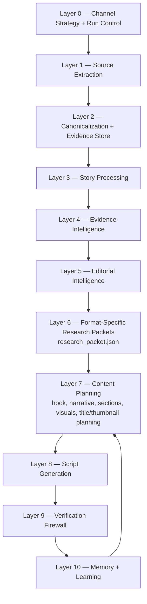
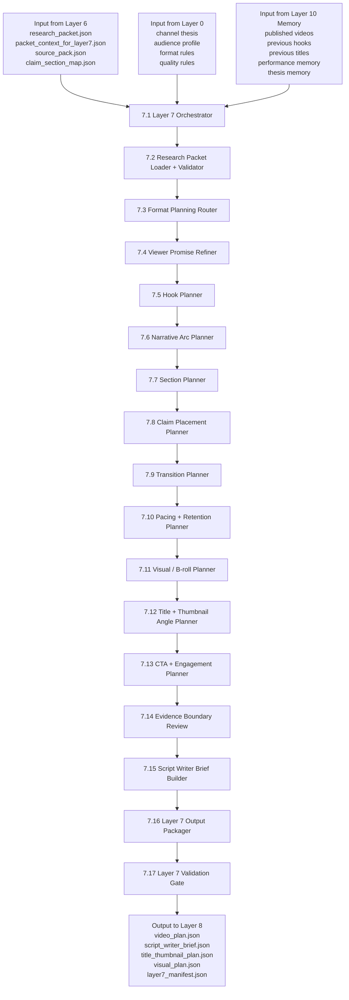

Absolutely — now we will design **Layer 7: Content Planning** in detail.

Up to Layer 6, the system has selected a video idea and created a clean, evidence-bounded research packet.

```text id="2yh1i2"
Layer 5 decided what video to make.
Layer 6 built the format-specific research packet.
Layer 7 now turns that packet into a video plan.
```

Layer 7 does **not** write the full script yet. It creates the **blueprint** for the script.

Your earlier design already had the idea of a YouTube script planner that outputs title options, hook, and sections like “What happened,” “Why it matters,” “Technical explanation,” “Business impact,” “Risks or criticism,” and “Final takeaway.” It also said the final system should produce title options, thumbnail ideas, hook, full script, source list, risk notes, description, and tags. Layer 7 is where the planning part of that output is created before the full script writer runs. 

---

# Layer 7 — Content Planning

## 1. Purpose of Layer 7

Layer 7 answers:

```text id="4vbrl8"
How should this video be structured before we write the script?
```

Layer 6 gives:

```text id="x1917w"
research_packet.json
source_pack.json
claim_section_map.json
packet_context_for_layer7.json
```

Layer 7 creates:

```text id="yj6j2n"
video_plan.json
hook_plan.json
section_plan.json
narrative_plan.json
title_thumbnail_plan.json
visual_plan.json
pacing_retention_plan.json
script_writer_brief.json
```

Layer 7 is the **video blueprint layer**.

It turns verified research into a clear plan for:

```text id="u0m8v9"
hook
opening structure
story flow
section order
section purpose
claim placement
viewer retention
transitions
visual/B-roll ideas
title and thumbnail angles
script writer instructions
```

---

# 2. Why Layer 7 is important

Without Layer 7, the system jumps from research packet directly to script writing.

That causes problems:

```text id="w4n0bn"
The script may have weak structure.
The hook may be boring or misleading.
The writer may introduce claims too early.
The video may lose audience retention.
The script may repeat previous angles.
The title may overpromise.
The final video may feel like a report, not a YouTube video.
```

Layer 7 prevents that by planning the video like a YouTuber:

```text id="zqatnp"
What should viewers care about first?
What question keeps them watching?
What order makes the story understandable?
Where should we place the strongest evidence?
Where should we explain background?
Where should we mention limitations?
Where should we avoid hype?
What should appear on screen?
```

Layer 7 is where the system becomes **content-native**, not just research-native.

---

# 3. What Layer 7 should do and not do

## Layer 7 should do

```text id="5jad4w"
Create hook options.
Create the narrative arc.
Create section-by-section plan.
Assign claims to sections.
Plan transitions.
Plan pacing and time budget.
Plan visual/B-roll ideas.
Generate title and thumbnail angle candidates.
Define retention strategy.
Prepare script writer brief for Layer 8.
Preserve evidence boundaries from Layer 6.
```

## Layer 7 should not do

```text id="xi395s"
It should not write the full script.
It should not invent new facts.
It should not add unsupported claims.
It should not override evidence boundaries.
It should not use do-not-use claims.
It should not create clickbait titles that distort evidence.
It should not make final publishing decisions.
```

Layer 7 can say:

```json id="dz14cu"
{
  "hook_type": "question_hook",
  "hook_direction": "Open with the gap between hype and actual evidence.",
  "allowed_claim_ids": ["claim_001", "claim_002"]
}
```

Layer 7 should not write:

```text id="x6k2kk"
“AI coding is officially dead because OpenAI just replaced developers.”
```

That would be a script claim and likely unsupported.

---

# 4. Where Layer 7 sits in the full architecture



Layer 7 receives research from Layer 6 and limited memory from Layer 10. It then creates the planning package that Layer 8 uses to write the actual script.

---

# 5. Layer wise architecture — Layer 7 internal architecture



---

# 6. Layer 7 input and output

## Layer 7 input

Layer 7 receives from Layer 6:

```text id="if6zk0"
research_packet.json
packet_context_for_layer7.json
source_pack.json
claim_section_map.json
evidence_boundary_report.json
packet_quality_report.json
layer6_manifest.json
```

Layer 7 receives from Layer 0:

```text id="v48f4l"
channel thesis
audience profile
tone rules
format rules
quality policy
output contract
```

Layer 7 optionally receives from Layer 10:

```text id="ptav7l"
published video memory
previous hooks
previous titles
previous thumbnails
performance memory
thesis memory
style memory
```

Example input:

```json id="10isw9"
{
  "run_id": "run_2026_05_10_48h_auto",
  "inputs": {
    "research_packet_path": "data/runs/run_2026_05_10_48h_auto/layer_6/research_packet.json",
    "packet_context_for_layer7_path": "data/runs/run_2026_05_10_48h_auto/layer_6/packet_context_for_layer7.json",
    "source_pack_path": "data/runs/run_2026_05_10_48h_auto/layer_6/source_pack.json",
    "claim_section_map_path": "data/runs/run_2026_05_10_48h_auto/layer_6/claim_section_map.json"
  },
  "channel_strategy": {
    "audience": "technical_but_accessible",
    "tone": "clear_analytical_evidence_first",
    "content_promise": "Explain important AI news with evidence, context, practical impact, and low hype."
  },
  "selected_packet": {
    "packet_type": "deep_dive",
    "central_viewer_question": "Does this actually change how developers use AI coding tools?",
    "viewer_promise": "Viewers will understand what changed, what is useful, and what is still hype."
  }
}
```

---

## Layer 7 output

Layer 7 produces:

```text id="3u7zot"
data/runs/{run_id}/layer_7/
  video_plan.json
  hook_plan.json
  narrative_plan.json
  section_plan.json
  claim_placement_plan.json
  pacing_retention_plan.json
  visual_plan.json
  title_thumbnail_plan.json
  script_writer_brief.json
  layer7_manifest.json
```

Main output summary:

```json id="xynbih"
{
  "run_id": "run_2026_05_10_48h_auto",
  "layer": "layer_7_content_planning",
  "status": "completed",
  "selected_format": "deep_dive",
  "video_plan_path": "data/runs/run_2026_05_10_48h_auto/layer_7/video_plan.json",
  "script_writer_brief_path": "data/runs/run_2026_05_10_48h_auto/layer_7/script_writer_brief.json",
  "ready_for_layer_8": true
}
```

---

# 7. Core Layer 7 data objects

Layer 7 should mainly produce:

```text id="25yxih"
VideoPlan
HookPlan
NarrativePlan
SectionPlan
ClaimPlacementPlan
PacingRetentionPlan
VisualPlan
TitleThumbnailPlan
ScriptWriterBrief
Layer7Manifest
```

---

# 8. Universal VideoPlan format

Every video format should produce a `video_plan.json` with a common outer structure.

```json id="44c01s"
{
  "video_plan_id": "video_plan_20260510_001",
  "run_id": "run_2026_05_10_48h_auto",
  "selected_video_id": "video_brief_20260510_001",

  "video_identity": {
    "selected_format": "deep_dive",
    "target_duration_minutes": 10,
    "primary_story_id": "story_001",
    "supporting_story_ids": []
  },

  "viewer_strategy": {
    "target_audience": "technical_but_accessible",
    "central_viewer_question": "Does this actually change how developers use AI coding tools?",
    "viewer_promise": "Viewers will understand what changed, what is useful, and what is still hype.",
    "tone": "clear, analytical, practical, evidence-first"
  },

  "hook_strategy": {
    "selected_hook_direction": "Open with the gap between hype and actual workflow impact.",
    "hook_type": "tension_question",
    "hook_claim_ids": ["claim_001", "claim_002"],
    "hook_risk_level": "low"
  },

  "narrative_strategy": {
    "narrative_arc": "what happened → what changed → why it matters → limitations → takeaway",
    "core_tension": "AI coding tools are being marketed as agents, but the real question is whether they change actual developer workflows."
  },

  "sections": [],

  "evidence_boundaries": {
    "safe_claim_ids": ["claim_001", "claim_002", "claim_003"],
    "cautious_claim_ids": ["claim_018"],
    "do_not_use_claim_ids": ["claim_099"]
  },

  "handoff": {
    "ready_for_layer_8": true,
    "next_layer": "layer_8_script_generation"
  }
}
```

The `sections` section changes based on the format.

---

# 9. Module-by-module Layer 7 design

---

## Module 7.1 — Layer 7 Orchestrator

### Purpose

Coordinate the entire content planning process.

### Why it matters

Layer 7 uses multiple planning modules: hook, narrative, section plan, pacing, visuals, titles, and script writer brief. The orchestrator ensures all these modules use the same packet and evidence boundaries.

### Questions it answers

```text id="77jd6h"
Which research packet should be planned?
What video format are we planning for?
Which planning modules should run?
Which memory files should be used?
Where should Layer 7 outputs be written?
Can Layer 8 start?
```

### Input

```json id="ac9jg4"
{
  "run_manifest_path": "data/runs/run_2026_05_10_48h_auto/run_manifest.json",
  "layer6_manifest_path": "data/runs/run_2026_05_10_48h_auto/layer_6/layer6_manifest.json",
  "research_packet_path": "data/runs/run_2026_05_10_48h_auto/layer_6/research_packet.json"
}
```

### Logic

```text id="nrg26r"
1. Load Layer 6 manifest.
2. Load research packet and packet_context_for_layer7.
3. Load channel thesis and audience profile from run manifest.
4. Load relevant memory if enabled.
5. Route to format-specific planning rules.
6. Run planning modules.
7. Validate evidence boundaries.
8. Write Layer 7 outputs.
```

### Output

```json id="zym02s"
{
  "run_id": "run_2026_05_10_48h_auto",
  "selected_format": "deep_dive",
  "planning_modules_executed": [
    "viewer_promise_refiner",
    "hook_planner",
    "narrative_arc_planner",
    "section_planner",
    "claim_placement_planner",
    "visual_planner",
    "title_thumbnail_planner"
  ],
  "status": "completed"
}
```

---

## Module 7.2 — Research Packet Loader + Validator

### Purpose

Load and validate the Layer 6 packet.

### Why it matters

Layer 7 should not plan from an incomplete or unsafe packet.

### Questions it answers

```text id="vpoic3"
Does research_packet.json exist?
Does the selected format match Layer 5?
Does the packet have safe claims?
Does it include evidence boundaries?
Does it include source pack and claim-section map?
Is the packet ready for planning?
```

### Input

```json id="n4sfyd"
{
  "research_packet_path": "data/runs/.../layer_6/research_packet.json",
  "packet_quality_report_path": "data/runs/.../layer_6/packet_quality_report.json"
}
```

### Logic

```text id="3ekebn"
1. Load research packet.
2. Validate packet_type.
3. Validate selected story IDs.
4. Validate safe/cautious/do-not-use claim boundaries.
5. Validate packet quality score.
6. Reject if not ready_for_layer_7.
```

### Output

```json id="agv3cr"
{
  "research_packet_id": "packet_20260510_001",
  "packet_type": "deep_dive",
  "selected_format": "deep_dive",
  "validation_status": "passed",
  "ready_for_planning": true
}
```

---

## Module 7.3 — Format Planning Router

### Purpose

Route planning logic based on selected video format.

### Why it matters

A roundup plan, deep-dive plan, evergreen plan, comparison plan, and follow-up plan need different structures.

### Questions it answers

```text id="t3aehj"
Which planning template should be used?
What section structure applies?
What pacing style applies?
What hook style is suitable?
What output fields are required?
```

### Input

```json id="4nq88u"
{
  "selected_format": "deep_dive",
  "packet_type": "deep_dive"
}
```

### Logic

```text id="1b5hkc"
if format == roundup → use roundup planning template
if format == deep_dive → use deep_dive planning template
if format == evergreen → use evergreen planning template
if format == comparison → use comparison planning template
if format == follow_up → use follow_up planning template
```

### Output

```json id="utdvg4"
{
  "planning_template": "deep_dive_planning_template",
  "required_sections": [
    "hook",
    "what_happened",
    "why_it_matters",
    "technical_context",
    "limitations",
    "final_takeaway"
  ],
  "target_duration_minutes": 10,
  "pacing_style": "medium"
}
```

---

## Module 7.4 — Viewer Promise Refiner

### Purpose

Refine Layer 5’s viewer promise into a clear planning statement.

### Why it matters

The viewer promise controls the whole video. It tells the script writer what the viewer should get by the end.

### Questions it answers

```text id="vtwfrl"
What exactly will viewers understand after watching?
What confusion are we solving?
What value are we giving?
Is the promise supported by evidence?
Is the promise too broad or clickbait?
```

### Input

```json id="o9zh9v"
{
  "viewer_promise": "Viewers will understand what changed, what is useful, and what is still hype.",
  "central_viewer_question": "Does this actually change how developers use AI coding tools?",
  "safe_claim_ids": ["claim_001", "claim_002"],
  "cautious_claim_ids": ["claim_018"]
}
```

### Logic

```text id="6hk7dn"
1. Check viewer promise against evidence boundaries.
2. Make the promise specific.
3. Remove overbroad language.
4. Ensure it matches audience profile.
5. Produce refined viewer promise and content contract.
```

### Output

```json id="4zcvdr"
{
  "viewer_strategy": {
    "central_viewer_question": "Does this actually change how developers use AI coding tools?",
    "refined_viewer_promise": "By the end, viewers will know what was announced, what it may change in coding workflows, and which claims are still not proven.",
    "viewer_payoff": [
      "understand the announcement",
      "understand practical developer relevance",
      "separate evidence from hype"
    ],
    "promise_risk_level": "low"
  }
}
```

---

## Module 7.5 — Hook Planner

### Purpose

Plan the opening hook.

### Why it matters

The hook determines whether viewers continue watching.

The hook should create curiosity without overclaiming.

### Questions it answers

```text id="gn9bn8"
What should the first 15–30 seconds do?
Should we open with tension, question, surprise, contrast, or direct value?
Which evidence can support the hook?
What should we avoid saying?
```

### Hook types

```text id="1gudxe"
question_hook
tension_hook
contrast_hook
myth_vs_reality_hook
timeline_hook
stakes_hook
practical_value_hook
roundup_speed_hook
follow_up_hook
comparison_hook
```

### Input

```json id="8m4fwl"
{
  "selected_format": "deep_dive",
  "central_viewer_question": "Does this actually change how developers use AI coding tools?",
  "viewer_promise": "Separate evidence from hype.",
  "safe_claim_ids": ["claim_001", "claim_002"],
  "cautious_claim_ids": ["claim_018"],
  "do_not_use_claim_ids": ["claim_099"]
}
```

### Logic

```text id="finl1d"
1. Identify core tension from research packet.
2. Generate 3–5 hook directions, not full script.
3. Check each hook against evidence boundaries.
4. Reject hooks that require do-not-use claims.
5. Score hooks by clarity, curiosity, accuracy, and retention.
6. Select recommended hook direction.
```

### Output

```json id="dsa8jf"
{
  "hook_plan": {
    "recommended_hook": {
      "hook_type": "tension_question",
      "hook_direction": "Open with the question: are AI coding tools really becoming workflow agents, or is this just another feature update?",
      "supported_by_claim_ids": ["claim_001", "claim_002"],
      "cautious_claim_ids": ["claim_018"],
      "risk_level": "low",
      "why_it_works": "It creates curiosity while staying within the evidence boundaries."
    },
    "alternative_hooks": [
      {
        "hook_type": "myth_vs_reality",
        "hook_direction": "Start by contrasting the hype around AI agents with what the sources actually show.",
        "risk_level": "low"
      }
    ],
    "blocked_hook_angles": [
      {
        "angle": "AI will replace developers",
        "reason": "Uses do-not-use claim and unsupported prediction."
      }
    ]
  }
}
```

---

## Module 7.6 — Narrative Arc Planner

### Purpose

Plan the story flow.

### Why it matters

A good YouTube video is not just a list of facts. It has a logical journey.

For example:

```text id="5kzm61"
what happened → why viewers should care → what changed → what is still unclear → final takeaway
```

### Questions it answers

```text id="p9j4ew"
What is the best order of ideas?
Where should the strongest point appear?
Where should background be introduced?
Where should limitations be mentioned?
How do we maintain curiosity until the end?
```

### Input

```json id="boye1f"
{
  "packet_type": "deep_dive",
  "research_sections": [
    "what_happened",
    "why_it_matters",
    "technical_context",
    "limitations",
    "final_takeaway"
  ],
  "viewer_strategy": {},
  "hook_plan": {}
}
```

### Logic

```text id="v90gwt"
1. Select narrative arc template based on format.
2. Place hook before background.
3. Place core fact early.
4. Place deeper context after viewer stakes are clear.
5. Place limitations before final takeaway.
6. Add retention callbacks.
7. Preserve evidence boundaries.
```

### Output

```json id="ya5m0z"
{
  "narrative_plan": {
    "narrative_arc": "tension → factual announcement → practical meaning → deeper context → limitations → takeaway",
    "core_tension": "The announcement sounds like an AI agent story, but the practical question is whether it actually changes coding workflows.",
    "story_flow": [
      {
        "order": 1,
        "stage": "hook",
        "purpose": "Create curiosity and set evidence-first tone."
      },
      {
        "order": 2,
        "stage": "what_happened",
        "purpose": "State the verified announcement."
      },
      {
        "order": 3,
        "stage": "why_it_matters",
        "purpose": "Connect the facts to developer workflow relevance."
      },
      {
        "order": 4,
        "stage": "technical_context",
        "purpose": "Explain what changed without overhyping."
      },
      {
        "order": 5,
        "stage": "limitations",
        "purpose": "Clarify what is not proven yet."
      },
      {
        "order": 6,
        "stage": "final_takeaway",
        "purpose": "Give viewers a balanced conclusion."
      }
    ]
  }
}
```

---

## Module 7.7 — Section Planner

### Purpose

Create the section-by-section video structure.

### Why it matters

Layer 8 script writer needs clear instructions for each section.

### Questions it answers

```text id="ymlgm8"
What sections should the video have?
What is the purpose of each section?
How long should each section be?
Which claims belong in each section?
What should each section avoid?
```

### Input

```json id="cai9kr"
{
  "selected_format": "deep_dive",
  "narrative_plan": {},
  "claim_section_map": "data/runs/.../claim_section_map.json",
  "target_duration_minutes": 10
}
```

### Logic

```text id="s7s0wu"
1. Load format-specific required sections.
2. Use narrative arc to order sections.
3. Assign target duration per section.
4. Attach section goals.
5. Attach required and optional claim IDs.
6. Add cautions and blocked claims per section.
```

### Output

```json id="iyd7o3"
{
  "section_plan": [
    {
      "section_id": "sec_001",
      "section_key": "hook",
      "section_title": "The real question behind the announcement",
      "target_duration_seconds": 35,
      "section_goal": "Create curiosity without overclaiming.",
      "required_claim_ids": ["claim_001"],
      "optional_claim_ids": [],
      "cautious_claim_ids": [],
      "do_not_use_claim_ids": ["claim_099"],
      "writer_instructions": [
        "Open with the central viewer question.",
        "Do not claim this replaces developers.",
        "Promise an evidence-first breakdown."
      ]
    },
    {
      "section_id": "sec_002",
      "section_key": "what_happened",
      "section_title": "What was actually announced",
      "target_duration_seconds": 90,
      "section_goal": "Explain the verified announcement clearly.",
      "required_claim_ids": ["claim_001", "claim_002"],
      "optional_claim_ids": ["claim_003"],
      "writer_instructions": [
        "Use direct factual language.",
        "Mention source-backed facts only."
      ]
    }
  ]
}
```

---

## Module 7.8 — Claim Placement Planner

### Purpose

Decide exactly where claims should be used in the video plan.

### Why it matters

A verified claim can still be placed badly. For example, a limitation claim should not appear as a hook unless the video is framed around uncertainty.

### Questions it answers

```text id="7tt8bs"
Which claims are required?
Which claims are optional?
Which claims should appear early?
Which claims should be saved for later?
Which claims support the final takeaway?
Which cautious claims need specific wording?
```

### Input

```json id="vjal9z"
{
  "section_plan": [],
  "verified_claims": [],
  "claim_section_map": []
}
```

### Logic

```text id="pvg84e"
1. Load claim-section map from Layer 6.
2. Cross-check against section plan.
3. Mark each claim:
   - required
   - optional
   - background
   - limitation
   - transition-supporting
   - final-takeaway-supporting
4. Attach recommended wording if available.
5. Preserve cautious language requirements.
```

### Output

```json id="mvf0qm"
{
  "claim_placement_plan": [
    {
      "claim_id": "claim_001",
      "claim_text": "OpenAI announced a coding-related product update.",
      "placement": {
        "section_id": "sec_002",
        "section_key": "what_happened",
        "placement_type": "required_core_fact",
        "should_appear_before": ["claim_018"],
        "recommended_wording": "OpenAI announced a coding-related update..."
      }
    },
    {
      "claim_id": "claim_018",
      "claim_text": "The update may affect developer workflows.",
      "placement": {
        "section_id": "sec_004",
        "section_key": "why_it_matters",
        "placement_type": "cautious_interpretation",
        "required_language": "Use may/could/suggests. Do not say will."
      }
    }
  ]
}
```

---

## Module 7.9 — Transition Planner

### Purpose

Plan transitions between sections or stories.

### Why it matters

Transitions make a video feel coherent instead of like disconnected bullet points.

### Questions it answers

```text id="5ja3w2"
How do we move from hook to facts?
How do we move from what happened to why it matters?
How do we move from one roundup story to the next?
How do we transition into limitations without killing momentum?
```

### Input

```json id="cn103o"
{
  "selected_format": "deep_dive",
  "section_plan": [],
  "narrative_plan": {}
}
```

### Logic

```text id="6ckeqd"
1. Identify section sequence.
2. Create transition purpose for each gap.
3. For roundup, create story-to-story transition logic.
4. For deep dive, create question-based transitions.
5. Avoid adding new factual claims in transitions unless supported.
```

### Output

```json id="vdfh6s"
{
  "transition_plan": [
    {
      "from_section_id": "sec_001",
      "to_section_id": "sec_002",
      "transition_purpose": "Move from the central question into the verified announcement.",
      "transition_direction": "After asking whether this is hype or real workflow change, explain what was actually announced.",
      "allowed_claim_ids": ["claim_001"]
    },
    {
      "from_section_id": "sec_004",
      "to_section_id": "sec_005",
      "transition_purpose": "Move from potential impact to limitations.",
      "transition_direction": "After explaining why this could matter, clarify what the evidence does not yet prove."
    }
  ]
}
```

---

## Module 7.10 — Pacing + Retention Planner

### Purpose

Plan pacing, time budget, and retention moments.

### Why it matters

A technically correct video can still fail if it is slow, repetitive, or front-loaded with background.

### Questions it answers

```text id="hab2tm"
How long should the video be?
How much time should each section get?
Where should curiosity loops appear?
Where should the strongest insight appear?
Where should we prevent drop-off?
```

### Input

```json id="c78t72"
{
  "selected_format": "deep_dive",
  "target_duration_minutes": 10,
  "section_plan": [],
  "viewer_promise": "Understand what changed and what is still hype."
}
```

### Logic

```text id="u8p3by"
1. Assign total target duration.
2. Allocate section durations.
3. Add retention beat every 60–120 seconds.
4. Add pattern interrupts:
   - quick example
   - visual change
   - question
   - contrast
   - limitation
5. Avoid long background before viewer stakes are clear.
```

### Output

```json id="6t2zhb"
{
  "pacing_retention_plan": {
    "target_duration_seconds": 600,
    "section_time_budget": [
      {
        "section_id": "sec_001",
        "target_duration_seconds": 35
      },
      {
        "section_id": "sec_002",
        "target_duration_seconds": 90
      },
      {
        "section_id": "sec_003",
        "target_duration_seconds": 120
      }
    ],
    "retention_beats": [
      {
        "timestamp_target": "00:30",
        "beat_type": "viewer_promise",
        "instruction": "Tell viewers the video will separate evidence from hype."
      },
      {
        "timestamp_target": "02:00",
        "beat_type": "curiosity_loop",
        "instruction": "Tease that the biggest change is not the feature itself, but the workflow shift."
      },
      {
        "timestamp_target": "06:30",
        "beat_type": "limitation_turn",
        "instruction": "Introduce what is still not proven."
      }
    ]
  }
}
```

---

## Module 7.11 — Visual / B-roll Planner

### Purpose

Plan what should appear visually during the video.

### Why it matters

For YouTube, visuals improve clarity and retention. Even if the current system only creates scripts, planning visuals helps later video production.

### Questions it answers

```text id="l493gv"
What should be shown on screen?
Where should source screenshots appear?
Where should diagrams, timelines, or comparison tables appear?
What B-roll supports each section?
What visual proof should accompany claims?
```

### Input

```json id="etxnp5"
{
  "section_plan": [],
  "source_pack": {},
  "story_timeline": {},
  "selected_format": "deep_dive"
}
```

### Logic

```text id="h0p3ae"
1. For official announcement claims, suggest source screenshot.
2. For timeline sections, suggest timeline visual.
3. For comparisons, suggest comparison table.
4. For technical explanation, suggest simple diagram.
5. For limitations, suggest warning/caution card.
6. Link visuals to claim IDs and source refs.
```

### Output

```json id="dycccz"
{
  "visual_plan": [
    {
      "visual_id": "vis_001",
      "section_id": "sec_002",
      "visual_type": "source_screenshot",
      "visual_goal": "Show the official announcement headline.",
      "source_ref_id": "source_001",
      "claim_ids": ["claim_001"],
      "on_screen_text": "Official announcement",
      "notes": "Use only screenshot/title area; avoid clutter."
    },
    {
      "visual_id": "vis_002",
      "section_id": "sec_004",
      "visual_type": "simple_diagram",
      "visual_goal": "Explain the shift from autocomplete to workflow assistance.",
      "claim_ids": ["claim_003", "claim_018"],
      "diagram_idea": "Old flow: prompt → code suggestion. New flow: task → code edit → review → test."
    }
  ]
}
```

---

## Module 7.12 — Title + Thumbnail Angle Planner

### Purpose

Plan title and thumbnail angles.

### Why it matters

Title and thumbnail determine whether people click, but they must not distort evidence.

Layer 7 should generate **angles**, not necessarily final title copy. Layer 8 or a later packaging module can refine them.

### Questions it answers

```text id="o77h1f"
What is the clickable but accurate angle?
What is the central curiosity?
What should thumbnail text focus on?
Which title angles are risky or unsupported?
```

### Input

```json id="3nxd8h"
{
  "selected_format": "deep_dive",
  "viewer_promise": "Separate evidence from hype.",
  "central_viewer_question": "Does this actually change how developers use AI coding tools?",
  "safe_claim_ids": ["claim_001", "claim_002"],
  "do_not_use_claim_ids": ["claim_099"],
  "memory": {
    "previous_titles": []
  }
}
```

### Logic

```text id="ae4l9z"
1. Generate title angle categories:
   - question
   - what_changed
   - hype_vs_reality
   - practical_impact
   - trend_shift
2. Generate 5–10 title options.
3. Generate thumbnail text options, 2–5 words each.
4. Score by click potential, accuracy, novelty, and risk.
5. Reject titles that require unsupported claims.
6. Check similarity against previous titles.
```

### Output

```json id="vkemqt"
{
  "title_thumbnail_plan": {
    "recommended_title_angles": [
      {
        "title": "AI Coding Tools Are Moving Past Autocomplete",
        "angle_type": "trend_shift",
        "accuracy_risk": "low",
        "click_potential": "medium_high",
        "supported_by_claim_ids": ["claim_001", "claim_002"]
      },
      {
        "title": "Is This the Real Start of AI Coding Agents?",
        "angle_type": "question",
        "accuracy_risk": "medium",
        "required_caution": "The script must clarify what is and is not proven."
      }
    ],
    "thumbnail_text_options": [
      {
        "text": "AI CODING SHIFT",
        "risk": "low"
      },
      {
        "text": "NOT JUST AUTOCOMPLETE",
        "risk": "low"
      },
      {
        "text": "AGENTS NOW?",
        "risk": "medium"
      }
    ],
    "blocked_title_angles": [
      {
        "title": "AI Replaced Developers Overnight",
        "reason": "Unsupported and uses do-not-use claim."
      }
    ]
  }
}
```

---

## Module 7.13 — CTA + Engagement Planner

### Purpose

Plan calls-to-action and engagement prompts.

### Why it matters

A YouTube video should include natural engagement prompts, but they should not interrupt the flow.

### Questions it answers

```text id="l07kze"
Where should the video ask for comments?
What question should viewers answer?
Should there be a subscribe CTA?
Should the CTA be tied to the topic?
```

### Input

```json id="qnwh42"
{
  "selected_format": "deep_dive",
  "central_viewer_question": "Does this actually change how developers use AI coding tools?",
  "audience": "technical_but_accessible"
}
```

### Logic

```text id="jmka58"
1. Create one topic-relevant comment prompt.
2. Place CTA after value is delivered, not at the very start.
3. Avoid generic spammy CTA.
4. For roundup, use end-of-video comment prompt.
5. For deep dive, use mid/end prompt tied to viewer opinion.
```

### Output

```json id="hjykwj"
{
  "cta_plan": {
    "comment_prompt": "Do you think AI coding tools are becoming true workflow agents, or are they still mostly advanced autocomplete?",
    "subscribe_cta_timing": "near_end",
    "cta_style": "natural_topic_based",
    "avoid": [
      "Interrupting the first 30 seconds with subscribe request."
    ]
  }
}
```

---

## Module 7.14 — Evidence Boundary Review

### Purpose

Review the entire video plan against the evidence boundaries from Layer 6.

### Why it matters

Planning itself can accidentally introduce overclaims. This module catches that before script writing.

### Questions it answers

```text id="btb1al"
Does any section plan require unsupported claims?
Did any do-not-use claim appear?
Are cautious claims marked properly?
Are title options evidence-safe?
Are visual plans tied to real sources?
```

### Input

```json id="5snvvf"
{
  "video_plan": {},
  "hook_plan": {},
  "title_thumbnail_plan": {},
  "evidence_boundaries": {
    "safe_claim_ids": ["claim_001"],
    "cautious_claim_ids": ["claim_018"],
    "do_not_use_claim_ids": ["claim_099"]
  }
}
```

### Logic

```text id="z5xt9q"
1. Scan section plan claim IDs.
2. Scan hook plan claim IDs.
3. Scan title/thumbnail plan for risky unsupported language.
4. Check all cautious claims have guidance.
5. Check do-not-use claims are only in blocked/avoid sections.
6. Produce boundary review.
```

### Output

```json id="m5fkg6"
{
  "evidence_boundary_review": {
    "status": "passed",
    "safe_claim_ids_used": ["claim_001", "claim_002"],
    "cautious_claim_ids_used": ["claim_018"],
    "do_not_use_claim_ids_used": [],
    "warnings": [
      {
        "type": "medium_risk_title",
        "title": "Is This the Real Start of AI Coding Agents?",
        "required_script_handling": "Clarify uncertainty early."
      }
    ],
    "errors": []
  }
}
```

---

## Module 7.15 — Script Writer Brief Builder

### Purpose

Create a clean, structured brief for Layer 8.

### Why it matters

Layer 8 should not need to read all Layer 7 files manually. It should receive one `script_writer_brief.json`.

This brief tells the writer:

```text id="738abz"
what to write
what format to use
what sections to follow
what claims are allowed
what claims are cautious
what claims are blocked
what title/hook direction to use
what tone to use
what visuals to reference
```

### Input

```json id="bvkwxu"
{
  "video_plan": {},
  "section_plan": {},
  "claim_placement_plan": {},
  "visual_plan": {},
  "title_thumbnail_plan": {},
  "evidence_boundary_review": {}
}
```

### Output

```json id="errqio"
{
  "script_writer_brief": {
    "brief_id": "script_brief_20260510_001",
    "selected_format": "deep_dive",
    "target_duration_minutes": 10,
    "target_audience": "technical_but_accessible",
    "tone": "clear, analytical, practical, evidence-first",

    "central_viewer_question": "Does this actually change how developers use AI coding tools?",
    "viewer_promise": "By the end, viewers will know what was announced, what it may change, and what is still not proven.",

    "hook_instruction": {
      "hook_type": "tension_question",
      "direction": "Open with the difference between AI-agent hype and source-backed workflow changes.",
      "allowed_claim_ids": ["claim_001", "claim_002"]
    },

    "sections": [
      {
        "section_id": "sec_001",
        "section_key": "hook",
        "section_goal": "Create curiosity and set evidence-first tone.",
        "target_duration_seconds": 35,
        "required_claim_ids": ["claim_001"],
        "writer_instructions": [
          "Do not overclaim.",
          "Promise an evidence-based breakdown."
        ]
      },
      {
        "section_id": "sec_002",
        "section_key": "what_happened",
        "section_goal": "Explain the verified announcement.",
        "target_duration_seconds": 90,
        "required_claim_ids": ["claim_001", "claim_002"]
      }
    ],

    "evidence_rules": {
      "safe_claim_ids": ["claim_001", "claim_002", "claim_003"],
      "cautious_claim_ids": ["claim_018"],
      "do_not_use_claim_ids": ["claim_099"],
      "blocked_phrases": [
        "will replace developers",
        "guaranteed to dominate",
        "proves the end of coding"
      ]
    },

    "visual_notes": [
      {
        "section_id": "sec_002",
        "visual_type": "source_screenshot",
        "source_ref_id": "source_001"
      }
    ],

    "handoff": {
      "ready_for_layer_8": true
    }
  }
}
```

---

## Module 7.16 — Layer 7 Output Packager

### Purpose

Write all Layer 7 output files.

### Output files

```text id="3r1rew"
video_plan.json
hook_plan.json
narrative_plan.json
section_plan.json
claim_placement_plan.json
transition_plan.json
pacing_retention_plan.json
visual_plan.json
title_thumbnail_plan.json
cta_plan.json
evidence_boundary_review.json
script_writer_brief.json
layer7_manifest.json
```

### Output example

```json id="xz6si4"
{
  "run_id": "run_2026_05_10_48h_auto",
  "outputs": {
    "video_plan": "data/runs/run_2026_05_10_48h_auto/layer_7/video_plan.json",
    "script_writer_brief": "data/runs/run_2026_05_10_48h_auto/layer_7/script_writer_brief.json",
    "title_thumbnail_plan": "data/runs/run_2026_05_10_48h_auto/layer_7/title_thumbnail_plan.json",
    "visual_plan": "data/runs/run_2026_05_10_48h_auto/layer_7/visual_plan.json"
  }
}
```

---

## Module 7.17 — Layer 7 Validation Gate

### Purpose

Validate that the video plan is ready for script generation.

### Why it matters

Layer 8 should only write from a plan that has sections, claims, evidence rules, and no unsupported overclaims.

### Validation rules

Layer 7 passes if:

```text id="8s4tgk"
video_plan.json exists.
script_writer_brief.json exists.
selected format matches Layer 6 packet type.
every section has a section goal.
every section has target duration.
required sections exist for the selected format.
every required claim ID exists in Layer 6 claim map.
no do-not-use claim appears as allowed evidence.
cautious claims include cautious wording guidance.
hook plan exists.
title/thumbnail plan exists.
visual plan exists or is explicitly marked optional.
evidence boundary review passes.
```

### Output

```json id="77n5ax"
{
  "validation_status": "passed",
  "ready_for_layer_8": true,
  "warnings": [
    {
      "type": "medium_risk_title_angle",
      "message": "One title angle uses a question about AI agents; script must clarify uncertainty early."
    }
  ],
  "errors": []
}
```

---

# 10. Format-specific planning rules

Layer 7 must plan differently based on selected format.

---

## 10A. Roundup planning

### Purpose

Plan a fast, multi-story video.

### Required sections

```text id="swznuu"
intro_hook
story_1
story_2
story_3
story_4
story_5
optional_extra_story
final_takeaway
cta
```

### Roundup planning logic

```text id="miosrm"
1. Start with episode theme.
2. Lead with the strongest/highest-impact story.
3. Keep each story compact.
4. Use 2–4 verified claims per story.
5. Use simple transitions.
6. End with the common pattern across the stories.
```

### Example output

```json id="h8v1fr"
{
  "selected_format": "roundup",
  "section_plan": [
    {
      "section_key": "intro_hook",
      "target_duration_seconds": 35,
      "goal": "Preview the most important AI updates without listing everything."
    },
    {
      "section_key": "story_1",
      "story_id": "story_001",
      "target_duration_seconds": 100,
      "goal": "Explain the lead story and why it matters.",
      "required_claim_ids": ["claim_001", "claim_002"]
    },
    {
      "section_key": "story_2",
      "story_id": "story_002",
      "target_duration_seconds": 80,
      "goal": "Explain the second major update."
    }
  ]
}
```

---

## 10B. Deep dive planning

### Purpose

Plan one focused analysis video.

### Required sections

```text id="0emx0x"
hook
what_happened
why_it_matters
background_context
technical_or_practical_explanation
limitations_or_counterpoints
final_takeaway
cta
```

### Deep-dive planning logic

```text id="nfq7yi"
1. Start with central viewer question.
2. State verified facts early.
3. Explain background only after stakes are clear.
4. Use middle section for deeper analysis.
5. Include limitations before conclusion.
6. End with balanced takeaway.
```

---

## 10C. Evergreen planning

### Purpose

Plan a durable educational video.

### Required sections

```text id="mcmp7k"
hook_problem
simple_definition
why_it_matters
how_it_works
real_examples
common_misconceptions
practical_takeaway
cta
```

### Evergreen planning logic

```text id="i912o9"
1. Avoid over-focusing on breaking news.
2. Use recent stories as examples, not the whole video.
3. Use stable claims and memory.
4. Make definitions clear but not overabsolute.
5. End with practical understanding.
```

---

## 10D. Comparison planning

### Purpose

Plan a fair comparison video.

### Required sections

```text id="lujhod"
hook
comparison_scope
subjects_intro
dimension_1
dimension_2
dimension_3
evidence_gaps
practical_recommendation
cta
```

### Comparison planning logic

```text id="tv9p8v"
1. Define comparison scope.
2. Explain what is and is not being compared.
3. Use same dimensions for each subject.
4. Show evidence gaps.
5. Avoid final ranking unless evidence is balanced.
```

---

## 10E. Follow-up planning

### Purpose

Plan an update video connected to previous coverage.

### Required sections

```text id="0xwrrg"
previous_context
what_changed
new_evidence
what_this_updates
what_is_still_unclear
final_takeaway
cta
```

### Follow-up planning logic

```text id="bovhlw"
1. Briefly remind viewers of previous video.
2. Do not repeat the full old explanation.
3. Focus on what changed.
4. Explain whether previous thesis is confirmed, expanded, or challenged.
5. Add follow-up memory references.
```

---

# 11. Layer 7 output files in detail

## 11.1 `video_plan.json`

```json id="me6bl0"
{
  "video_plan_id": "video_plan_20260510_001",
  "run_id": "run_2026_05_10_48h_auto",
  "selected_format": "deep_dive",
  "target_duration_minutes": 10,
  "viewer_strategy": {},
  "hook_strategy": {},
  "narrative_strategy": {},
  "sections": [],
  "evidence_boundaries": {},
  "ready_for_layer_8": true
}
```

---

## 11.2 `hook_plan.json`

```json id="kb6rf7"
{
  "run_id": "run_2026_05_10_48h_auto",
  "hook_plan": {
    "recommended_hook": {
      "hook_type": "tension_question",
      "hook_direction": "Open with the gap between AI-agent hype and actual workflow impact.",
      "supported_by_claim_ids": ["claim_001", "claim_002"],
      "risk_level": "low"
    },
    "blocked_hook_angles": []
  }
}
```

---

## 11.3 `narrative_plan.json`

```json id="ol156r"
{
  "narrative_arc": "tension → factual announcement → practical meaning → context → limitations → takeaway",
  "core_tension": "The announcement sounds like an AI agent story, but the practical question is whether it changes developer workflows.",
  "story_flow": []
}
```

---

## 11.4 `section_plan.json`

```json id="w2ao5w"
{
  "sections": [
    {
      "section_id": "sec_001",
      "section_key": "hook",
      "section_title": "The real question behind the announcement",
      "target_duration_seconds": 35,
      "section_goal": "Create curiosity without overclaiming.",
      "required_claim_ids": ["claim_001"],
      "writer_instructions": []
    }
  ]
}
```

---

## 11.5 `claim_placement_plan.json`

```json id="h5xy6i"
{
  "claim_placement_plan": [
    {
      "claim_id": "claim_001",
      "section_id": "sec_002",
      "placement_type": "required_core_fact",
      "recommended_wording": "OpenAI announced a coding-related update..."
    }
  ]
}
```

---

## 11.6 `pacing_retention_plan.json`

```json id="kgyaxh"
{
  "target_duration_seconds": 600,
  "retention_beats": [
    {
      "timestamp_target": "00:30",
      "beat_type": "viewer_promise",
      "instruction": "Tell viewers the video will separate evidence from hype."
    }
  ]
}
```

---

## 11.7 `visual_plan.json`

```json id="hha6wg"
{
  "visual_plan": [
    {
      "visual_id": "vis_001",
      "section_id": "sec_002",
      "visual_type": "source_screenshot",
      "visual_goal": "Show official announcement headline.",
      "source_ref_id": "source_001",
      "claim_ids": ["claim_001"]
    }
  ]
}
```

---

## 11.8 `title_thumbnail_plan.json`

```json id="4ylgst"
{
  "recommended_title_angles": [
    {
      "title": "AI Coding Tools Are Moving Past Autocomplete",
      "angle_type": "trend_shift",
      "accuracy_risk": "low",
      "click_potential": "medium_high",
      "supported_by_claim_ids": ["claim_001", "claim_002"]
    }
  ],
  "thumbnail_text_options": [
    {
      "text": "AI CODING SHIFT",
      "risk": "low"
    }
  ],
  "blocked_title_angles": []
}
```

---

## 11.9 `script_writer_brief.json`

```json id="fkdltb"
{
  "brief_id": "script_brief_20260510_001",
  "selected_format": "deep_dive",
  "target_duration_minutes": 10,
  "target_audience": "technical_but_accessible",
  "tone": "clear, analytical, practical, evidence-first",
  "central_viewer_question": "Does this actually change how developers use AI coding tools?",
  "viewer_promise": "By the end, viewers will know what was announced, what it may change, and what is still not proven.",
  "sections": [],
  "evidence_rules": {
    "safe_claim_ids": [],
    "cautious_claim_ids": [],
    "do_not_use_claim_ids": []
  },
  "handoff": {
    "ready_for_layer_8": true
  }
}
```

---

## 11.10 `layer7_manifest.json`

```json id="1jlsq1"
{
  "run_id": "run_2026_05_10_48h_auto",
  "layer": "layer_7_content_planning",
  "created_at": "2026-05-10T11:40:00Z",

  "inputs": {
    "run_manifest": "data/runs/run_2026_05_10_48h_auto/run_manifest.json",
    "layer6_manifest": "data/runs/run_2026_05_10_48h_auto/layer_6/layer6_manifest.json",
    "research_packet": "data/runs/run_2026_05_10_48h_auto/layer_6/research_packet.json",
    "source_pack": "data/runs/run_2026_05_10_48h_auto/layer_6/source_pack.json",
    "claim_section_map": "data/runs/run_2026_05_10_48h_auto/layer_6/claim_section_map.json"
  },

  "outputs": {
    "video_plan": "data/runs/run_2026_05_10_48h_auto/layer_7/video_plan.json",
    "hook_plan": "data/runs/run_2026_05_10_48h_auto/layer_7/hook_plan.json",
    "narrative_plan": "data/runs/run_2026_05_10_48h_auto/layer_7/narrative_plan.json",
    "section_plan": "data/runs/run_2026_05_10_48h_auto/layer_7/section_plan.json",
    "claim_placement_plan": "data/runs/run_2026_05_10_48h_auto/layer_7/claim_placement_plan.json",
    "pacing_retention_plan": "data/runs/run_2026_05_10_48h_auto/layer_7/pacing_retention_plan.json",
    "visual_plan": "data/runs/run_2026_05_10_48h_auto/layer_7/visual_plan.json",
    "title_thumbnail_plan": "data/runs/run_2026_05_10_48h_auto/layer_7/title_thumbnail_plan.json",
    "script_writer_brief": "data/runs/run_2026_05_10_48h_auto/layer_7/script_writer_brief.json"
  },

  "planning_summary": {
    "selected_format": "deep_dive",
    "section_count": 7,
    "target_duration_minutes": 10,
    "title_options_count": 8,
    "visual_suggestions_count": 9
  },

  "handoff": {
    "ready_for_layer_8": true,
    "next_layer": "layer_8_script_generation"
  }
}
```

---

# 12. Layer 7 config files

Layer 7 should be config-driven.

```text id="k1h3wh"
config/
  content_planning_rules.yaml
  hook_rules.yaml
  narrative_templates.yaml
  section_templates.yaml
  pacing_rules.yaml
  title_thumbnail_rules.yaml
  visual_planning_rules.yaml
  script_brief_rules.yaml
```

---

## `content_planning_rules.yaml`

```yaml id="w2k4qs"
content_planning:
  require_viewer_promise: true
  require_hook_plan: true
  require_section_plan: true
  require_claim_placement_plan: true
  require_evidence_boundary_review: true
  require_script_writer_brief: true

  block_if:
    do_not_use_claim_in_allowed_claims: true
    missing_required_sections: true
    unsupported_title_angle: true
```

---

## `hook_rules.yaml`

```yaml id="tj8pxf"
hook_rules:
  allowed_hook_types:
    - question_hook
    - tension_hook
    - contrast_hook
    - myth_vs_reality_hook
    - practical_value_hook
    - roundup_speed_hook
    - follow_up_hook
    - comparison_hook

  max_hook_duration_seconds:
    roundup: 30
    deep_dive: 45
    evergreen: 45
    comparison: 45
    follow_up: 35

  block:
    - unsupported_predictions
    - exaggerated_replacement_claims
    - fake_urgency
    - claims_without_claim_ids
```

---

## `section_templates.yaml`

```yaml id="8kk0e7"
section_templates:
  roundup:
    sections:
      - intro_hook
      - story_segments
      - final_takeaway
      - cta

  deep_dive:
    sections:
      - hook
      - what_happened
      - why_it_matters
      - background_context
      - technical_or_practical_explanation
      - limitations_or_counterpoints
      - final_takeaway
      - cta

  evergreen:
    sections:
      - hook_problem
      - simple_definition
      - why_it_matters
      - how_it_works
      - examples
      - misconceptions
      - practical_takeaway
      - cta

  comparison:
    sections:
      - hook
      - comparison_scope
      - subjects_intro
      - comparison_dimensions
      - evidence_gaps
      - practical_recommendation
      - cta

  follow_up:
    sections:
      - previous_context
      - what_changed
      - new_evidence
      - what_this_updates
      - still_unclear
      - final_takeaway
      - cta
```

---

## `pacing_rules.yaml`

```yaml id="bh4jzk"
pacing:
  target_duration_seconds:
    roundup: 480
    deep_dive: 600
    evergreen: 720
    comparison: 720
    follow_up: 480

  retention_beat_interval_seconds:
    roundup: 60
    deep_dive: 90
    evergreen: 90
    comparison: 90
    follow_up: 75

  avoid:
    - long_background_before_stakes
    - more_than_3_minutes_without_new_point
    - repeating_same_claim
```

---

## `title_thumbnail_rules.yaml`

```yaml id="344eyj"
title_thumbnail:
  title_count: 8
  thumbnail_text_count: 5
  max_thumbnail_words: 4

  allowed_angle_types:
    - what_changed
    - question
    - hype_vs_reality
    - practical_impact
    - trend_shift
    - comparison
    - follow_up

  block:
    - unsupported_superlatives
    - fake_certainty
    - panic_language
    - accusation_without_source
```

---

## `visual_planning_rules.yaml`

```yaml id="x1r85f"
visual_planning:
  suggest_visuals: true

  visual_types:
    - source_screenshot
    - timeline
    - simple_diagram
    - comparison_table
    - quote_card
    - caution_card
    - product_ui_reference
    - paper_abstract_screenshot
    - github_repo_screenshot

  require_claim_link_for_source_visuals: true
```

---

# 13. Suggested Layer 7 folder structure

```text id="y73bkx"
pipelines/
  layer_7_content_planning/
    __init__.py
    run_layer_7.py

    orchestrator/
      layer7_orchestrator.py

    loaders/
      research_packet_loader.py
      packet_context_loader.py
      memory_style_loader.py

    routing/
      format_planning_router.py

    planning/
      viewer_promise_refiner.py
      hook_planner.py
      narrative_arc_planner.py
      section_planner.py
      claim_placement_planner.py
      transition_planner.py
      pacing_retention_planner.py
      visual_broll_planner.py
      title_thumbnail_angle_planner.py
      cta_engagement_planner.py

    safety/
      evidence_boundary_review.py
      title_risk_checker.py
      hook_risk_checker.py

    output/
      script_writer_brief_builder.py
      layer7_output_packager.py
      layer7_manifest_writer.py

    validation/
      layer7_validation_gate.py

config/
  content_planning_rules.yaml
  hook_rules.yaml
  narrative_templates.yaml
  section_templates.yaml
  pacing_rules.yaml
  title_thumbnail_rules.yaml
  visual_planning_rules.yaml
  script_brief_rules.yaml

data/
  runs/
    run_2026_05_10_48h_auto/
      layer_7/
        video_plan.json
        hook_plan.json
        narrative_plan.json
        section_plan.json
        claim_placement_plan.json
        transition_plan.json
        pacing_retention_plan.json
        visual_plan.json
        title_thumbnail_plan.json
        cta_plan.json
        evidence_boundary_review.json
        script_writer_brief.json
        layer7_manifest.json
```

---

# 14. Layer 7 processing flow

```text id="r2p6st"
Step 1:
Load run_manifest.json and layer6_manifest.json.

Step 2:
Load research_packet.json, source_pack.json, claim_section_map.json, and packet_context_for_layer7.json.

Step 3:
Validate research packet and packet quality.

Step 4:
Route planning based on selected format.

Step 5:
Refine viewer promise.

Step 6:
Plan hook direction.

Step 7:
Plan narrative arc.

Step 8:
Build section plan.

Step 9:
Place claims into sections.

Step 10:
Plan transitions.

Step 11:
Plan pacing and retention beats.

Step 12:
Plan visuals and B-roll.

Step 13:
Plan title and thumbnail angles.

Step 14:
Plan CTA and engagement prompt.

Step 15:
Review evidence boundaries.

Step 16:
Build script_writer_brief.json.

Step 17:
Validate Layer 7 outputs.

Step 18:
Pass script_writer_brief.json to Layer 8.
```

---

# 15. How Layer 7 supports downstream layers

| Downstream layer                | What Layer 7 provides                                                            |
| ------------------------------- | -------------------------------------------------------------------------------- |
| Layer 8 — Script Generation     | script writer brief, section plan, hook direction, claim placement, tone, pacing |
| Layer 9 — Verification Firewall | intended section-claim mapping, title risk notes, evidence boundaries            |
| Layer 10 — Memory               | planned title angles, hook direction, thesis candidate, structure used           |

---

# 16. Layer 7 and hallucination control

Layer 7 is not the main fact-checking layer, but it prevents hallucination by limiting what the script writer is allowed to do.

## Rule 1: Plan only from Layer 6 packet

Layer 7 should not search randomly or invent new facts. It should only plan from:

```text id="a0t6fw"
research_packet.json
source_pack.json
claim_section_map.json
packet_context_for_layer7.json
```

## Rule 2: Hook cannot require unsupported claims

A hook can be interesting, but it cannot be false.

Blocked:

```text id="5b6kd3"
“AI just replaced developers.”
```

Allowed:

```text id="di26zr"
“AI coding tools are being pushed beyond autocomplete — but what actually changed?”
```

## Rule 3: Titles must be click-worthy but evidence-safe

Layer 7 should produce title candidates with risk scores.

```json id="qoa9g5"
{
  "title": "Is This the Real Start of AI Coding Agents?",
  "accuracy_risk": "medium",
  "required_script_handling": "Clarify uncertainty early."
}
```

## Rule 4: Do-not-use claims must remain blocked

Layer 7 can mention them only as blocked restrictions, never as planned content.

## Rule 5: Cautious claims must stay cautious

If Layer 6 says:

```text id="85w3ns"
Use may/could/suggests.
```

Layer 7 must pass that instruction into the script writer brief.

---

# 17. What Layer 7 should produce for each format

## For Roundup

Layer 7 should produce:

```text id="81j57o"
episode hook
story order
segment timing
transition plan
claim placement per story
final common takeaway
title/thumbnail options for the whole roundup
```

## For Deep Dive

Layer 7 should produce:

```text id="cbs317"
central hook
narrative arc
section sequence
claim placement
technical explanation placement
limitation placement
retention beats
visual/source screenshot plan
```

## For Evergreen

Layer 7 should produce:

```text id="fivlag"
concept-first hook
definition sequence
example placement
misconception section
practical takeaway
less time-sensitive title angles
```

## For Comparison

Layer 7 should produce:

```text id="g8m13e"
comparison scope
dimension order
fair comparison structure
evidence gap placement
avoid-overranking instructions
comparison table visual plan
```

## For Follow-up

Layer 7 should produce:

```text id="7m9w8z"
previous-context intro
what-changed structure
new evidence placement
old-claim update section
avoid-repetition notes
follow-up title angle
```

---

# 18. Final Layer 7 input/output contract

## Layer 7 input contract

```json id="djxfkm"
{
  "run_id": "string",
  "run_manifest_path": "string",
  "layer6_manifest_path": "string",

  "layer6_inputs": {
    "research_packet_path": "string",
    "packet_context_for_layer7_path": "string",
    "source_pack_path": "string",
    "claim_section_map_path": "string",
    "evidence_boundary_report_path": "string",
    "packet_quality_report_path": "string"
  },

  "memory_inputs": {
    "video_memory_path": "string",
    "previous_hooks_path": "string",
    "performance_memory_path": "string",
    "thesis_memory_path": "string"
  }
}
```

---

## Layer 7 output contract

```json id="nfxys7"
{
  "run_id": "string",
  "layer": "layer_7_content_planning",
  "status": "completed | completed_with_warnings | failed",

  "outputs": {
    "video_plan": "string",
    "hook_plan": "string",
    "narrative_plan": "string",
    "section_plan": "string",
    "claim_placement_plan": "string",
    "transition_plan": "string",
    "pacing_retention_plan": "string",
    "visual_plan": "string",
    "title_thumbnail_plan": "string",
    "cta_plan": "string",
    "evidence_boundary_review": "string",
    "script_writer_brief": "string",
    "layer7_manifest": "string"
  },

  "planning_summary": {
    "selected_format": "string",
    "section_count": "number",
    "target_duration_seconds": "number",
    "title_option_count": "number",
    "visual_suggestion_count": "number"
  },

  "handoff": {
    "ready_for_layer_8": "boolean",
    "next_layer": "layer_8_script_generation"
  }
}
```

---

# 19. Implementation priority for Layer 7

Build Layer 7 in this order:

```text id="j7p3k4"
1. Research Packet Loader + Validator
2. Format Planning Router
3. Viewer Promise Refiner
4. Section Planner
5. Claim Placement Planner
6. Script Writer Brief Builder
7. Layer 7 Validation Gate
8. Hook Planner
9. Narrative Arc Planner
10. Pacing + Retention Planner
11. Title + Thumbnail Angle Planner
12. Visual / B-roll Planner
13. Transition Planner
14. CTA + Engagement Planner
15. Evidence Boundary Review
```

For the first practical version, build only:

```text id="lxltco"
research packet loader
format planning router
section planner
claim placement planner
hook planner
script_writer_brief.json
layer7_manifest.json
```

Then add:

```text id="kcd1uq"
title/thumbnail planner
visual planner
retention planner
transition planner
CTA planner
memory-based title/hook similarity checks
```

---

# 20. Final summary of Layer 7

Layer 7 is the **content planning layer**.

It receives:

```text id="92q599"
research_packet.json
source_pack.json
claim_section_map.json
packet_context_for_layer7.json
channel strategy
format rules
limited memory
```

It produces:

```text id="qxhqhn"
video_plan.json
hook_plan.json
narrative_plan.json
section_plan.json
claim_placement_plan.json
pacing_retention_plan.json
visual_plan.json
title_thumbnail_plan.json
script_writer_brief.json
layer7_manifest.json
```

Its job is:

```text id="6z9gz4"
turn research packet into a video blueprint
plan hook, structure, sections, pacing, visuals, title angles
place verified claims in the right sections
preserve evidence boundaries
prepare the script writer brief for Layer 8
```

The most important Layer 7 rule:

```text id="r9eqc2"
Layer 7 should plan the video, not write the video.
```

Once Layer 7 is complete, your system can safely say:

```text id="qzfxpv"
Here is the video structure.
Here is the hook direction.
Here is the section-by-section plan.
Here are the claims each section can use.
Here are the title and thumbnail angles.
Here are the visual suggestions.
Here are the evidence boundaries.
Now Layer 8 can write the script without losing control.
```
