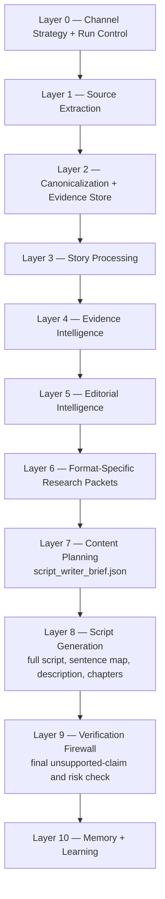
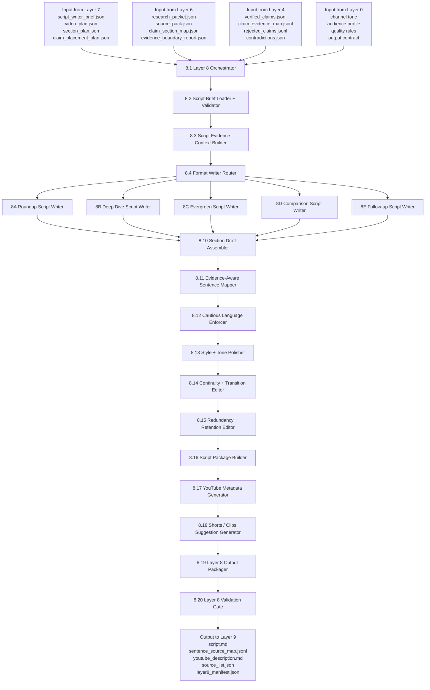

Now we will design **Layer 8 — Script Generation** in detail.

Up to Layer 7, the system has not written the final video yet. It has only prepared:

```text
Layer 5 → selected the video opportunity
Layer 6 → built the evidence-bounded research packet
Layer 7 → created the video plan and script writer brief
Layer 8 → now writes the actual video script and publishing package
```

Layer 8 is the **controlled writing layer**.

It should write the script, but it should not freely invent ideas. It should write from:

```text
script_writer_brief.json
research_packet.json
source_pack.json
claim_section_map.json
verified_claims.jsonl
evidence boundaries
```

---

# Layer 8 — Script Generation

## 1. Purpose of Layer 8

Layer 8 answers:

```text
How do we turn the approved video plan into a polished YouTube script?
```

It produces:

```text
full script
section-by-section script
sentence-to-claim map
sentence-to-source map
YouTube description
source list
chapter timestamps
title options refinement
shorts/clips suggestions
script generation report
```

Layer 8 is where the actual content is created, but it must remain inside the evidence boundaries created by earlier layers.

---

# 2. Why Layer 8 is important

Without Layer 8, the system only has a plan, not a publishable video.

But this layer is also risky because this is where hallucinations can enter if the writer starts “being creative” with facts.

Layer 8 must balance two goals:

```text
Goal 1 — Make the script engaging, natural, and YouTube-friendly.
Goal 2 — Keep every factual statement traceable to verified claims and sources.
```

So Layer 8 should not behave like a normal open-ended script writer.

It should behave like an **evidence-aware script writer**.

---

# 3. What Layer 8 should do and not do

## Layer 8 should do

```text
Write the full video script.
Follow the section plan from Layer 7.
Use only approved claim IDs.
Use cautious wording for cautious claims.
Avoid do-not-use claims.
Create natural transitions.
Write in the configured channel tone.
Create sentence-level claim/source mapping.
Generate YouTube description and source list.
Generate chapter timestamps.
Generate optional Shorts/clips ideas.
Prepare output for Layer 9 verification.
```

## Layer 8 should not do

```text
It should not select a new topic.
It should not change the selected format.
It should not introduce unsupported facts.
It should not use rejected claims.
It should not turn cautious claims into certain claims.
It should not perform final verification; Layer 9 does that.
It should not cite community signals as factual proof.
It should not create final publishing approval.
```

Layer 8 can write:

```text
“OpenAI announced a coding-related update, and based on the available sources, it may signal a shift toward more workflow-oriented coding tools.”
```

Layer 8 should not write:

```text
“OpenAI just replaced software developers.”
```

unless a verified claim explicitly supports that, which in most cases it will not.

---

# 4. Where Layer 8 sits in the full architecture



Layer 8 writes the script.
Layer 9 verifies the script.

That separation is very important.

---

# 5. Layer wise architecture — Layer 8 internal architecture



---

# 6. Layer 8 input and output

## Layer 8 input

Layer 8 receives from Layer 7:

```text
script_writer_brief.json
video_plan.json
section_plan.json
hook_plan.json
narrative_plan.json
claim_placement_plan.json
visual_plan.json
title_thumbnail_plan.json
pacing_retention_plan.json
```

Layer 8 receives from Layer 6:

```text
research_packet.json
source_pack.json
claim_section_map.json
evidence_boundary_report.json
packet_context_for_layer7.json
```

Layer 8 receives from Layer 4:

```text
verified_claims.jsonl
claim_evidence_map.jsonl
rejected_claims.jsonl
contradictions.json
evidence_gaps.json
```

Layer 8 receives from Layer 0:

```text
channel thesis
audience profile
tone rules
quality policy
output contract
```

Example input:

```json
{
  "run_id": "run_2026_05_10_48h_auto",
  "inputs": {
    "script_writer_brief_path": "data/runs/run_2026_05_10_48h_auto/layer_7/script_writer_brief.json",
    "video_plan_path": "data/runs/run_2026_05_10_48h_auto/layer_7/video_plan.json",
    "research_packet_path": "data/runs/run_2026_05_10_48h_auto/layer_6/research_packet.json",
    "source_pack_path": "data/runs/run_2026_05_10_48h_auto/layer_6/source_pack.json",
    "verified_claims_path": "data/runs/run_2026_05_10_48h_auto/layer_4/verified_claims.jsonl",
    "claim_evidence_map_path": "data/runs/run_2026_05_10_48h_auto/layer_4/claim_evidence_map.jsonl"
  },
  "selected_format": "deep_dive",
  "evidence_rules": {
    "safe_claim_ids": ["claim_001", "claim_002", "claim_003"],
    "cautious_claim_ids": ["claim_018"],
    "do_not_use_claim_ids": ["claim_099"]
  }
}
```

---

## Layer 8 output

Layer 8 produces:

```text
data/runs/{run_id}/layer_8/
  script.md
  script.txt
  section_scripts.json
  sentence_claim_map.jsonl
  sentence_source_map.jsonl
  claim_usage_report.json
  cautious_language_report.json
  title_options_refined.json
  youtube_description.md
  youtube_chapters.json
  source_list.json
  shorts_clips_suggestions.json
  script_generation_report.json
  layer8_manifest.json
```

Main output summary:

```json
{
  "run_id": "run_2026_05_10_48h_auto",
  "layer": "layer_8_script_generation",
  "status": "completed",
  "selected_format": "deep_dive",
  "script_path": "data/runs/run_2026_05_10_48h_auto/layer_8/script.md",
  "sentence_source_map_path": "data/runs/run_2026_05_10_48h_auto/layer_8/sentence_source_map.jsonl",
  "youtube_description_path": "data/runs/run_2026_05_10_48h_auto/layer_8/youtube_description.md",
  "ready_for_layer_9": true
}
```

---

# 7. Core Layer 8 data objects

Layer 8 should produce these main objects:

```text
GeneratedScript
SectionScript
ScriptSentence
SentenceClaimMap
SentenceSourceMap
ClaimUsageReport
CautiousLanguageReport
YouTubeDescription
YouTubeChapterPlan
ShortsClipSuggestion
ScriptGenerationReport
Layer8Manifest
```

---

# 8. Universal GeneratedScript format

The main script should be saved in both Markdown and structured JSON.

## `script.md`

```markdown
# AI Coding Tools Are Moving Past Autocomplete

## Format
Deep Dive

## Target Duration
10 minutes

## Hook

AI coding tools are being pushed beyond autocomplete. But the real question is whether this actually changes the way developers work — or whether this is just another feature announcement.

## Section 1 — What happened

OpenAI announced a coding-related product update...

## Section 2 — Why it matters

The reason this matters is that AI coding tools are increasingly being framed around workflow assistance...

## Section 3 — What is still unclear

But there is one important limitation: the available sources do not yet prove that this changes outcomes inside real development teams...

## Final takeaway

So the balanced takeaway is this...
```

## `generated_script.json`

```json
{
  "script_id": "script_20260510_001",
  "run_id": "run_2026_05_10_48h_auto",
  "selected_format": "deep_dive",
  "title_working": "AI Coding Tools Are Moving Past Autocomplete",
  "target_duration_minutes": 10,
  "target_audience": "technical_but_accessible",
  "tone": "clear, analytical, practical, evidence-first",

  "sections": [
    {
      "section_id": "sec_001",
      "section_key": "hook",
      "section_title": "The real question behind the announcement",
      "target_duration_seconds": 35,
      "script_text": "AI coding tools are being pushed beyond autocomplete...",
      "sentence_ids": ["sent_001", "sent_002"]
    }
  ],

  "evidence_boundaries": {
    "safe_claim_ids": ["claim_001", "claim_002"],
    "cautious_claim_ids": ["claim_018"],
    "do_not_use_claim_ids": ["claim_099"]
  },

  "handoff": {
    "ready_for_layer_9": true,
    "next_layer": "layer_9_verification_firewall"
  }
}
```

---

# 9. Module-by-module Layer 8 design

---

## Module 8.1 — Layer 8 Orchestrator

### Purpose

Coordinate the script generation workflow.

### Why it matters

Layer 8 has multiple writing and packaging steps. The orchestrator ensures the script is generated from the approved plan and does not skip evidence mapping.

### Questions it answers

```text
Which script brief should be used?
Which format-specific writer should run?
Which verified claims are allowed?
Where should output files be written?
Is the script ready for Layer 9 verification?
```

### Input

```json
{
  "run_manifest_path": "data/runs/run_2026_05_10_48h_auto/run_manifest.json",
  "layer7_manifest_path": "data/runs/run_2026_05_10_48h_auto/layer_7/layer7_manifest.json",
  "script_writer_brief_path": "data/runs/run_2026_05_10_48h_auto/layer_7/script_writer_brief.json"
}
```

### Logic

```text
1. Load run manifest.
2. Load Layer 7 script writer brief.
3. Load Layer 6 packet and source pack.
4. Load verified claims and evidence map.
5. Validate allowed claim IDs.
6. Route to format-specific writer.
7. Generate section scripts.
8. Build sentence-level claim/source maps.
9. Apply cautious language and style polishing.
10. Generate metadata package.
11. Write Layer 8 outputs.
12. Validate readiness for Layer 9.
```

### Output

```json
{
  "run_id": "run_2026_05_10_48h_auto",
  "selected_format": "deep_dive",
  "writer_used": "deep_dive_script_writer",
  "script_generation_status": "completed"
}
```

---

## Module 8.2 — Script Brief Loader + Validator

### Purpose

Load and validate `script_writer_brief.json`.

### Why it matters

Layer 8 should never write without a valid script brief from Layer 7.

### Questions it answers

```text
Does the script brief exist?
Does it contain selected format?
Does it contain section plan?
Does it contain evidence rules?
Does it contain safe/cautious/do-not-use claim IDs?
Does it contain target tone and audience?
```

### Input

```json
{
  "script_writer_brief_path": "data/runs/.../layer_7/script_writer_brief.json"
}
```

### Logic

```text
1. Load script_writer_brief.json.
2. Validate selected format.
3. Validate target audience and tone.
4. Validate section list.
5. Validate evidence rules.
6. Validate hook instruction.
7. Validate ready_for_layer_8 = true.
```

### Output

```json
{
  "brief_id": "script_brief_20260510_001",
  "selected_format": "deep_dive",
  "section_count": 7,
  "safe_claim_count": 12,
  "cautious_claim_count": 2,
  "do_not_use_claim_count": 1,
  "validation_status": "passed"
}
```

---

## Module 8.3 — Script Evidence Context Builder

### Purpose

Build the controlled context that the script writer can use.

### Why it matters

The writer should not receive the entire evidence store. It should only receive claims and sources approved for the selected video.

### Questions it answers

```text
Which claims are allowed?
Which claims require caution?
Which claims are blocked?
What source refs support each allowed claim?
Which sections can use each claim?
```

### Input

```json
{
  "script_writer_brief": {},
  "verified_claims_path": "data/runs/.../verified_claims.jsonl",
  "claim_evidence_map_path": "data/runs/.../claim_evidence_map.jsonl",
  "source_pack_path": "data/runs/.../source_pack.json"
}
```

### Logic

```text
1. Load safe claim IDs from script brief.
2. Load cautious claim IDs.
3. Load do-not-use claim IDs.
4. Pull verified claim text for safe/cautious claims.
5. Pull recommended wording from Layer 4.
6. Pull source refs from source pack.
7. Build section-specific evidence context.
```

### Output

```json
{
  "script_evidence_context": {
    "safe_claims": [
      {
        "claim_id": "claim_001",
        "claim_text": "OpenAI announced a coding-related product update.",
        "recommended_wording": "OpenAI announced a coding-related update...",
        "source_refs": ["source_001"],
        "allowed_sections": ["what_happened", "hook"]
      }
    ],
    "cautious_claims": [
      {
        "claim_id": "claim_018",
        "claim_text": "The update may affect developer workflows.",
        "required_language": "Use may/could/suggests. Do not say will.",
        "source_refs": ["source_001"]
      }
    ],
    "blocked_claims": [
      {
        "claim_id": "claim_099",
        "reason": "Unsupported prediction.",
        "blocked_phrases": ["will replace developers"]
      }
    ]
  }
}
```

---

## Module 8.4 — Format Writer Router

### Purpose

Route to the correct script writer.

### Why it matters

A roundup script is structurally different from a deep dive, evergreen explainer, comparison, or follow-up.

### Input

```json
{
  "selected_format": "deep_dive"
}
```

### Logic

```text
if format == roundup → RoundupScriptWriter
if format == deep_dive → DeepDiveScriptWriter
if format == evergreen → EvergreenScriptWriter
if format == comparison → ComparisonScriptWriter
if format == follow_up → FollowUpScriptWriter
```

### Output

```json
{
  "selected_writer": "deep_dive_script_writer",
  "script_template": "deep_dive_script_template",
  "routing_status": "success"
}
```

---

# 10. Format-specific script writers

---

## Module 8A — Roundup Script Writer

### Purpose

Write a multi-story AI news roundup script.

### When used

```text
selected_format = roundup
```

### Why it matters

This supports your original channel idea: AI news updates covering multiple stories.

### Questions it answers

```text
How do we introduce the episode?
How do we cover each story quickly?
How do we transition between stories?
How do we avoid over-explaining?
How do we make the roundup feel connected?
```

### Input

```json
{
  "selected_format": "roundup",
  "script_writer_brief": {},
  "roundup_packet": {},
  "story_segment_guidance": [
    {
      "story_id": "story_001",
      "segment_role": "lead_story",
      "target_duration_seconds": 100,
      "safe_claim_ids": ["claim_001", "claim_002"],
      "cautious_claim_ids": ["claim_018"]
    }
  ]
}
```

### Logic

```text
1. Write short episode hook using episode theme.
2. Write each story segment using approved claims.
3. Keep each segment within time budget.
4. Use simple explanation: what happened + why it matters.
5. Use transitions from Layer 7.
6. Avoid deep-dive-level background.
7. End with common takeaway across stories.
8. Add CTA naturally near the end.
```

### Output

```json
{
  "section_scripts": [
    {
      "section_id": "sec_intro",
      "section_key": "intro_hook",
      "script_text": "A lot happened in AI over the last two days, but five updates matter most..."
    },
    {
      "section_id": "sec_story_001",
      "story_id": "story_001",
      "script_text": "First, OpenAI announced a coding-related update...",
      "used_claim_ids": ["claim_001", "claim_002"]
    }
  ]
}
```

### Roundup writing rule

```text
Use compact explanations.
Do not let one story consume the whole script.
Every story segment must have at least one verified claim.
```

---

## Module 8B — Deep Dive Script Writer

### Purpose

Write a focused script about one major story.

### When used

```text
selected_format = deep_dive
```

### Why it matters

This supports your current prototype: one story, deeper analysis, stronger context.

### Questions it answers

```text
How do we open with tension?
How do we explain what happened?
How do we explain why it matters?
How do we provide context without boring viewers?
How do we explain limitations?
How do we end with a balanced takeaway?
```

### Input

```json
{
  "selected_format": "deep_dive",
  "script_writer_brief": {
    "central_viewer_question": "Does this actually change how developers use AI coding tools?",
    "viewer_promise": "Viewers will know what was announced, what it may change, and what is still not proven.",
    "sections": []
  },
  "script_evidence_context": {}
}
```

### Logic

```text
1. Write hook using approved hook direction.
2. State verified announcement early.
3. Explain why it matters using safe and cautious claims.
4. Add background only after viewer stakes are clear.
5. Explain technical/practical context.
6. Include limitations and open questions.
7. End with balanced, evidence-safe takeaway.
8. Avoid unsupported predictions.
```

### Output

```json
{
  "section_scripts": [
    {
      "section_id": "sec_001",
      "section_key": "hook",
      "script_text": "AI coding tools are being pushed beyond autocomplete. But the real question is whether this actually changes how developers work...",
      "used_claim_ids": ["claim_001"],
      "sentence_ids": ["sent_001", "sent_002"]
    },
    {
      "section_id": "sec_002",
      "section_key": "what_happened",
      "script_text": "OpenAI announced a coding-related product update...",
      "used_claim_ids": ["claim_001", "claim_002"],
      "sentence_ids": ["sent_003", "sent_004"]
    }
  ]
}
```

### Deep dive writing rule

```text
Every major analytical point must be built from safe or cautious claims.
Limitations must be included before the final takeaway.
```

---

## Module 8C — Evergreen Script Writer

### Purpose

Write a durable educational/explainer script.

### When used

```text
selected_format = evergreen
```

### Why it matters

Evergreen videos are not only news. They explain long-term AI concepts.

### Questions it answers

```text
How do we explain the concept clearly?
How do we use recent stories as examples?
How do we avoid making breaking news sound timeless?
How do we make the video useful months later?
```

### Input

```json
{
  "selected_format": "evergreen",
  "evergreen_packet": {
    "topic": "AI agents",
    "concept_blocks": [],
    "timeline": []
  }
}
```

### Logic

```text
1. Open with a viewer problem or confusion.
2. Define the concept carefully.
3. Explain why the concept matters.
4. Use recent verified stories as examples.
5. Explain common misconceptions.
6. End with practical takeaway.
7. Avoid date-sensitive framing unless clearly timestamped.
```

### Output

```json
{
  "section_scripts": [
    {
      "section_key": "hook_problem",
      "script_text": "Everyone is talking about AI agents, but the term is being used in different ways..."
    },
    {
      "section_key": "simple_definition",
      "script_text": "A useful way to think about an AI agent is..."
    }
  ]
}
```

### Evergreen writing rule

```text
Separate stable explanation from recent examples.
Do not turn current marketing terms into universal definitions.
```

---

## Module 8D — Comparison Script Writer

### Purpose

Write a fair comparison script.

### When used

```text
selected_format = comparison
```

### Why it matters

Comparison videos can be powerful, but they are risky because unsupported rankings can damage credibility.

### Questions it answers

```text
What exactly are we comparing?
What dimensions are fair?
Which product/model has evidence for each dimension?
Where is evidence missing?
Can we make a recommendation without overclaiming?
```

### Input

```json
{
  "selected_format": "comparison",
  "comparison_packet": {
    "subjects": ["ChatGPT", "Claude", "Gemini"],
    "comparison_dimensions": [],
    "evidence_matrix": []
  }
}
```

### Logic

```text
1. Define comparison scope.
2. Introduce subjects.
3. Compare dimension by dimension.
4. Use evidence matrix only.
5. Mention missing evidence clearly.
6. Avoid final ranking if evidence is not balanced.
7. End with practical recommendation by use case.
```

### Output

```json
{
  "section_scripts": [
    {
      "section_key": "comparison_scope",
      "script_text": "This is not a universal ranking of every AI assistant. We are only comparing coding workflow support based on the available evidence..."
    },
    {
      "section_key": "dimension_1",
      "script_text": "For coding workflow support, the strongest available evidence for..."
    }
  ]
}
```

### Comparison writing rule

```text
Do not say “best overall” unless the comparison packet explicitly allows final ranking.
Use “based on available evidence” when evidence is uneven.
```

---

## Module 8E — Follow-up Script Writer

### Purpose

Write a follow-up video connected to previous coverage.

### When used

```text
selected_format = follow_up
```

### Why it matters

Follow-up scripts should update viewers without repeating the previous video.

### Questions it answers

```text
What did we cover before?
What changed?
What new evidence exists?
Does this confirm, expand, or challenge the earlier view?
What is still unclear?
```

### Input

```json
{
  "selected_format": "follow_up",
  "followup_packet": {
    "previous_video_id": "video_2026_04_25_ai_agents",
    "what_changed": [],
    "previous_claim_status": []
  }
}
```

### Logic

```text
1. Briefly reference previous video context.
2. Do not repeat full old explanation.
3. Focus on new evidence.
4. Explain what changed.
5. Update previous claims carefully.
6. End with new takeaway.
```

### Output

```json
{
  "section_scripts": [
    {
      "section_key": "previous_context",
      "script_text": "A few weeks ago, we looked at how AI agents were moving from demos into real workflows..."
    },
    {
      "section_key": "what_changed",
      "script_text": "Now there is a new update that adds another example to that trend..."
    }
  ]
}
```

### Follow-up writing rule

```text
The script must clearly explain what is new.
If it only repeats the earlier video, it should fail Layer 8 validation.
```

---

# 11. Supporting script generation modules

---

## Module 8.10 — Section Draft Assembler

### Purpose

Combine generated section drafts into one coherent script.

### Why it matters

Format-specific writers may create section-level text. This module assembles them in order and checks flow.

### Questions it answers

```text
Are all required sections present?
Are sections in the correct order?
Does the script follow the Layer 7 section plan?
Are target durations roughly followed?
```

### Input

```json
{
  "section_scripts": [],
  "section_plan": [],
  "narrative_plan": {}
}
```

### Logic

```text
1. Sort section scripts by section order.
2. Check all required sections exist.
3. Add section headings.
4. Combine into full script.
5. Estimate word count and duration.
6. Mark sections over or under target duration.
```

### Output

```json
{
  "assembled_script": {
    "script_text": "Full script text...",
    "section_count": 7,
    "estimated_word_count": 1450,
    "estimated_duration_seconds": 590,
    "duration_status": "within_target"
  }
}
```

---

## Module 8.11 — Evidence-Aware Sentence Mapper

### Purpose

Create sentence-level mapping between script sentences and claim/source IDs.

### Why it matters

This is the key handoff to Layer 9. Layer 9 needs to know which source supports each sentence.

### Questions it answers

```text
Which sentence is factual?
Which claim supports it?
Which source span supports the claim?
Which sentences are analysis, opinion, transition, or CTA?
```

### Sentence types

```text
evidence_sentence
cautious_evidence_sentence
analysis_sentence
opinion_sentence
transition_sentence
hook_sentence
cta_sentence
visual_instruction
```

### Input

```json
{
  "assembled_script": {},
  "used_claim_ids": ["claim_001", "claim_002"],
  "claim_evidence_map": {}
}
```

### Logic

```text
1. Split script into sentences.
2. Classify each sentence type.
3. Attach claim IDs to factual sentences.
4. Attach source span IDs through claim_evidence_map.
5. Mark sentences with no claim support.
6. Create sentence_claim_map and sentence_source_map.
```

### Output

```json
{
  "sentence_id": "sent_004",
  "section_id": "sec_002",
  "sentence_text": "OpenAI announced a coding-related product update.",
  "sentence_type": "evidence_sentence",
  "claim_ids": ["claim_001"],
  "source_span_ids": ["span_doc_openai_001_0001"],
  "source_refs": ["source_001"],
  "support_status": "mapped"
}
```

For analysis sentence:

```json
{
  "sentence_id": "sent_018",
  "section_id": "sec_004",
  "sentence_text": "The bigger shift is that coding assistants are being framed around workflows, not just autocomplete.",
  "sentence_type": "analysis_sentence",
  "claim_ids": ["claim_003", "claim_018"],
  "source_span_ids": ["span_003", "span_018"],
  "support_status": "analysis_supported_by_claims",
  "requires_layer9_review": true
}
```

---

## Module 8.12 — Cautious Language Enforcer

### Purpose

Ensure cautious claims are written with cautious wording.

### Why it matters

A cautious claim should not become a confident claim in the script.

Layer 4 may say:

```text
The update may affect developer workflows.
```

Layer 8 must not write:

```text
This will change developer workflows.
```

### Questions it answers

```text
Did the script use “will” when it should use “may”?
Did cautious claims become certain?
Did the script hide uncertainty?
Are unresolved contradictions handled carefully?
```

### Input

```json
{
  "script_sentences": [],
  "cautious_claim_ids": ["claim_018"],
  "cautious_language_rules": {
    "claim_018": "Use may/could/suggests. Do not say will."
  }
}
```

### Logic

```text
1. Find sentences mapped to cautious claims.
2. Check wording for certainty markers.
3. Flag words like will, definitely, proves, guarantees.
4. Rewrite or mark for correction.
5. Produce cautious language report.
```

### Output

```json
{
  "cautious_language_report": {
    "status": "passed_with_edits",
    "issues_found": [
      {
        "sentence_id": "sent_018",
        "issue": "Cautious claim stated too strongly.",
        "original": "This will change developer workflows.",
        "corrected": "This could affect developer workflows, but the real-world impact is not yet proven."
      }
    ],
    "final_status": "resolved"
  }
}
```

---

## Module 8.13 — Style + Tone Polisher

### Purpose

Improve readability, voice, and flow while preserving evidence boundaries.

### Why it matters

The script should sound natural, not like a research report.

### Questions it answers

```text
Does the script sound like the channel?
Is it clear for the target audience?
Is it too technical?
Is it too casual?
Does it avoid hype?
```

### Input

```json
{
  "assembled_script": {},
  "channel_tone": "clear_analytical_evidence_first",
  "audience": "technical_but_accessible"
}
```

### Logic

```text
1. Simplify overly dense sentences.
2. Improve spoken flow.
3. Keep evidence-backed meaning unchanged.
4. Preserve claim mappings.
5. Avoid adding new factual content.
6. Avoid hype language.
```

### Output

```json
{
  "style_polish_report": {
    "status": "completed",
    "edits_applied": 18,
    "meaning_changed": false,
    "new_claims_added": false
  }
}
```

---

## Module 8.14 — Continuity + Transition Editor

### Purpose

Improve section-to-section flow.

### Why it matters

A script with good facts can still feel choppy.

### Questions it answers

```text
Do sections connect naturally?
Does the story flow match the narrative plan?
Are transitions adding unsupported claims?
Are roundup story transitions smooth?
```

### Input

```json
{
  "section_scripts": [],
  "transition_plan": []
}
```

### Logic

```text
1. Check transitions between sections.
2. Add or polish transition sentences.
3. Ensure transitions do not introduce new unsupported facts.
4. Keep transitions mapped as transition_sentence.
```

### Output

```json
{
  "transition_edit_report": {
    "transitions_checked": 6,
    "transitions_added": 4,
    "unsupported_transition_claims": 0
  }
}
```

---

## Module 8.15 — Redundancy + Retention Editor

### Purpose

Remove repetition and improve retention.

### Why it matters

Scripts often repeat the same idea in different sections. This can make the video feel slow.

### Questions it answers

```text
Are we repeating the same claim too often?
Does the script maintain curiosity?
Are retention beats included?
Is the intro too long?
Is background introduced too early?
```

### Input

```json
{
  "assembled_script": {},
  "pacing_retention_plan": {}
}
```

### Logic

```text
1. Detect repeated claim usage.
2. Detect repeated phrasing.
3. Compare script to pacing plan.
4. Add light retention cues where planned.
5. Shorten bloated sections.
6. Preserve required claims.
```

### Output

```json
{
  "retention_edit_report": {
    "repeated_claims_reduced": 3,
    "sections_shortened": ["background_context"],
    "retention_beats_preserved": true,
    "estimated_duration_seconds": 585
  }
}
```

---

## Module 8.16 — Script Package Builder

### Purpose

Create the final script files.

### Why it matters

Layer 9 and the user need clean outputs.

### Output files

```text
script.md
script.txt
section_scripts.json
generated_script.json
```

### Example output

```json
{
  "script_package": {
    "script_md_path": "data/runs/run_2026_05_10_48h_auto/layer_8/script.md",
    "script_txt_path": "data/runs/run_2026_05_10_48h_auto/layer_8/script.txt",
    "section_scripts_path": "data/runs/run_2026_05_10_48h_auto/layer_8/section_scripts.json",
    "generated_script_path": "data/runs/run_2026_05_10_48h_auto/layer_8/generated_script.json"
  }
}
```

---

## Module 8.17 — YouTube Metadata Generator

### Purpose

Generate YouTube publishing metadata.

### Why it matters

A video package should include more than the script.

This module should create:

```text
description
source list
chapters
tags
pinned comment idea
title options refinement
```

### Questions it answers

```text
What should the YouTube description say?
Which sources should be listed?
What chapters should be included?
What tags are relevant?
What title options are safe and compelling?
```

### Input

```json
{
  "script": {},
  "title_thumbnail_plan": {},
  "source_pack": {},
  "section_plan": {}
}
```

### Logic

```text
1. Generate description from video plan and script.
2. Include source list from source_pack.
3. Generate chapter timestamps from section time budgets.
4. Generate tags from entities/topics.
5. Refine title options without increasing risk.
6. Generate pinned comment prompt from CTA plan.
```

### Output

```json
{
  "youtube_metadata": {
    "description": "In this video, we break down...",
    "sources": [
      {
        "label": "Official announcement",
        "url": "https://...",
        "source_role": "primary_evidence"
      }
    ],
    "chapters": [
      {
        "timestamp": "00:00",
        "title": "Intro"
      },
      {
        "timestamp": "00:35",
        "title": "What happened"
      }
    ],
    "tags": [
      "AI news",
      "AI coding tools",
      "AI agents",
      "OpenAI"
    ],
    "pinned_comment": "Do you think AI coding tools are becoming real workflow agents, or are they still advanced autocomplete?"
  }
}
```

---

## Module 8.18 — Shorts / Clips Suggestion Generator

### Purpose

Suggest short-form clips from the final script.

### Why it matters

One long YouTube video can produce Shorts, clips, LinkedIn posts, or X threads later.

### Questions it answers

```text
Which parts of the script can become Shorts?
What is the hook for each clip?
Which claim IDs support the clip?
Is the clip safe out of context?
```

### Input

```json
{
  "section_scripts": [],
  "claim_placement_plan": [],
  "sentence_source_map": []
}
```

### Logic

```text
1. Identify high-retention sections.
2. Pick 20–60 second standalone moments.
3. Ensure each clip is evidence-safe.
4. Avoid clips that require too much missing context.
5. Create clip suggestions.
```

### Output

```json
{
  "shorts_clips_suggestions": [
    {
      "clip_id": "clip_001",
      "source_section_id": "sec_004",
      "clip_type": "hype_vs_reality",
      "clip_hook": "AI coding tools are moving past autocomplete — but not in the way people think.",
      "start_sentence_id": "sent_030",
      "end_sentence_id": "sent_038",
      "estimated_duration_seconds": 42,
      "claim_ids": ["claim_003", "claim_018"],
      "context_risk": "low"
    }
  ]
}
```

---

## Module 8.19 — Layer 8 Output Packager

### Purpose

Write all Layer 8 outputs.

### Output files

```text
script.md
script.txt
generated_script.json
section_scripts.json
sentence_claim_map.jsonl
sentence_source_map.jsonl
claim_usage_report.json
cautious_language_report.json
youtube_description.md
youtube_metadata.json
youtube_chapters.json
source_list.json
shorts_clips_suggestions.json
script_generation_report.json
layer8_manifest.json
```

### Output example

```json
{
  "run_id": "run_2026_05_10_48h_auto",
  "outputs": {
    "script_md": "data/runs/run_2026_05_10_48h_auto/layer_8/script.md",
    "generated_script": "data/runs/run_2026_05_10_48h_auto/layer_8/generated_script.json",
    "sentence_source_map": "data/runs/run_2026_05_10_48h_auto/layer_8/sentence_source_map.jsonl",
    "youtube_metadata": "data/runs/run_2026_05_10_48h_auto/layer_8/youtube_metadata.json",
    "layer8_manifest": "data/runs/run_2026_05_10_48h_auto/layer_8/layer8_manifest.json"
  }
}
```

---

## Module 8.20 — Layer 8 Validation Gate

### Purpose

Validate the generated script before Layer 9 verification.

### Why it matters

Layer 8 should catch obvious structural problems before Layer 9 does deeper verification.

### Validation rules

Layer 8 passes if:

```text
script.md exists.
generated_script.json exists.
script_writer_brief was used.
selected format matches Layer 7.
all required sections are present.
sentence_claim_map.jsonl exists.
sentence_source_map.jsonl exists.
every evidence sentence has claim IDs.
every claim ID used is allowed or cautious.
no do-not-use claim is used as evidence.
cautious claims use cautious wording.
YouTube description exists.
source list exists.
layer8_manifest.json exists.
```

### Output

```json
{
  "validation_status": "passed",
  "ready_for_layer_9": true,
  "warnings": [
    {
      "type": "analysis_sentence_requires_review",
      "sentence_id": "sent_018",
      "message": "Sentence is analytical and mapped to multiple claims. Layer 9 should verify support strength."
    }
  ],
  "errors": []
}
```

---

# 12. Layer 8 output files in detail

## 12.1 `script.md`

Human-readable script.

```markdown
# AI Coding Tools Are Moving Past Autocomplete

## Hook

AI coding tools are being pushed beyond autocomplete. But the real question is whether this actually changes how developers work — or whether this is just another feature announcement.

## What Happened

OpenAI announced a coding-related product update...

## Why It Matters

The important part is not just that another AI coding feature exists. The bigger signal is that AI tools are being framed around workflows...

## What Is Still Unclear

But there is a limit to what we can say from the available sources...

## Final Takeaway

The balanced takeaway is this...
```

---

## 12.2 `generated_script.json`

```json
{
  "script_id": "script_20260510_001",
  "run_id": "run_2026_05_10_48h_auto",
  "selected_format": "deep_dive",
  "title_working": "AI Coding Tools Are Moving Past Autocomplete",
  "estimated_duration_seconds": 585,
  "estimated_word_count": 1450,
  "sections": [
    {
      "section_id": "sec_001",
      "section_key": "hook",
      "script_text": "AI coding tools are being pushed beyond autocomplete...",
      "used_claim_ids": ["claim_001"]
    }
  ]
}
```

---

## 12.3 `section_scripts.json`

```json
{
  "sections": [
    {
      "section_id": "sec_001",
      "section_key": "hook",
      "section_title": "The real question behind the announcement",
      "target_duration_seconds": 35,
      "actual_estimated_duration_seconds": 38,
      "script_text": "AI coding tools are being pushed beyond autocomplete...",
      "used_claim_ids": ["claim_001"],
      "sentence_ids": ["sent_001", "sent_002"]
    }
  ]
}
```

---

## 12.4 `sentence_claim_map.jsonl`

```json
{
  "sentence_id": "sent_004",
  "section_id": "sec_002",
  "sentence_text": "OpenAI announced a coding-related product update.",
  "sentence_type": "evidence_sentence",
  "claim_ids": ["claim_001"],
  "claim_support_status": "mapped"
}
```

---

## 12.5 `sentence_source_map.jsonl`

```json
{
  "sentence_id": "sent_004",
  "section_id": "sec_002",
  "sentence_text": "OpenAI announced a coding-related product update.",
  "claim_ids": ["claim_001"],
  "source_span_ids": ["span_doc_openai_001_0001"],
  "source_refs": ["source_001"],
  "source_urls": ["https://openai.com/news/example"],
  "support_status": "mapped"
}
```

---

## 12.6 `claim_usage_report.json`

```json
{
  "run_id": "run_2026_05_10_48h_auto",
  "claim_usage": {
    "safe_claims_available": 12,
    "safe_claims_used": 9,
    "cautious_claims_available": 2,
    "cautious_claims_used": 1,
    "do_not_use_claims_used": 0
  },
  "unused_required_claims": [],
  "overused_claims": [
    {
      "claim_id": "claim_001",
      "usage_count": 4,
      "warning": "Claim appears multiple times; Layer 9 may check repetition."
    }
  ]
}
```

---

## 12.7 `cautious_language_report.json`

```json
{
  "status": "passed",
  "cautious_claims_checked": 2,
  "issues_found": 0,
  "required_language_preserved": true
}
```

---

## 12.8 `youtube_metadata.json`

```json
{
  "title_options": [
    {
      "title": "AI Coding Tools Are Moving Past Autocomplete",
      "risk": "low",
      "recommended": true
    },
    {
      "title": "Is This the Real Start of AI Coding Agents?",
      "risk": "medium",
      "required_script_context": "Clarify uncertainty early."
    }
  ],
  "description": "In this video, we break down...",
  "chapters": [
    {
      "timestamp": "00:00",
      "title": "Intro"
    },
    {
      "timestamp": "00:35",
      "title": "What happened"
    }
  ],
  "tags": ["AI news", "AI coding tools", "AI agents"],
  "source_list": []
}
```

---

## 12.9 `source_list.json`

```json
{
  "sources": [
    {
      "source_ref_id": "source_001",
      "label": "Official announcement",
      "title": "Official announcement title",
      "url": "https://openai.com/news/example",
      "source_role": "primary_evidence",
      "used_for_claim_ids": ["claim_001", "claim_002"]
    }
  ]
}
```

---

## 12.10 `script_generation_report.json`

```json
{
  "run_id": "run_2026_05_10_48h_auto",
  "selected_format": "deep_dive",
  "script_status": "generated",
  "estimated_duration_seconds": 585,
  "estimated_word_count": 1450,
  "sections_generated": 7,
  "evidence_sentence_count": 28,
  "analysis_sentence_count": 12,
  "transition_sentence_count": 9,
  "cta_sentence_count": 2,
  "unsupported_sentence_count_precheck": 0,
  "ready_for_layer_9": true
}
```

---

## 12.11 `layer8_manifest.json`

```json
{
  "run_id": "run_2026_05_10_48h_auto",
  "layer": "layer_8_script_generation",
  "created_at": "2026-05-10T12:05:00Z",

  "inputs": {
    "run_manifest": "data/runs/run_2026_05_10_48h_auto/run_manifest.json",
    "layer7_manifest": "data/runs/run_2026_05_10_48h_auto/layer_7/layer7_manifest.json",
    "script_writer_brief": "data/runs/run_2026_05_10_48h_auto/layer_7/script_writer_brief.json",
    "research_packet": "data/runs/run_2026_05_10_48h_auto/layer_6/research_packet.json",
    "source_pack": "data/runs/run_2026_05_10_48h_auto/layer_6/source_pack.json",
    "verified_claims": "data/runs/run_2026_05_10_48h_auto/layer_4/verified_claims.jsonl"
  },

  "outputs": {
    "script_md": "data/runs/run_2026_05_10_48h_auto/layer_8/script.md",
    "script_txt": "data/runs/run_2026_05_10_48h_auto/layer_8/script.txt",
    "generated_script": "data/runs/run_2026_05_10_48h_auto/layer_8/generated_script.json",
    "section_scripts": "data/runs/run_2026_05_10_48h_auto/layer_8/section_scripts.json",
    "sentence_claim_map": "data/runs/run_2026_05_10_48h_auto/layer_8/sentence_claim_map.jsonl",
    "sentence_source_map": "data/runs/run_2026_05_10_48h_auto/layer_8/sentence_source_map.jsonl",
    "youtube_metadata": "data/runs/run_2026_05_10_48h_auto/layer_8/youtube_metadata.json",
    "source_list": "data/runs/run_2026_05_10_48h_auto/layer_8/source_list.json",
    "script_generation_report": "data/runs/run_2026_05_10_48h_auto/layer_8/script_generation_report.json"
  },

  "script_summary": {
    "selected_format": "deep_dive",
    "estimated_duration_seconds": 585,
    "estimated_word_count": 1450,
    "section_count": 7,
    "sentence_count": 51
  },

  "handoff": {
    "ready_for_layer_9": true,
    "next_layer": "layer_9_verification_firewall"
  }
}
```

---

# 13. Layer 8 config files

Layer 8 should be config-driven.

```text
config/
  script_generation_rules.yaml
  script_style_rules.yaml
  format_script_templates.yaml
  cautious_language_rules.yaml
  sentence_mapping_rules.yaml
  youtube_metadata_rules.yaml
  shorts_clip_rules.yaml
```

---

## `script_generation_rules.yaml`

```yaml
script_generation:
  require_script_writer_brief: true
  require_sentence_source_map: true
  require_claim_usage_report: true
  block_do_not_use_claims: true
  allow_unsourced_factual_sentences: false

  target_word_count:
    roundup:
      min: 900
      max: 1400
    deep_dive:
      min: 1200
      max: 1800
    evergreen:
      min: 1400
      max: 2200
    comparison:
      min: 1400
      max: 2200
    follow_up:
      min: 900
      max: 1500
```

---

## `script_style_rules.yaml`

```yaml
style:
  channel_voice: clear_analytical_evidence_first

  tone:
    default: analytical
    avoid:
      - fake urgency
      - panic
      - unsupported hype
      - personal attacks
      - overconfident predictions

  audience:
    default: technical_but_accessible
    explanation_depth: medium
    define_jargon: true
    use_examples: true

  spoken_style:
    use_short_paragraphs: true
    avoid_overly_long_sentences: true
    allow_conversational_phrasing: true
```

---

## `format_script_templates.yaml`

```yaml
templates:
  roundup:
    sections:
      - intro_hook
      - story_segments
      - final_takeaway
      - cta

  deep_dive:
    sections:
      - hook
      - what_happened
      - why_it_matters
      - background_context
      - technical_or_practical_explanation
      - limitations_or_counterpoints
      - final_takeaway
      - cta

  evergreen:
    sections:
      - hook_problem
      - simple_definition
      - why_it_matters
      - how_it_works
      - examples
      - misconceptions
      - practical_takeaway
      - cta

  comparison:
    sections:
      - hook
      - comparison_scope
      - subjects_intro
      - comparison_dimensions
      - evidence_gaps
      - practical_recommendation
      - cta

  follow_up:
    sections:
      - previous_context
      - what_changed
      - new_evidence
      - what_this_updates
      - still_unclear
      - final_takeaway
      - cta
```

---

## `cautious_language_rules.yaml`

```yaml
cautious_language:
  required_for:
    - cautious_claims
    - predictions
    - interpretation
    - claims_with_uncertainty
    - unresolved_contradictions

  preferred_words:
    - may
    - could
    - suggests
    - appears to
    - based on available sources
    - not yet independently verified

  blocked_overstatements:
    - proves
    - guarantees
    - definitely
    - will replace
    - destroys
    - ends the need for
```

---

## `sentence_mapping_rules.yaml`

```yaml
sentence_mapping:
  sentence_types:
    - evidence_sentence
    - cautious_evidence_sentence
    - analysis_sentence
    - opinion_sentence
    - transition_sentence
    - hook_sentence
    - cta_sentence

  require_claim_ids_for:
    - evidence_sentence
    - cautious_evidence_sentence
    - analysis_sentence

  allow_no_claim_ids_for:
    - transition_sentence
    - cta_sentence
    - purely_rhetorical_hook_sentence
```

---

## `youtube_metadata_rules.yaml`

```yaml
youtube_metadata:
  require_description: true
  require_source_list: true
  require_chapters: true
  max_title_options: 8
  max_tags: 15

  description_sections:
    - video_summary
    - key_topics
    - sources
    - disclaimer

  source_rules:
    include_primary_sources: true
    include_research_sources: true
    include_independent_sources: true
    exclude_community_signal_only_sources_by_default: true
```

---

# 14. Suggested Layer 8 folder structure

```text
pipelines/
  layer_8_script_generation/
    __init__.py
    run_layer_8.py

    orchestrator/
      layer8_orchestrator.py

    loaders/
      script_brief_loader.py
      evidence_context_builder.py
      source_pack_loader.py
      verified_claim_loader.py

    routing/
      format_writer_router.py

    writers/
      roundup_script_writer.py
      deep_dive_script_writer.py
      evergreen_script_writer.py
      comparison_script_writer.py
      followup_script_writer.py

    assembly/
      section_draft_assembler.py
      script_package_builder.py

    mapping/
      sentence_splitter.py
      sentence_claim_mapper.py
      sentence_source_mapper.py
      claim_usage_tracker.py

    editing/
      cautious_language_enforcer.py
      style_tone_polisher.py
      continuity_transition_editor.py
      redundancy_retention_editor.py

    metadata/
      youtube_metadata_generator.py
      youtube_description_generator.py
      chapter_generator.py
      source_list_generator.py
      shorts_clip_suggestion_generator.py

    output/
      layer8_output_packager.py
      layer8_manifest_writer.py

    validation/
      layer8_validation_gate.py

config/
  script_generation_rules.yaml
  script_style_rules.yaml
  format_script_templates.yaml
  cautious_language_rules.yaml
  sentence_mapping_rules.yaml
  youtube_metadata_rules.yaml
  shorts_clip_rules.yaml

data/
  runs/
    run_2026_05_10_48h_auto/
      layer_8/
        script.md
        script.txt
        generated_script.json
        section_scripts.json
        sentence_claim_map.jsonl
        sentence_source_map.jsonl
        claim_usage_report.json
        cautious_language_report.json
        youtube_description.md
        youtube_metadata.json
        youtube_chapters.json
        source_list.json
        shorts_clips_suggestions.json
        script_generation_report.json
        layer8_manifest.json
```

---

# 15. Layer 8 processing flow

```text
Step 1:
Load run_manifest.json and layer7_manifest.json.

Step 2:
Load script_writer_brief.json.

Step 3:
Load Layer 6 research packet, source pack, and claim-section map.

Step 4:
Load verified claims, rejected claims, and claim evidence map.

Step 5:
Validate allowed safe, cautious, and do-not-use claim boundaries.

Step 6:
Build script evidence context.

Step 7:
Route to the correct format-specific script writer.

Step 8:
Generate section-level drafts.

Step 9:
Assemble full script.

Step 10:
Create sentence-level claim map.

Step 11:
Create sentence-level source map.

Step 12:
Enforce cautious language.

Step 13:
Polish style and tone.

Step 14:
Edit transitions and reduce repetition.

Step 15:
Generate YouTube metadata, chapters, source list, and optional clips.

Step 16:
Write Layer 8 output package.

Step 17:
Run Layer 8 validation gate.

Step 18:
Pass script and sentence maps to Layer 9 verification firewall.
```

---

# 16. How Layer 8 supports downstream layers

| Downstream layer                | What Layer 8 provides                                                                              |
| ------------------------------- | -------------------------------------------------------------------------------------------------- |
| Layer 9 — Verification Firewall | full script, sentence-source map, sentence-claim map, claim usage report, cautious language report |
| Layer 10 — Memory + Learning    | final script, used claims, title options, video metadata, script summary, source list              |

---

# 17. Layer 8 and hallucination control

Layer 8 is one of the highest-risk layers because it uses generative writing.

So it needs strict controls.

## Rule 1: Write only from the script writer brief

Layer 8 should not go back and search randomly. It should use:

```text
script_writer_brief.json
research_packet.json
source_pack.json
verified_claims.jsonl
```

## Rule 2: Every factual sentence must map to a claim

Correct:

```json
{
  "sentence_text": "OpenAI announced a coding-related product update.",
  "claim_ids": ["claim_001"],
  "source_span_ids": ["span_doc_openai_001_0001"]
}
```

Incorrect:

```json
{
  "sentence_text": "This is the most important coding update of the decade.",
  "claim_ids": [],
  "source_span_ids": []
}
```

## Rule 3: Cautious claims must stay cautious

If Layer 4 says:

```text
may affect workflows
```

Layer 8 cannot write:

```text
will transform workflows
```

## Rule 4: Do-not-use claims must never appear as script facts

The script can have a restriction like:

```text
Do not say this replaces developers.
```

But the script should not say:

```text
This replaces developers.
```

## Rule 5: Analysis sentences must still map to evidence

Analysis is allowed, but it must be built from claims.

Example:

```json
{
  "sentence_text": "The bigger signal is that AI coding tools are being framed around workflows, not just autocomplete.",
  "sentence_type": "analysis_sentence",
  "claim_ids": ["claim_003", "claim_018"],
  "support_status": "analysis_supported_by_claims"
}
```

Layer 9 will later decide if the analysis is too strong.

---

# 18. What Layer 8 should produce for each format

## For Roundup

Layer 8 produces:

```text
fast intro
5–8 story segments
short “what happened”
short “why it matters”
clean transitions
final common takeaway
YouTube description with sources
chapter timestamps per story
```

## For Deep Dive

Layer 8 produces:

```text
strong hook
clear announcement explanation
deeper context
why-it-matters section
technical/practical explanation
limitations/counterpoints
balanced final takeaway
source-backed sentence map
```

## For Evergreen

Layer 8 produces:

```text
concept-first hook
simple explanation
examples
misconceptions
practical takeaway
less time-sensitive phrasing
```

## For Comparison

Layer 8 produces:

```text
comparison scope
subject introduction
dimension-by-dimension comparison
evidence gaps
practical recommendation
no unsupported final ranking
```

## For Follow-up

Layer 8 produces:

```text
brief previous context
what changed
new evidence
what this updates
what is still unclear
new takeaway
avoid-repetition structure
```

---

# 19. Final Layer 8 input/output contract

## Layer 8 input contract

```json
{
  "run_id": "string",
  "run_manifest_path": "string",
  "layer7_manifest_path": "string",

  "layer7_inputs": {
    "script_writer_brief_path": "string",
    "video_plan_path": "string",
    "section_plan_path": "string",
    "claim_placement_plan_path": "string",
    "title_thumbnail_plan_path": "string",
    "visual_plan_path": "string"
  },

  "layer6_inputs": {
    "research_packet_path": "string",
    "source_pack_path": "string",
    "claim_section_map_path": "string",
    "evidence_boundary_report_path": "string"
  },

  "layer4_inputs": {
    "verified_claims_path": "string",
    "rejected_claims_path": "string",
    "claim_evidence_map_path": "string",
    "contradictions_path": "string"
  }
}
```

---

## Layer 8 output contract

```json
{
  "run_id": "string",
  "layer": "layer_8_script_generation",
  "status": "completed | completed_with_warnings | failed",

  "outputs": {
    "script_md": "string",
    "script_txt": "string",
    "generated_script": "string",
    "section_scripts": "string",
    "sentence_claim_map": "string",
    "sentence_source_map": "string",
    "claim_usage_report": "string",
    "cautious_language_report": "string",
    "youtube_description": "string",
    "youtube_metadata": "string",
    "youtube_chapters": "string",
    "source_list": "string",
    "shorts_clips_suggestions": "string",
    "script_generation_report": "string",
    "layer8_manifest": "string"
  },

  "script_summary": {
    "selected_format": "string",
    "estimated_duration_seconds": "number",
    "estimated_word_count": "number",
    "section_count": "number",
    "sentence_count": "number"
  },

  "handoff": {
    "ready_for_layer_9": "boolean",
    "next_layer": "layer_9_verification_firewall"
  }
}
```

---

# 20. Implementation priority for Layer 8

Build Layer 8 in this order:

```text
1. Script Brief Loader + Validator
2. Script Evidence Context Builder
3. Format Writer Router
4. Deep Dive Script Writer
5. Roundup Script Writer
6. Section Draft Assembler
7. Script Package Builder
8. Sentence Claim Mapper
9. Sentence Source Mapper
10. Cautious Language Enforcer
11. Layer 8 Validation Gate
12. YouTube Metadata Generator
13. Source List Generator
14. Style + Tone Polisher
15. Continuity + Transition Editor
16. Redundancy + Retention Editor
17. Evergreen Script Writer
18. Comparison Script Writer
19. Follow-up Script Writer
20. Shorts / Clips Suggestion Generator
```

For your first practical version, build only:

```text
script brief loader
evidence context builder
deep dive script writer
roundup script writer
section assembler
script.md output
sentence_claim_map.jsonl
sentence_source_map.jsonl
layer8_manifest.json
```

Then add:

```text
YouTube metadata generator
chapter generator
style polisher
retention editor
shorts/clip suggestions
evergreen/comparison/follow-up writers
```

---

# 21. Final summary of Layer 8

Layer 8 is the **script generation layer**.

It receives:

```text
script_writer_brief.json
research_packet.json
source_pack.json
claim_section_map.json
verified_claims.jsonl
claim_evidence_map.jsonl
channel style rules
```

It produces:

```text
script.md
script.txt
generated_script.json
section_scripts.json
sentence_claim_map.jsonl
sentence_source_map.jsonl
claim_usage_report.json
cautious_language_report.json
youtube_description.md
youtube_metadata.json
youtube_chapters.json
source_list.json
shorts_clips_suggestions.json
layer8_manifest.json
```

Its job is:

```text
write the actual YouTube script
follow the Layer 7 video plan
use only approved evidence
map factual sentences to claims and sources
preserve cautious language
generate publishing metadata
prepare the script for Layer 9 verification
```

The most important Layer 8 rule:

```text
Layer 8 should write the script, but every factual sentence must remain traceable.
```

Once Layer 8 is complete, your system can safely say:

```text
Here is the full script.
Here is every sentence.
Here is which claim supports each sentence.
Here is which source supports each claim.
Here is the YouTube description.
Here are the chapters and source list.
Now Layer 9 can verify the final script before publishing.
```
