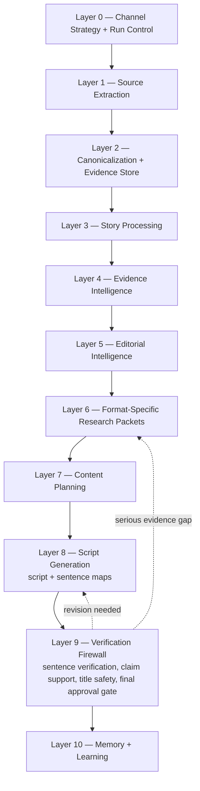
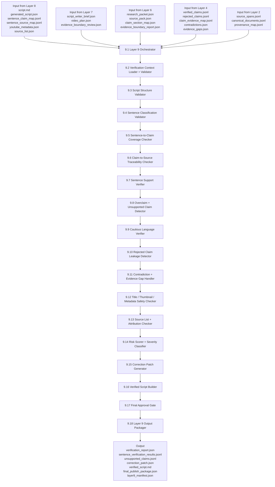

Absolutely — now we will design **Layer 9: Verification Firewall** in detail.

Up to Layer 8, the system has generated the actual script:

```text
Layer 6 → research packet
Layer 7 → content plan
Layer 8 → script generation
Layer 9 → final verification firewall
```

Layer 9 is the **last safety gate before the script becomes publish-ready**.

This layer is extremely important because even if earlier layers were careful, the final generated script can still introduce:

```text
unsupported claims
overconfident wording
wrong source mapping
misused cautious claims
title/thumbnail exaggeration
unsupported comparison
hidden contradictions
claims that sound factual but have no evidence
```

Layer 9 prevents that.

---

# Layer 9 — Verification Firewall

## 1. Purpose of Layer 9

Layer 9 answers:

```text
Is this generated script factually safe, evidence-supported, source-traceable, and ready for human review or publishing?
```

Layer 8 produced:

```text
script.md
sentence_claim_map.jsonl
sentence_source_map.jsonl
youtube_metadata.json
source_list.json
claim_usage_report.json
```

Layer 9 verifies:

```text
Every factual sentence has a supporting claim.
Every supporting claim maps back to source spans.
The sentence does not overstate the source.
Cautious claims remain cautious.
Rejected claims did not leak into the script.
Contradictions and evidence gaps are handled.
Title, thumbnail, description, and chapters are evidence-safe.
Source list is complete.
```

Layer 9 is the **quality firewall**.

---

# 2. Why Layer 9 is important

Layer 8 is generative. Even with good prompts and a good script brief, the writer can still accidentally create unsupported statements.

For example, Layer 8 might write:

```text
This update will completely change how software developers work.
```

But the evidence may only support:

```text
The update is related to coding workflows and may affect how developers use AI tools.
```

Layer 9 catches this difference.

Layer 9 protects your channel from:

```text
hallucinations
overclaims
unsupported hype
fake certainty
misleading titles
unverified benchmark claims
unsupported accusations
using community comments as facts
incorrect source attribution
```

In short:

```text
Layer 8 writes.
Layer 9 verifies.
```

That separation is one of the most important design decisions in your whole system.

---

# 3. What Layer 9 should do and not do

## Layer 9 should do

```text
Validate every factual sentence.
Check sentence-to-claim mapping.
Check claim-to-source mapping.
Compare script wording against verified claims.
Detect unsupported claims.
Detect overclaims.
Detect cautious claim misuse.
Detect rejected claim leakage.
Check contradiction handling.
Check evidence gap handling.
Check title and thumbnail safety.
Check YouTube description and source list.
Generate correction patches.
Create final verification report.
Approve, approve with warnings, require revision, or block.
```

## Layer 9 should not do

```text
It should not choose a new topic.
It should not rewrite the whole video creatively.
It should not introduce new facts.
It should not perform new research unless your system explicitly allows a later research loop.
It should not override verified evidence.
It should not publish automatically.
It should not hide contradictions.
```

Layer 9 can recommend:

```json
{
  "sentence_id": "sent_018",
  "issue": "overclaim",
  "recommended_fix": "Change 'will change developer workflows' to 'could affect developer workflows'."
}
```

Layer 9 should not randomly rewrite the entire script in a new style unless it is explicitly running a controlled correction pass.

---

# 4. Where Layer 9 sits in the full architecture



Layer 9 is after script generation and before memory update.

If Layer 9 passes, the script can move to:

```text
human review
publishing package
memory update
```

If Layer 9 fails, it should send a structured correction report back to Layer 8 or, if the issue is deeper, back to Layer 6.

---

# 5. Layer wise architecture — Layer 9 internal architecture



---

# 6. Layer 9 input and output

## Layer 9 input

Layer 9 receives from Layer 8:

```text
script.md
script.txt
generated_script.json
section_scripts.json
sentence_claim_map.jsonl
sentence_source_map.jsonl
claim_usage_report.json
cautious_language_report.json
youtube_metadata.json
youtube_chapters.json
source_list.json
script_generation_report.json
layer8_manifest.json
```

Layer 9 receives from Layer 7:

```text
script_writer_brief.json
video_plan.json
section_plan.json
evidence_boundary_review.json
title_thumbnail_plan.json
```

Layer 9 receives from Layer 6:

```text
research_packet.json
source_pack.json
claim_section_map.json
evidence_boundary_report.json
packet_quality_report.json
```

Layer 9 receives from Layer 4:

```text
verified_claims.jsonl
rejected_claims.jsonl
claim_evidence_map.jsonl
contradictions.json
evidence_gaps.json
story_fact_sheets.json
```

Layer 9 can also read from Layer 2 for source-span text:

```text
source_spans.jsonl
canonical_documents.jsonl
provenance_map.jsonl
```

Example input package:

```json
{
  "run_id": "run_2026_05_10_48h_auto",
  "inputs": {
    "script_md_path": "data/runs/run_2026_05_10_48h_auto/layer_8/script.md",
    "generated_script_path": "data/runs/run_2026_05_10_48h_auto/layer_8/generated_script.json",
    "sentence_claim_map_path": "data/runs/run_2026_05_10_48h_auto/layer_8/sentence_claim_map.jsonl",
    "sentence_source_map_path": "data/runs/run_2026_05_10_48h_auto/layer_8/sentence_source_map.jsonl",
    "verified_claims_path": "data/runs/run_2026_05_10_48h_auto/layer_4/verified_claims.jsonl",
    "rejected_claims_path": "data/runs/run_2026_05_10_48h_auto/layer_4/rejected_claims.jsonl",
    "source_spans_path": "data/runs/run_2026_05_10_48h_auto/layer_2/source_spans.jsonl",
    "youtube_metadata_path": "data/runs/run_2026_05_10_48h_auto/layer_8/youtube_metadata.json"
  },
  "quality_policy": {
    "allow_unsourced_factual_sentences": false,
    "block_do_not_use_claims": true,
    "require_cautious_language": true,
    "require_sources_in_description": true
  }
}
```

---

## Layer 9 output

Layer 9 produces:

```text
data/runs/{run_id}/layer_9/
  verification_report.json
  sentence_verification_results.jsonl
  unsupported_sentences.jsonl
  overclaim_report.json
  cautious_language_verification.json
  rejected_claim_leakage_report.json
  contradiction_handling_report.json
  metadata_safety_report.json
  source_attribution_report.json
  repetition_safety_report.json
  correction_patch.json
  verified_script.md
  verified_youtube_metadata.json
  final_publish_package.json
  layer9_manifest.json
```

Main output summary:

```json
{
  "run_id": "run_2026_05_10_48h_auto",
  "layer": "layer_9_verification_firewall",
  "status": "approved_with_warnings",
  "script_verification_status": "passed",
  "sentence_count": 51,
  "verified_sentence_count": 47,
  "warning_sentence_count": 4,
  "blocked_sentence_count": 0,
  "unsupported_sentence_count": 0,
  "correction_patch_required": false,
  "verified_script_path": "data/runs/run_2026_05_10_48h_auto/layer_9/verified_script.md",
  "ready_for_layer_10": true
}
```

---

# 7. Core Layer 9 data objects

Layer 9 should mainly produce:

```text
VerificationContext
SentenceVerificationResult
UnsupportedSentence
OverclaimRecord
CautiousLanguageCheck
RejectedClaimLeakageRecord
MetadataSafetyCheck
SourceAttributionCheck
CorrectionPatch
VerificationReport
FinalPublishPackage
Layer9Manifest
```

---

# 8. Verification status taxonomy

Layer 9 should use strict statuses.

## Sentence verification statuses

```text
verified
verified_with_caution
analysis_supported
transition_no_source_needed
cta_no_source_needed
needs_revision
unsupported
overclaim
contradiction_unhandled
blocked
```

## Severity levels

```text
info
warning
medium
high
critical
```

## Final approval statuses

```text
approved
approved_with_warnings
requires_revision
blocked
```

## Revision routing

```text
minor_wording_issue → return to Layer 8 correction pass
unsupported factual sentence → return to Layer 8
missing evidence for planned section → return to Layer 6
wrong editorial direction → return to Layer 5
source extraction/canonicalization issue → return to Layer 2 or Layer 1
```

---

# 9. Module-by-module Layer 9 design

---

## Module 9.1 — Layer 9 Orchestrator

### Purpose

Coordinate the complete verification firewall process.

### Why it matters

Layer 9 reads outputs from multiple earlier layers. The orchestrator ensures the verification sequence is consistent and all required checks run.

### Questions it answers

```text
Which generated script should be verified?
Which sentence maps should be used?
Which claims are allowed, cautious, or blocked?
Which sources support the script?
Which verification modules should run?
Is the script approved, revision-needed, or blocked?
```

### Input

```json
{
  "run_manifest_path": "data/runs/run_2026_05_10_48h_auto/run_manifest.json",
  "layer8_manifest_path": "data/runs/run_2026_05_10_48h_auto/layer_8/layer8_manifest.json",
  "script_path": "data/runs/run_2026_05_10_48h_auto/layer_8/script.md"
}
```

### Logic

```text
1. Load run manifest.
2. Load Layer 8 manifest.
3. Load script and sentence maps.
4. Load Layer 4 verified/rejected claims.
5. Load source spans and evidence maps.
6. Run verification modules.
7. Classify issues by severity.
8. Generate correction patch if needed.
9. Build verified script package.
10. Produce final approval decision.
```

### Output

```json
{
  "run_id": "run_2026_05_10_48h_auto",
  "verification_started": "2026-05-10T12:10:00Z",
  "verification_completed": "2026-05-10T12:14:00Z",
  "final_status": "approved_with_warnings"
}
```

---

## Module 9.2 — Verification Context Loader + Validator

### Purpose

Load and validate every file required for verification.

### Why it matters

Layer 9 cannot verify a script without sentence maps, verified claims, source spans, and rejected-claim boundaries.

### Questions it answers

```text
Do all required files exist?
Can every sentence map be loaded?
Can every claim ID be found?
Can every source span ID be found?
Are evidence boundaries available?
```

### Input

```json
{
  "script_path": "data/runs/.../layer_8/script.md",
  "sentence_claim_map_path": "data/runs/.../layer_8/sentence_claim_map.jsonl",
  "sentence_source_map_path": "data/runs/.../layer_8/sentence_source_map.jsonl",
  "verified_claims_path": "data/runs/.../layer_4/verified_claims.jsonl",
  "source_spans_path": "data/runs/.../layer_2/source_spans.jsonl"
}
```

### Logic

```text
1. Load script.
2. Load generated_script.json.
3. Load sentence_claim_map.
4. Load sentence_source_map.
5. Load verified claims.
6. Load rejected claims.
7. Load source spans.
8. Build lookup indexes:
   - sentence_id → sentence
   - claim_id → claim
   - claim_id → source spans
   - source_span_id → text/source URL
9. Validate that all IDs resolve.
```

### Output

```json
{
  "verification_context": {
    "script_loaded": true,
    "sentence_count": 51,
    "verified_claim_count": 221,
    "rejected_claim_count": 46,
    "source_span_count": 2430,
    "unresolved_claim_ids": [],
    "unresolved_source_span_ids": [],
    "context_validation_status": "passed"
  }
}
```

---

## Module 9.3 — Script Structure Validator

### Purpose

Validate that the script follows the Layer 7 plan.

### Why it matters

The script may be factually supported but structurally wrong. For example, a deep dive may omit limitations or a roundup may skip required stories.

### Questions it answers

```text
Does the script follow the selected format?
Are all required sections present?
Are sections in the correct order?
Does the estimated duration fit the plan?
Are required story segments present?
```

### Input

```json
{
  "generated_script": "data/runs/.../layer_8/generated_script.json",
  "section_plan": "data/runs/.../layer_7/section_plan.json",
  "script_writer_brief": "data/runs/.../layer_7/script_writer_brief.json"
}
```

### Logic

```text
1. Compare generated sections against Layer 7 section plan.
2. Check required sections.
3. Check selected format.
4. Check target duration.
5. Check section order.
6. Check required story IDs for roundup/comparison/follow-up.
```

### Output

```json
{
  "script_structure_check": {
    "status": "passed",
    "selected_format": "deep_dive",
    "required_sections_present": true,
    "section_order_valid": true,
    "duration_status": "within_target",
    "warnings": []
  }
}
```

Failure example:

```json
{
  "script_structure_check": {
    "status": "failed",
    "errors": [
      {
        "type": "missing_required_section",
        "section_key": "limitations_or_counterpoints",
        "severity": "high",
        "recommended_action": "return_to_layer_8"
      }
    ]
  }
}
```

---

## Module 9.4 — Sentence Classification Validator

### Purpose

Validate sentence types produced by Layer 8.

### Why it matters

Layer 9 verifies factual sentences differently from transition or CTA sentences.

### Sentence types

```text
evidence_sentence
cautious_evidence_sentence
analysis_sentence
opinion_sentence
transition_sentence
hook_sentence
cta_sentence
visual_instruction
```

### Questions it answers

```text
Which sentences are factual?
Which sentences require evidence?
Which sentences are transitions and do not need source support?
Which sentences are opinions or analysis?
Were any factual sentences incorrectly labeled as transitions?
```

### Input

```json
{
  "sentence_claim_map_path": "data/runs/.../layer_8/sentence_claim_map.jsonl"
}
```

### Logic

```text
1. Read sentence-level records.
2. Check sentence_type.
3. Detect factual language in sentences labeled as transition/opinion.
4. Reclassify suspicious sentences for review.
5. Mark which sentences require claim support.
```

### Output

```json
{
  "sentence_id": "sent_018",
  "original_sentence_type": "analysis_sentence",
  "validated_sentence_type": "analysis_sentence",
  "requires_claim_support": true,
  "classification_status": "valid"
}
```

Suspicious example:

```json
{
  "sentence_id": "sent_022",
  "original_sentence_type": "transition_sentence",
  "validated_sentence_type": "evidence_sentence",
  "requires_claim_support": true,
  "classification_status": "reclassified",
  "reason": "Sentence contains factual claim about product availability."
}
```

---

## Module 9.5 — Sentence-to-Claim Coverage Checker

### Purpose

Check whether every factual sentence maps to at least one approved claim.

### Why it matters

This is one of the core hallucination checks.

### Questions it answers

```text
Does every factual sentence have claim IDs?
Are those claim IDs allowed?
Are cautious claim IDs marked correctly?
Did any sentence use a rejected claim?
```

### Input

```json
{
  "sentence_claim_map": "data/runs/.../layer_8/sentence_claim_map.jsonl",
  "safe_claim_ids": ["claim_001", "claim_002"],
  "cautious_claim_ids": ["claim_018"],
  "do_not_use_claim_ids": ["claim_099"]
}
```

### Logic

```text
1. For every sentence requiring support:
   - check claim_ids present
   - check claim_ids are valid
   - check claim_ids are safe or cautious
   - reject if do_not_use claim is used
2. Mark unsupported factual sentences.
3. Mark caution-required sentences.
```

### Output

```json
{
  "sentence_id": "sent_004",
  "coverage_status": "covered",
  "claim_ids": ["claim_001"],
  "claim_boundary_status": "safe_claim"
}
```

Failure example:

```json
{
  "sentence_id": "sent_027",
  "coverage_status": "uncovered",
  "sentence_text": "This is the biggest AI coding shift of the decade.",
  "claim_ids": [],
  "severity": "high",
  "recommended_action": "revise_or_remove_sentence"
}
```

---

## Module 9.6 — Claim-to-Source Traceability Checker

### Purpose

Ensure every claim used in the script traces back to source spans and source URLs.

### Why it matters

A sentence may map to a claim, but the claim itself must trace back to evidence.

### Questions it answers

```text
Does each used claim have source spans?
Do the source spans exist?
Do source spans map to canonical documents?
Do canonical documents map to source URLs?
Is provenance intact?
```

### Input

```json
{
  "used_claim_ids": ["claim_001", "claim_002"],
  "claim_evidence_map_path": "data/runs/.../claim_evidence_map.jsonl",
  "source_spans_path": "data/runs/.../source_spans.jsonl",
  "provenance_map_path": "data/runs/.../provenance_map.jsonl"
}
```

### Logic

```text
1. For each used claim, look up claim evidence map.
2. Validate source_span_ids.
3. Validate canonical_document_ids.
4. Validate source URLs.
5. Validate provenance paths.
6. Mark claims with broken traceability.
```

### Output

```json
{
  "claim_id": "claim_001",
  "traceability_status": "passed",
  "source_span_ids": ["span_doc_openai_001_0001"],
  "canonical_document_ids": ["doc_openai_001"],
  "source_urls": ["https://openai.com/news/example"]
}
```

Failure example:

```json
{
  "claim_id": "claim_044",
  "traceability_status": "failed",
  "issue": "source_span_id_not_found",
  "severity": "critical",
  "recommended_action": "block_until_evidence_restored"
}
```

---

## Module 9.7 — Sentence Support Verifier

### Purpose

Verify that each script sentence is actually supported by its mapped claim and source span.

### Why it matters

A sentence can have a claim ID but still overstate that claim.

Example:

Verified claim:

```text
The update may affect developer workflows.
```

Bad script sentence:

```text
The update will transform developer workflows.
```

This module catches that.

### Questions it answers

```text
Does the script sentence accurately reflect the verified claim?
Does the source span support the sentence?
Is the sentence stronger than the evidence?
Does the sentence add unsupported details?
```

### Input

```json
{
  "sentence_id": "sent_018",
  "sentence_text": "This update will transform developer workflows.",
  "claim_ids": ["claim_018"],
  "claim_text": "The update may affect developer workflows.",
  "source_span_text": "..."
}
```

### Logic

```text
1. Compare sentence text with mapped claim text.
2. Compare claim text with source span.
3. Detect added entities, numbers, dates, rankings, or certainty.
4. Classify support:
   - directly_supported
   - supported_with_caution
   - partially_supported
   - unsupported
   - overclaim
5. Recommend correction if needed.
```

### Output

```json
{
  "sentence_id": "sent_018",
  "support_verification": {
    "status": "overclaim",
    "severity": "high",
    "issue": "Sentence uses 'will transform' but claim only supports 'may affect'.",
    "recommended_fix": "This update could affect developer workflows, but its real-world impact is not yet proven."
  }
}
```

Passed example:

```json
{
  "sentence_id": "sent_004",
  "support_verification": {
    "status": "directly_supported",
    "severity": "info",
    "claim_ids": ["claim_001"],
    "source_span_ids": ["span_doc_openai_001_0001"]
  }
}
```

---

## Module 9.8 — Overclaim + Unsupported Claim Detector

### Purpose

Detect claims in the script that go beyond evidence.

### Why it matters

This module catches claims that may not be obvious from sentence maps.

### Overclaim types

```text
unsupported_superlative
unsupported_prediction
unsupported_causality
unsupported_comparison
unsupported_benchmark
unsupported_accusation
unsupported_availability_claim
unsupported_pricing_claim
unsupported_safety_claim
unsupported_replacement_claim
```

### Questions it answers

```text
Did the script say “best,” “first,” “biggest,” or “revolutionary” without evidence?
Did it predict the future as fact?
Did it imply causality without support?
Did it compare companies without balanced evidence?
Did it make claims about safety, pricing, benchmarks, or availability without source support?
```

### Input

```json
{
  "script_sentences": [],
  "verified_claims": [],
  "rejected_claims": [],
  "blocked_phrases": [
    "will replace developers",
    "guaranteed to dominate",
    "proves the end of coding"
  ]
}
```

### Logic

```text
1. Scan sentences for risky language patterns.
2. Compare against claim support.
3. Check for blocked phrases.
4. Classify issue type and severity.
5. Recommend fix or removal.
```

### Output

```json
{
  "overclaim_id": "overclaim_001",
  "sentence_id": "sent_027",
  "overclaim_type": "unsupported_superlative",
  "sentence_text": "This is the biggest AI coding update of the decade.",
  "severity": "high",
  "reason": "No verified claim supports 'biggest' or 'of the decade'.",
  "recommended_fix": "This is a notable AI coding update, but its long-term importance is still unclear."
}
```

---

## Module 9.9 — Cautious Language Verifier

### Purpose

Verify that cautious claims remain cautious in the final script.

### Why it matters

Earlier layers may mark claims as uncertain or partially supported. Layer 9 ensures the final script preserves that uncertainty.

### Questions it answers

```text
Did every cautious claim use cautious wording?
Did the script use words like “will,” “definitely,” or “proves” where it should say “may,” “could,” or “suggests”?
Did unresolved uncertainty remain visible?
```

### Input

```json
{
  "cautious_claim_ids": ["claim_018"],
  "sentence_claim_map": [],
  "cautious_language_rules": {
    "claim_018": "Use may/could/suggests. Do not say will."
  }
}
```

### Logic

```text
1. Find all sentences using cautious claims.
2. Search for certainty markers.
3. Check required qualifiers.
4. Check if uncertainty is explained near the claim.
5. Mark pass/fail.
```

### Output

```json
{
  "claim_id": "claim_018",
  "sentence_id": "sent_018",
  "cautious_language_status": "failed",
  "issue": "Cautious claim stated with certainty.",
  "original_sentence": "This will change developer workflows.",
  "recommended_sentence": "This could affect developer workflows, but current sources do not prove the real-world impact yet.",
  "severity": "high"
}
```

Passed example:

```json
{
  "claim_id": "claim_018",
  "sentence_id": "sent_018",
  "cautious_language_status": "passed",
  "qualifier_detected": "could",
  "severity": "info"
}
```

---

## Module 9.10 — Rejected Claim Leakage Detector

### Purpose

Detect if any rejected or do-not-use claims entered the final script.

### Why it matters

This is a hard firewall check.

If Layer 4 rejected a claim, Layer 8 must not use it as fact.

### Questions it answers

```text
Did any do-not-use claim appear in the script?
Did any blocked phrase appear?
Did the script restate a rejected claim in different words?
Did the title or thumbnail use a rejected claim?
```

### Input

```json
{
  "script_text": "Full script...",
  "rejected_claims": [
    {
      "claim_id": "claim_099",
      "claim_text": "This update will replace software developers.",
      "blocked_phrases": ["will replace developers"]
    }
  ],
  "youtube_metadata": {}
}
```

### Logic

```text
1. Exact scan for rejected claim text.
2. Scan for blocked phrases.
3. Semantic similarity check against rejected claims.
4. Check title, thumbnail, description, pinned comment.
5. Mark critical if found.
```

### Output

```json
{
  "rejected_claim_leakage": {
    "status": "failed",
    "leaks": [
      {
        "claim_id": "claim_099",
        "location": "script",
        "sentence_id": "sent_031",
        "matched_text": "replace developers",
        "severity": "critical",
        "recommended_action": "remove_or_rewrite"
      }
    ]
  }
}
```

Passed output:

```json
{
  "rejected_claim_leakage": {
    "status": "passed",
    "leaks": []
  }
}
```

---

## Module 9.11 — Contradiction + Evidence Gap Handler

### Purpose

Check whether known contradictions and evidence gaps are properly handled in the script.

### Why it matters

If Layer 4 found uncertainty or contradiction, the script must not ignore it.

### Questions it answers

```text
Did the script mention unresolved contradictions where needed?
Did it avoid definitive wording when evidence gaps exist?
Did it claim something is proven when Layer 4 marked it uncertain?
Did the final takeaway reflect evidence limitations?
```

### Input

```json
{
  "contradictions_path": "data/runs/.../layer_4/contradictions.json",
  "evidence_gaps_path": "data/runs/.../layer_4/evidence_gaps.json",
  "script_text": "..."
}
```

### Logic

```text
1. Load contradictions for selected stories.
2. Load evidence gaps.
3. Check if script includes required caution or limitation section.
4. Detect if script makes definitive claims about unresolved issues.
5. Generate contradiction handling report.
```

### Output

```json
{
  "contradiction_handling": {
    "status": "passed",
    "contradictions_checked": 1,
    "evidence_gaps_checked": 2,
    "required_cautions_present": true,
    "warnings": []
  }
}
```

Failure example:

```json
{
  "contradiction_handling": {
    "status": "failed",
    "issues": [
      {
        "evidence_gap_id": "gap_001",
        "issue": "Script claims real-world impact is clear, but Layer 4 marked real-world impact as unmeasured.",
        "severity": "high",
        "recommended_fix": "Add limitation language before final takeaway."
      }
    ]
  }
}
```

---

## Module 9.12 — Title / Thumbnail / Metadata Safety Checker

### Purpose

Verify that YouTube metadata is evidence-safe.

### Why it matters

A script can be accurate, but the title or thumbnail can still overclaim.

Example:

```text
Script: cautious and balanced.
Title: “AI Just Killed Coding.”
```

Layer 9 should block that.

### Questions it answers

```text
Is the title supported by evidence?
Does the thumbnail text exaggerate?
Does the description include unsupported claims?
Are tags misleading?
Does the pinned comment create false framing?
```

### Input

```json
{
  "youtube_metadata_path": "data/runs/.../layer_8/youtube_metadata.json",
  "title_thumbnail_plan_path": "data/runs/.../layer_7/title_thumbnail_plan.json",
  "verified_claims": [],
  "rejected_claims": []
}
```

### Logic

```text
1. Check each title option for unsupported claims.
2. Check recommended title risk.
3. Check thumbnail text.
4. Check description.
5. Check pinned comment.
6. Check tags for misleading terms.
7. Mark safe, caution, or blocked.
```

### Output

```json
{
  "metadata_safety": {
    "status": "passed_with_warnings",
    "recommended_title": {
      "title": "AI Coding Tools Are Moving Past Autocomplete",
      "status": "safe",
      "risk": "low"
    },
    "blocked_titles": [
      {
        "title": "AI Replaced Developers Overnight",
        "reason": "Unsupported rejected claim.",
        "severity": "critical"
      }
    ],
    "thumbnail_text_status": "safe",
    "description_status": "safe"
  }
}
```

---

## Module 9.13 — Source List + Attribution Checker

### Purpose

Verify the final source list and attribution package.

### Why it matters

Your channel should show sources clearly. This also helps audience trust.

### Questions it answers

```text
Are all primary sources included?
Are all sources used in the script represented in the source list?
Are community-only sources excluded from factual source list or labeled correctly?
Are source URLs deduplicated?
Does the description include sources?
```

### Input

```json
{
  "source_list_path": "data/runs/.../layer_8/source_list.json",
  "sentence_source_map_path": "data/runs/.../layer_8/sentence_source_map.jsonl",
  "source_pack_path": "data/runs/.../layer_6/source_pack.json",
  "youtube_description_path": "data/runs/.../layer_8/youtube_description.md"
}
```

### Logic

```text
1. Collect all source_refs used by script sentences.
2. Compare against source_list.json.
3. Compare against YouTube description source section.
4. Check source roles.
5. Ensure primary/research/independent sources are included.
6. Mark community sources as trend signals if listed.
```

### Output

```json
{
  "source_attribution": {
    "status": "passed",
    "sources_used_in_script": 6,
    "sources_listed": 6,
    "missing_sources": [],
    "community_sources_labeled_correctly": true,
    "description_sources_present": true
  }
}
```

Failure example:

```json
{
  "source_attribution": {
    "status": "failed",
    "missing_sources": [
      {
        "source_ref_id": "source_003",
        "used_for_claim_ids": ["claim_021"],
        "severity": "medium",
        "recommended_action": "add_to_description_source_list"
      }
    ]
  }
}
```

---

## Module 9.13B — Repetition + Memory Consistency Checker

### Purpose

Check if title, hook, thumbnail angle, and framing are too similar to previous videos.

### Why it matters

Layer 5 checks novelty before editorial selection ("should we cover this story?"). But Layer 9 checks repetition AFTER the script is written — because the same story can be covered with different angles, and the system may still accidentally produce a similar title, hook, or thumbnail as a previous video.

### Questions it answers

```text
Is this title too similar to a previous video's title?
Is this hook framing too similar to a recent hook?
Is this thumbnail text/angle a repeat?
Is the final takeaway a duplicate of a recent video?
```

### Input

```json
{
  "verified_youtube_metadata_path": "data/runs/.../layer_9/verified_youtube_metadata.json",
  "title_thumbnail_plan_path": "data/runs/.../layer_7/title_thumbnail_plan.json",
  "hook_plan_path": "data/runs/.../layer_7/hook_plan.json",
  "memory_paths": {
    "video_memory": "memory/video_memory.jsonl",
    "editorial_pattern_memory": "memory/editorial_pattern_memory.jsonl",
    "title_hook_memory": "memory/title_hook_memory.jsonl"
  },
  "similarity_threshold": 0.80,
  "lookback_days": 60
}
```

### Logic

```text
1. Load recent video titles, hooks, and thumbnail angles from memory.
2. Compare current title options against previous titles.
3. Compare current hook direction against previous hooks.
4. Compare current thumbnail text/angle against previous thumbnails.
5. Compare final takeaway against recent final takeaways.
6. Flag items that exceed similarity threshold.
7. Generate repetition_safety_report.json.
```

### Output

```json
{
  "repetition_safety": {
    "status": "passed",
    "title_repetition_check": {
      "status": "passed",
      "most_similar_previous_title": "AI Coding Tools Are Getting Serious",
      "similarity_score": 0.62,
      "threshold": 0.80
    },
    "hook_repetition_check": {
      "status": "passed",
      "most_similar_previous_hook": "...",
      "similarity_score": 0.45
    },
    "thumbnail_repetition_check": {
      "status": "passed"
    },
    "takeaway_repetition_check": {
      "status": "passed"
    }
  }
}
```

Warning example:

```json
{
  "repetition_safety": {
    "status": "warning",
    "title_repetition_check": {
      "status": "too_similar",
      "recommended_title": "current title",
      "most_similar_previous_title": "very similar previous title",
      "similarity_score": 0.87,
      "previous_video_date": "2026-04-28",
      "severity": "medium",
      "recommended_action": "consider_different_title_angle"
    }
  }
}
```

> **Note:** This module does not block factual correctness issues. It only warns on channel-quality repetition. Blocking is handled by Module 9.14 (Risk Scorer) if the repetition severity is configured as high.

---

## Module 9.14 — Risk Scorer + Severity Classifier

### Purpose

Aggregate all verification issues and assign final risk level.

### Why it matters

Not every issue should block the script.

Example:

```text
Minor repetition → warning
Missing source for factual sentence → high
Rejected claim leakage → critical
Unsupported benchmark claim → critical
Cautious wording issue → high or medium
```

### Questions it answers

```text
How serious are the issues?
Can the script pass with warnings?
Does it need revision?
Should it be blocked?
Which issues must be fixed first?
```

### Input

```json
{
  "sentence_verification_results": [],
  "overclaim_report": {},
  "cautious_language_report": {},
  "metadata_safety_report": {},
  "source_attribution_report": {}
}
```

### Logic

```text
1. Count issues by severity.
2. Apply blocking rules.
3. Assign script risk score.
4. Assign final verification status.
5. Generate priority fix list.
```

### Output

```json
{
  "risk_score": {
    "overall_risk_level": "low",
    "risk_score": 18,
    "critical_issues": 0,
    "high_issues": 0,
    "medium_issues": 2,
    "warnings": 4,
    "final_recommendation": "approved_with_warnings"
  }
}
```

Blocking example:

```json
{
  "risk_score": {
    "overall_risk_level": "critical",
    "critical_issues": 1,
    "final_recommendation": "blocked",
    "blocking_reasons": [
      "Rejected claim leaked into title."
    ]
  }
}
```

---

## Module 9.15 — Correction Patch Generator

### Purpose

Generate a structured correction patch for issues found.

### Why it matters

Layer 9 should not only say “failed.” It should tell Layer 8 exactly what to fix.

### Questions it answers

```text
Which sentences need revision?
What exact replacement is recommended?
Which title should be removed?
Which source should be added?
Which section needs cautious language?
```

### Input

```json
{
  "verification_issues": [],
  "script_text": "..."
}
```

### Logic

```text
1. For each issue, create patch instruction.
2. Include original text.
3. Include recommended replacement.
4. Include reason and source/claim context.
5. Mark whether auto-patch is safe.
6. Write correction_patch.json.
```

### Output

```json
{
  "correction_patch": {
    "patch_required": true,
    "auto_patch_safe": true,
    "patches": [
      {
        "patch_id": "patch_001",
        "target_type": "sentence",
        "sentence_id": "sent_018",
        "issue_type": "cautious_claim_overstated",
        "original_text": "This will change developer workflows.",
        "replacement_text": "This could affect developer workflows, but the available sources do not yet prove the real-world impact.",
        "reason": "Mapped claim is cautious, not definitive.",
        "severity": "high"
      }
    ]
  }
}
```

If no patch needed:

```json
{
  "correction_patch": {
    "patch_required": false,
    "patches": []
  }
}
```

---

## Module 9.16 — Verified Script Builder

### Purpose

Build the verified script output after checks and safe corrections.

### Why it matters

Layer 8’s script is generated. Layer 9’s verified script is the version that passed the firewall.

### Modes

```text
report_only:
  Do not change the script; only report issues.

safe_auto_patch:
  Apply safe sentence-level corrections.

manual_review_required:
  Do not produce verified script until human or Layer 8 revision happens.
```

### Questions it answers

```text
Can we produce a verified script?
Were safe patches applied?
Is this the script that should go to human review or publishing package?
```

### Input

```json
{
  "script_path": "data/runs/.../layer_8/script.md",
  "correction_patch": {},
  "risk_score": {}
}
```

### Logic

```text
1. If approved, copy script to verified_script.md.
2. If approved_with_warnings and no blocking issue, copy script and include warnings.
3. If safe_auto_patch enabled, apply approved patches.
4. If blocked, do not create publish-ready script.
5. Write verified_script.md and verified_script_report.json.
```

### Output

```json
{
  "verified_script": {
    "status": "created",
    "verified_script_path": "data/runs/run_2026_05_10_48h_auto/layer_9/verified_script.md",
    "patches_applied": 1,
    "remaining_warnings": 2,
    "ready_for_publish_review": true
  }
}
```

Blocked output:

```json
{
  "verified_script": {
    "status": "not_created",
    "reason": "critical_verification_failure",
    "ready_for_publish_review": false
  }
}
```

---

## Module 9.17 — Final Approval Gate

### Purpose

Make the final Layer 9 decision.

### Why it matters

This is the formal firewall output.

### Questions it answers

```text
Is the script approved?
Approved with warnings?
Does it need revision?
Is it blocked?
Can Layer 10 memory update happen?
Can a final publishing package be created?
```

### Input

```json
{
  "risk_score": {},
  "verification_reports": {},
  "verified_script": {}
}
```

### Logic

```text
1. If critical issue exists → blocked.
2. If high issue exists → requires_revision.
3. If only medium/warnings exist → approved_with_warnings.
4. If no issues → approved.
5. Set ready_for_layer_10 based on final status.
```

### Output

```json
{
  "final_approval": {
    "status": "approved_with_warnings",
    "ready_for_human_review": true,
    "ready_for_layer_10": true,
    "ready_for_publish": false,
    "reason": "Script is evidence-safe but has minor metadata/title warnings."
  }
}
```

Important distinction:

```text
ready_for_human_review = true
ready_for_layer_10 = true
ready_for_publish = optional/manual
```

You may not want your system to auto-publish. Layer 9 can prepare the publish package, but publishing should usually be a human decision.

---

## Module 9.18 — Layer 9 Output Packager

### Purpose

Write all Layer 9 outputs.

### Output files

```text
verification_report.json
sentence_verification_results.jsonl
unsupported_sentences.jsonl
overclaim_report.json
cautious_language_verification.json
rejected_claim_leakage_report.json
contradiction_handling_report.json
metadata_safety_report.json
source_attribution_report.json
correction_patch.json
verified_script.md
verified_youtube_metadata.json
final_publish_package.json
layer9_manifest.json
```

### Output example

```json
{
  "run_id": "run_2026_05_10_48h_auto",
  "outputs": {
    "verification_report": "data/runs/run_2026_05_10_48h_auto/layer_9/verification_report.json",
    "sentence_verification_results": "data/runs/run_2026_05_10_48h_auto/layer_9/sentence_verification_results.jsonl",
    "verified_script": "data/runs/run_2026_05_10_48h_auto/layer_9/verified_script.md",
    "final_publish_package": "data/runs/run_2026_05_10_48h_auto/layer_9/final_publish_package.json",
    "layer9_manifest": "data/runs/run_2026_05_10_48h_auto/layer_9/layer9_manifest.json"
  }
}
```

---

# 10. Layer 9 output files in detail

## 10.1 `verification_report.json`

This is the main Layer 9 report.

```json
{
  "run_id": "run_2026_05_10_48h_auto",
  "layer": "layer_9_verification_firewall",
  "script_id": "script_20260510_001",

  "summary": {
    "final_status": "approved_with_warnings",
    "overall_risk_level": "low",
    "sentence_count": 51,
    "verified_sentence_count": 47,
    "warning_sentence_count": 4,
    "unsupported_sentence_count": 0,
    "overclaim_count": 0,
    "critical_issue_count": 0,
    "high_issue_count": 0
  },

  "checks": {
    "script_structure": "passed",
    "sentence_claim_coverage": "passed",
    "claim_source_traceability": "passed",
    "sentence_support": "passed",
    "cautious_language": "passed",
    "rejected_claim_leakage": "passed",
    "metadata_safety": "passed_with_warnings",
    "source_attribution": "passed"
  },

  "decision": {
    "ready_for_human_review": true,
    "ready_for_layer_10": true,
    "ready_for_publish": false,
    "reason": "Approved for review; final publishing remains manual."
  }
}
```

---

## 10.2 `sentence_verification_results.jsonl`

One row per sentence.

```json
{
  "sentence_id": "sent_004",
  "section_id": "sec_002",
  "sentence_text": "OpenAI announced a coding-related product update.",
  "sentence_type": "evidence_sentence",
  "claim_ids": ["claim_001"],
  "source_span_ids": ["span_doc_openai_001_0001"],
  "verification_status": "verified",
  "support_level": "direct",
  "severity": "info",
  "recommended_action": "none"
}
```

Warning example:

```json
{
  "sentence_id": "sent_018",
  "section_id": "sec_004",
  "sentence_text": "This could affect developer workflows.",
  "sentence_type": "cautious_evidence_sentence",
  "claim_ids": ["claim_018"],
  "source_span_ids": ["span_doc_openai_001_0007"],
  "verification_status": "verified_with_caution",
  "support_level": "partial",
  "severity": "warning",
  "recommended_action": "keep_cautious_wording"
}
```

Failure example:

```json
{
  "sentence_id": "sent_027",
  "section_id": "sec_005",
  "sentence_text": "This is the biggest AI coding shift of the decade.",
  "sentence_type": "analysis_sentence",
  "claim_ids": [],
  "source_span_ids": [],
  "verification_status": "unsupported",
  "severity": "high",
  "recommended_action": "remove_or_rewrite"
}
```

---

## 10.3 `unsupported_sentences.jsonl`

```json
{
  "sentence_id": "sent_027",
  "section_id": "sec_005",
  "sentence_text": "This is the biggest AI coding shift of the decade.",
  "issue_type": "unsupported_superlative",
  "severity": "high",
  "reason": "No verified claim supports this ranking or timeframe.",
  "recommended_fix": "This is a notable AI coding update, but its long-term importance is still unclear."
}
```

---

## 10.4 `overclaim_report.json`

```json
{
  "run_id": "run_2026_05_10_48h_auto",
  "overclaims": [
    {
      "overclaim_id": "overclaim_001",
      "sentence_id": "sent_018",
      "overclaim_type": "certainty_overclaim",
      "original_sentence": "This will transform developer workflows.",
      "supported_claim": "The update may affect developer workflows.",
      "severity": "high",
      "recommended_fix": "This could affect developer workflows, but the available sources do not yet prove the real-world impact."
    }
  ],
  "overclaim_count": 1
}
```

---

## 10.5 `cautious_language_verification.json`

```json
{
  "status": "passed",
  "cautious_claims_checked": 2,
  "sentences_checked": 3,
  "issues_found": 0,
  "required_qualifiers_preserved": true
}
```

---

## 10.6 `rejected_claim_leakage_report.json`

```json
{
  "status": "passed",
  "rejected_claims_checked": 46,
  "blocked_phrases_checked": [
    "will replace developers",
    "guaranteed to dominate",
    "proves the end of coding"
  ],
  "leaks_found": 0
}
```

---

## 10.7 `contradiction_handling_report.json`

```json
{
  "status": "passed",
  "contradictions_checked": 1,
  "evidence_gaps_checked": 2,
  "required_limitations_present": true,
  "unhandled_contradictions": [],
  "unhandled_evidence_gaps": []
}
```

---

## 10.8 `metadata_safety_report.json`

```json
{
  "status": "passed_with_warnings",
  "title_checks": [
    {
      "title": "AI Coding Tools Are Moving Past Autocomplete",
      "status": "safe",
      "risk": "low"
    },
    {
      "title": "Is This the Real Start of AI Coding Agents?",
      "status": "allowed_with_context",
      "risk": "medium",
      "required_context": "The script must clarify that the evidence suggests a direction, not a proven final shift."
    }
  ],
  "thumbnail_text_checks": [
    {
      "text": "AI CODING SHIFT",
      "status": "safe"
    }
  ],
  "description_status": "safe",
  "tags_status": "safe"
}
```

---

## 10.9 `source_attribution_report.json`

```json
{
  "status": "passed",
  "sources_used_in_script": 6,
  "sources_in_description": 6,
  "missing_sources": [],
  "primary_sources_included": true,
  "research_sources_included": true,
  "community_sources_labeled_correctly": true
}
```

---

## 10.10 `correction_patch.json`

```json
{
  "patch_required": false,
  "auto_patch_safe": false,
  "patches": []
}
```

If correction needed:

```json
{
  "patch_required": true,
  "auto_patch_safe": true,
  "patches": [
    {
      "patch_id": "patch_001",
      "target_type": "sentence",
      "sentence_id": "sent_018",
      "original_text": "This will transform developer workflows.",
      "replacement_text": "This could affect developer workflows, but the available sources do not yet prove the real-world impact.",
      "severity": "high",
      "reason": "Cautious claim overstated."
    }
  ]
}
```

---

## 10.11 `verified_script.md`

This is the script that passed the verification firewall.

```markdown
# AI Coding Tools Are Moving Past Autocomplete

## Hook

AI coding tools are being pushed beyond autocomplete. But the real question is whether this actually changes how developers work — or whether this is just another feature announcement.

## What Happened

OpenAI announced a coding-related product update...

## Why It Matters

The available sources suggest this could affect how developers think about AI-assisted workflows, but the real-world impact is not yet proven.

## What Is Still Unclear

The important limitation is that current sources describe capabilities and positioning, but they do not yet prove measurable productivity impact across real development teams.

## Final Takeaway

The balanced takeaway is this: the update is worth watching because it points toward workflow-level AI coding tools, but it is too early to claim that it transforms software development.
```

---

## 10.12 `verified_youtube_metadata.json`

```json
{
  "recommended_title": "AI Coding Tools Are Moving Past Autocomplete",
  "approved_title_options": [
    {
      "title": "AI Coding Tools Are Moving Past Autocomplete",
      "risk": "low"
    },
    {
      "title": "Is This the Real Start of AI Coding Agents?",
      "risk": "medium",
      "usage_note": "Only use if script clearly explains uncertainty early."
    }
  ],
  "approved_thumbnail_text": [
    "AI CODING SHIFT",
    "NOT JUST AUTOCOMPLETE"
  ],
  "description": "In this video, we break down...",
  "chapters": [],
  "sources": []
}
```

---

## 10.13 `final_publish_package.json`

This is the final package prepared for human review or publishing.

```json
{
  "final_publish_package_id": "publish_pkg_20260510_001",
  "run_id": "run_2026_05_10_48h_auto",

  "approval": {
    "status": "approved_with_warnings",
    "ready_for_human_review": true,
    "ready_for_publish": false,
    "reason": "Final publishing should remain manual unless explicitly automated."
  },

  "assets": {
    "verified_script": "data/runs/run_2026_05_10_48h_auto/layer_9/verified_script.md",
    "youtube_metadata": "data/runs/run_2026_05_10_48h_auto/layer_9/verified_youtube_metadata.json",
    "source_list": "data/runs/run_2026_05_10_48h_auto/layer_8/source_list.json",
    "verification_report": "data/runs/run_2026_05_10_48h_auto/layer_9/verification_report.json"
  },

  "summary": {
    "selected_format": "deep_dive",
    "estimated_duration_seconds": 585,
    "risk_level": "low",
    "remaining_warnings": 2
  },

  "memory_handoff": {
    "ready_for_layer_10": true,
    "memory_update_allowed": true,
    "memory_update_scope": [
      "published_video_candidate",
      "used_claims",
      "source_usage",
      "title_options",
      "topic_coverage"
    ]
  }
}
```

---

## 10.14 `layer9_manifest.json`

```json
{
  "run_id": "run_2026_05_10_48h_auto",
  "layer": "layer_9_verification_firewall",
  "created_at": "2026-05-10T12:15:00Z",

  "inputs": {
    "run_manifest": "data/runs/run_2026_05_10_48h_auto/run_manifest.json",
    "layer8_manifest": "data/runs/run_2026_05_10_48h_auto/layer_8/layer8_manifest.json",
    "script_md": "data/runs/run_2026_05_10_48h_auto/layer_8/script.md",
    "generated_script": "data/runs/run_2026_05_10_48h_auto/layer_8/generated_script.json",
    "sentence_claim_map": "data/runs/run_2026_05_10_48h_auto/layer_8/sentence_claim_map.jsonl",
    "sentence_source_map": "data/runs/run_2026_05_10_48h_auto/layer_8/sentence_source_map.jsonl",
    "verified_claims": "data/runs/run_2026_05_10_48h_auto/layer_4/verified_claims.jsonl",
    "rejected_claims": "data/runs/run_2026_05_10_48h_auto/layer_4/rejected_claims.jsonl",
    "source_spans": "data/runs/run_2026_05_10_48h_auto/layer_2/source_spans.jsonl"
  },

  "outputs": {
    "verification_report": "data/runs/run_2026_05_10_48h_auto/layer_9/verification_report.json",
    "sentence_verification_results": "data/runs/run_2026_05_10_48h_auto/layer_9/sentence_verification_results.jsonl",
    "unsupported_sentences": "data/runs/run_2026_05_10_48h_auto/layer_9/unsupported_sentences.jsonl",
    "overclaim_report": "data/runs/run_2026_05_10_48h_auto/layer_9/overclaim_report.json",
    "cautious_language_verification": "data/runs/run_2026_05_10_48h_auto/layer_9/cautious_language_verification.json",
    "metadata_safety_report": "data/runs/run_2026_05_10_48h_auto/layer_9/metadata_safety_report.json",
    "source_attribution_report": "data/runs/run_2026_05_10_48h_auto/layer_9/source_attribution_report.json",
    "correction_patch": "data/runs/run_2026_05_10_48h_auto/layer_9/correction_patch.json",
    "verified_script": "data/runs/run_2026_05_10_48h_auto/layer_9/verified_script.md",
    "final_publish_package": "data/runs/run_2026_05_10_48h_auto/layer_9/final_publish_package.json"
  },

  "verification_summary": {
    "final_status": "approved_with_warnings",
    "overall_risk_level": "low",
    "sentence_count": 51,
    "unsupported_sentence_count": 0,
    "overclaim_count": 0,
    "critical_issue_count": 0,
    "high_issue_count": 0
  },

  "handoff": {
    "ready_for_layer_10": true,
    "next_layer": "layer_10_memory_learning"
  }
}
```

---

# 11. Layer 9 config files

Layer 9 should be heavily config-driven.

```text
config/
  verification_firewall_rules.yaml
  sentence_verification_rules.yaml
  overclaim_detection_rules.yaml
  cautious_language_verification_rules.yaml
  metadata_safety_rules.yaml
  source_attribution_rules.yaml
  approval_gate_rules.yaml
```

---

## `verification_firewall_rules.yaml`

```yaml
verification_firewall:
  allow_unsourced_factual_sentences: false
  block_rejected_claim_leakage: true
  require_sentence_claim_map: true
  require_sentence_source_map: true
  require_source_attribution: true
  require_metadata_check: true

  modes:
    default: report_only
    allow_safe_auto_patch: true
    allow_full_rewrite: false
```

---

## `sentence_verification_rules.yaml`

```yaml
sentence_verification:
  require_claim_ids_for:
    - evidence_sentence
    - cautious_evidence_sentence
    - analysis_sentence

  allow_no_claim_ids_for:
    - transition_sentence
    - cta_sentence
    - purely_rhetorical_hook_sentence

  support_statuses:
    pass:
      - directly_supported
      - supported_with_caution
      - analysis_supported
    fail:
      - unsupported
      - overclaim
      - contradiction_unhandled
```

---

## `overclaim_detection_rules.yaml`

```yaml
overclaim_detection:
  blocked_patterns:
    - "will replace developers"
    - "guaranteed to"
    - "proves that"
    - "the end of"
    - "destroys"
    - "best ever"
    - "biggest of the decade"

  risky_claim_types:
    - benchmark_claim
    - prediction_claim
    - comparison_claim
    - accusation_claim
    - safety_claim
    - pricing_claim
    - availability_claim

  unsupported_superlatives_action: requires_revision
  rejected_claim_leakage_action: blocked
```

---

## `cautious_language_verification_rules.yaml`

```yaml
cautious_language:
  required_qualifiers:
    - may
    - could
    - suggests
    - appears to
    - based on available sources
    - not yet independently verified

  certainty_markers_to_flag:
    - will
    - definitely
    - proves
    - guarantees
    - clearly shows
    - without question

  action_if_missing_qualifier: requires_revision
```

---

## `metadata_safety_rules.yaml`

```yaml
metadata_safety:
  check_titles: true
  check_thumbnail_text: true
  check_description: true
  check_tags: true
  check_pinned_comment: true

  block:
    - unsupported_superlatives
    - rejected_claims
    - fake_urgency
    - misleading_comparison
    - unsupported_accusation

  allow_question_titles_if:
    script_clarifies_uncertainty: true
```

---

## `source_attribution_rules.yaml`

```yaml
source_attribution:
  require_sources_in_description: true
  include_primary_sources: true
  include_research_sources: true
  include_independent_sources: true

  community_sources:
    allow_in_description: false
    allow_if_labeled_as_discussion_signal: true

  fail_if:
    source_used_but_missing_from_source_list: true
    primary_source_missing: true
```

---

## `approval_gate_rules.yaml`

```yaml
approval_gate:
  statuses:
    approved:
      max_critical_issues: 0
      max_high_issues: 0
      max_medium_issues: 0

    approved_with_warnings:
      max_critical_issues: 0
      max_high_issues: 0
      max_medium_issues: 3

    requires_revision:
      max_critical_issues: 0
      allow_high_issues: true

    blocked:
      if_critical_issues: true

  critical_issue_types:
    - rejected_claim_leakage
    - unsupported_factual_claim_in_title
    - missing_source_traceability
    - unsupported_benchmark_claim
    - unsupported_accusation
```

---

# 12. Suggested Layer 9 folder structure

```text
pipelines/
  layer_9_verification_firewall/
    __init__.py
    run_layer_9.py

    orchestrator/
      layer9_orchestrator.py

    loaders/
      verification_context_loader.py
      script_loader.py
      sentence_map_loader.py
      claim_loader.py
      source_span_loader.py

    validation/
      script_structure_validator.py
      sentence_classification_validator.py
      sentence_claim_coverage_checker.py
      claim_source_traceability_checker.py
      layer9_validation_gate.py

    verification/
      sentence_support_verifier.py
      overclaim_detector.py
      cautious_language_verifier.py
      rejected_claim_leakage_detector.py
      contradiction_evidence_gap_handler.py

    metadata/
      title_thumbnail_metadata_safety_checker.py
      source_attribution_checker.py
      youtube_description_checker.py

    scoring/
      risk_scorer.py
      severity_classifier.py

    correction/
      correction_patch_generator.py
      verified_script_builder.py

    output/
      final_approval_gate.py
      final_publish_package_builder.py
      layer9_output_packager.py
      layer9_manifest_writer.py

config/
  verification_firewall_rules.yaml
  sentence_verification_rules.yaml
  overclaim_detection_rules.yaml
  cautious_language_verification_rules.yaml
  metadata_safety_rules.yaml
  source_attribution_rules.yaml
  approval_gate_rules.yaml

data/
  runs/
    run_2026_05_10_48h_auto/
      layer_9/
        verification_report.json
        sentence_verification_results.jsonl
        unsupported_sentences.jsonl
        overclaim_report.json
        cautious_language_verification.json
        rejected_claim_leakage_report.json
        contradiction_handling_report.json
        metadata_safety_report.json
        source_attribution_report.json
        correction_patch.json
        verified_script.md
        verified_youtube_metadata.json
        final_publish_package.json
        layer9_manifest.json
```

---

# 13. Layer 9 processing flow

```text
Step 1:
Load run_manifest.json and layer8_manifest.json.

Step 2:
Load generated script, sentence claim map, sentence source map, YouTube metadata, and source list.

Step 3:
Load verified claims, rejected claims, claim evidence map, source spans, and provenance.

Step 4:
Validate verification context.

Step 5:
Validate script structure against Layer 7 plan.

Step 6:
Validate sentence classifications.

Step 7:
Check sentence-to-claim coverage.

Step 8:
Check claim-to-source traceability.

Step 9:
Verify sentence support against claims and source spans.

Step 10:
Detect unsupported claims and overclaims.

Step 11:
Verify cautious language.

Step 12:
Detect rejected claim leakage.

Step 13:
Check contradiction and evidence gap handling.

Step 14:
Check title, thumbnail, description, chapters, and tags.

Step 15:
Check source list and attribution completeness.

Step 16:
Score risk and classify severity.

Step 17:
Generate correction patch if needed.

Step 18:
Build verified script if allowed.

Step 19:
Run final approval gate.

Step 20:
Write Layer 9 output package and handoff to Layer 10.
```

---

# 14. How Layer 9 supports downstream layers

| Downstream layer              | What Layer 9 provides                                                                            |
| ----------------------------- | ------------------------------------------------------------------------------------------------ |
| Layer 10 — Memory + Learning  | verified script, final claim usage, source usage, title choices, approval status, topic coverage |
| Human review / publishing     | verified script, YouTube metadata, source list, verification report, correction patch            |
| Future Layer 5 novelty checks | final selected story, title, angle, thesis, used claims                                          |
| Future Layer 4 claim ledger   | claims used in final approved content                                                            |
| Future quality improvement    | unsupported claim patterns, rejected phrases, title risk patterns                                |

---

# 15. Layer 9 and hallucination control

Layer 9 is the strictest hallucination-control layer.

## Rule 1: Every factual sentence must be mapped

A factual sentence without a claim ID should fail.

```json
{
  "sentence_text": "This is the most powerful coding model ever released.",
  "claim_ids": [],
  "verification_status": "unsupported",
  "severity": "high"
}
```

## Rule 2: Every claim must map to source spans

A claim without source spans should fail traceability.

```json
{
  "claim_id": "claim_044",
  "traceability_status": "failed",
  "severity": "critical"
}
```

## Rule 3: Script wording cannot exceed claim wording

Claim:

```text
The update may affect coding workflows.
```

Script cannot say:

```text
The update will transform coding workflows.
```

## Rule 4: Rejected claims are hard-blocked

If Layer 4 rejected:

```text
This will replace developers.
```

Layer 9 must block that phrase in:

```text
script
title
thumbnail
description
pinned comment
shorts clips
```

## Rule 5: Metadata must be verified too

A safe script with a misleading title should not pass.

## Rule 6: Warnings must be preserved for Layer 10

If the script passed with warnings, those warnings should be stored so future runs learn from them.

---

# 16. What Layer 9 should verify for each format

## For Roundup

Layer 9 checks:

```text
Every story segment has verified claims.
No story is presented as more important than evidence supports.
Transitions do not invent connections.
Final takeaway does not overgeneralize.
Chapters match story order.
Source list includes sources for all segments.
```

## For Deep Dive

Layer 9 checks:

```text
Core thesis is supported by multiple claims.
Limitations are included.
Cautious claims stay cautious.
No unsupported prediction appears in final takeaway.
Title does not overhype the story.
```

## For Evergreen

Layer 9 checks:

```text
Definitions are not overabsolute.
Breaking-news examples are clearly treated as examples.
Stable claims are separated from time-sensitive claims.
Memory-based claims are traceable.
```

## For Comparison

Layer 9 checks:

```text
Comparison scope is clear.
Evidence exists for each subject.
No unsupported “best overall” ranking.
Missing evidence is mentioned.
Comparison dimensions are fair and consistent.
```

## For Follow-up

Layer 9 checks:

```text
Previous video is referenced accurately.
New evidence is actually new.
Old claims are not misrepresented.
The script does not repeat the earlier video too much.
Follow-up takeaway is supported.
```

---

# 17. Final Layer 9 input/output contract

## Layer 9 input contract

```json
{
  "run_id": "string",
  "run_manifest_path": "string",
  "layer8_manifest_path": "string",

  "layer8_inputs": {
    "script_md_path": "string",
    "generated_script_path": "string",
    "section_scripts_path": "string",
    "sentence_claim_map_path": "string",
    "sentence_source_map_path": "string",
    "claim_usage_report_path": "string",
    "youtube_metadata_path": "string",
    "source_list_path": "string"
  },

  "layer7_inputs": {
    "script_writer_brief_path": "string",
    "video_plan_path": "string",
    "section_plan_path": "string",
    "evidence_boundary_review_path": "string"
  },

  "layer6_inputs": {
    "research_packet_path": "string",
    "source_pack_path": "string",
    "claim_section_map_path": "string",
    "evidence_boundary_report_path": "string"
  },

  "layer4_inputs": {
    "verified_claims_path": "string",
    "rejected_claims_path": "string",
    "claim_evidence_map_path": "string",
    "contradictions_path": "string",
    "evidence_gaps_path": "string"
  },

  "layer2_inputs": {
    "source_spans_path": "string",
    "canonical_documents_path": "string",
    "provenance_map_path": "string"
  }
}
```

---

## Layer 9 output contract

```json
{
  "run_id": "string",
  "layer": "layer_9_verification_firewall",
  "status": "approved | approved_with_warnings | requires_revision | blocked",

  "outputs": {
    "verification_report": "string",
    "sentence_verification_results": "string",
    "unsupported_sentences": "string",
    "overclaim_report": "string",
    "cautious_language_verification": "string",
    "rejected_claim_leakage_report": "string",
    "contradiction_handling_report": "string",
    "metadata_safety_report": "string",
    "source_attribution_report": "string",
    "correction_patch": "string",
    "verified_script": "string",
    "verified_youtube_metadata": "string",
    "final_publish_package": "string",
    "layer9_manifest": "string"
  },

  "verification_summary": {
    "sentence_count": "number",
    "verified_sentence_count": "number",
    "unsupported_sentence_count": "number",
    "overclaim_count": "number",
    "critical_issue_count": "number",
    "high_issue_count": "number",
    "overall_risk_level": "low | medium | high | critical"
  },

  "decision": {
    "ready_for_human_review": "boolean",
    "ready_for_layer_10": "boolean",
    "ready_for_publish": "boolean",
    "revision_required": "boolean"
  }
}
```

---

# 18. Implementation priority for Layer 9

Build Layer 9 in this order:

```text
1. Verification Context Loader + Validator
2. Script Structure Validator
3. Sentence-to-Claim Coverage Checker
4. Claim-to-Source Traceability Checker
5. Sentence Support Verifier
6. Rejected Claim Leakage Detector
7. Cautious Language Verifier
8. Overclaim Detector
9. Metadata Safety Checker
10. Source Attribution Checker
11. Risk Scorer
12. Correction Patch Generator
13. Final Approval Gate
14. Verified Script Builder
15. Layer 9 Output Packager
16. Contradiction + Evidence Gap Handler
17. Sentence Classification Validator
```

For your first practical version, build only:

```text
context loader
script structure validator
sentence-to-claim checker
claim-to-source checker
rejected claim leakage checker
cautious language checker
verification_report.json
layer9_manifest.json
```

Then add:

```text
sentence support verifier
overclaim detector
metadata checker
source attribution checker
correction patch generator
verified_script.md
final_publish_package.json
```

---

# 19. Final summary of Layer 9

Layer 9 is the **verification firewall**.

It receives:

```text
script.md
generated_script.json
sentence_claim_map.jsonl
sentence_source_map.jsonl
youtube_metadata.json
source_list.json
verified_claims.jsonl
rejected_claims.jsonl
claim_evidence_map.jsonl
source_spans.jsonl
```

It produces:

```text
verification_report.json
sentence_verification_results.jsonl
unsupported_sentences.jsonl
overclaim_report.json
cautious_language_verification.json
rejected_claim_leakage_report.json
metadata_safety_report.json
source_attribution_report.json
correction_patch.json
verified_script.md
verified_youtube_metadata.json
final_publish_package.json
layer9_manifest.json
```

Its job is:

```text
verify the final script
verify every factual sentence
verify claim-source traceability
detect unsupported claims and overclaims
enforce cautious language
block rejected claim leakage
check title/thumbnail/description safety
generate correction patches
approve, require revision, or block the script
```

The most important Layer 9 rule:

```text
Layer 9 should approve only evidence-safe content.
```

Once Layer 9 is complete, your system can safely say:

```text
This script has passed the verification firewall.
Every factual sentence is traceable.
Unsupported claims were blocked or corrected.
The title and metadata are evidence-safe.
The source list is complete.
This package is ready for human review and memory update.
```
