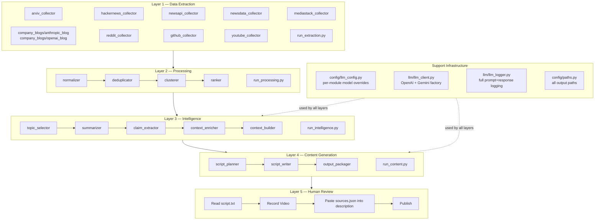

# AI Content Creation Pipeline — Master System Design

**Project:** Automated AI News YouTube Pipeline  
**Last updated:** 2026-05-10  
**Status:** Layers 1–4 built and tested end-to-end

---

# 1. Final Architecture Decision

This system is an **automated AI news intelligence pipeline** that collects raw data from 9+ sources, processes and ranks stories, generates a research-grade context packet, and finally produces a ready-to-record YouTube video script — all without human intervention except the final recording.

```text
Raw internet data (9 sources)
   ↓
Layer 1 — Extraction
   (collect raw articles, papers, repos, transcripts)
   ↓
Layer 2 — Processing
   (normalize → deduplicate → cluster → rank)
   ↓
Layer 3 — Intelligence
   (select topic → summarize → extract claims → enrich → assemble packet)
   ↓
Layer 4 — Content Generation
   (plan video → write script → package output)
   ↓
Layer 5 — Human Review (manual)
   (review script → record → publish)
```

**Core design principles:**
- Every layer writes its output to disk — each layer is independently runnable
- Raw logic, no heavy validations, no complex fallbacks
- Every module testable individually with `if __name__ == "__main__"` block
- Every LLM call logged to `output/llm_logs/` with full prompt + response
- Every fact in the final script traceable to a source URL

---

# 2. Final System Architecture Diagram



---

# 3. Layer-wise Implementation Plan

---

## Layer 1 — Data Extraction

### Purpose

Collect raw AI news data from 9 different source types. Each collector is independent. Save raw JSON to disk. No analysis, no summarization, no ranking — pure collection.

### Layer input

```text
Environment variables: API keys in .env
Config: which sources to query, date range, search keywords
```

### Layer output

```json
{
  "output/layer_1_raw/arxiv/2026-05-08_cs_ai.json":       "[ ...papers ]",
  "output/layer_1_raw/hackernews/2026-05-08_top.json":    "[ ...stories ]",
  "output/layer_1_raw/newsapi/2026-05-08_ai.json":        "[ ...articles ]",
  "output/layer_1_raw/newsdata/2026-05-08_ai.json":       "[ ...articles ]",
  "output/layer_1_raw/mediastack/2026-05-08_ai.json":     "[ ...articles ]",
  "output/layer_1_raw/blogs/anthropic/2026-05-08.json":   "[ ...posts ]",
  "output/layer_1_raw/blogs/openai/2026-05-08.json":      "[ ...posts ]",
  "output/layer_1_raw/reddit/2026-05-08_machinelearning.json": "[ ...posts ]",
  "output/layer_1_raw/github/2026-05-08_llm.json":        "[ ...repos ]",
  "output/layer_1_raw/youtube/VIDEO_ID.json":             "{ transcript + metadata }",
  "output/layer_1_raw/master_2026-05-08.json":            "[ ...all sources merged ]"
}
```

### Modules

| Module | File | Status | Purpose | Input | Output |
|--------|------|--------|---------|-------|--------|
| ArXiv collector | `arxiv_collector.py` | ✅ Built | Fetch latest AI/ML research papers via RSS | ArXiv RSS feed | `arxiv/YYYY-MM-DD_cs_ai.json` |
| Hacker News collector | `hackernews_collector.py` | ✅ Built | Top HN stories filtered to AI topics | HN REST API | `hackernews/YYYY-MM-DD_top.json` |
| NewsAPI collector | `newsapi_collector.py` | ✅ Built | News articles from 70K+ publishers | NewsAPI REST | `newsapi/YYYY-MM-DD_ai.json` |
| NewsData collector | `newsdata_collector.py` | ✅ Built | AI news from NewsData.io | NewsData REST | `newsdata/YYYY-MM-DD_ai.json` |
| Mediastack collector | `mediastack_collector.py` | ✅ Built | AI news from Mediastack | Mediastack REST | `mediastack/YYYY-MM-DD_ai.json` |
| Anthropic blog | `company_blogs/anthropic_blog.py` | ✅ Built | Official Anthropic announcements | HTML scrape | `blogs/anthropic/YYYY-MM-DD.json` |
| OpenAI blog | `company_blogs/openai_blog.py` | ✅ Built | Official OpenAI announcements | HTML scrape | `blogs/openai/YYYY-MM-DD.json` |
| Reddit collector | `reddit_collector.py` | ✅ Built | AI subreddit community signals | Reddit API | `reddit/YYYY-MM-DD_ml.json` |
| GitHub collector | `github_collector.py` | ✅ Built | Trending AI repos + README | GitHub API | `github/YYYY-MM-DD_llm.json` |
| YouTube collector | `youtube_collector.py` | ✅ Built | Video transcripts from given video IDs | YouTube API + transcript | `youtube/VIDEO_ID.json` |
| Extraction orchestrator | `run_extraction.py` | ✅ Built | Run all collectors, merge into master file | All above outputs | `master_YYYY-MM-DD.json` |

### Run command

```bash
python3 pipelines/layer_1_extraction/run_extraction.py
# or individual:
python3 pipelines/layer_1_extraction/arxiv_collector.py
python3 pipelines/layer_1_extraction/youtube_collector.py --id dQw4w9WgXcQ
```

---

## Layer 2 — Processing

### Purpose

Take the raw master file and transform it into a clean, ranked list of story clusters — ready for the intelligence layer to work on. No LLM involved. Pure code.

Four sequential steps: normalize all documents to a standard schema → deduplicate by URL and title → cluster similar stories together → rank clusters by a 5-dimension scoring system.

### Layer input

```json
{
  "source": "output/layer_1_raw/master_2026-05-08.json",
  "total_documents": 153
}
```

### Layer output

```json
{
  "normalized":    "output/layer_2_processed/documents/normalized_2026-05-08.json",
  "deduplicated":  "output/layer_2_processed/documents/deduplicated_2026-05-08.json",
  "clusters":      "output/layer_2_processed/clusters/clusters_2026-05-08.json",
  "ranked":        "output/layer_2_processed/rankings/ranked_2026-05-08.json"
}
```

### Modules

| Module | File | Status | Purpose | Input | Output |
|--------|------|--------|---------|-------|--------|
| Normalizer | `normalizer.py` | ✅ Built | Standardize all 9 source formats into one schema. Extract companies, models, keywords as entities. Cap raw_text at 15K chars. | `master_*.json` | `normalized_*.json` |
| Deduplicator | `deduplicator.py` | ✅ Built | 2-pass dedup: exact URL match first, then title similarity (>85%). Keep source attribution for merged docs. | `normalized_*.json` | `deduplicated_*.json` |
| Clusterer | `clusterer.py` | ✅ Built | Greedy single-pass clustering. Two docs cluster if they share 2 of 3: same entities, same date window, similar title. | `deduplicated_*.json` | `clusters_*.json` |
| Ranker | `ranker.py` | ✅ Built | Score each cluster 0–100 across 5 dimensions: Authority (source tier), Coverage (publisher count), Engagement (community signals), Significance (entity prominence), Richness (content depth). | `clusters_*.json` | `ranked_*.json` |
| Processing orchestrator | `run_processing.py` | ✅ Built | Run all 4 modules in sequence | `master_*.json` | All 4 output files |

### Scoring dimensions (Ranker)

| Dimension | Weight | What it measures |
|-----------|--------|-----------------|
| Authority | 30% | Trust tier of sources (Tier 1 = official company blog, Tier 3 = community) |
| Coverage | 25% | How many unique publishers cover this story |
| Engagement | 20% | Reddit score, GitHub stars, HN points |
| Significance | 15% | Mentions of major companies/models in entities |
| Richness | 10% | Average article length and content depth |

### Run command

```bash
python3 pipelines/layer_2_processing/run_processing.py
```

---

## Layer 3 — Intelligence

### Purpose

Turn the ranked story list into a comprehensive, research-grade **context packet** — the single file that Layer 4 reads to write the script. This is where LLMs are used for the first time.

Five sequential modules: pick the topic → synthesize sources → extract verified claims → add background context → assemble the final packet.

### Layer input

```json
{
  "source": "output/layer_2_processed/rankings/ranked_2026-05-08.json",
  "top_n_stories": 10
}
```

### Layer output

```json
{
  "context_packet": "output/layer_3_intelligence/context_packets/context_packet_2026-05-09.json",
  "size": "~25KB",
  "total_content_words": 1833,
  "verified_claims": 17,
  "sources": 6
}
```

### Context packet structure

```json
{
  "topic":               "story title",
  "headline":            "suggested YouTube headline",
  "date":                "YYYY-MM-DD",
  "story_score":         95,
  "summary":             "935-word narrative synthesis",
  "background":          "203-word history and context",
  "why_it_matters":      "153-word implications",
  "technical_breakdown": "194-word plain-language explanation",
  "comparisons":         "234-word competitive analysis",
  "audience_angle":      "114-word developer takeaway",
  "key_statistics":      [ "3 benchmark numbers with source URLs" ],
  "key_facts":           [ "14 product facts with attribution" ],
  "all_claims":          [ "17 total verified claims" ],
  "sources":             [ "6 sources sorted by trust tier" ],
  "pipeline_metadata":   { "models used, word counts, file paths" }
}
```

### Modules

| Module | File | Status | LLM? | Purpose | Input | Output |
|--------|------|--------|------|---------|-------|--------|
| Topic Selector | `topic_selector.py` | ✅ Built | ✅ (auto mode) | Pick which story to cover. 3 modes: interactive, `--pick N`, `--auto` (LLM scores top 10 and picks best for YouTube). | `ranked_*.json` | `selected_topic_*.json` |
| Summarizer | `summarizer.py` | ✅ Built | ✅ | Filter articles by content quality (min 200 chars). Sort by trust tier. Send all to LLM as labelled sources. Produce 400–700 word factual synthesis with source attribution. | `selected_topic_*.json` | `summaries/summary_*.json` |
| Claim Extractor | `claim_extractor.py` | ✅ Built | ✅ | Send summary + source URLs to LLM. Extract every verifiable claim as structured JSON with source URL, type (statistic/product_fact/comparison), and confidence. | `summary_*.json` + `selected_topic_*.json` | `claims_*.json` |
| Context Enricher | `context_enricher.py` | ✅ Built | ✅ | Go beyond the source articles. LLM draws on training knowledge to add 5 enrichment sections: background, why_it_matters, technical_breakdown, comparisons, audience_angle. | `summary_*.json` + `claims_*.json` | `research/enriched_*.json` |
| Context Builder | `context_builder.py` | ✅ Built | ❌ | Pure code. Merge all 4 intermediate files into one self-contained context packet. Split claims into key_statistics / key_facts / all_claims. Sort sources by trust tier. | All 4 above files | `context_packets/context_packet_*.json` |
| Intelligence orchestrator | `run_intelligence.py` | ✅ Built | — | Run all 5 modules in sequence | `ranked_*.json` | `context_packet_*.json` |

### LLM call log (per run)

| Module | Prompt tokens | Output tokens | Duration |
|--------|-------------|---------------|----------|
| topic_selector (auto) | ~761 | ~91 | ~10s |
| summarizer | ~7,180 | ~1,578 | ~35s |
| claim_extractor | ~2,037 | ~1,281 | ~108s |
| context_enricher | ~1,538 | ~1,656 | ~24s |

All calls logged to `output/llm_logs/YYYY-MM-DD_{module}_{time}.json`

### Run command

```bash
python3 pipelines/layer_3_intelligence/run_intelligence.py --auto
# or step-by-step:
python3 pipelines/layer_3_intelligence/topic_selector.py --auto
python3 pipelines/layer_3_intelligence/summarizer.py
python3 pipelines/layer_3_intelligence/claim_extractor.py
python3 pipelines/layer_3_intelligence/context_enricher.py
python3 pipelines/layer_3_intelligence/context_builder.py
```

---

## Layer 4 — Content Generation

### Purpose

Turn the context packet into a ready-to-record YouTube video script package. Two LLM calls: one to design the video structure, one to write the script. Final module is pure code.

### Design principle — why plan first, then write

If you ask the LLM to "write a script" in one shot, it invents structure while writing and compromises on both. The planner forces the LLM to decide the narrative arc, angle, and section timing first. The writer then executes within that structure with full attention on language quality.

### Layer input

```json
{
  "source": "output/layer_3_intelligence/context_packets/context_packet_2026-05-09.json",
  "target_duration_minutes": 10
}
```

### Layer output

```text
output/layer_4_content/scripts/2026-05-09_claude_opus_4_7/
├── script.txt        ← plain text, open on teleprompter and record
├── script.md         ← formatted with section headers and [📺 On screen:] callouts
├── sources.json      ← filtered source list + copy-paste description text
└── metadata.json     ← topic, word count, duration, all models used
```

### Modules

| Module | File | Status | LLM? | Purpose | Input | Output |
|--------|------|--------|------|---------|-------|--------|
| Script Planner | `script_planner.py` | ✅ Built | ✅ | Design the video structure. LLM acts as video producer: decides angle, tone, throughline, and section-by-section plan with timestamps, duration targets, writing direction, and which specific claims to use per section. | `context_packet_*.json` | `plan_*.json` |
| Script Writer | `script_writer.py` | ✅ Built | ✅ | Write word-for-word script following the plan. Single LLM call with: full plan, verified facts reference, strict writing rules (speak-first, exact stat wording, [SHOW:] directions, bridge sentences, no hype words). | `plan_*.json` + `context_packet_*.json` | `script_*.txt` + `script_*.md` |
| Output Packager | `output_packager.py` | ✅ Built | ❌ | Pure code. Clean the script text, build formatted markdown, filter quality sources (remove GitHub trending/PyPI noise), assemble folder with 4 files. | `script_*.txt` + `plan_*.json` + `context_packet_*.json` | `{date}_{slug}/` folder |
| Content orchestrator | `run_content.py` | ✅ Built | — | Run all 3 modules in sequence | `context_packet_*.json` | Final script folder |

### Script writing rules (enforced in prompt)

1. **Write for speaking** — short sentences, active voice, contractions OK
2. **Numbers need context** — don't say "0.715", say "0.715 out of 1.0 — that's the top score across all six evaluation categories"
3. **Exact wording for statistics** — zero paraphrasing of benchmark numbers
4. **Screen directions** — `[SHOW: coding benchmark chart]` on its own line
5. **Section bridges** — every section ends with one sentence flowing to the next
6. **Forbidden phrases** — no "game-changing", "revolutionary", "groundbreaking", "in conclusion", "as we can see"

### LLM call log (per run)

| Module | Prompt tokens | Output tokens | Duration |
|--------|-------------|---------------|----------|
| script_planner | ~1,680 | ~2,334 | ~67s |
| script_writer | ~3,261 | ~2,127 | ~52s |

### Run command

```bash
python3 pipelines/layer_4_content/run_content.py
# or with duration override:
python3 pipelines/layer_4_content/run_content.py --duration 8
# or step-by-step:
python3 pipelines/layer_4_content/script_planner.py
python3 pipelines/layer_4_content/script_writer.py
python3 pipelines/layer_4_content/output_packager.py
```

---

## Layer 5 — Human Review (Manual)

### Purpose

You are the final quality gate. Review the script, record the video, publish.

### What you receive

```text
output/layer_4_content/scripts/2026-05-09_claude_opus_4_7/
├── script.txt     ← Open this on your teleprompter
├── script.md      ← Read this for editing, it has section headers
├── sources.json   ← Copy description_text field into YouTube description
└── metadata.json  ← Reference: word count, models used, story score
```

### What to check before recording

- [ ] All benchmark numbers cited match what you know from reading the source
- [ ] The angle/throughline makes sense for your audience
- [ ] The Hook (first 30 seconds) is strong enough — rewrite if needed
- [ ] The Practical Adoption section gives viewers something to actually do
- [ ] Sources list is clean and relevant (check `sources.json`)

### Status

🔲 Not automated — intentionally manual

---

# 4. Support Infrastructure

| Component | File | Purpose |
|-----------|------|---------|
| LLM config | `config/llm_config.py` | Central model config. Switch between `dev` (fast/cheap) and `production` (high-quality) profiles. Per-module overrides via `MODULE_OVERRIDES`. |
| LLM client | `llm/llm_client.py` | Factory function. Returns correct LangChain LLM object for OpenAI or Gemini based on profile. |
| LLM logger | `llm/llm_logger.py` | Drop-in wrapper for `llm.invoke()`. Saves full prompt + response + token estimates + duration to `output/llm_logs/`. Use `call_llm(llm, prompt, module="name")`. |
| Paths | `config/paths.py` | All output path constants. Call `ensure_output_dirs()` at start of any orchestrator. |

### LLM config — switching models

```python
# config/llm_config.py

ACTIVE_PROFILE = "dev"      # cheap/fast for development

# For production recording, change to:
ACTIVE_PROFILE = "production"

# Or override just the script writer (most visible quality impact):
MODULE_OVERRIDES = {
    "script_writer": "production",   # gpt-4o or Claude Sonnet
}
```

---

# 5. Full Pipeline — End to End

```bash
# Step 1: Collect raw data (~2 min)
python3 pipelines/layer_1_extraction/run_extraction.py

# Step 2: Process + rank stories (<1 sec)
python3 pipelines/layer_2_processing/run_processing.py

# Step 3: Intelligence — pick topic, research, build context packet (~3 min, ~$0.11)
python3 pipelines/layer_3_intelligence/run_intelligence.py --auto

# Step 4: Generate script (~2 min, ~$0.10)
python3 pipelines/layer_4_content/run_content.py

# Step 5: Open script and record (human)
open output/layer_4_content/scripts/*/script.txt
```

**Total cost per video:** ~$0.21 on dev models (gpt-5-nano). ~$0.50–$1.00 on production models (gpt-4o / Claude Sonnet 4.5).

---

# 6. Output Directory Map

```text
output/
├── layer_1_raw/
│   ├── arxiv/
│   ├── hackernews/
│   ├── newsapi/
│   ├── newsdata/
│   ├── mediastack/
│   ├── blogs/
│   │   ├── anthropic/
│   │   └── openai/
│   ├── reddit/
│   ├── github/
│   ├── youtube/
│   └── master_YYYY-MM-DD.json          ← Layer 1 final output
│
├── layer_2_processed/
│   ├── documents/
│   │   ├── normalized_YYYY-MM-DD.json
│   │   └── deduplicated_YYYY-MM-DD.json
│   ├── clusters/
│   │   └── clusters_YYYY-MM-DD.json
│   └── rankings/
│       └── ranked_YYYY-MM-DD.json      ← Layer 2 final output
│
├── layer_3_intelligence/
│   ├── selected_topic_YYYY-MM-DD.json
│   ├── summaries/
│   │   └── summary_YYYY-MM-DD.json
│   ├── claims_YYYY-MM-DD.json
│   ├── research/
│   │   └── enriched_YYYY-MM-DD.json
│   └── context_packets/
│       └── context_packet_YYYY-MM-DD.json   ← Layer 3 final output
│
├── layer_4_content/
│   └── scripts/
│       ├── plan_YYYY-MM-DD.json
│       ├── script_YYYY-MM-DD.txt
│       ├── script_YYYY-MM-DD.md
│       └── YYYY-MM-DD_{slug}/               ← Layer 4 final output
│           ├── script.txt
│           ├── script.md
│           ├── sources.json
│           └── metadata.json
│
└── llm_logs/
    └── YYYY-MM-DD_{module}_{HHMMSS}.json    ← one file per LLM call
```

---

# 7. Build Status

| Layer | Layer Name | Status | Modules Built |
|-------|-----------|--------|---------------|
| Layer 1 | Data Extraction | ✅ Complete | 10 collectors + orchestrator |
| Layer 2 | Processing | ✅ Complete | normalizer, deduplicator, clusterer, ranker + orchestrator |
| Layer 3 | Intelligence | ✅ Complete | topic_selector, summarizer, claim_extractor, context_enricher, context_builder + orchestrator |
| Layer 4 | Content Generation | ✅ Complete | script_planner, script_writer, output_packager + orchestrator |
| Layer 5 | Human Review | 🔲 Manual | (intentionally not automated) |

**All 4 automated layers are built, tested, and producing real output.**

---

# 8. What to Build Next

| Priority | Item | Why |
|----------|------|-----|
| 🔴 High | Reddit collector fix | Reddit API auth needs revisiting — currently returning limited data |
| 🔴 High | More company blogs | Google DeepMind, Meta AI, Mistral — high-value Tier 1 sources missing |
| 🟡 Medium | Hugging Face papers collector | Great source for trending AI papers alongside ArXiv |
| 🟡 Medium | Run scheduler (`cron` / `launchd`) | Automate daily Layer 1+2 run at 6am, Layer 3+4 at 7am |
| 🟡 Medium | Script quality upgrade | Switch `script_writer` to `production` profile for recorded videos |
| 🟢 Low | Layer 5 linter | Script auto-check: count words, flag forbidden phrases, verify all stats have sources |
| 🟢 Low | Thumbnail prompt generator | From the topic + angle, generate a DALL-E prompt for the thumbnail |
| 🟢 Low | YouTube description generator | Auto-format description from `sources.json` + `metadata.json` |
