Below is the **final system design / implementation plan** for your AI YouTube content engine.

The key decision: this should **not** be only a “script generator.” It should be a **YouTube AI Content Operating System**.

Your current repo is a good start. Based on the uploaded project, you already have:

```text
Layer 1 — extraction
Layer 2 — normalization / deduplication / clustering / ranking
Layer 3 — single-topic intelligence packet
Layer 4 — single-topic script generation
```

That means you built a strong **Deep Dive branch**, but the final product should support multiple video formats from the same shared news/research backbone.

---

# 1. Final product definition

Your system should support these content formats:

```text
Format A — AI News Roundup
Example: “Everything Important That Happened in AI This Week”
Input: top 5–8 stories
Output: 6–10 minute multi-story script

Format B — Deep Dive
Example: “Why OpenAI’s New Agent System Actually Matters”
Input: one story cluster
Output: 8–12 minute focused analysis script

Format C — Evergreen / Explainer
Example: “AI Agents Explained: What Changed in 2026?”
Input: long-term memory + recent sources
Output: durable educational video

Format D — Comparison / Battle
Example: “Claude vs Gemini vs ChatGPT for Coding”
Input: product docs, benchmarks, user signals, prior memory
Output: comparison script with evidence table

Format E — Follow-up / Update
Example: “What Happened After the Controversial AI Model Launch?”
Input: previous video memory + new evidence
Output: follow-up video
```

So the final architecture should be:

```text
Shared evidence trunk
     ↓
Story intelligence
     ↓
Editorial router
     ↓
Format-specific branches
     ↓
Verification firewall
     ↓
Script package
     ↓
Memory update
```

---

# 2. Final system architecture diagram

```mermaid
flowchart TB

    subgraph L0["Layer 0 — Channel Strategy + Run Control"]
        L0A[Channel Thesis Config]
        L0B[Run Config<br/>daily / 48h / weekly]
        L0C[Format Config<br/>roundup / deep dive / evergreen]
        L0D[Quality Rules]
    end

    subgraph L1["Layer 1 — Source Extraction"]
        L1A[AI Company Blogs]
        L1B[Tech News APIs]
        L1C[Research Papers]
        L1D[YouTube / Podcast Transcripts]
        L1E[Community Signals]
        L1F[GitHub / Open Source Signals]
    end

    subgraph L2["Layer 2 — Canonicalization + Evidence Store"]
        L2A[Document Normalizer]
        L2B[Content Cleaner]
        L2C[Source Span Chunker]
        L2D[Trust Tier Tagger]
        L2E[Provenance Builder]
    end

    subgraph L3["Layer 3 — Story Processing"]
        L3A[Deduplicator]
        L3B[Story Clusterer]
        L3C[Entity + Topic Mapper]
        L3D[Story Ranker]
        L3E[Story Timeline Builder]
    end

    subgraph L4["Layer 4 — Evidence Intelligence"]
        L4A[Atomic Claim Extractor]
        L4B[Claim Verifier]
        L4C[Contradiction Detector]
        L4D[Evidence Density Scorer]
        L4E[Uncertainty Classifier]
    end

    subgraph L5["Layer 5 — Editorial Intelligence"]
        L5A[Audience Fit Analyzer]
        L5B[Novelty Checker]
        L5C[Market Gap Analyzer]
        L5D[Format Router]
        L5E[Video Opportunity Scorer]
    end

    subgraph L6["Layer 6 — Format-Specific Research Packets"]
        L6A[Roundup Packet Builder]
        L6B[Deep Dive Packet Builder]
        L6C[Evergreen Packet Builder]
        L6D[Comparison Packet Builder]
        L6E[Follow-up Packet Builder]
    end

    subgraph L7["Layer 7 — Content Planning"]
        L7A[Hook Planner]
        L7B[Narrative Planner]
        L7C[Section Planner]
        L7D[Visual / B-roll Planner]
        L7E[Title + Thumbnail Angle Planner]
    end

    subgraph L8["Layer 8 — Script Generation"]
        L8A[Roundup Script Writer]
        L8B[Deep Dive Script Writer]
        L8C[Evergreen Script Writer]
        L8D[Comparison Script Writer]
        L8E[Follow-up Script Writer]
        L8F[YouTube Metadata Generator]
        L8G[Shorts / Clips Generator]
    end

    subgraph L9["Layer 9 — Verification Firewall"]
        L9A[Sentence-Level Source Checker]
        L9B[Unsupported Claim Detector]
        L9C[Repeated Angle Checker]
        L9D[Risk / Defamation Checker]
        L9E[Final Approval Report]
    end

    subgraph L10["Layer 10 — Memory + Learning"]
        L10A[Video + Story Coverage Memory]
        L10B[Claim Ledger + Evidence Gaps]
        L10C[Entity + Topic Memory]
        L10D[Editorial Pattern + Source Memory]
        L10E[Follow-ups + Watchlists]
        L10F[Performance + Learning Signals]
    end

    L0 --> L1
    L1 --> L2
    L2 --> L3
    L3 --> L4
    L4 --> L5
    L10 --> L5
    L5 --> L6
    L6 --> L7
    L7 --> L8
    L8 --> L9
    L9 --> L10
```



---

# 3. Core design principle

Every module should communicate through **structured state**, not free-form agent chat.

Use this rule:

```text
Source document
→ source span
→ atomic claim
→ story cluster
→ editorial decision
→ format packet
→ script sentence
→ verification report
→ memory update
```

Not this:

```text
Article summary
→ LLM opinion
→ another LLM opinion
→ final script
```

This matters because hallucinations compound when one model-generated paragraph becomes the next model’s “source.” Use JSON schemas for inter-module outputs. OpenAI Structured Outputs are specifically designed to make model responses follow a developer-supplied JSON schema, which fits this architecture well. ([OpenAI Platform][1])

---

# 4. Layer 0 — Channel Strategy + Run Control

## Purpose

This layer defines what kind of YouTube channel you are building.

It answers:

```text
Who is the audience?
What video formats do we support?
How often are we publishing?
What tone should the channel use?
What topics are in-scope or out-of-scope?
How strict should evidence requirements be?
```

## Why this layer is important

Without this layer, the system will become generic. It may write technically correct scripts, but they will not feel like a consistent channel.

## Modules

### 0.1 Channel Thesis Config

**Purpose:** Define your channel identity.

**Questions it answers:**

```text
Are we making videos for AI beginners, developers, founders, investors, or general tech viewers?
Should the tone be skeptical, excited, technical, simple, or business-focused?
What makes our channel different from other AI news channels?
```

**Input:**

```json
{
  "target_audience": "AI-interested developers and tech professionals",
  "tone": "clear, analytical, skeptical but not negative",
  "content_promise": "AI news explained with evidence, practical impact, and no hype",
  "avoid": ["unsupported rumors", "clickbait panic", "fake certainty"]
}
```

**Output:**

```json
{
  "channel_thesis_id": "default_ai_channel_v1",
  "audience": "technical-but-accessible",
  "style_rules": [
    "explain why it matters",
    "separate facts from analysis",
    "do not overhype model releases",
    "always mention uncertainty"
  ],
  "preferred_angles": [
    "what changed",
    "who is affected",
    "what is actually useful",
    "what is still unclear"
  ]
}
```

---

### 0.2 Run Config

**Purpose:** Decide the collection and publishing window.

**Questions it answers:**

```text
Are we making a video today?
Should we collect the last 24 hours, 48 hours, or 7 days?
Are we generating a roundup, deep dive, or evergreen video?
```

**Recommended cadence:**

```text
Roundup video: every 48 hours
Deep dive video: once per week
Evergreen / comparison video: every 1–2 weeks
```

Collecting can happen daily, even if publishing does not. YouTube’s own analytics tools emphasize engagement metrics like watch time, average view duration, and audience retention, so publishing fewer but better videos is usually better than forcing weak daily videos. ([Google Help][2])

**Input:**

```json
{
  "run_date": "2026-05-10",
  "lookback_hours": 48,
  "preferred_format": "auto",
  "max_videos_to_generate": 1
}
```

**Output:**

```json
{
  "run_id": "run_2026_05_10_48h",
  "collection_window": {
    "start": "2026-05-08T00:00:00Z",
    "end": "2026-05-10T00:00:00Z"
  },
  "eligible_formats": ["roundup", "deep_dive", "evergreen"]
}
```

---

# 5. Layer 1 — Source Extraction

## Purpose

Collect raw AI-related information from trusted and semi-trusted sources.

This layer should not analyze. It should only collect.

## Layer input

```json
{
  "run_id": "run_2026_05_10_48h",
  "collection_window": {
    "start": "2026-05-08T00:00:00Z",
    "end": "2026-05-10T00:00:00Z"
  },
  "source_config": "config/sources.yaml"
}
```

## Layer output

```json
{
  "run_id": "run_2026_05_10_48h",
  "raw_documents_path": "data/raw/master_2026_05_10.jsonl",
  "source_count": 9,
  "document_count": 240,
  "failed_sources": []
}
```

## Modules

### 1.1 AI Company Blog Collector

**Purpose:** Collect official company announcements.

**Sources:**

```text
OpenAI News
Anthropic News
Google DeepMind Blog
Google Research Blog
Meta AI Blog
Microsoft AI
AWS Machine Learning Blog
NVIDIA Blog
Hugging Face Blog
Mistral AI Blog
Perplexity Blog
```

**Questions it answers:**

```text
What did the company officially announce?
When did it announce it?
Is this a model release, product launch, partnership, research post, or safety update?
```

**Why important:**

Official sources are your strongest evidence for factual claims.

**Input:**

```json
{
  "source_id": "openai_news",
  "url": "https://openai.com/news/",
  "lookback_hours": 48
}
```

**Output document format:**

```json
{
  "document_id": "doc_openai_001",
  "source_id": "openai_news",
  "source_category": "official_company_blog",
  "trust_tier": 1,
  "title": "Article title",
  "url": "https://...",
  "published_at": "2026-05-10T12:00:00Z",
  "raw_text": "...",
  "raw_html_path": "data/raw/company_blogs/openai/doc_openai_001.html",
  "collected_at": "2026-05-10T13:00:00Z"
}
```

---

### 1.2 Tech News API Collector

**Purpose:** Collect broad news coverage and trending media stories.

**Sources:**

```text
NewsAPI
GDELT
Mediastack
NewsData.io
Google News RSS as optional discovery
```

**Questions it answers:**

```text
Which AI stories are being covered by multiple media outlets?
What is trending across tech media?
Is there independent coverage beyond the company announcement?
```

**Why important:**

Official blogs show what companies claim. News APIs show how the market and media interpret those announcements.

**Input:**

```json
{
  "queries": [
    "artificial intelligence",
    "generative AI",
    "OpenAI",
    "Claude",
    "Gemini",
    "AI agents",
    "NVIDIA AI",
    "AI regulation"
  ],
  "lookback_hours": 48
}
```

**Output:**

```json
{
  "document_id": "doc_newsapi_001",
  "source_category": "tech_news_api",
  "trust_tier": 2,
  "publisher": "The Verge",
  "title": "...",
  "url": "...",
  "description": "...",
  "published_at": "...",
  "query_used": "AI agents",
  "raw_api_response_path": "data/raw/newsapi/doc_newsapi_001.json"
}
```

---

### 1.3 Research Paper Collector

**Purpose:** Collect latest AI research and technical signals.

**Sources:**

```text
arXiv cs.AI
arXiv cs.LG
arXiv cs.CL
arXiv cs.CV
Semantic Scholar
Hugging Face Papers
Papers with Code / GitHub repo links
```

**Questions it answers:**

```text
What new AI research is emerging?
Are there papers connected to a current news story?
Is there technical evidence behind a product or benchmark claim?
```

**Why important:**

This gives your channel technical credibility and helps you move beyond basic news summarization.

**Input:**

```json
{
  "categories": ["cs.AI", "cs.LG", "cs.CL", "cs.CV"],
  "lookback_days": 7
}
```

**Output:**

```json
{
  "document_id": "doc_arxiv_001",
  "source_category": "research_paper",
  "trust_tier": 1.5,
  "title": "...",
  "authors": ["..."],
  "abstract": "...",
  "arxiv_id": "...",
  "pdf_url": "...",
  "published_at": "...",
  "categories": ["cs.LG"],
  "code_url": null
}
```

---

### 1.4 YouTube / Podcast Transcript Collector

**Purpose:** Collect context from interviews, demos, launch videos, conference talks, and podcasts.

**Sources:**

```text
Official OpenAI YouTube
Anthropic YouTube
Google DeepMind YouTube
Microsoft Developer
AWS / NVIDIA channels
Lex Fridman
Dwarkesh Podcast
a16z podcast
Y Combinator
AI conference talks
```

**Questions it answers:**

```text
Did someone explain the announcement in more detail?
Are there direct quotes from founders, researchers, or engineers?
Can we extract timestamped clips for video context?
```

**Why important:**

Transcripts give you useful quotes, explanations, and B-roll opportunities.

**Input:**

```json
{
  "channel_ids": ["..."],
  "lookback_days": 7,
  "include_transcripts": true
}
```

**Output:**

```json
{
  "document_id": "doc_youtube_001",
  "source_category": "video_transcript",
  "trust_tier": 2,
  "platform": "youtube",
  "channel": "OpenAI",
  "video_id": "...",
  "title": "...",
  "url": "...",
  "published_at": "...",
  "duration_seconds": 1800,
  "transcript_chunks": [
    {
      "chunk_id": "yt_001_0001",
      "start_time": 120.5,
      "end_time": 145.2,
      "text": "..."
    }
  ]
}
```

---

### 1.5 Community Signal Collector

**Purpose:** Collect signals from developer and AI communities.

**Sources:**

```text
Hacker News
Reddit
GitHub Trending
GitHub Releases
Product Hunt
X/Twitter, optional and only if API access is reliable
```

**Questions it answers:**

```text
What are people discussing?
What is controversial?
Which open-source projects are gaining attention?
Are developers excited, skeptical, or confused?
```

**Why important:**

Community signals help with topic selection and audience relevance, but they should not be treated as factual proof.

**Output:**

```json
{
  "document_id": "doc_hn_001",
  "source_category": "community_signal",
  "trust_tier": 3,
  "platform": "hackernews",
  "title": "...",
  "url": "...",
  "points": 580,
  "comment_count": 210,
  "linked_source_url": "...",
  "discussion_summary_raw": "..."
}
```

---

# 6. Layer 2 — Canonicalization + Evidence Store

## Purpose

Turn raw source outputs into clean, traceable, standardized evidence records.

This layer is very important because every later layer depends on source traceability.

## Layer input

```json
{
  "raw_documents_path": "data/raw/master_2026_05_10.jsonl"
}
```

## Layer output

```json
{
  "documents": "data/canonical/documents_2026_05_10.jsonl",
  "source_spans": "data/evidence/source_spans_2026_05_10.jsonl",
  "source_registry_snapshot": "data/evidence/source_registry_2026_05_10.json"
}
```

## Modules

### 2.1 Document Normalizer

**Purpose:** Convert every source type into one schema.

**Questions it answers:**

```text
What is this source?
Who published it?
When was it published?
What kind of content is it?
Can later modules treat it the same way as all other documents?
```

**Input:** raw source documents
**Output:**

```json
{
  "document_id": "doc_123",
  "run_id": "run_2026_05_10_48h",
  "source_id": "anthropic_news",
  "source_category": "official_company_blog",
  "trust_tier": 1,
  "title": "...",
  "url": "...",
  "published_at": "...",
  "author": "Anthropic",
  "clean_text": "...",
  "language": "en",
  "content_hash": "sha256...",
  "metadata": {
    "company": "Anthropic",
    "content_type": "product_announcement"
  }
}
```

---

### 2.2 Content Cleaner

**Purpose:** Remove junk text.

**Questions it answers:**

```text
Is the article body clean?
Did we remove cookie banners, nav text, duplicate paragraphs, ads, and unrelated links?
```

**Why important:**

Bad cleaning leads to bad summaries and false claims.

---

### 2.3 Source Span Chunker

**Purpose:** Split documents into traceable chunks.

**Questions it answers:**

```text
Which exact paragraph or transcript timestamp supports a later claim?
Can we cite the exact source span, not just the article URL?
```

**Input:**

```json
{
  "document_id": "doc_123",
  "clean_text": "..."
}
```

**Output:**

```json
{
  "span_id": "span_doc_123_004",
  "document_id": "doc_123",
  "source_url": "https://...",
  "span_index": 4,
  "text": "The exact paragraph text...",
  "start_char": 1200,
  "end_char": 1600,
  "timestamp_start": null,
  "timestamp_end": null
}
```

For YouTube transcripts:

```json
{
  "span_id": "span_yt_001_012",
  "document_id": "doc_youtube_001",
  "text": "...",
  "timestamp_start": 331.2,
  "timestamp_end": 359.8
}
```

---

### 2.4 Trust Tier Tagger

**Purpose:** Assign reliability to each source.

**Trust model:**

```text
Tier 1 — official company / official docs / official repo
Tier 1.5 — research paper / benchmark / academic source
Tier 2 — reputable news outlet / news API
Tier 3 — community signal
Tier 4 — weak / unknown / unsourced
```

**Output:**

```json
{
  "document_id": "doc_123",
  "trust_tier": 1,
  "reliability_score": 0.95,
  "source_role": "primary_evidence"
}
```

---

# 7. Layer 3 — Story Processing

## Purpose

Turn documents into story clusters.

Layer 1 and 2 collect evidence. Layer 3 decides:

```text
What are the actual stories?
Which documents are about the same event?
Which stories are important?
```

## Layer input

```json
{
  "documents_path": "data/canonical/documents_2026_05_10.jsonl",
  "source_spans_path": "data/evidence/source_spans_2026_05_10.jsonl"
}
```

## Layer output

```json
{
  "story_clusters_path": "data/stories/story_clusters_2026_05_10.json",
  "ranked_stories_path": "data/stories/ranked_stories_2026_05_10.json"
}
```

## Modules

### 3.1 Deduplicator

**Purpose:** Remove repeated articles and duplicate versions.

**Questions it answers:**

```text
Is this exact URL already collected?
Is this title almost identical to another one?
Is this a republished article?
```

**Logic:**

```text
1. Exact URL match
2. Canonical URL match
3. Title similarity
4. Content hash similarity
5. Publisher duplicate check
```

**Output:**

```json
{
  "canonical_document_id": "doc_123",
  "duplicate_document_ids": ["doc_456", "doc_789"],
  "dedup_reason": "same_canonical_url"
}
```

---

### 3.2 Story Clusterer

**Purpose:** Group different sources covering the same story.

**Questions it answers:**

```text
Are these documents about the same AI event?
Which sources support the same story?
Is this story official, media-driven, research-driven, or community-driven?
```

**Logic:**

Cluster if documents share:

```text
same key entity
same event date range
similar headline
same product/model/research paper
same source URL being discussed
semantic similarity
```

**Output:**

```json
{
  "story_id": "story_2026_05_10_openai_agent_release",
  "canonical_title": "OpenAI announces new AI agent tools",
  "primary_entities": ["OpenAI", "AI agents"],
  "documents": ["doc_123", "doc_456", "doc_789"],
  "source_mix": {
    "official": 1,
    "news": 4,
    "community": 2,
    "research": 0
  }
}
```

---

### 3.3 Entity + Topic Mapper

**Purpose:** Identify people, companies, products, models, and topics.

**Questions it answers:**

```text
Which AI company is involved?
Which model or product is involved?
Is this about agents, chips, regulation, open source, benchmarks, or funding?
```

**Output:**

```json
{
  "story_id": "story_123",
  "entities": {
    "companies": ["OpenAI", "Microsoft"],
    "models": ["GPT-5.1"],
    "products": ["Codex"],
    "people": [],
    "topics": ["AI agents", "coding assistants"]
  }
}
```

---

### 3.4 Story Ranker

**Purpose:** Rank stories by importance.

**Questions it answers:**

```text
Which stories are most important?
Which stories have enough evidence?
Which stories have audience interest?
```

**Scoring dimensions:**

```text
Authority score — official/reliable sources
Coverage score — number of independent sources
Engagement score — HN/Reddit/GitHub/YouTube signal
Impact score — user/developer/business impact
Novelty score — new vs repeated
Evidence density score — enough source spans and claims
```

**Output:**

```json
{
  "story_id": "story_123",
  "rank_score": 86,
  "score_breakdown": {
    "authority": 25,
    "coverage": 18,
    "engagement": 14,
    "impact": 16,
    "novelty": 8,
    "evidence_density": 5
  },
  "recommendation": "eligible_for_editorial_routing"
}
```

---

# 8. Layer 4 — Evidence Intelligence

## Purpose

Extract and verify facts before any script is written.

This is your hallucination-control foundation.

## Layer input

```json
{
  "story_clusters_path": "data/stories/ranked_stories_2026_05_10.json",
  "source_spans_path": "data/evidence/source_spans_2026_05_10.jsonl"
}
```

## Layer output

```json
{
  "atomic_claims_path": "data/evidence/atomic_claims_2026_05_10.jsonl",
  "claim_verification_path": "data/evidence/claim_verification_2026_05_10.json"
}
```

## Modules

### 4.1 Atomic Claim Extractor

**Purpose:** Extract small, verifiable claims directly from source spans.

**Questions it answers:**

```text
What exact factual claims exist in the sources?
Which source span supports each claim?
Is this a quote, statistic, product fact, event fact, benchmark, or opinion?
```

**Very important rule:**

Extract claims from **source spans**, not from generated summaries.

**Input:**

```json
{
  "span_id": "span_doc_123_004",
  "text": "OpenAI announced that Codex can now..."
}
```

**Output:**

```json
{
  "claim_id": "claim_001",
  "story_id": "story_123",
  "claim_text": "OpenAI announced that Codex can perform code editing tasks inside a developer workflow.",
  "claim_type": "product_fact",
  "source_span_ids": ["span_doc_123_004"],
  "source_urls": ["https://..."],
  "trust_tier": 1,
  "confidence": "high"
}
```

---

### 4.2 Claim Verifier

**Purpose:** Check whether each claim is actually supported.

**Questions it answers:**

```text
Does the source span really support the claim?
Is the claim overstated?
Does another source contradict it?
Is it official claim, independent confirmation, or community opinion?
```

**Output:**

```json
{
  "claim_id": "claim_001",
  "verification_status": "verified",
  "support_level": "direct",
  "risk": "low",
  "notes": "Supported by official product announcement."
}
```

---

### 4.3 Contradiction Detector

**Purpose:** Find conflicting claims.

**Questions it answers:**

```text
Do sources disagree?
Is the company claim challenged by independent sources?
Are benchmarks inconsistent?
Is this rumor-level information?
```

**Output:**

```json
{
  "story_id": "story_123",
  "contradictions": [
    {
      "claim_a": "claim_001",
      "claim_b": "claim_018",
      "contradiction_type": "benchmark_conflict",
      "severity": "medium"
    }
  ]
}
```

---

### 4.4 Evidence Density Scorer

**Purpose:** Decide whether a story has enough proof to become a video.

**Questions it answers:**

```text
Do we have enough evidence to discuss this confidently?
Do we have primary sources?
Do we have independent sources?
Do we only have community speculation?
```

**Output:**

```json
{
  "story_id": "story_123",
  "evidence_density_score": 82,
  "primary_source_count": 1,
  "independent_source_count": 4,
  "community_signal_count": 3,
  "verdict": "safe_for_video"
}
```

---

# 9. Layer 5 — Editorial Intelligence

## Purpose

This is the “think like a YouTuber” layer.

It decides:

```text
Should we make a video?
What format should it be?
What angle makes it worth watching?
Has this already been covered by us?
Is the market already saturated?
```

## Layer input

```json
{
  "ranked_stories": "data/stories/ranked_stories_2026_05_10.json",
  "atomic_claims": "data/evidence/atomic_claims_2026_05_10.jsonl",
  "memory": "memory/"
}
```

## Layer output

```json
{
  "editorial_candidates_path": "data/editorial/editorial_candidates_2026_05_10.json",
  "selected_video_brief_path": "data/editorial/selected_video_brief_2026_05_10.json"
}
```

## Modules

### 5.1 Audience Fit Analyzer

**Purpose:** Decide whether your audience will care.

**Questions it answers:**

```text
Is this useful for developers, AI users, founders, or general tech viewers?
Is this too niche?
Is this too shallow?
Does this have practical impact?
```

**Output:**

```json
{
  "story_id": "story_123",
  "audience_fit_score": 88,
  "best_audience": "AI developers and tech professionals",
  "viewer_question": "Does this change how developers use AI coding tools?"
}
```

---

### 5.2 Novelty Checker

**Purpose:** Avoid repeating your own videos.

**Questions it answers:**

```text
Have we already covered this company, product, or exact angle?
Is this a fresh update or just a duplicate?
Should this be a follow-up instead of a new video?
```

**Memory checked:**

```text
video_memory.jsonl
story_coverage_memory.jsonl
claim_ledger.jsonl
entity_topic_memory.jsonl
```

**Output:**

```json
{
  "story_id": "story_123",
  "novelty_score": 72,
  "previous_related_videos": ["video_2026_04_25_ai_agents"],
  "recommendation": "make_as_follow_up_angle"
}
```

This should happen **early** and **late**. Early to avoid selecting duplicate topics. Late to avoid writing the same intro, analogy, or framing again.

---

### 5.3 Market Gap Analyzer

**Purpose:** Check what other creators are doing.

**Questions it answers:**

```text
Are other YouTubers already covering this?
What angle are they using?
Is there an under-covered angle?
Can we create a better, more evidence-based version?
```

**Important rule:**

This module is not part of the evidence pipeline. It is only for packaging and positioning.

**Output:**

```json
{
  "story_id": "story_123",
  "market_saturation": "medium",
  "common_angles": [
    "AI agents are replacing developers",
    "new model release reaction"
  ],
  "gap_angle": "what actually changed in the developer workflow, with source-backed examples"
}
```

---

### 5.4 Format Router

**Purpose:** Decide the best video format.

**Questions it answers:**

```text
Should this be one item in a roundup?
Should this become a deep dive?
Should we save it for an evergreen explainer?
Should we ignore it for now?
```

**Routing logic:**

```text
If story has high importance + high evidence + high depth → Deep Dive
If story is important but shallow → Roundup mention
If story connects to long-term trend → Evergreen
If story updates a previous video → Follow-up
If story has weak evidence → Monitor only
```

**Output:**

```json
{
  "story_id": "story_123",
  "recommended_format": "deep_dive",
  "reason": "High evidence density, strong audience fit, enough technical context, high novelty.",
  "secondary_format": "roundup"
}
```

---

### 5.5 Video Opportunity Scorer

**Purpose:** Score the actual video opportunity, not just the news.

**Questions it answers:**

```text
Can this become a strong video?
Does it have tension?
Does it have a clear viewer promise?
Can we make a strong hook?
Can we explain something others missed?
```

**Output:**

```json
{
  "story_id": "story_123",
  "video_opportunity_score": 91,
  "hook_potential": 87,
  "retention_potential": 82,
  "visual_potential": 74,
  "recommended_title_angle": "This changes AI coding tools more than people realize"
}
```

---

# 10. Layer 6 — Format-Specific Research Packets

## Purpose

Build the correct research packet for the selected video format.

This is where your system splits into branches.

---

## 6A. Roundup Packet Builder

### Purpose

Build a packet for a multi-story AI news video.

### Questions it answers

```text
What are the top 5–8 stories?
What is the one-line importance of each?
What is the best order?
How much time should each story receive?
What sources support each story?
What is the unifying theme of the episode?
```

### Input

```json
{
  "ranked_stories": ["story_001", "story_002", "story_003"],
  "format": "roundup",
  "target_duration_minutes": 8
}
```

### Output

```json
{
  "packet_type": "roundup_packet",
  "episode_theme": "AI agents, open-source models, and regulation all moved forward this week.",
  "selected_stories": [
    {
      "story_id": "story_001",
      "segment_order": 1,
      "time_budget_seconds": 90,
      "one_line_summary": "...",
      "why_it_matters": "...",
      "verified_claim_ids": ["claim_001", "claim_002"],
      "source_urls": ["..."]
    }
  ],
  "intro_angle": "This was not one big AI story. It was a week where several smaller updates pointed in the same direction."
}
```

---

## 6B. Deep Dive Packet Builder

### Purpose

Build a rich packet for one major story.

### Questions it answers

```text
What happened?
Why does it matter?
What is the background?
What changed compared to before?
Who benefits?
What are the limitations?
What is the strongest counterpoint?
What should viewers take away?
```

### Output

```json
{
  "packet_type": "deep_dive_packet",
  "story_id": "story_123",
  "central_question": "Does this actually change how developers use AI coding tools?",
  "thesis": "The announcement matters less because of the model itself and more because it shifts AI coding from autocomplete to workflow automation.",
  "evidence_claim_ids": ["claim_001", "claim_002", "claim_003"],
  "background_claim_ids": ["claim_010", "claim_011"],
  "counterpoints": [
    {
      "point": "The feature may still be limited by reliability and review requirements.",
      "supporting_claim_ids": ["claim_021"]
    }
  ]
}
```

---

## 6C. Evergreen Packet Builder

### Purpose

Build a durable educational/explainer video.

### Questions it answers

```text
What is the long-term trend?
What background knowledge does the viewer need?
What has changed over time?
Which past stories support this thesis?
What examples make the concept easy to understand?
```

### Input

```json
{
  "topic": "AI agents",
  "recent_story_ids": ["story_123", "story_145"],
  "memory_window": "last_6_months"
}
```

### Output

```json
{
  "packet_type": "evergreen_packet",
  "topic": "AI agents",
  "core_explanation": "...",
  "historical_timeline": [
    {
      "date": "2025-11-01",
      "event": "...",
      "claim_ids": ["claim_old_101"]
    }
  ],
  "recent_updates": ["story_123", "story_145"],
  "viewer_promise": "By the end, viewers understand what AI agents are and why the term is being used everywhere."
}
```

---

## 6D. Comparison Packet Builder

### Purpose

Create comparison videos.

### Questions it answers

```text
Which products/models are being compared?
What are the comparison dimensions?
Which claims are official?
Which claims are independently verified?
Where is evidence missing?
```

### Output

```json
{
  "packet_type": "comparison_packet",
  "comparison_subjects": ["ChatGPT", "Claude", "Gemini"],
  "dimensions": [
    "coding",
    "long context",
    "tool use",
    "cost",
    "speed",
    "enterprise features"
  ],
  "evidence_matrix": [
    {
      "dimension": "coding",
      "subject": "Claude",
      "claim_ids": ["claim_221"],
      "confidence": "medium"
    }
  ]
}
```

---

# 11. Layer 7 — Content Planning

## Purpose

Turn research packets into a video plan.

This layer does not write the final script yet.

## Layer input

```json
{
  "packet_path": "data/packets/deep_dive_packet_2026_05_10.json",
  "channel_thesis": "memory/thesis/channel_thesis.json"
}
```

## Layer output

```json
{
  "video_plan_path": "data/content_plans/video_plan_2026_05_10.json"
}
```

## Modules

### 7.1 Hook Planner

**Purpose:** Create the opening promise.

**Questions it answers:**

```text
Why should someone watch this now?
What tension or question opens the video?
What is the viewer payoff?
```

**Output:**

```json
{
  "hook": "AI coding tools are no longer just autocomplete. The bigger shift is that they are starting to act like workflow agents.",
  "hook_type": "tension_plus_explanation",
  "viewer_promise": "You will understand what changed, what is useful, and what is still hype."
}
```

---

### 7.2 Narrative Planner

**Purpose:** Decide the structure.

**Questions it answers:**

```text
What is the story arc?
What should come first?
Where should we place background?
Where should we add skepticism?
Where should the strongest point appear?
```

**Output:**

```json
{
  "narrative_arc": "what happened → why it matters → what changed → limits → takeaway",
  "sections": [
    {
      "section_id": "sec_001",
      "title": "What happened",
      "target_duration_seconds": 90,
      "claim_ids": ["claim_001", "claim_002"]
    }
  ]
}
```

---

### 7.3 Visual / B-roll Planner

**Purpose:** Identify what to show on screen.

**Questions it answers:**

```text
Should we show company blog screenshots?
Should we show GitHub repo pages?
Should we show charts, timelines, product UI, paper abstract, or transcript timestamps?
```

**Output:**

```json
{
  "visuals": [
    {
      "section_id": "sec_001",
      "visual_type": "source_screenshot",
      "source_url": "...",
      "screen_note": "Show official announcement headline"
    }
  ]
}
```

---

### 7.4 Title + Thumbnail Angle Planner

**Purpose:** Create packaging ideas without distorting facts.

**Questions it answers:**

```text
What title is clickable but accurate?
What thumbnail text captures the tension?
What title should we avoid because it overpromises?
```

**Output:**

```json
{
  "title_options": [
    {
      "title": "AI Coding Agents Just Took a Real Step Forward",
      "accuracy_risk": "low",
      "click_potential": "medium"
    }
  ],
  "thumbnail_text_options": [
    "AI Coding Changed?",
    "Not Just Autocomplete",
    "The Agent Shift"
  ]
}
```

---

# 12. Layer 8 — Script Generation

## Purpose

Write the final content.

This layer should only use the approved video plan and evidence packet.

## Layer input

```json
{
  "video_plan": "data/content_plans/video_plan_2026_05_10.json",
  "research_packet": "data/packets/deep_dive_packet_2026_05_10.json",
  "atomic_claims": "data/evidence/atomic_claims_2026_05_10.jsonl"
}
```

## Layer output

```json
{
  "script_path": "output/scripts/2026_05_10/script.md",
  "sentence_map_path": "output/scripts/2026_05_10/sentence_source_map.jsonl",
  "description_path": "output/scripts/2026_05_10/youtube_description.md"
}
```

## Modules

### 8.1 Format-Specific Script Writer

You should not have one generic script writer. Use separate writers:

```text
roundup_script_writer.py
deep_dive_script_writer.py
evergreen_script_writer.py
comparison_script_writer.py
followup_script_writer.py
```

### Why separate writers matter

A roundup script and deep dive script are not the same.

Roundup needs:

```text
fast pacing
clean transitions
short explanations
story prioritization
episode theme
```

Deep dive needs:

```text
one central thesis
background
proof
counterpoints
stronger narrative build
```

Evergreen needs:

```text
definitions
examples
timeless framing
less urgency
more educational clarity
```

---

### 8.2 Sentence Source Mapper

**Purpose:** Attach every factual sentence to source claims.

**Output:**

```json
{
  "sentence_id": "s_014",
  "text": "The company says the tool can inspect code, make changes, and run tests.",
  "sentence_type": "evidence",
  "supporting_claim_ids": ["claim_001", "claim_002"],
  "source_span_ids": ["span_doc_123_004"]
}
```

Every sentence should be one of:

```text
evidence — directly supported by source
analysis — interpretation based on claims
opinion — host framing, no new factual claim
transition — narrative bridge
cta — like/subscribe/comment
```

---

### 8.3 YouTube Description + Sources Generator

**Purpose:** Produce a copy-paste publishing package.

**Output:**

```json
{
  "description": "In this video, we break down...",
  "sources": [
    {
      "label": "Official announcement",
      "url": "...",
      "used_for_claims": ["claim_001", "claim_002"]
    }
  ],
  "tags": ["AI news", "OpenAI", "AI agents"],
  "chapters": [
    {
      "timestamp": "00:00",
      "title": "Intro"
    }
  ]
}
```

---

# 13. Layer 9 — Verification Firewall

## Purpose

Prevent hallucinations, unsupported claims, risky accusations, and repeated content.

This is not optional. This is the layer that makes your system trustworthy.

OpenAI’s web search docs describe using web search for up-to-date information with sourced citations, which is useful for verification and current-event workflows. ([OpenAI Platform][3]) OpenAI’s trace grading and agent evals guidance is also relevant here because it supports grading full workflow traces and detecting failures across multi-step agent systems. ([OpenAI Platform][4])

## Layer input

```json
{
  "script": "output/scripts/2026_05_10/script.md",
  "sentence_source_map": "output/scripts/2026_05_10/sentence_source_map.jsonl",
  "atomic_claims": "data/evidence/atomic_claims_2026_05_10.jsonl",
  "memory": "memory/"
}
```

## Layer output

```json
{
  "verification_status": "pass_with_minor_notes",
  "unsupported_sentences": [],
  "risky_sentences": [],
  "repeated_angles": [],
  "required_edits": []
}
```

## Modules

### 9.1 Unsupported Claim Detector

**Purpose:** Find factual statements with no evidence.

**Questions it answers:**

```text
Does every factual sentence have source support?
Is the sentence stronger than the source?
Did the writer invent a number, comparison, or claim?
```

**Output:**

```json
{
  "sentence_id": "s_014",
  "status": "fail",
  "problem": "No supporting claim ID found.",
  "required_action": "remove_or_source"
}
```

---

### 9.2 Wrong-Source Checker

**Purpose:** Check whether the cited source actually supports the sentence.

**Questions it answers:**

```text
Does the source say this?
Is the citation being used correctly?
Is this interpretation too broad?
```

---

### 9.3 Risk / Defamation Checker

**Purpose:** Avoid unsupported accusations.

**Questions it answers:**

```text
Are we accusing a company, person, or product without evidence?
Are we presenting rumors as facts?
Are we using words like scam, fake, illegal, lying, unsafe without direct support?
```

**Rules:**

```text
Use “the company claims” when it is only official company evidence.
Use “reported by” when it is media evidence.
Use “users discussed” when it is community evidence.
Use “not yet independently verified” when proof is weak.
```

---

### 9.4 Repeated Angle Checker

**Purpose:** Avoid publishing the same video twice.

**Questions it answers:**

```text
Have we used the same hook before?
Have we used the same thesis before?
Is this too similar to a previous video?
```

---

### 9.5 Final Approval Report

**Output:**

```json
{
  "approval": "approved",
  "confidence": "high",
  "evidence_coverage": 0.94,
  "unsupported_sentence_count": 0,
  "risk_level": "low",
  "human_review_notes": [
    "Check pronunciation of product names.",
    "Verify final title before publishing."
  ]
}
```

---

# 14. Layer 10 — Memory + Learning

## Purpose

The system should remember what it collected, what it published, what it claimed, and what performed well.

## Memory types

### 10.1 Short-Term Run Memory

**Used for:** current pipeline run only.

```json
{
  "run_id": "run_2026_05_10_48h",
  "top_stories": ["story_001", "story_002"],
  "selected_format": "roundup",
  "unresolved_contradictions": [],
  "pending_review": []
}
```

---

### 10.2 Long-Term Knowledge Memory

**Used for:** future analysis.

Files:

```text
memory/story_coverage_memory.jsonl
memory/claim_ledger.jsonl
memory/entity_topic_memory.jsonl
memory/source_memory.jsonl
memory/followups.jsonl
```

Example:

```json
{
  "entity_id": "entity_openai",
  "entity_type": "company",
  "related_story_ids": ["story_001", "story_100"],
  "recurring_topics": ["AI agents", "coding tools", "model releases"],
  "last_covered_at": "2026-05-01"
}
```

---

### 10.3 Published Video Memory

**Used for:** novelty and duplicate checks.

```json
{
  "video_id": "video_2026_05_10_ai_agents",
  "title": "AI Coding Agents Just Took a Real Step Forward",
  "format": "deep_dive",
  "published_at": "2026-05-10",
  "story_ids": ["story_123"],
  "claim_ids": ["claim_001", "claim_002"],
  "thesis": "AI coding is shifting from autocomplete to workflow automation.",
  "hook": "...",
  "tags": ["AI agents", "coding", "OpenAI"]
}
```

---

### 10.4 Thesis Memory

**Used for:** channel consistency.

```json
{
  "channel_positioning": "evidence-first AI news and explainers",
  "audience": "AI-curious developers and professionals",
  "tone": "clear, analytical, practical",
  "content_rules": [
    "no unsupported hype",
    "separate fact from interpretation",
    "explain practical impact",
    "mention uncertainty"
  ]
}
```

---

### 10.5 Performance Memory

**Used for:** learning what works.

Metrics to store later:

```text
CTR
average view duration
audience retention
drop-off points
traffic source
comments sentiment
likes/dislikes
subscriber conversion
```

YouTube Analytics provides engagement reports such as watch time, average view duration, and audience retention, so this memory can later improve hooks, pacing, format choice, and video length decisions. ([Google Help][2])

Example:

```json
{
  "video_id": "video_2026_05_10_ai_agents",
  "ctr": 5.8,
  "average_view_duration_seconds": 310,
  "retention_30_seconds": 0.72,
  "best_section": "technical explanation",
  "dropoff_section": "long intro",
  "learning": "Shorter intros perform better for deep-dive videos."
}
```

---

# 15. Final folder structure

For now, keep it JSON-first and simple.

```text
AI_Content_Creation/
│
├── config/
│   ├── sources.yaml
│   ├── channel_thesis.yaml
│   ├── format_config.yaml
│   ├── scoring_config.yaml
│   └── quality_rules.yaml
│
├── pipelines/
│   ├── layer_0_control/
│   │   ├── run_config_loader.py
│   │   └── channel_thesis_loader.py
│   │
│   ├── layer_1_extraction/
│   │   ├── company_blog_collector.py
│   │   ├── news_api_collector.py
│   │   ├── research_collector.py
│   │   ├── youtube_transcript_collector.py
│   │   ├── community_signal_collector.py
│   │   ├── github_collector.py
│   │   └── run_extraction.py
│   │
│   ├── layer_2_canonicalization/
│   │   ├── document_normalizer.py
│   │   ├── content_cleaner.py
│   │   ├── source_span_chunker.py
│   │   ├── trust_tier_tagger.py
│   │   └── run_canonicalization.py
│   │
│   ├── layer_3_story_processing/
│   │   ├── deduplicator.py
│   │   ├── story_clusterer.py
│   │   ├── entity_topic_mapper.py
│   │   ├── story_ranker.py
│   │   ├── story_timeline_builder.py
│   │   └── run_story_processing.py
│   │
│   ├── layer_4_evidence_intelligence/
│   │   ├── atomic_claim_extractor.py
│   │   ├── claim_verifier.py
│   │   ├── contradiction_detector.py
│   │   ├── evidence_density_scorer.py
│   │   └── run_evidence_intelligence.py
│   │
│   ├── layer_5_editorial_intelligence/
│   │   ├── audience_fit_analyzer.py
│   │   ├── novelty_checker.py
│   │   ├── market_gap_analyzer.py
│   │   ├── format_router.py
│   │   ├── video_opportunity_scorer.py
│   │   └── run_editorial_intelligence.py
│   │
│   ├── layer_6_research_packets/
│   │   ├── roundup_packet_builder.py
│   │   ├── deep_dive_packet_builder.py
│   │   ├── evergreen_packet_builder.py
│   │   ├── comparison_packet_builder.py
│   │   └── run_packet_builder.py
│   │
│   ├── layer_7_content_planning/
│   │   ├── hook_planner.py
│   │   ├── narrative_planner.py
│   │   ├── visual_planner.py
│   │   ├── title_thumbnail_planner.py
│   │   └── run_content_planning.py
│   │
│   ├── layer_8_script_generation/
│   │   ├── roundup_script_writer.py
│   │   ├── deep_dive_script_writer.py
│   │   ├── evergreen_script_writer.py
│   │   ├── comparison_script_writer.py
│   │   ├── followup_script_writer.py
│   │   ├── sentence_source_mapper.py
│   │   ├── youtube_metadata_generator.py
│   │   └── run_script_generation.py
│   │
│   └── layer_9_verification/
│       ├── unsupported_claim_detector.py
│       ├── wrong_source_checker.py
│       ├── risk_checker.py
│       ├── repeated_angle_checker.py
│       ├── final_approval_report.py
│       └── run_verification.py
│
├── memory/
│   ├── video_memory.jsonl
│   ├── story_coverage_memory.jsonl
│   ├── claim_ledger.jsonl
│   ├── entity_topic_memory.jsonl
│   ├── source_memory.jsonl
│   ├── editorial_pattern_memory.jsonl
│   ├── followups.jsonl
│   ├── memory_snapshot.json
│   └── layer10_manifest.json
│
├── data/
│   ├── raw/
│   ├── canonical/
│   ├── evidence/
│   ├── stories/
│   ├── editorial/
│   ├── packets/
│   └── content_plans/
│
└── output/
    ├── scripts/
    ├── descriptions/
    ├── sources/
    ├── approval_reports/
    └── logs/
```

---

# 16. What to change from your current system

Your current system is good, but it is currently too linear:

```text
collect → process → pick one topic → build one context packet → write one script
```

The final system should become:

```text
collect → process → evidence claims → editorial routing → choose format → build correct packet → write script → verify → update memory
```

## Keep these from your current system

```text
Layer 1 collectors
Layer 2 normalizer / deduplicator / clusterer / ranker
LLM logging
Config-driven sources
Output-per-layer design
Script planner before script writer
```

## Refactor these

```text
Current Layer 3 should split into:
- Evidence Intelligence
- Editorial Intelligence
- Format Packet Builder

Current Layer 4 should split into:
- Format-specific planners
- Format-specific script writers
- Verification firewall
- Publishing package generator
```

---

# 17. Most important implementation order

Build in this sequence:

```text
1. Keep your current Deep Dive pipeline as Deep Dive v1.
2. Add source-span chunking.
3. Add atomic claim extraction from source spans.
4. Add evidence-linked sentence mapping.
5. Add Roundup branch.
6. Add Editorial Router.
7. Add Published Video Memory.
8. Add Final Verification Firewall.
9. Add Evergreen / Comparison branch.
10. Add Performance Memory after publishing real videos.
```

This avoids overbuilding. Your next real milestone should be:

```text
Same source collection + same story ranking
→ choose either Roundup or Deep Dive
→ generate evidence-linked script
→ verify unsupported claims
→ save video memory
```

---

# 18. The exact final system goal

The final product should produce this package:

```text
/video_output/
  script.md
  script.txt
  sentence_source_map.jsonl
  sentence_claim_map.jsonl
  source_pack.json
  youtube_description.md
  youtube_metadata.json
  title_options.json
  thumbnail_angles.json
  visual_plan.json
  verification_report.json
  layer10_manifest.json
```

That means for every generated video, you know:

```text
what story was selected
why it was selected
which format was chosen
which sources support it
which claims were used
which sentences are evidence vs analysis
whether the script passed verification
how it updates future memory
```

That is the difference between a simple AI script generator and a real AI YouTube content system.

[1]: https://platform.openai.com/docs/guides/structured-outputs?lang=javascript&utm_source=chatgpt.com "Structured model outputs | OpenAI API"
[2]: https://support.google.com/youtube/answer/9313698?hl=en&utm_source=chatgpt.com "Understand your YouTube engagement - Computer - YouTube Help"
[3]: https://platform.openai.com/docs/guides/tools-web-search?api-mode=responses&utm_source=chatgpt.com "Web search | OpenAI API"
[4]: https://platform.openai.com/docs/guides/trace-grading?utm_source=chatgpt.com "Trace grading | OpenAI API"
